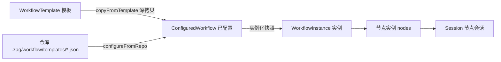
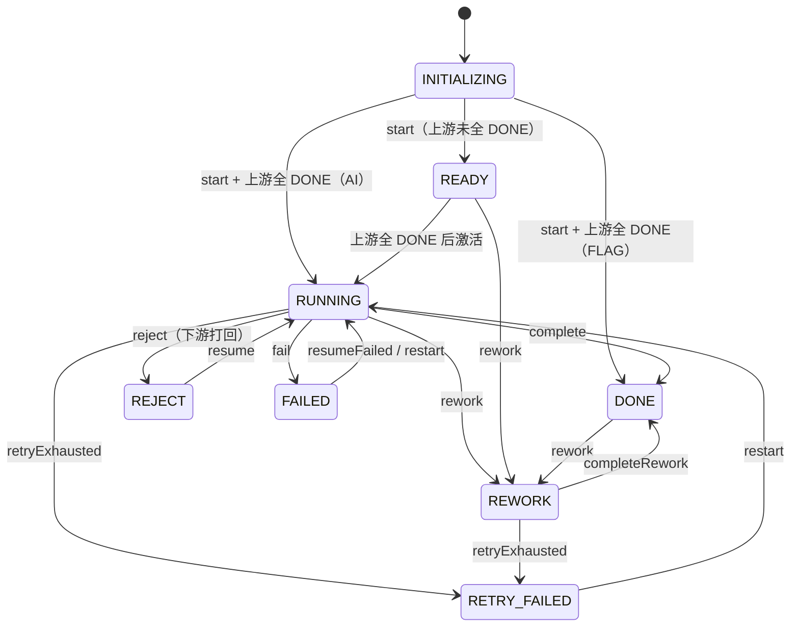
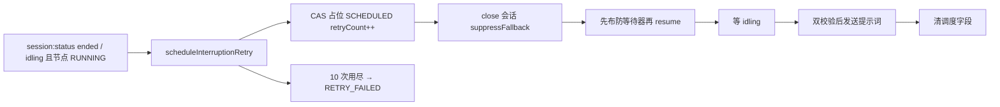
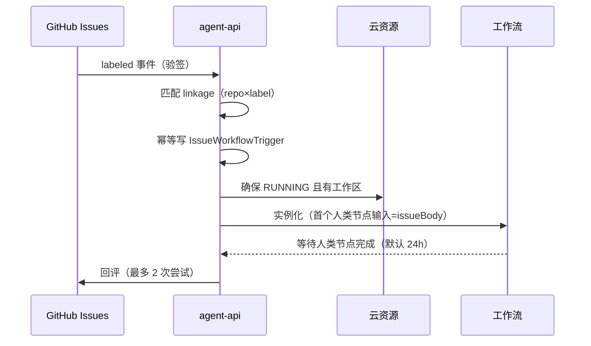

# 工作流 · 上下文概览

## 职责边界

负责「把 Agent 组织成可编排的流程」：节点图定义、实例化、状态推进、中断自动重试、PR/Issue 自动化。
**不负责**：Agent 内部执行细节（属会话）、云环境准备（属云资源）。

## 聚合清单

| 聚合 | 集合 | 说明 |
|---|---|---|
| WorkflowTemplate | workflowtemplates | 可复用节点图，isBuiltin 不可改不可删 |
| ConfiguredWorkflow | configuredworkflows | 绑定控制器+Agent 配置的节点快照 |
| WorkflowInstance | workflowinstances | 一次运行，含节点实例、黑板、接续历史 |
| WorkflowPrHandler | workflowprhandlers | 人类节点与 PR 的联动登记 |
| IssueWorkflowTrigger | issue_workflow_triggers | Issue 标签触发的幂等账本 |
| CloudHostIssuesLinkage | cloud_host_issues_linkages | 云电脑×标签×仓库 的触发配置 |

## 三段式

- 模板：只有图结构（nodeKey/type/name/stage/prompts/dependsOn…）。
- 已配置：增加 agentConfig（acpServerType / modeId / modelId / initNewWorktree），sourceKind=PLATFORM/REPO。
- 实例：节点快照 + 运行时状态（status/sessionId/retryCount/产物）。

## 节点状态机

重要口径：**start 的目标是 READY**，随后 maybeActivate 才可能自动转 RUNNING（AI）或 DONE（FLAG）。

## 节点类型差异

| 维度 | AI | HUMAN | FLAG |
|---|---|---|---|
| 首节点 | 否 | 必须是唯一首节点 | 否 |
| prompts | ≥1 条非空 | 必须为空 | 必须为空 |
| artifactTitles | 允许 | 不允许 | 不允许 |
| agentConfig | 必填 | 无 | 无 |
| 会话 | 创建 ACP 会话 | 可无会话 | 不创建 |
| 推进 | Agent 完成后 complete | 人工 complete/reject | 自动 DONE 透传 |
| 失败重试 | fail/restart/resumeFailed/自动中断重试 | 无 | 无 |
| linkUpstreamPullRequest | 不可为 true | 唯一可为 true | 不可为 true |

## 核心不变量（图校验 validateTemplateGraph）

1. 至少 1 个节点。
2. nodeKey 唯一。
3. 依赖必须存在。
4. AI 节点至少 1 条非空提示词。
5. HUMAN/FLAG 不允许 prompts 与 artifactTitles。
6. 仅 HUMAN 可开启 linkUpstreamPullRequest。
7. 无环（报出环上节点）。
8. 入度为 0 的节点**恰好 1 个**。
9. 首节点必须是 HUMAN。
10. 内置模板不可修改/删除。
11. AI 节点必须有 agentConfig.acpServerType，且必须在控制器可用列表内。

## 实例不变量

1. 来源校验：CONFIGURED 必须给 configuredWorkflowId；TEMPLATE 必须给 templateId。
2. 工作区必须属于目标控制器，否则 工作区不存在、无权限或不属于该控制器。
3. 节点编辑仅限 INITIALIZING/READY 且 startedAt=null。
4. 人类节点完成：非 HUMAN → 节点「X」不是人类节点，不能人工完成。
5. 立即失败仅 AI：仅 AI 节点支持立即失败；顺序硬约束「先引擎 fail 落库，后中断会话」。
6. 控制器离线/删除 → 不可用（CONTROLLER_DELETED / CONTROLLER_OFFLINE），阻断流转，允许接续。
7. 归档只写 archivedAt，不影响流程；删除是软删 deletedAt，引擎与查询排除。
8. 追加提示词系统键（github-pr / github-pr-review）只允许内部写入。
9. 节点会话由引擎创建，GraphQL CreateSessionInput 不暴露 workflowInstanceId/workflowNodeId。

## 中断自动重试

- 上限 10 次；延迟 0/1/2/4/8/16/30/30/30/30 分钟。
- 排期 CAS 条件：{nodeId,sessionId,status∈RUNNING/REWORK,retryPhase,retryCount 快照}。
- 调度器 30s 扫描到期 SCHEDULED 与超时 RECONNECTING。
- 单实例部署前提（进程内锁 + 等待器）。
- 重试成功发送提示词**不复位 retryCount**（防死循环）。

## 自动化

### Issue 标签触发

- 幂等键：(controllerId, repoFullName, labelName, issueId) 唯一。
- 无人类节点 → 状态 COMPLETED 且 failureReason=workflow has no human node（不是 FAILED）。
- 工作区优先复用 CloudHost.workspaceId；缺失才走 GitHub 项目设置。

### PR Review 触发

- 前提：HUMAN 节点 linkUpstreamPullRequest=true，MCP 工具登记 WorkflowPrHandler。
- 判定链顺序：NO_HANDLER → INSTANCE_NOT_FOUND → INSTANCE_DELETED/ARCHIVED/FINISHED → DUPLICATE_EVENT → CURRENT_NODE_AMBIGUOUS → CURRENT_NODE_NOT_HUMAN → NODE_NOT_FOUND → LINK_BROKEN → HUMAN_NODE_IN_BETWEEN → UNSUPPORTED_REVIEW_STATE → HANDLER_FAILED。
- approved → 写 github-pr-review 提示词并 completeHumanNode；changes_requested/rejected/dismissed → rejectNode。

## 对外契约

contracts/workflow.graphql（模板/配置/实例/节点/自动化配置）、contracts/event-callback.openapi.yaml（PR 事件）、contracts/github.graphql（提交身份）。

## 跨上下文关系

| 方向 | 关系 |
|---|---|
| 工作流 → 会话 | 节点拉起 Session（workflowInstanceId 打标）；ended 驱动重试 |
| 工作流 → 控制器 | 必须绑定可用控制器；支持接续换绑到新控制器 |
| 工作流 → GitHub | PR check-run 投影、Issue 回评、提交身份 |
| 工作流 → 云资源 | 实例化要求工作区可用；REPO 模板仅云电脑 |
| 工作流 ← 密钥与工具 | agent-workflow-tools（14 工具）、agent-workflow-admin-tools（含 prompts；prompts 仅客户端可见，模型读不到——见 `90-密钥与工具/00-上下文概览.md` 同名提示） |

## 口径陷阱

1. **WorkflowInstance.workspaceId 是项目工作区**，resourceWorkspaceId 才是租户工作区。
2. **Issue 触发“无人类节点”是 COMPLETED + failureReason**，不是 FAILED。
3. **archivedAt 不影响流转**；只有 deletedAt 排除。
4. **start 不等于 RUNNING**。
5. **REWORK 与 REJECT 不同**：REJECT 是下游节点被打回后上游进入 REWORK 的记录态。

## 相关文档

- /60-工作流/01-聚合与实体.md
- /50-会话与交互/00-上下文概览.md
- /A0-GitHub集成/00-上下文概览.md
