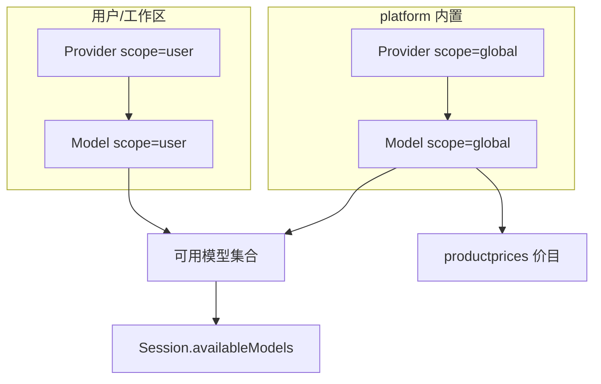

# 模型网关 · 上下文概览

## 职责边界

负责「模型从哪来、怎么暴露、怎么下发、怎么代理访问」：供应商配置、模型目录、云电脑内模型分组的下发载荷（ModelProvision）、OpenAI 兼容网关显示口径、控制器端口映射代理。
**不负责**：调用计费（见 80-计费与计量）、会话内模型切换（见 50-会话与交互）、云电脑内配置文件重写（见 40-云资源与Harness）。

## 聚合清单

| 聚合 | 集合 | 写方 |
|---|---|---|
| Provider | providers | agent-api（user scope）/ admin-api（global scope） |
| Model | models | 同上 |
| Gateway | gateways | agent-api |

## 双作用域模型



- scope=user：归属 tenantId + workspaceId，工作区内名称唯一。
- scope=global：tenantId/workspaceId 恒 null，全平台名称唯一（模型还需跨供应商唯一）。
- 读：shared 可见集（当前工作区 ∪ 全局工作区）+ globalScopeVisible 放行平台内置。
- 写：仅当前工作区（admin 写 global 走 admin-api）。

## 核心不变量

1. Provider 名称在工作区内（user）或全平台（global）唯一。
2. Model 名称在 provider 内唯一；global 模型名跨供应商唯一。
3. 凭据只存 encryptedCredential（AES-256-GCM），出参只给掩码（≤8 → ****；否则前3+****+后4）。
4. 更新时 credentialValue 为空 = 保留原凭据。
5. admin 全局供应商创建/修改前必须连通性测试，失败统一文案「供应商连通性测试失败，请检查 API 地址和凭据是否正确」。
6. 删除/启停 global Provider 会级联删除/同步 global Model。
7. Model.contextLength 必须为正整数（null=未设置）。
8. 模型变更后尽力失效 ACP options 缓存：用户变更按用户控制器，全局变更全量 SCAN 失效（失败不阻断，300s TTL 兜底）。
9. 定价真相在 productprices；models.pricing 只是便捷视图与回退。
10. **ModelProvision 是模型目录的投影**：zag 组恒首位、显示名恒 `Agent Gear`；用户组 `vendorId=providerId`、`displayName=provider.name`；剔除禁用模型与 provider 缺失/禁用的用户模型。
11. **模型下发是 best-effort**：推送失败不回滚 mutation、不影响网关；`delivered:false` 不是业务失败。
12. **contextLength 人工值优先**：同步/新增仅在上游提供且当前未设置时自动补全，人工修改不被后续同步覆盖。

## 模型下发载荷（ModelProvision）

`ModelProvision` 不是集合，是创建期 secret 与运行期推送共用的值对象；唯一构建口径在 agent-api `services/model-provision.ts`，cloud-controller 只做结构校验与旧字段投影。

```jsonc
{
  "providers": [
    { "vendorId": "zag", "displayName": "Agent Gear", "models": [{ "id": "kimi-k2", "contextLength": 262144 }] },
    { "vendorId": "65f0a1b2c3d4e5f60718293a", "displayName": "我的 OpenAI", "models": [{ "id": "gpt-5.1" }] }
  ]
}
```

- `zag` 组恒存在、恒首位，`displayName` 固定 `Agent Gear`，承载启用中的 global 模型（provider 状态不参与）。
- 用户模型按 `providerId` 分组：`vendorId = providerId`（ObjectId 字符串）、`displayName = provider.name`；组序按 provider `createdAt` 升序（同刻以 `_id` 兜底）。
- 剔除禁用模型、provider 缺失/禁用的用户模型（与网关「列出即可调用」口径一致）。
- 同名模型 global 优先；同名用户模型不出现在载荷中。
- `contextLength` 仅正整数携带，未设置不出现该键；同名保留首个正整数。
- **全量替换语义**：本次未出现的 vendor/模型视为删除，不是增量补丁。

## 运行期下发链路

| 变更源 | 触发 | 范围 |
|---|---|---|
| 前台模型/供应商 mutation | resolver 成功后 fire-and-forget | 该租户全部 `RUNNING` 云电脑 |
| 后台 global mutation | `POST /internal/model-config/refresh`（202） | 全部 `RUNNING` 云电脑 + 全部 ACP 选项缓存失效 |

- agent-api 逐台按 `CloudHost.resourceWorkspaceId` 构造工作区上下文后重算载荷，并发 ≤5；单台失败只告警；global refresh 进程内 single-flight 合并批量触发。
- 仅对 `RUNNING` 且未软删的云电脑推送，非 `RUNNING` 不补发；下一次任意变更或创建期快照自然收敛。
- cloud-controller 先持久化 `cloudcontainersecrets.modelProviders`（旧字段投影）再 emit `harness:models`；worker <2.20.0 返回 `worker_unsupported`，创建中间态 `offline`，终态 409；`delivered:false` 不是失败。
- 旧 worker 无事件监听，保持创建期快照；下次任意模型变更或重建自然收敛。
- 部分 Harness 运行时不会热重载模型配置，已运行会话可能需重启；前台保存时提示，后台不提示。

## OpenAI 兼容网关显示口径（/v1/models）

- `owned_by`：`scope=global` 与 account Key 列举恒为 `Agent Gear`；`scope=user`（含存量无 scope）为绑定供应商的 `provider.name`；不暴露 providerId/地址/凭据。
- 条目 `id` 为模型名；`context_length` 仅在 `contextLength >= 1` 时携带。
- `/chat/completions` 与 `/v1/models` 逐请求实时查库：模型/供应商禁用后新请求立即 `model_not_found`，进行中请求不受影响。

## 端口网关（Gateway）

- 控制器上的本地端口映射，名称 1..50，仅字母数字下划线连字符，控制器内唯一。
- 每控制器上限 GATEWAY_MAX_PER_CONTROLLER（默认 5）。
- 创建/删除发布 Redis port-forward:command（tunnel:create / tunnel:close）。
- 代理路由：/api/gateway/:controllerId/:name/*，鉴权仅用户 JWT 或 cookie，30s 超时；**纯 HTTP 请求/响应代理，不支持 WebSocket upgrade**（Vite HMR 长连接必失败，暴露指引要求关闭 HMR 或改轮询）。
- status 枚举含 inactive/error，但**无代码写入**，实际恒为 active。
- **endpoint 是派生字段、不落库**：唯一计算口径 `buildGatewayEndpoint(publicBaseUrl, controllerId, name)` → `{PUBLIC_BASE_URL}/api/gateway/{controllerId}/{name}/`（恒尾斜杠），`buildGatewayBasePath` 输出 path 部分；GraphQL `Gateway.endpoint`、UI 展示、MCP 返回三方同源，前端不得用 `window.location.origin` 自行拼接（Issue #565）。
- **Agent 入口 = 平台 MCP `agent-gateway-tools`**（恒装配全部会话）：`gateway_list` / `gateway_create_endpoint` / `gateway_delete_endpoint`，创建返回 `{name, port, status, endpoint, basePath}`；操作对象为**会话所在控制器**（不接受外部 controllerId），查询/计数保留 `{userId}` 个人口径。
- **暴露指引经 MCP resources 投递**（#580 裁决：平台片段只用 resources、不恢复 prompts）：`zag://agent-gateway-tools/prompt/gateway-exposure-guidance`，引导以 endpoint 为外网 basePath 配置服务（Vite `base`/`allowedHosts`/关 HMR 等），并声明「需登录访问、非匿名公网」。

## 对外契约

| 契约 | 覆盖 |
|---|---|
| contracts/llm.graphql | 用户侧 Provider/Model CRUD、排序、启停、可用模型、`providerModelOptions`、`updateModelContextLength`、`CustomModelInput.contextLength` |
| contracts/admin-llm.graphql | 全局 Provider/Model、定价配置、上下文长度 |
| contracts/gateway.graphql | Gateway 增删查（含派生 `endpoint` 字段） |
| contracts/gateway-proxy.openapi.yaml | 代理路由与错误码（401 / 404 / 502） |
| contracts/mcp-server.graphql | 平台 MCP `agent-gateway-tools`（工具清单、resources URI 约定） |
| contracts/agent-session-websocket.md | §2.12.1 平台服务路由表（`agent-gateway-tools` 行） |
| contracts/billing-openai.openapi.yaml | OpenAI 兼容网关（`/v1/models` 的 `owned_by` / `context_length` 口径） |
| contracts/cloud-controller-websocket.md | `ModelProvision`、`harness:models` / `harness:models:result`、A.2.15 |

## 跨上下文关系

| 方向 | 关系 |
|---|---|
| 网关 → 会话 | Session.availableModels 由模型库三档来源推断 |
| 网关 → 计费 | productId=model.<modelId>.token 价目；BillingApiCall 归因 modelId |
| 网关 → 控制器 | Gateway.controllerId；tunnel 命令经 Redis 下发 |
| 网关 → 云资源 | ModelProvision 创建期快照 + 运行期全量替换；vendor 分组/显示名与网关 `owned_by` 同口径 |
| 网关 → 会话 | Session.availableModels 由模型库三档来源推断；模型变更失效 ACP 选项缓存 |

## 口径陷阱

1. **Gateway 不是模型网关**，是本地端口映射；模型网关由 Provider/Model + OpenAI 兼容入口组成。
2. **Gateway 代理没有独立 Key 模型**，仅校验用户 JWT，且查询不带 userId 过滤。
3. **models.pricing 不是价目真相**；productprices 无档或全 0 时才回落。
4. **全局模型名唯一索引不在 schema 声明**，由迁移 005 创建（避免 autoIndex 竞态）。
5. **前端展示单位是 credits，落库是分**。
6. **ModelProvision 是全量替换快照**，不是增量补丁；不下发即删除 vendor/模型。
7. **zag 是保留 vendorId**，显示名恒 `Agent Gear`；用户供应商的 vendorId 是 providerId，不是名称 slug。
8. **模型下发不等于计费网关生效口径**：网关逐请求查库，模型禁用立即 404；下发失败不影响网关正确性。
9. **contextLength 自动补全不覆盖人工值**；`max_tokens` / `max_output_tokens` 是输出上限，不属于上下文窗口，不得映射。
10. **/v1/models 的 owned_by 是展示名，不是权限/归属字段**，不能反查后台供应商。
11. **Gateway endpoint 不落库**：由 `PUBLIC_BASE_URL + controllerId + name` 派生，服务端是唯一来源；前端/MCP/GraphQL 任一侧自行拼接地址即口径漂移（Issue #565）。
12. **网关「对外暴露」≠匿名公网**：代理鉴权仍是用户 JWT/cookie，第三方 webhook/匿名访问不在能力内。
13. **网关代理不支持 WebSocket upgrade**：HMR/长连接不经过网关，暴露指引必须要求关闭 HMR 或改轮询，不得承诺热更新可用。

## 相关文档

- /70-模型网关/01-聚合与实体.md
- /40-云资源与Harness/00-上下文概览.md
- /80-计费与计量/00-上下文概览.md
- /50-会话与交互/00-上下文概览.md
