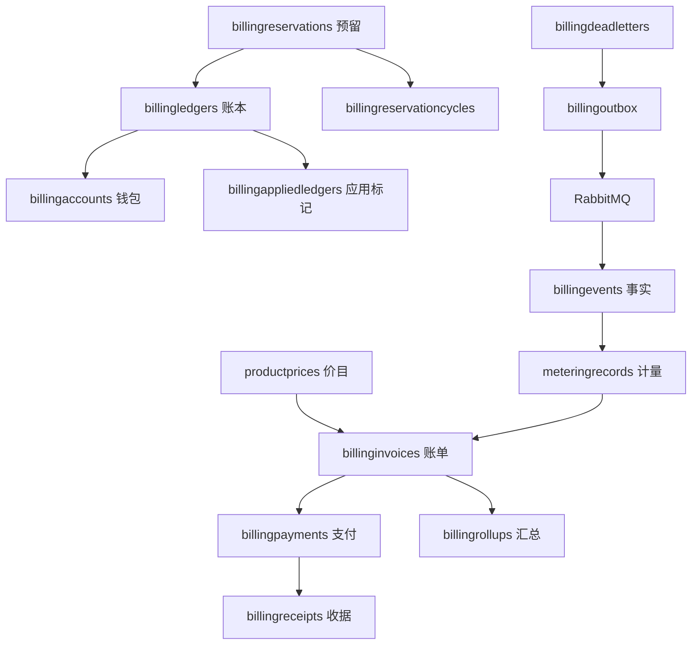
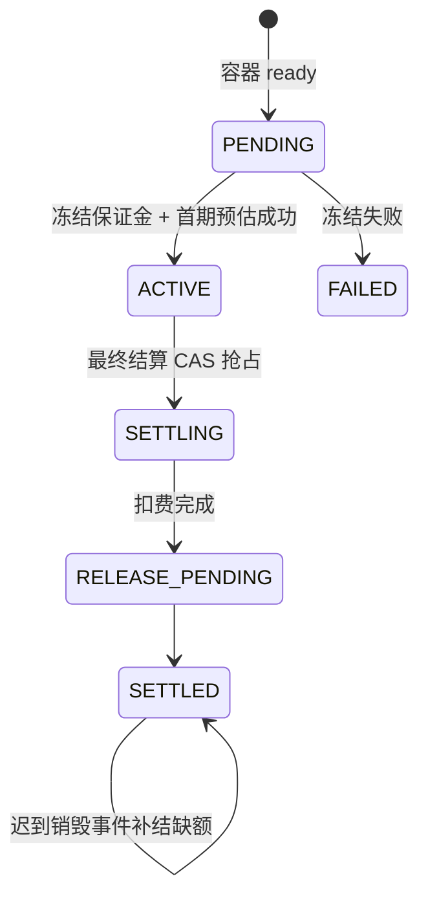

# 计费与计量 · 上下文概览

## 职责边界

负责「钱怎么算、怎么扣、怎么记」：账户余额、追加式账本、容器预留与周期结算、出账/支付/收据、计量事实、价目、事件投递。
**不负责**：资源该不该创建（属云资源/会话），只回答「够不够钱、扣多少」。

## 金额单位（先读，最重要）

| 概念 | 规则 |
|---|---|
| 落库单位 | **整数分（cent）**，所有资金字段 |
| 对外单位 | credits，1 credit = 100 分（CENTS_PER_CREDIT） |
| 换算 | 仅在 GraphQL/HTTP 边界换算，四舍五入到整数分 |
| 模型单价 | 分 / 百万 token（TOKENS_PER_MILLION） |
| token 计费 | 先求各段精确值之和再统一 ceil，用最大余数法分摊到各段 |
| 容器分钟 | 不足 1 分钟按 1 分钟 |
| 可用余额 | cashBalance + giftBalance + creditLimit − frozenAmount |

## 资金模型全景

## 聚合清单

| 聚合 | 集合 | 职责 |
|---|---|---|
| BillingAccount | billingaccounts | 钱包缓存 + 状态 |
| BillingLedger | billingledgers | 追加式资金真相 |
| BillingAppliedLedger | billingappliedledgers | 钱包应用标记与租约 |
| BillingReservation / Cycle | billingreservations / billingreservationcycles | 容器计时预留与周期结算 |
| BillingInvoice | billinginvoices | 出账（追加式） |
| BillingPayment | billingpayments | 拆池扣款结果 |
| BillingReceipt | billingreceipts | 收据（追加式） |
| BillingRollup | billingrollups | 分钟/小时/天汇总（派生缓存） |
| MeteringRecord | meteringrecords | 用量事实 |
| ProductPrice | productprices | 分段价目（真相源） |
| BillingEvent | billingevents | 计费事件事实层 |
| BillingOutbox | billingoutbox | 可靠投递 |
| BillingDeadLetter | billingdeadletters | 死信 |
| BillingApiCall | billingapicalls | 模型调用审计 |
| BillingApiKey | billingapikeys | 平台 API Key |
| StorageBillingCursor | storagebillingcursors | 存储按小时计费游标 |
| CloudBillingCursor | cloudbillingcursors | 新版云电脑规格分段小时计费游标（admin-api 独占写） |

## 预留状态机（容器计费核心）

- 一个 resourceId 一条预留（唯一索引），并发 start 由索引兜底。
- 结算 CAS：{_id, status∈[ACTIVE,PENDING], version} → SETTLING；幂等键保证重放 no-op。
- 游标用 $max 推进，绝不回退。
- 余额不足不拒绝创建：deposit/cycle 置 0 启动，并 markInsufficient（欠费宽限 10 分钟）。

## 规格分段小时计费（新版云电脑）

新版云电脑（`container.ready` 事件携带 `spec` 规格快照）**不进入预留路径**，改走 `cloudbillingcursors` 小时桶结算：

- **分流判据唯一**：`container.ready` payload 带 `spec` → 规格分段计费（0 费用规格也走此路径、仅不出账）；不带 `spec` → 既有 `container.minute` 预留路径逐字不变（旧版云电脑零改动）。
- **分段计价（超额累进）**：CPU ≤4 部分 15 credits/核/小时、>4 部分 30；内存 ≤4GiB 15、4-8GiB 30、8-16GiB 45、>16GiB 60（credits/GiB/小时）；临时存储 ≤10GiB 不收费、>10GiB 10（credits/GiB/小时）。价目落在 `productprices` 七档 `cloud_spec.*` 产品，在线可调；逐桶按桶末时刻取价。
- **小时桶**：锚点 `billingStartedAt`，第 n 桶 `[start+n·1h, start+(n+1)·1h)`；活跃 `due=floor`、单次 tick 最多补 24 桶；销毁尾段按实际分钟折算（不足 1 分钟按 1 分钟）后置 `closedAt`。
- **幂等键**：`cloud_host.spec.hour:<resourceId>:<桶末epoch小时>`（整桶）、`cloud_host.spec.tail:<resourceId>`（尾段至多一次）；游标 `$max` 推进绝不回退。
- **出账**：`category=container`、`refType=cloud_host`、`refId=<hostId>`（按 resourceId 经 cloudcontainers 镜像解析），items 按分档拆条；余额不足记 `lastError` + `markInsufficient`，下个 tick 重试。

## 账本不变量（最重要）

1. **billingledgers 追加式不可变**：update/delete/bulkWrite 全部被 pre-hook 拒绝，错误文案 billingledgers is append-only; update/delete is forbidden。
2. 更正只能新增 adjust 条目。
3. deltaBalance 必须等于 allocations 各池合计。
4. **钱包应用前必先写 billingappliedledgers 标记**：无标记 ⇒ 从未应用（安全）。
5. 应用租约 LEDGER_APPLY_LEASE_MS=60s；stale 可接管并按账本真值绝对校准自愈。
6. accounts.appliedLedgerIds 只是最近 N 条水位，**不能作为幂等依据**。

## 事件与投递

| 事件 | 语义 |
|---|---|
| container.ready | 首次 online，payload {billingStartedAt, spec?}（spec=规格快照，缺省即旧版分钟计费） |
| container.destroyed | destroying→exited 且已计费，payload {billingStartedAt,exitedAt,minutes?}（新版规格计费尾段折算事实同源） |
| model_call.completed | 模型调用完成 |
| model_call.aborted | 中断调用（20% 未缓存 + 80% 缓存计费） |
| billing.settlement.cycle | 周期结算驱动消息 |

Outbox 规则：eventId 唯一；producer 只处理本服务行；claimedAt 原子认领避免双发；超限置 failed=true 并落死信；repairOf 保证每个原始事件至多补投一次。

## 价目选择

1. 取消费时刻已生效的最新档：{productId, effectiveFrom ≤ at} sort effectiveFrom desc。
2. 无档或全 0 档且 isBillable≠false → 回落 models.pricing。
3. 显式 isBillable:false → 不计费，不回落。
4. 存储三档（前 10Gi / 10-25Gi / 25Gi 以上），归档小时单价减半（description 追加「归档半价」）。
5. 规格七档（`cloud_spec.cpu.tier1/2`、`cloud_spec.mem.tier1~4`、`cloud_spec.ephemeral.tier`）为新版云电脑分段计费价目，默认价 1500/3000/1500/3000/4500/6000/1000 分，`ensureDefaultPrices` `$setOnInsert` 播种不覆盖调价。

## 对外契约

| 契约 | 覆盖 |
|---|---|
| contracts/billing.graphql | 前台账户/账单/流水/汇总 |
| contracts/admin-billing.graphql | 后台账户管理、充值、调账、对账 |
| contracts/billing-events.asyncapi.yaml | MQ 事件定义 |
| contracts/billing-openai.openapi.yaml | OpenAI 兼容入口（invalid_api_key / insufficient_quota / account_frozen / model_not_priced …） |

## 跨上下文关系

| 方向 | 关系 |
|---|---|
| 计费 ← 云资源 | 云电脑创建费、容器分钟费（旧版云电脑/无 spec 事件）、规格分段小时费（新版云电脑，cloudbillingcursors）、存储小时费 |
| 计费 ← 模型网关 | 模型 token 价目与调用审计 |
| 计费 ← 身份 | BillingAccount.ownerType=tenant，ownerId=tenantId |
| 计费 → 云资源 | 余额校验/冻结；云电脑创建失败触发退款 |

## 口径陷阱

1. **契约 BillingLedgerType 只有 charge/recharge/adjust**，模型 bizType 还有 freeze/unfreeze/settle。
2. **MeteringRecord.resourceType 含 cloud_host/cloud_storage，但当前只写 container/model**；存储计费走 storagebillingcursors。
3. **MeteringRecord.invoiced 全仓无读取点**，不是出账游标。
4. **models.pricing 是便捷视图**，productprices 才是真相。
5. **front_user 已废弃**，运行时归一为 tenant。
6. **冻结/解冻不是账本余额变动**，而是 frozenAmount 与 allocations 的配合。
7. **新旧云电脑计费分流只看 `container.ready` 是否携带 `spec`**，不要用金额或规格名判断；0 费用规格（0C 0G）走新路径但不出账，禁止回落分钟预留。
8. **规格分段计费不在 billingreservations 留痕**，进度只在 `cloudbillingcursors`；对账时勿把新版云电脑缺预留当异常。

## 相关文档

- /80-计费与计量/01-聚合与实体.md
- /40-云资源与Harness/00-上下文概览.md
- /70-模型网关/00-上下文概览.md
