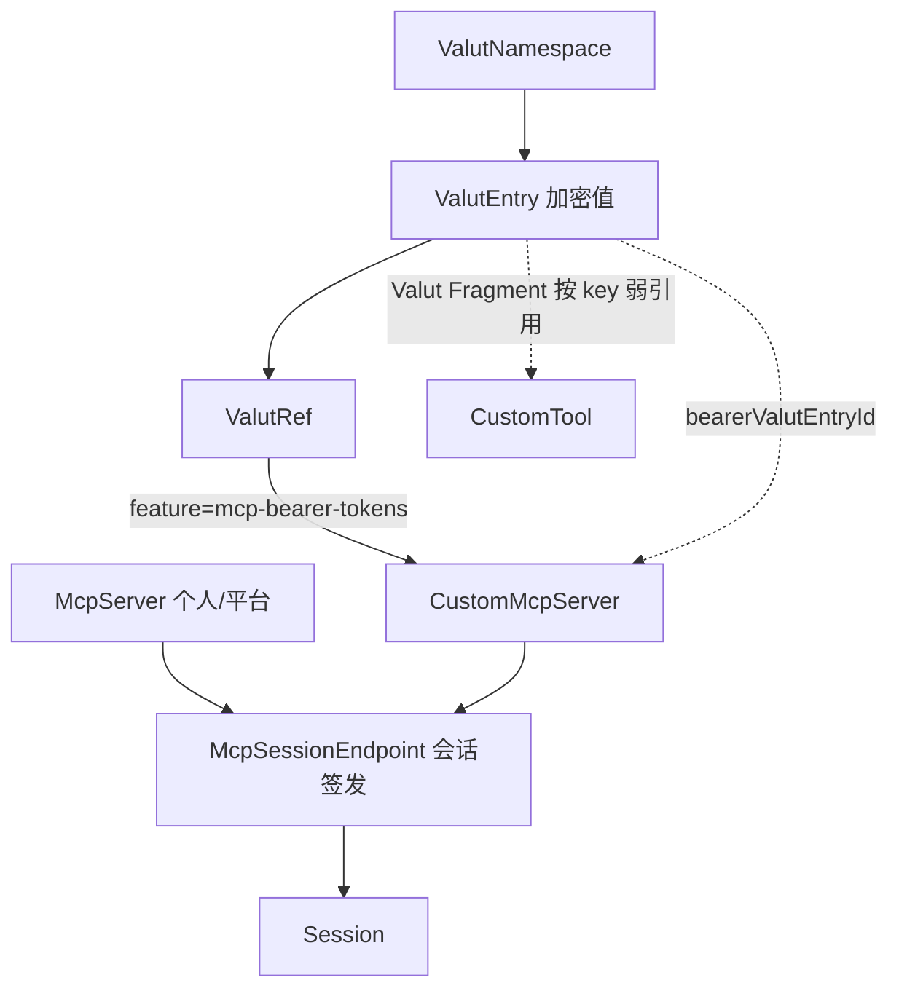

# 密钥与工具 · 上下文概览

## 职责边界

负责「Agent 能用什么外部能力，以及这些能力怎么安全持有凭据」：工作区加密密钥库（Valut）、MCP 服务注册与转发、自定义 MCP、自定义工具。
**不负责**：会话装配策略（属会话）、模型供应商凭据（属模型网关，用同一套加密原语）。

## 聚合清单

| 聚合 | 集合 | 说明 |
|---|---|---|
| ValutNamespace | valutnamespaces | 全局命名空间注册表（manual / service-*） |
| ValutEntry | valutentries | 工作区级加密键值 |
| ValutRef | valutrefs | entry 与业务数据的引用关系 |
| McpServer | mcpservers | 个人 MCP 注册项（含平台内置 service） |
| CustomMcpServer | custommcpservers | 工作区级直连 MCP |
| CustomTool | customtools | 工作区级自定义工具 |
| McpSessionEndpoint | mcpsessionendpoints | 会话级 MCP 签发凭证 |
| McpProxyKey | mcpproxykeys | controller-api MCP 代理密钥（见 30-控制器） |

## 分层关系

## Valut 安全模型（红线）

1. **明文不出服务端**：GraphQL 契约无 value 出参；list/get 装配显式不含 valueEncrypted。
2. 解密唯一入口 valut-service.resolveValue，唯一消费点是 custom-mcp-forwarder 内存组装请求头。
3. 加密：AES-256-GCM，复用 services/crypto.ts + CREDENTIAL_ENCRYPTION_KEY；未配置即抛错。
4. 命名空间：manual（展示名「自定义密钥」，迁移播种）与 service-{feature}（服务自检幂等 upsert）。
5. entry 唯一性：{workspaceId,namespace,key}；key trim 后 1..128，禁空白与控制字符。
6. editable / deletable 是能力位：false 时对应操作分别报 valut entry is not editable / is not deletable。
7. 有 ref 的条目删除 → valut entry has refs（级联路径先清 ref 除外）。

## MCP 注册与转发

| 类型 | transport | 凭据 | 转发路径 |
|---|---|---|---|
| 平台内置 | platform | 无 | mcp-dispatch 直发（进程内） |
| 个人 MCP | registered_proxy / http | headersEncrypted / proxy 连接 | mcp:forward:* Redis 频道 |
| 自定义 MCP | http（工作区） | bearer token 存 Valut | custom-mcp-forwarder 直连真实 endpoint |

平台内置服务（transport/source=platform）：
- agent-workflow-tools（节点作用域 14 工具）
- agent-workflow-admin-tools（管理工具 + MCP prompts）
- agent-cloud-host-tools（workload_list / workload_install）
- agent-session-preview-tools（review）
- agent-valut-tools（valut_list）
- agent-custom-tools（自定义工具动态暴露）
- agent-knowledge-base-tools（六工具）

> **MCP prompts 的消费方是客户端（人），不是模型**（2026-11-26 核实）：harness 只把 `prompts/list`
> 的结果转成交互式斜杠命令 `<server>:<prompt>`（ACP `available_commands_update`），正文仅在人工执行
> 该命令时展开为用户消息，从不注入模型上下文；模型侧没有 prompts 读取工具。因此「给 AI 的权威说明」
> 不能只靠 prompts 投递（`agent-workflow-admin-tools` 的 `workflow-schema` /
> `workflow-project-persistence`、`agent-knowledge-base-tools` 的 `repo-knowledge-base-authoring`）。
> 证据与修复方向见 `docs/engineering/acceptance/20261126-mcp-prompts-not-visible-bug-investigation-report.md`。
>
> **MCP 没有 skills 原语**（2026-11-26 调研）：服务端只有 tools / resources / prompts；Skill 由 harness
> 从文件系统目录或 config `skills`（本地路径 / HTTP catalog）发现，不能经 MCP 提供。需要「给 AI 可复用
> 能力包」时，只能经 MCP tools（模型可调）或 resources（opencode 下模型可读）投递内容，或把 `SKILL.md`
> 物化到会话工作区（如 `.agents/skills/<id>/SKILL.md`）。
>
> **平台片段投递定稿（2026-11-26 评审裁决）**：工作流/知识库的权威说明片段**唯一由 MCP resources 投递**
> （`resources/list` + `resources/read`，URI `zag://<server>/prompt/<name>`），**移除 prompts**、**不做
> tools 兜底**。实现口径见报告 §6.1。

## 自定义 MCP 不变量

1. 本集合不存 bearer token，只存 bearerValutEntryId。
2. 新建 token 路径：预生成 MCP _id → 先建服务条目（service-mcp-bearer-tokens，editable=true/deletable=false）→ 再落 MCP；失败补偿删 entry+ref。
3. 引用已有条目：仅限 manual，否则 bearer entry must be manual namespace。
4. 删除：以 deleteOne 的 deletedCount===1 作为「执行级联」凭证，保证并发只级联一次。
5. 编辑换绑：先持久化、后做副作用；副作用失败回滚 $set 并恢复旧 ref，两方向都无孤儿。
6. 改名不同步已建条目 key 与 refLabel（创建期锚定）。

## 自定义工具模型

- type=prompt：片段模板渲染成提示词。
- type=http：method + endpoint + headers/queries/body/form，30s 超时，响应 256KB 截断。
- Fragment：Plain / Valut / Parameter；format：Generic / Json / Uri。
- 上限：片段 ≤200、单值 ≤4096、渲染结果 ≤65536。
- args key 规则 ^[A-Za-z_][A-Za-z0-9_]{0,63}$，唯一、≤32；Parameter 必须属于 args。
- 工具名安全字符直接暴露，否则用 ct-<id 后 8 位>，description 恒带展示名；tools/list 每次实时查库（删除即失效）。

## 会话签发（McpSessionEndpoint）

- 触发条件：mcpServerIds 或 customMcpServers 非空（custom-only 也签发）。
- serverNames = 个人 MCP 名 ∪ custom 名（Set 去重，同名 custom 优先）。
- tokenHash + 两份快照同一次 findOneAndUpdate 落库；JWT TTL 默认 86400s；workflow 作用域 expiresAt=null。
- agent-api 无 TTL 索引（便于 resume 重签）；controller-api 镜像仍有 TTL 索引 —— 现状差异，勿改语义。
- 重签空判定：两份快照都空才返回 null。

## 对外契约

| 契约 | 覆盖 |
|---|---|
| contracts/valut.graphql | 密钥列表/新建/改值/删除（无 value 出参） |
| contracts/mcp-server.graphql | 个人 MCP 注册、工具同步、默认 MCP |
| contracts/custom-mcp.graphql | 自定义 MCP CRUD（bearer 两路径） |
| contracts/custom-tool.graphql | 自定义工具 CRUD |
| contracts/mcp-proxy.graphql | controller-api 代理密钥 |
| contracts/fragment-template.md | Fragment 渲染语义 |
| contracts/mcp-proxy-websocket.md / mcp-forward-redis.md | 转发协议 |

## 跨上下文关系

| 方向 | 关系 |
|---|---|
| 工具 → 会话 | 会话创建装配 MCP；McpSessionEndpoint 随会话签发/吊销 |
| 工具 → 工作流 | agent-workflow-tools 由节点会话使用 |
| 工具 ← 工作区 | valutentries / custommcpservers / customtools 挂独占型 workspace-scope |
| 工具 ← 知识库 | agent-knowledge-base-tools 直发，不依赖 MCP 转发 |
| 工具 ← GitHub | GitHub token 走 Valut/加密原语，不复用 MCP 条目 |

## 口径陷阱

1. **McpServer 唯一键两侧不同**：agent-api {tenantId,userId,name}，controller-api {userId,name} —— 同集合两套索引。
2. **平台服务不可被用户选择**（MCP_SERVER_NOT_SELECTABLE），也不出现在默认 MCP 候选。
3. **custom MCP 优先于同名个人 MCP**。
4. **tools/list 动态**：自定义工具与平台工具均实时/按 role 门控，不是静态清单。
5. **agent-api 的 McpSessionEndpoint 无 TTL 索引**，不要按 controller-api 镜像推断。

## 相关文档

- /90-密钥与工具/01-聚合与实体.md
- /50-会话与交互/00-上下文概览.md
- /20-工作区/00-上下文概览.md
