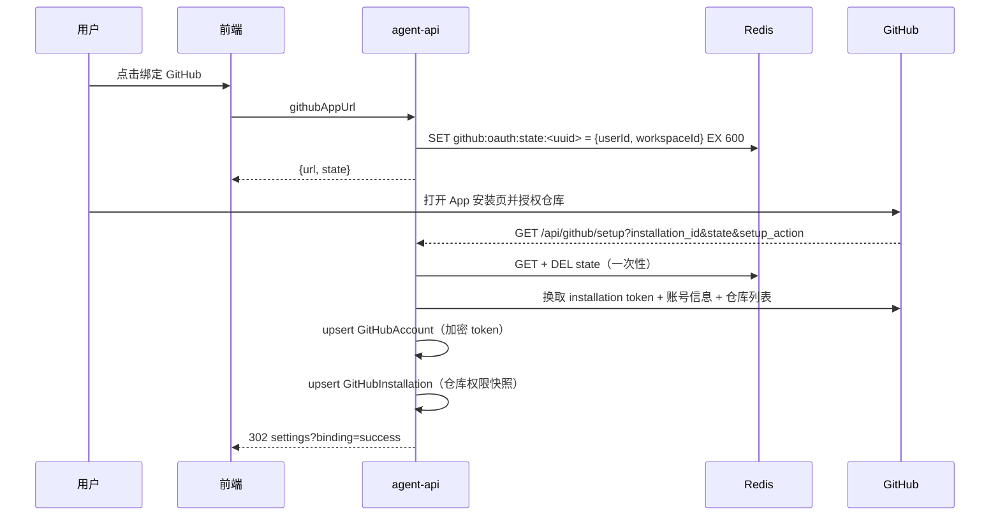
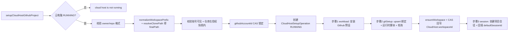
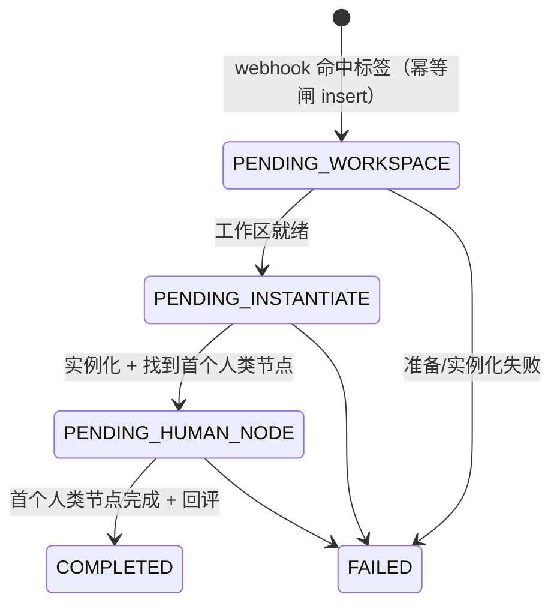
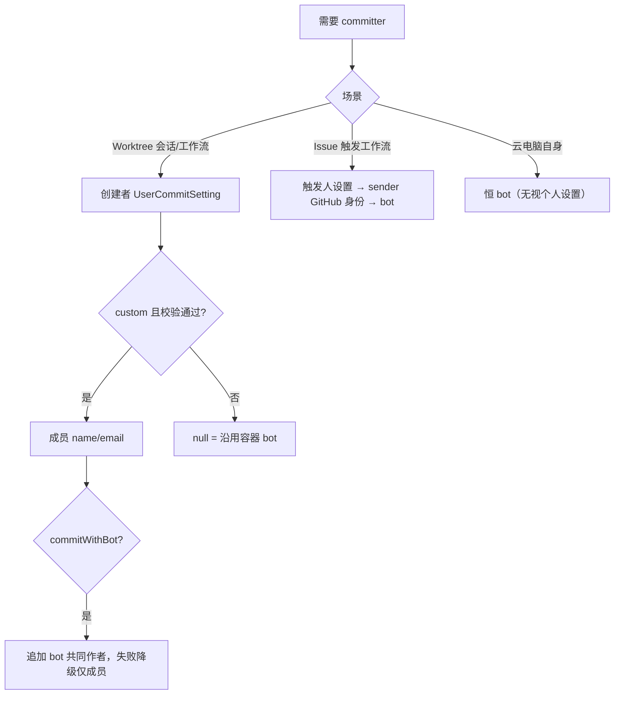

# GitHub 集成 · 上下文概览

## 职责边界

负责平台与 GitHub 之间的全部集成面：GitHub App 安装与账号绑定、仓库授权快照、云电脑 Git 项目克隆、
GitHub Issues 标签联动、PR 评审联动、提交身份（committer）解析与下发。
**不负责**：工作流节点推进（见 60-工作流）、云电脑生命周期与容器编排（见 40-云资源与Harness）。

## 聚合清单

| 聚合 | 集合 | 唯一写方 | 说明 |
|---|---|---|---|
| GitHubAccount | githubaccounts | agent-api | 工作区级绑定，加密存储 installation/user token |
| GitHubInstallation | githubinstallations | agent-api | 安装与仓库授权快照，按 githubUserId 共享读取 |
| CloudHostGithubBinding | cloud_host_github_bindings | agent-api | 控制器 × 仓库唯一（一机多项目），容器凭据端点按 controllerId（可选 repoFullName）取回 |
| CloudHostIssuesLinkage | cloud_host_issues_linkages | agent-api | 云电脑 × 触发标签 → 已配置工作流 |
| IssueWorkflowTrigger | issue_workflow_triggers | agent-api | Issue 触发记录与幂等闸 |
| UserCommitSetting | user_commit_settings | agent-api | 成员级提交人设置（无作用域插件） |

## 账号绑定与安装

要点：

- state 由服务端生成 UUID，写入 Redis **TTL 600 秒**，回调时 GET 后立即 DEL（一次性凭证）。
- state 载荷为 JSON **{userId, workspaceId}**；一期旧格式（裸 userId 字符串）仍兼容，回退个人租户全局工作区。
- 落点工作区在一次绑定中被「冻结」：**normal 工作区要求 admin 或成员**，global 工作区 + developer 直接拒绝
  （文案 **global workspace is read-only**）。
- setup_action=update 且无 state 时只刷新安装仓库快照（handleSetupUpdate），不再新建账号。
- 账号唯一键为 **{tenantId, workspaceId, githubUserId}**，同一 GitHub 用户在不同工作区各有独立绑定行；
  userId 仅记录首次创建者。
- 解绑按「是否仍有存活绑定行」决定是否调用 GitHub 卸载 App；当前工作区只读时拒绝。

## 云电脑 Git 项目设置

- **targetPath 是前缀地址（工作根目录）**，不是最终目录；最终目录由服务端 resolveClonePath 权威拼接，
  operation / binding / 脚本参数 / ensureWorkspace 一律使用 finalPath。
- Git 设置脚本幂等：同仓库复用零改动、空目录 rmdir 后克隆、异仓库/非空目录统一提示且不改动内容。
- 凭据由容器侧 github-credential-manager 在脚本批次前拉取（批次可携带 `githubRepoFullName` 按项目预取）；token **不落库、不写日志、不进 operation error**。
- 容器内 `gh` 由 Github 工作负载覆盖为 wrapper（`/usr/local/bin/gh` 遮蔽 `/usr/bin/gh`）：执行时经 agent-gear
  按当前目录解析所属 GitHub 项目（git origin 归一）→ 查绑定 + 授权快照（权限校验）→ 申请**项目级 token**
  以 `GITHUB_TOKEN` 环境变量执行原生 `gh`；无法获得 token 时仅 stderr 打印一行提示并照常执行原生 `gh`
  （**不报错退出**，退出码恒为 `gh` 语义）。工作负载脚本幂等可重复执行，收敛到最新 wrapper。
- session 步骤失败**不使 operation 失败**：步骤记 FAILED，operation 仍 SUCCEEDED 并提示手动建会话。
- createSession=false 时 session 步骤初始即 SKIPPED（多 Harness 场景），工作区初始化前移到 gitSetup 收尾。

## Issue 联动状态机

- 唯一索引 **(controllerId, repoFullName, labelName, issueId)** 是「这个 Issue 对这条配置未曾创建过工作流」的权威幂等闸；
  webhook 重复投递捕获 E11000 返回 ALREADY_TRIGGERED。
- 触发人（GitHub sender，即打标签者）快照为 triggerSenderId / triggerSenderLogin，并按 GitHubAccount.githubUserId
  反查平台成员写入 triggerUserId（未匹配为 null）。
- 配置删除后仍可推进/留档：configuredWorkflowName / issue* / trigger* 均为快照字段。
- 事件入口无 ALS 上下文，tenantId 显式继承联动配置，避免 tenant-scope 写成 userId（个人租户）。

## PR 评审联动

- 双入口：POST /api/events/callback（平台 token 或 GitHub 验签双通道）与
  POST /api/events/github/webhook（仅 X-Hub-Signature-256 + GITHUB_WEBHOOK_SECRET），
  两者共用 handlePullRequestEvent 判定链。
- 原生 webhook 仅处理 pull_request_review submitted；必须在全局 express.json() 之前挂载（验签需原始字节）。
- check-run 回写经 session:message 订阅（高频豁免，不逐条开 span）。

## 提交身份解析

- 成员级设置**无共享/继承**：唯键 userId，任何工作区同一份；tenantId 仅留档。
- Issue 触发身份优先级：**触发人提交人设置 → sender 的 GitHub 身份（login + noreply）→ bot**。
- 云电脑自身（非 Worktree）恒 bot：resolveCloudHostIdentity 返回 {mode:'agent_only'}，bot 解析失败为 {mode:'unset'}。
- 实例化时解析一次并落 WorkflowInstance 快照，节点级 worktree 复用同一快照；已有 Worktree 的会话通过
  git:worktree:coauthor 二次同步共同作者。

## 核心不变量

1. state 一次性且 600s 过期；回调先 DEL 再处理，重复回调按 invalid_state 拒绝。
2. GitHubAccount 读 = 当前工作区 ∪ 本租户全局工作区；写仅当前工作区（shared 型 workspace-scope）。
3. GitHubInstallation 按 installationId 全局唯一，读取按 githubUserId 关联，**不随工作区副本复制**。
4. CloudHostGithubBinding 的 **{controllerId, repoFullName} 组合唯一**（一机多项目）；设置批次下发前按两键 upsert。无 repoFullName 的凭据请求返回**主项目**（createdAt 最早绑定）token，单绑定存量行为逐字不变。
5. Issue 联动标签在同一控制器内**大小写不敏感唯一**（labelNameLower 承担）。
6. IssueWorkflowTrigger 幂等闸唯一索引不可放宽；快照字段只增不改。
7. UserCommitSetting 唯一键 userId，**不得挂任何作用域插件**，否则跨工作区静默丢设置。
8. installation token 进程内缓存；周期续期（无 repoFullName）凭据端点要求最小剩余有效期 55 分钟，**项目级即时申请**沿用 5 分钟缓存硬余量（token 即用即弃、同项目短时共享缓存）。
9. 项目级凭据获取失败必须降级执行原生 `gh`：只打印错误、不报错退出；wrapper 获取到的 token 仅进单次 `gh` 子进程 env，不落盘、不进 argv、不进日志。

## 对外契约

| 契约 | 覆盖 |
|---|---|
| contracts/github.graphql | githubAccounts / githubAppUrl / commitSettings / personalGithubAccounts / unbindGitHubAccount / refreshGitHubInstallations / updateCommitSettings |
| contracts/cloud-host.graphql | setupCloudHostGithubProject / retryCloudHostSetupOperation / cloudHostSetupOperation |
| contracts/workflow.graphql | Issues 联动配置与触发记录相关字段 |
| contracts/agent-session-websocket.md §2.12.1 | PR check-run 与会话联动 |

## 跨上下文关系

| 方向 | 关系 |
|---|---|
| GitHub → 云资源 | 云电脑 githubAccountId 一次性锁定；Git 设置产出项目工作区 |
| GitHub → 工作流 | Issues 联动实例化工作流；PR 评审事件驱动节点推进 |
| GitHub → 会话 | 项目设置后自动建会话；Git 克隆决定会话工作目录 |
| GitHub ← 身份与租户 | 工作区归属、成员角色决定绑定落点与只读拦截 |
| GitHub ← 工作区 | 账号可见集 = 本工作区 ∪ 本租户全局 |

## 口径陷阱

1. **GitHubAccount.workspaceId 是租户工作区**（String 口径 = workspace._id.toString），不是项目工作区。
2. **CloudHostGithubBinding.targetPath 已归一为 finalPath**，历史绑定记录可能保留旧前缀语义，勿反推。
3. **GitHubInstallation.accountId 只是「任一存活绑定行」代表**；真实关联口径是 githubUserId，不要按 accountId 统计。
4. **CloudHostIssuesLinkage 的 configuredWorkflowName 是快照**，配置改名/删除不影响已存联动行。
5. **UserCommitSetting 不挂 tenant-scope / workspace-scope** 是有意豁免（userId 全局唯一主键）。
6. **CreateCloudHostInput 没有 githubAccountId 强制项**；锁定发生在首次 Git 设置，锁定后不可换绑。
7. **凭据端点两口径**：无 `repoFullName` = 主项目（最早绑定）+ 55 分钟余量（周期续期）；带 `repoFullName` = 项目级签发（绑定 + 授权快照双校验）+ 默认 5 分钟余量，响应回显 `repoFullName` 供调用方校验。

## 相关文档

- /A0-GitHub集成/01-聚合与实体.md
- /40-云资源与Harness/00-上下文概览.md
- /60-工作流/00-上下文概览.md
- /10-身份与租户/00-上下文概览.md
