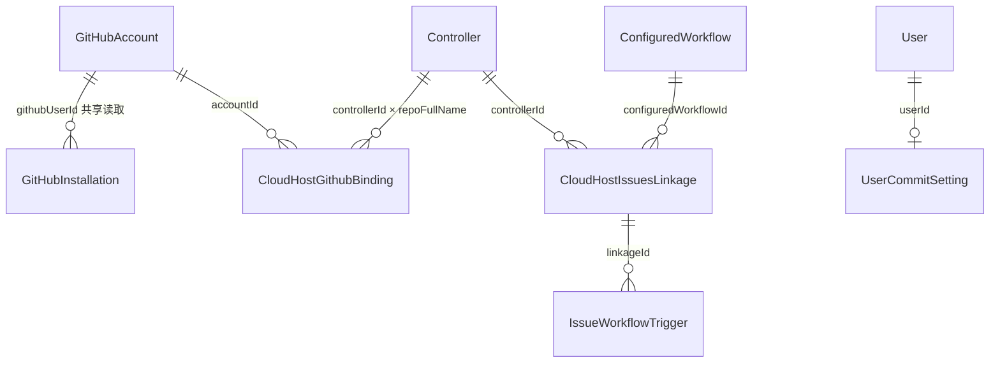

# GitHub 集成 · 聚合与实体

## 实体关系

## GitHubAccount（githubaccounts）

工作区级 GitHub 账号绑定，token 加密存储。

| 字段 | 类型 | 约束 / 说明 |
|---|---|---|
| _id | ObjectId | 主键 |
| userId | String | required, index；**首次创建者**（不随共享读取变化） |
| tenantId | String | required, index；租户工作区 id（String 口径） |
| workspaceId | String | default null, index；**租户工作区**归属 |
| githubUserId | Number | required；GitHub 用户数字 id |
| githubLogin | String | required；登录名 |
| githubAvatarUrl | String | 可选 |
| accessToken | String | required；AES-256-GCM 加密后的 token 串 |
| tokenExpiresAt | Date | 可选；token 到期时间 |
| createdAt / updatedAt | Date | timestamps |

索引与作用域：

- 唯一索引 **uniq_github_account_tenant_workspace_user {tenantId, workspaceId, githubUserId}**。
  旧索引 {tenantId, userId, githubUserId} 由迁移 015 删除。
- applyTenantScope + applyWorkspaceScope({shared: true})：**读 = 当前工作区 ∪ 本租户全局工作区，写仅当前工作区**。
- 账号归属在绑定回调时按 state 里的 workspaceId 解析；normal 工作区要求 admin 或成员，global + developer 拒绝。

## GitHubInstallation（githubinstallations）

GitHub App 安装与仓库授权快照；**不挂任何作用域插件**。

| 字段 | 类型 | 约束 / 说明 |
|---|---|---|
| _id | ObjectId | 主键 |
| accountId | ObjectId ref GitHubAccount | required, index；语义为「任一存活绑定行」代表 |
| githubUserId | Number | default null, index；**共享读取的真实关联口径** |
| installationId | Number | required, **unique** |
| accountLogin | String | required；安装账号登录名 |
| accountType | String enum | User / Organization |
| repos | GitHubRepo[] | 内嵌数组，_id:false |
| createdAt / updatedAt | Date | timestamps |

GitHubRepo 子文档：

| 字段 | 类型 | 说明 |
|---|---|---|
| repoId | Number | required |
| repoName | String | required |
| fullName | String | required，owner/repo |
| private | Boolean | required |
| permissions.read | Boolean | pull 或 push 或 admin |
| permissions.write | Boolean | push 或 admin |

- installationId 全局唯一；安装数据跨工作区共享读取（按 githubUserId 或 accountId 查询）。
- 查询仓库授权时用 OR 组合 githubUserId 与 accountId，并做 fullName 大小写不敏感比较。

## CloudHostGithubBinding（cloud_host_github_bindings）

云主机（控制器）级 GitHub 项目绑定，供容器凭据端点按 controllerId（可选 repoFullName）取回。

| 字段 | 类型 | 约束 / 说明 |
|---|---|---|
| _id | ObjectId | 主键 |
| userId | ObjectId ref User | required, index；操作发起人 |
| tenantId | ObjectId ref Tenant | required, index |
| controllerId | ObjectId ref Controller | required；与 repoFullName 组合唯一 |
| accountId | ObjectId ref GitHubAccount | required |
| repoFullName | String | required，owner/repo；与 controllerId 组合唯一 |
| targetPath | String | required；已归一为 **finalPath** |
| createdAt / updatedAt | Date | timestamps |

- 唯一索引 **uniq_cloud_host_github_binding {controllerId, repoFullName}**（迁移 029 先建后删旧 `controllerId` unique）；
  一机多项目共存，同仓库重复设置幂等覆盖。
- applyTenantScope；集合名固定 cloud_host_github_bindings。
- Git 设置步骤开始时按 {controllerId, tenantId, repoFullName} upsert。
- **主项目** = createdAt 最早的绑定；容器凭据端点无 `repoFullName` 请求返回主项目 token（单绑定存量行为不变），
  带 `repoFullName` 时按两键查绑定并经授权快照复核后签发项目级 token，响应回显 `repoFullName`。
- 双鉴权（INTERNAL_API_TOKEN 或控制器 key）；token 不落库、不写日志。

## CloudHostIssuesLinkage（cloud_host_issues_linkages）

云电脑 Issues 联动配置：一条配置 = 一个已配置工作流 + 一个触发标签 + 一组仓库。

| 字段 | 类型 | 约束 / 说明 |
|---|---|---|
| _id | ObjectId | 主键 |
| userId | ObjectId ref User | required |
| tenantId | ObjectId ref Tenant | required, index |
| controllerId | ObjectId ref Controller | required |
| configuredWorkflowId | ObjectId ref ConfiguredWorkflow | required |
| configuredWorkflowName | String | required；**名称快照**，配置删除后仍可读 |
| labelName | String | required；trim 后落库 |
| labelNameLower | String | required；小写归一列，唯一索引与事件匹配口径 |
| repoFullNames | String[] | default []；trim、去空、大小写不敏感去重 |
| createdAt / updatedAt | Date | timestamps |

索引与钩子：

- 唯一索引 **uniq_cloud_host_issues_linkage_label {controllerId, labelNameLower}**（同云电脑标签大小写不敏感唯一）。
- 普通索引 {userId:1}、{repoFullNames:1}（事件入口按仓库反查候选配置）。
- pre('validate') 兜底归一：labelName trim + labelNameLower；repoFullNames 经 dedupeRepoNames 去重（保留首次出现顺序）。
- 导出常量 LABEL_NAME_MAX_LENGTH=50、REPO_FULL_NAMES_MAX=50。
- applyTenantScope；集合名固定 cloud_host_issues_linkages。

服务层校验与副作用：

- labelName trim 后非空、≤50、不含逗号；repoFullNames ≤50。
- 创建/更新后调用 syncLabels，对每个仓库 ensureIssueLabel（颜色固定 0e8a16，描述固定）。
- 删除配置时对已同步仓库 deleteIssueLabel（尽力而为）。
- 重名抛 label name already exists: 标签名；E11000 收敛同文案。

## IssueWorkflowTrigger（issue_workflow_triggers）

Issue 触发的权威幂等闸与推进记录。

| 字段 | 类型 | 约束 / 说明 |
|---|---|---|
| _id | ObjectId | 主键 |
| userId | ObjectId ref User | required；继承联动配置的创建者 |
| tenantId | ObjectId ref Tenant | required, index；**显式继承联动配置**，不依赖 ALS |
| controllerId | ObjectId ref Controller | required |
| linkageId | ObjectId | default null；配置删除后仅留档 |
| configuredWorkflowId | ObjectId ref ConfiguredWorkflow | required |
| labelName | String | required |
| repoFullName | String | required |
| issueId | String | required；GitHub issue 数字 id 字符串化，幂等键组成 |
| issueNumber | Number | required |
| issueTitle | String | required |
| issueUrl | String | default null |
| issueAuthor | String | default null |
| triggerSenderId | Number | default null；sender 数字 id |
| triggerSenderLogin | String | default null；sender 登录名 |
| triggerUserId | ObjectId ref User | default null；按 GitHubAccount.githubUserId 匹配的平台成员 |
| issueBody | String | default null；≤64000，首个人类节点输入 |
| status | String enum | 五态，默认 PENDING_WORKSPACE |
| workspaceId | ObjectId ref ControllerWorkspace | default null；**项目工作区** |
| setupOperationId | ObjectId | default null |
| workflowInstanceId | ObjectId ref WorkflowInstance | default null |
| humanNodeId | String | default null；待自动完成的首个人类节点 |
| completedNodeId | String | default null |
| commentId | Number | default null |
| commentAttempts | Number | default 0；失败后仅补偿一次 |
| commentError | String | default null；回评失败不阻断推进 |
| failureReason | String | default null |
| createdAt / updatedAt | Date | timestamps |

状态枚举 ISSUE_TRIGGER_STATUSES：

| 状态 | 含义 |
|---|---|
| PENDING_WORKSPACE | 已建触发记录，等待工作区准备 |
| PENDING_INSTANTIATE | 工作区就绪，等待实例化 |
| PENDING_HUMAN_NODE | 已实例化，等待首个人类节点完成 |
| COMPLETED | 首个人类节点完成并回评 |
| FAILED | 准备/实例化/推进失败 |

索引：

- 唯一索引 **uniq_issue_workflow_trigger {controllerId, repoFullName, labelName, issueId}**（幂等闸）。
- {controllerId:1, status:1}（启动扫描/定时恢复）、{status:1, updatedAt:-1}。
- applyTenantScope；集合名固定 issue_workflow_triggers。

## UserCommitSetting（user_commit_settings）

成员级提交人设置；**仅对云容器环境生效**。

| 字段 | 类型 | 约束 / 说明 |
|---|---|---|
| _id | ObjectId | 主键 |
| userId | String | required；**唯一键**，全局成员标识 |
| tenantId | String | required, index；成员归属租户（**仅留档，不参与查询过滤**） |
| committerType | String enum | custom / unset，默认 unset（DB 小写；GraphQL 大写） |
| customName | String | default null，maxlength 100 |
| customEmail | String | default null，maxlength 254 |
| commitWithBot | Boolean | default false；仅 custom 生效，unset 归一 false |
| createdAt / updatedAt | Date | timestamps |

- 唯一索引 **uniq_user_commit_setting {userId}**；旧 workspaceId 键与三段继承已由迁移 019 下线。
- **不挂任何作用域插件**（既无 applyWorkspaceScope 也无 applyTenantScope）：
  tenantId 只留档，userId 是全局唯一主键，跨租户泄漏不成立。
- 读写一律按 userId 点查/upsert，不读取 ALS 工作区上下文。
- 已下线字段：committerMode、githubAccountId、workspaceId。
- 集合名固定 user_commit_settings。

校验（唯一错误文案 **invalid custom committer**）：

- name trim 后长度在 1..100，email trim 后不超过 254，两者禁换行/回车/NUL 字符。
- 邮箱必须为常规 user@domain.tld 形式。
- unset 清空 customName / customEmail，commitWithBot 归一 false。

## 派生与解析规则

| 名称 | 来源 | 规则 |
|---|---|---|
| GitHubAccount.installations | 查询 GitHubInstallation | 按 githubUserId（或 accountId）关联，managementUrl 按账号类型拼接 |
| 仓库授权校验 | GitHubInstallation.repos | fullName 大小写不敏感精确匹配 |
| resolveWorktreeCommitter | UserCommitSetting | custom 且合法 → {name,email}；commitWithBot 追加 bot 共同作者 |
| resolveCloudHostIdentity | GitHub App bot | **恒 bot**，无视个人设置；失败 {mode:'unset'} |
| Issue 触发身份 | IssueWorkflowTrigger | 触发人设置 → sender GitHub 身份（login + noreply）→ bot |
| repo 级 token | GitHub API | 进程内缓存 repoTokenCache，key = accountId:repoFullName(lower) |
| 项目级 token 签发 | CloudHostGithubBinding + GitHubInstallation | 带 repoFullName 的凭据请求：绑定存在（=「设置 Github 项目」初始化）+ 授权快照复核后按需铸造，响应回显 repoFullName |
| gh wrapper 项目识别 | git origin remote 归一 | 仅 github.com 的 owner/repo 视为 GitHub 项目；非 git 仓库/无 origin/非 github 静默降级原生 gh |

## 关键常量与配置

| 名称 | 值 / 语义 |
|---|---|
| 绑定 state TTL | 600 秒（Redis github:oauth:state:<state>） |
| TOKEN_EXPIRY_MARGIN_MS | 5 分钟（缓存硬余量；项目级即时申请即用此余量） |
| CONTAINER_CREDENTIAL_MIN_REMAINING_MS | 55 分钟（周期续期凭据端点最小剩余有效期，仅无 repoFullName 口径） |
| ISSUES_LINKAGE_LABEL_COLOR | 0e8a16 |
| ISSUES_LINKAGE_LABEL_DESCRIPTION | 由 z-agent-gear 云电脑 Issues 联动同步 |
| GITHUB_API_BASE | 默认 https://api.github.com，测试可覆盖 |

## 口径陷阱

1. **GitHubAccount.workspaceId 是租户工作区**；GitHubInstallation 没有 workspaceId（跨工作区共享）。
2. **UserCommitSetting 的 tenantId 只留档**；任何按 tenantId 过滤的读取都是 bug。
3. **CloudHostIssuesLinkage.labelNameLower 才是唯一索引字段**；绕过 pre-validate 的直接写库需自行归一。
4. **IssueWorkflowTrigger.issueId 是字符串**（GitHub 数字 id），issueNumber 才是展示编号。
5. **CloudHostGithubBinding.targetPath 是 finalPath**，不是用户输入前缀。
6. **用户提交设置仅影响 Worktree**；云电脑自身身份永远 bot，内部端点永不 404、恒 200。
7. **凭据端点两口径勿混**：无 `repoFullName` = 主项目（最早绑定）+ 55 分钟余量；带 `repoFullName` = 项目级签发 + 5 分钟余量且回显校验。`CloudHostGithubBinding.controllerId` 不再单独唯一。

## 相关文档

- /A0-GitHub集成/00-上下文概览.md
- /40-云资源与Harness/01-聚合与实体.md
- /60-工作流/01-聚合与实体.md
