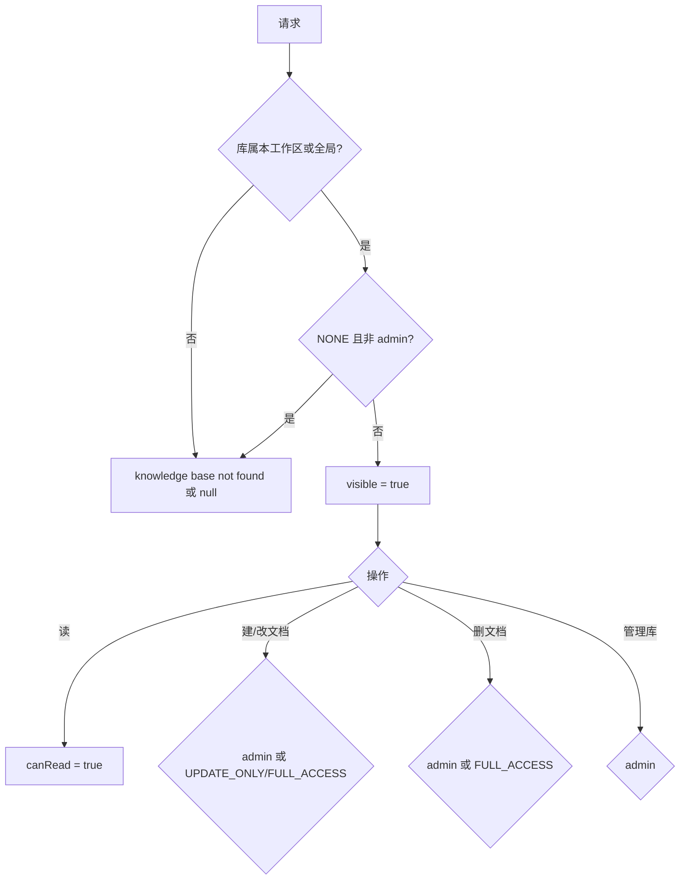
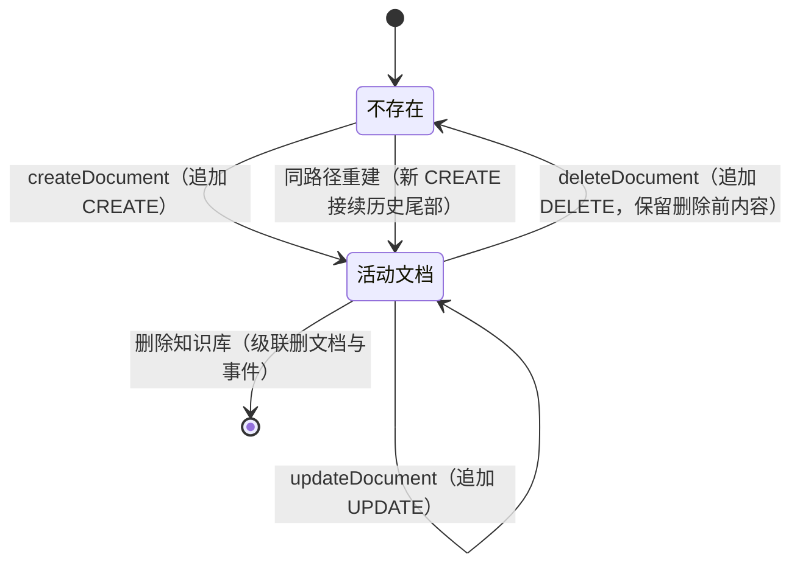

# 知识库 · 上下文概览

## 职责边界

负责工作区级知识库的创建与权限管理、文档树读写、追加式事件历史，面向 Agent 的知识库 MCP 工具，
以及**仓库内建知识库（仓库知识库）的只读视图**（发现、加载、展示，不落库）。
**不负责**：工作区成员与角色判定（见 20-工作区 / 10-身份与租户）、通用文件存储（平台文档存在 MongoDB 而非对象存储）、仓库知识库的写入（唯一写入口是仓库文件）。

## 聚合清单

| 聚合 | 集合 | 唯一写方 | 说明 |
|---|---|---|---|
| KnowledgeBase | knowledgebases | agent-api | 工作区级知识库 + 四档权限模式 |
| KnowledgeBaseDocument | knowledgebasedocuments | agent-api | **仅活动文档**，删除即释放路径 |
| KnowledgeBaseEvent | knowledgebaseevents | agent-api | 追加式 CREATE/UPDATE/DELETE 全量快照 |

## 权限模型

可见集 = 库属**本工作区** ∪ 本租户**全局工作区**；其他普通工作区的库对本工作区成员不可见（独占语义）。
可见是一切读写前提；非管理员在 NONE 模式下连可见性都没有。

| 角色 \ 模式 | NONE | READ_ONLY | UPDATE_ONLY | FULL_ACCESS |
|---|---|---|---|---|
| admin | 全 true | 全 true | 全 true | 全 true |
| developer | 不可见 | 仅 canRead | + canCreate/canUpdate | + canDelete |

- **canManage**（改名 / 改权限模式 / 删除库）恒等于「当前用户是租户管理员」。
- 全局工作区的库对跨工作区成员**按库自身模式放行写**——有意偏离「全局工作区 developer 只读」的通用口径。
- 创建知识库恒要求租户 admin（role !== 'admin' → not a tenant admin）。
- 默认模式：**global → READ_ONLY**（所有人读、管理员写），**normal → NONE**（仅管理员）。

## 文档生命周期与事件溯源

- 文档集合**只存活动文档**：删除是硬删除，路径立即释放。
- 历史由事件集合承担：DELETE 事件保留删除前最后内容，同路径重建历史延续。
- 事件**无任何更新/删除入口**（仅删除知识库时级联清理），无 TTL。

## 写入不变量（业务行 + 事件）

服务层写入顺序固定为「业务行变更 → 追加事件」，事件失败**回滚业务行**并整体抛错：

| 操作 | 业务行 | 事件 | 事件失败时 |
|---|---|---|---|
| 创建文档 | insert | CREATE | 删除刚插入的行 |
| 更新文档 | update | UPDATE | 还原旧值 |
| 删除文档 | delete | DELETE | 用快照重建行 |
| upsert 文档 | 存在则 update / 不存在则 create | 对应事件 | 同上分支 |

- 不留半提交：任一步失败都不允许「文档已变、历史缺失」。
- actorName 在 appendEvent 内经 User.findById 快照；账户改名不影响历史。
- 全部服务方法**首参显式 userId**（WorkspaceContext 无 userId；MCP relay 链路无 RequestAuth ALS）。
- 入口 requireContext() → **workspace not found**。

## 路径规范

- 以 **/** 开头、去末尾 **/**、无空段、无控制字符/NUL。
- 单段 ≤128 字符；全长 ≤512 字符。
- 归一化由 normalizeDocumentPath 唯一负责；非法 → **invalid document path**。
- 路径是库内唯一键（knowledgeBaseId + path），前缀查询用 path 正则（索引可支撑）。

## MCP 工具

平台服务 **agent-knowledge-base-tools**（六工具）：

| 工具 | 语义 |
|---|---|
| knowledge_base_list | 列出当前会话可见知识库 |
| knowledge_base_create | 创建知识库（仅租户管理员；非 admin 不出现在 tools/list） |
| knowledge_base_document_list | 按前缀列出文档元信息 |
| knowledge_base_document_get | 按路径取完整内容 |
| knowledge_base_document_update | **upsert**：存在 → UPDATE，不存在 → CREATE（权限分支各自判定） |
| knowledge_base_document_delete | 删除文档（释放路径） |

- 平台服务在 sessionService.create 公共路径**恒装配并去重**（普通/云/节点会话全覆盖）。
- mcp-dispatch platform 链尾直发；默认 MCP 候选与 setControllerDefaultMcp 的排除名单**两处**同步追加。
- tools/list 按 getWorkspaceContext().role 门控 create；tools/call 服务层二次校验。
- 库定位 id 优先，name 在可见集内解析；0/多命中返回明确 isError 提示。
- MCP 错误统一 isError:true 文本；读不可见/无权限/不存在统一 null（不泄露存在性）。

## 仓库知识库（内建于仓库，只读视图）

仓库知识库**无任何持久化聚合**（不落 MongoDB、零迁移）：仓库为唯一事实源，平台只读加载与展示。

- **发现规则**：仓库根目录 `.zag/knowledges/` 与 `docs/knowledges/` 两个约定目录的**直接子文件夹**内含常规文件 `knowledge-base.json` 即一个知识库（发现不递归）；库内文档 = 递归收集的 `.md` 常规文件（扩展名小写比较）。
- **加载上限（知识库优化二期口径）**：

| 限制 | 上限 |
|---|---|
| 单个文件（文档与 `knowledge-base.json`） | ≤ 1 MiB |
| 单个文件夹直接子项（目录与文件合计） | ≤ 1000（按 `localeCompare` 取前 1000） |
| 文档数 / 知识库数 / 内容累计 | **无上限**（二期取消全部总额限制） |

  二期前口径：每来源 20 库 / 每库 50 文档 / schema 64KiB / 单文档 128KiB / 单库累计 1MiB / 单来源累计 2MiB。
  超限语义：单文件超限逐条 `file too large`（`knowledge-base.json` 超限整库 `file too large`）；单文件夹子项超 1000 截断并置 `truncated`（沿文件夹→库→来源→整体逐级上浮）。
  文档级 `file too large` **保留不可打开节点**：`RepoKnowledgeBaseNode.error` 非空、不计入 `documentCount`、`getDocument` 恒 `null`，不影响同库其余文档与库合法性。
- **只读与隔离**：平台无任何写入口；仓库知识库**不进入知识库 MCP 工具**（六工具只返回平台托管知识库）；MCP prompts 提供「仓库知识库编写指引」，上限口径与扫描器同源（防漂移守卫锁定）。
- **加载与缓存**：逐级懒加载（候选云电脑骨架纯 DB → 知识库列表 → 子条目 → 文档）；工作区级缓存 `repo-knowledge-bases:ws:{workspaceId}`（300s）+ 「重新检测」（`refresh:true` 删缓存重扫）。

## 核心不变量

1. 三集合**有意不挂任何 scope 插件**；可见性/权限唯一判定源为 knowledge-base-access 纯函数。
2. 可见集 = 本工作区 ∪ 本租户全局；NONE 模式对非 admin 完全隐藏。
3. 写库管理操作恒需租户 admin；文档写权限由库模式决定，与通用「全局只读」口径无关。
4. 文档路径库内唯一；删除即释放；同路径重建是新 CREATE 事件。
5. 事件只追加、不可改删；DELETE 保留删除前内容。
6. 业务行与事件必须同生共死（事件失败回滚业务行）。

## 对外契约

| 契约 | 覆盖 |
|---|---|
| contracts/knowledge-base.graphql | knowledgeBases / knowledgeBaseTree / createKnowledgeBase / renameKnowledgeBase / updateKnowledgeBasePermission / deleteKnowledgeBase / knowledgeBaseDocuments / knowledgeBaseDocument / knowledgeBaseEvents / 四个文档 mutation；仓库知识库只读四查询 repoKnowledgeBaseHosts / repoKnowledgeBases / repoKnowledgeBaseDocumentChildren / repoKnowledgeBaseDocument |

错误白名单 14 条（resolver wrap() 逐字透传，未命中 internal error）：
Not authenticated / workspace not found / knowledge base not found / knowledge base name already exists /
invalid knowledge base name / not a tenant admin / knowledge base permission denied /
knowledge base document not found / knowledge base document already exists / invalid document path /
invalid document title / invalid document tags / invalid document description / invalid document content。

## 跨上下文关系

| 方向 | 关系 |
|---|---|
| 知识库 ← 工作区 | 归属工作区 + 权限模式判定依赖 WorkspaceContext（id / globalWorkspaceId / role） |
| 知识库 ← 身份与租户 | 建库与管理操作要求租户 admin |
| 知识库 → 会话 | 作为平台 MCP 装配进每个会话，Agent 通过工具读写 |
| 知识库 → 工作流 | 工作流节点会话同样装配知识库工具 |

## 口径陷阱

1. **不要给三集合补挂 applyWorkspaceScope / applyTenantScope**：会与「库自身模式放行写」冲突并导致全局库不可写。
2. **canManage 不等于 canUpdate**：前者是租户 admin，后者由库模式决定。
3. **NONE 不是「只读」而是「非 admin 不可见」**；READ_ONLY 才是只读。
4. **KnowledgeBaseEvent 没有删除单条事件的入口**；历史只能随整库删除。
5. **文档读取不可见时返回 null 而非报错**；写操作才区分 not found 与 permission denied。
6. **创建文档的 path 由显式入参提供**（不是从 title 推导），服务端归一化并校验。
7. **mcp-dispatch 需团队工作区补查**：relay 链路无 ALS，直接 findOne 会被注入 tenantId=userId 而查不到平台服务行。

## 相关文档

- /B0-知识库/01-聚合与实体.md
- /20-工作区/00-上下文概览.md
- /10-身份与租户/00-上下文概览.md
- /50-会话与交互/00-上下文概览.md
