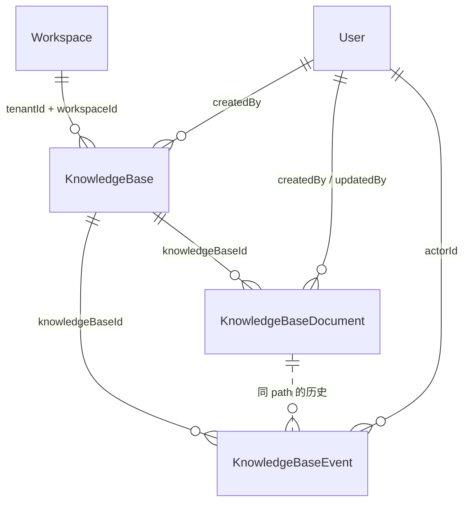

# 知识库 · 聚合与实体

## 实体关系

## KnowledgeBase（knowledgebases）

| 字段 | 类型 | 约束 / 说明 |
|---|---|---|
| _id | ObjectId | 主键 |
| tenantId | String | required；租户 id（String 口径） |
| workspaceId | String | required；归属工作区 id（String 口径） |
| name | String | required, trim；trim 后 1..64，**工作区内唯一** |
| permissionMode | String enum | required；NONE / READ_ONLY / UPDATE_ONLY / FULL_ACCESS |
| createdBy | String | required；创建人 userId |
| createdAt / updatedAt | Date | timestamps |

索引：

- 唯一索引 **uniq_knowledge_base_workspace_name {workspaceId, name}**（迁移 028 同名同键；服务层预检 + E11000 兜底）。
- 普通索引 **knowledge_base_tenant_workspace {tenantId, workspaceId}**（本租户 × 工作区并集查询）。

作用域：

- **不挂 applyTenantScope / applyWorkspaceScope**。理由：需求要求全局工作区的库对同租户其他工作区成员可见，
  且读写按库自身权限模式放行（全局 developer 亦可写），与插件「写只回当前工作区 + 全局 developer 只读拦截」冲突。
- 可见性/权限由 services/knowledge-base-access.ts 纯函数显式判定；租户/工作区过滤由服务层显式写入查询条件。

默认权限模式（defaultPermissionMode）：

| 创建工作区类型 | 默认 permissionMode | 语义 |
|---|---|---|
| global | READ_ONLY | 所有人读、管理员写 |
| normal | NONE | 仅管理员可见可写 |

## KnowledgeBaseDocument（knowledgebasedocuments）

| 字段 | 类型 | 约束 / 说明 |
|---|---|---|
| _id | ObjectId | 主键 |
| tenantId | String | required；冗余租户维度 |
| knowledgeBaseId | ObjectId ref KnowledgeBase | required |
| path | String | required；**归一化路径**，库内唯一 |
| title | String | required；trim 后 1..200 |
| tags | String[] | default []；≤16 个，单项 trim 后 1..32，去重 |
| description | String | default ''；≤1024 |
| content | String | default ''；≤262144 |
| createdBy | String | required |
| updatedBy | String | required |
| createdAt / updatedAt | Date | timestamps |

索引：

- 唯一索引 **uniq_knowledge_base_doc_path {knowledgeBaseId, path}**（迁移 028 同名同键）。
  同索引亦支撑路径前缀查询（path 正则）。
- **仅存活动文档**：删除即硬删除并释放路径；同路径重建接续在历史尾部。

## KnowledgeBaseEvent（knowledgebaseevents）

| 字段 | 类型 | 约束 / 说明 |
|---|---|---|
| _id | ObjectId | 主键 |
| tenantId | String | required |
| knowledgeBaseId | ObjectId ref KnowledgeBase | required |
| path | String | required；事件所属文档路径 |
| op | String enum | required；CREATE / UPDATE / DELETE |
| title | String | required；完整快照 |
| tags | String[] | default []；完整快照 |
| description | String | default ''；完整快照 |
| content | String | default ''；完整快照（DELETE 保留删除前内容） |
| actorId | String | required；操作人 userId |
| actorName | String | required；写入时点名称快照 |
| createdAt | Date | default Date.now；**无 updatedAt**（timestamps:false） |

索引：

- **knowledge_base_event_recent {knowledgeBaseId, createdAt:-1}**（全库历史，设置页倒序）。
- **knowledge_base_event_path_recent {knowledgeBaseId, path, createdAt:-1}**（单路径全部版本）。
- 追加式：**无任何更新/删除入口**；仅删除知识库时级联清理。无 TTL。

## 枚举

KNOWLEDGE_BASE_PERMISSION_MODES：

| 值 | 含义 |
|---|---|
| NONE | 仅租户 admin 可见可写 |
| READ_ONLY | 可见只读 |
| UPDATE_ONLY | 可见 + 可建/改文档，不可删 |
| FULL_ACCESS | 可见 + 可建/改/删文档 |

KNOWLEDGE_BASE_EVENT_OPS：CREATE / UPDATE / DELETE。

## 权限判定明细

resolveKnowledgeBaseAccess(kb, context) 返回六标志：

| 模式 | visible | canRead | canCreate | canUpdate | canDelete | canManage |
|---|---|---|---|---|---|---|
| NONE + admin | true | true | true | true | true | true |
| NONE + developer | false | false | false | false | false | false |
| READ_ONLY + admin | true | true | true | true | true | true |
| READ_ONLY + developer | true | true | false | false | false | false |
| UPDATE_ONLY + developer | true | true | true | true | false | false |
| FULL_ACCESS + developer | true | true | true | true | true | false |

判定输入只有三个：kb.workspaceId、kb.permissionMode、context（id / globalWorkspaceId / role）。
**context.readOnly 不参与判定**（全局 developer 对全局库仍按库模式放行）。

## 路径与输入校验

| 规则 | 常量 / 行为 | 失败文案 |
|---|---|---|
| 路径以 / 开头、去末尾 /、无空段 | normalizeDocumentPath | invalid document path |
| 单段 ≤128、全长 ≤512 | DOC 常量 | invalid document path |
| 控制字符 / NUL | 正则拒绝 | invalid document path |
| 库名 trim 1..64 | normalizeName | invalid knowledge base name |
| 标题 trim 1..200 | 校验函数 | invalid document title |
| 标签 ≤16 × 1..32 去重 | 校验函数 | invalid document tags |
| 描述 ≤1024 | 校验函数 | invalid document description |
| 内容 ≤262144 | 校验函数 | invalid document content |
| 权限模式四档枚举 | validatePermissionMode | invalid knowledge base permission mode（内部） |

## 服务方法

services/knowledge-base-service.ts 为唯一读写口：

| 方法 | 权限门 | 说明 |
|---|---|---|
| list / listTree | 按库模式过滤可见 | 本工作区 ∪ 全局工作区，按 createdAt 升序 |
| create | role === admin | 默认模式按工作区类型 |
| rename | canManage | 同工作区重名预检 + E11000 |
| updatePermission | canManage | 四档枚举校验 |
| remove | canManage | 级联删文档与事件 |
| listDocuments | canRead | 支持路径前缀 |
| getDocument | canRead | 不可见返回 null |
| createDocument | canCreate | 路径归一 + 已存在拒绝 |
| updateDocument | canUpdate | 匹配数 0 → DOC_NOT_FOUND |
| upsertDocument | 存在走 canUpdate / 不存在走 canCreate | MCP update 的底层 |
| deleteDocument | canDelete | 硬删除 + DELETE 事件 |
| listEvents | canRead | 可按 path 过滤，createdAt 倒序 |

## 仓库知识库视图（非持久化）

仓库知识库（`docs/knowledges/domain` 本身即一例）不落任何集合；下表为加载/解析层的视图形状与口径（纯函数解析，唯一读写口 `services/repo-knowledge-bases.ts`）：

| 视图对象 | 来源 | 关键字段 / 口径 |
|---|---|---|
| RepoKnowledgeBase | 扫描结果 + `knowledge-base.json` 解析 | `id`（`repo:<workspaceId>:<source>:<encodeURIComponent(folder)>`）、name（trim 1..64）/ description（≤1024）、source（`ZAG`/`DOCS`）、valid/errors、documentCount、truncated |
| RepoDocument | 库内 `.md` 解析 | path（库内相对 POSIX 路径归一）、front matter 三键（title 1..200 / tags ≤16×1..32 去重 / description ≤1024）、标题回退链 fm.title → 首个 `# ` → 文件名、content 原文 |
| 路径冲突 | `a.md` vs `a.MD` | 整库 `valid:false`，冲突文档不收录 |

加载上限（知识库优化二期口径，扫描器 `packages/agent-controller/src/knowledge-bases.ts` 为唯一执行点）：

| 规则 | 上限 | 超限行为 |
|---|---|---|
| 单文件（文档与 `knowledge-base.json`） | ≤ 1 MiB | 文档逐条 `file too large`；标识文件整库 `file too large` |
| 单文件夹直接子项（目录与文件合计） | ≤ 1000（`localeCompare` 取前 1000） | 截断并置 `truncated`（文件夹→库→来源→整体逐级上浮） |
| 文档数 / 知识库数 / 内容累计 | 无上限 | ——（二期取消：每来源 20 库 / 每库 50 文档 / 单库 1MiB / 单来源 2MiB 已删除） |

缓存：`repo-knowledge-bases:ws:{workspaceId}`（EX 300，解析后全集含文档内容）+ 单次扫描结果键（EX 60，读后即删）。

## MCP 工具契约要点

| 工具 | 关键口径 |
|---|---|
| knowledge_base_list | 仅返回可见库，含 myAccess 六标志 |
| knowledge_base_create | 非 admin 在 tools/list 不出现；tools/call 二次校验 |
| knowledge_base_document_list | 路径前缀过滤；不含 content |
| knowledge_base_document_get | 返回完整内容；不可见统一 not found |
| knowledge_base_document_update | upsert + 线性历史；存在 UPDATE / 不存在 CREATE |
| knowledge_base_document_delete | 释放路径；DELETE 事件保留内容 |

- 库定位：knowledgeBaseId 优先；未提供时按 name 在可见集内解析（0/多命中明确报错）。
- 平台服务名 **agent-knowledge-base-tools**；sessionService.create 公共路径恒装配并去重。
- 默认 MCP 候选与 setControllerDefaultMcp 排除名单两处同步，漏一处即口径漂移。

## 迁移与索引

迁移 **028-knowledge-base** 幂等建索引（生产 autoIndex=false 兜底）：

- knowledgebases：uniq_knowledge_base_workspace_name、knowledge_base_tenant_workspace。
- knowledgebasedocuments：uniq_knowledge_base_doc_path。
- knowledgebaseevents：knowledge_base_event_recent、knowledge_base_event_path_recent。

tenant-isolation / workspace-isolation 双测试对三集合显式豁免，并断言查询不注入 tenant/workspace 过滤。

## 口径陷阱

1. **三集合均无 userId 主维度**，不要套用「带 userId 集合必须声明 tenantId 并挂 applyTenantScope」的规则。
2. **事件集合 createdAt 是业务字段**（timestamps:false），没有 updatedAt。
3. **canDelete 只有 admin 或 FULL_ACCESS**；UPDATE_ONLY 不能删。
4. **文档删除是硬删除**，不要指望从文档集合恢复历史，历史只在事件集合。
5. **知识库删除会级联删事件**，历史不可保留（本期取舍）。
6. **路径前缀查询用归一化后的 path**，直接传原始路径可能因末尾斜杠导致空结果。
7. **createDocument 的 path 是显式入参**，不从 title 或文件名推导。

## 相关文档

- /B0-知识库/00-上下文概览.md
- /20-工作区/01-聚合与实体.md
- /90-密钥与工具/00-上下文概览.md
