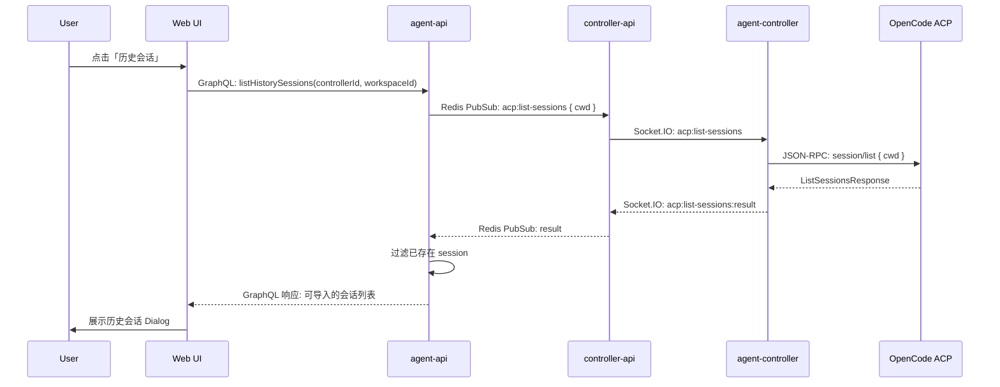
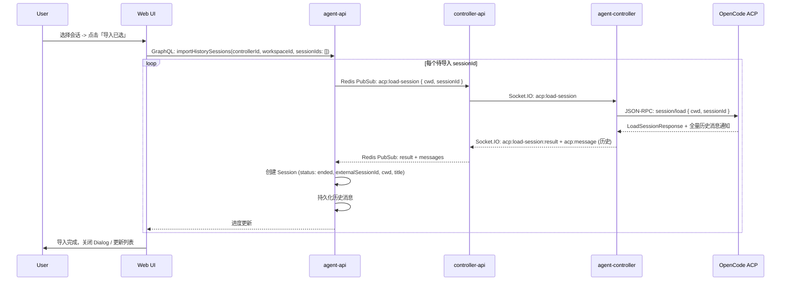
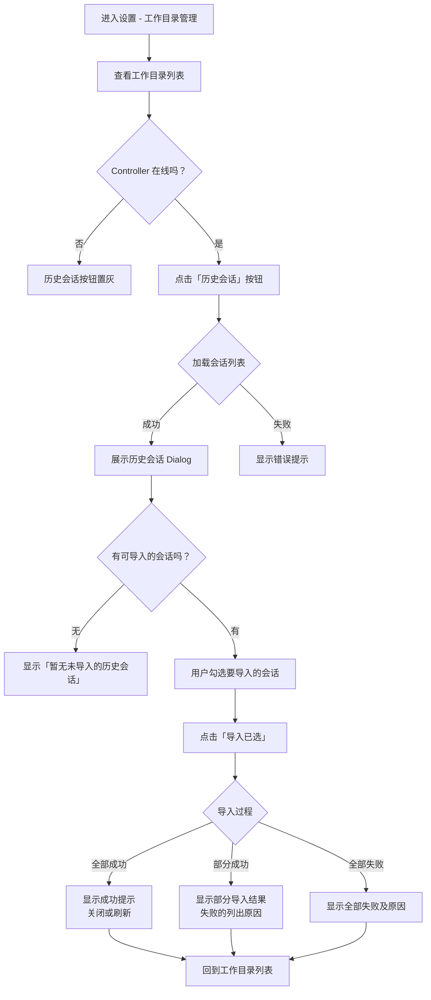

# 工作目录历史会话同步

**功能名称**: 工作目录历史会话同步
**PRD 版本**: v1.0
**创建日期**: 2026-05-21
**作者**: ZeroAsh

## 背景与目标

### 1.1 背景

用户在管理 Controller 工作目录时，可能已经在某个工作目录下通过 OpenCode 或其他 ACP 兼容 Agent 有过大量历史会话。当前系统只能从「新建会话」入口开始新的对话，无法发现和导入工作目录中已有的历史会话。这导致用户在切换管理平台时需要手动复制历史记录，或将旧会话丢弃，造成信息断层。

### 1.2 目标

允许用户在 Controller 工作目录管理界面中，通过 ACP 协议拉取该工作目录下的所有历史会话列表，选择性导入系统中。导入完成后，用户可以在系统中查看完整的会话历史，就像这些会话是在本系统中创建的一样。

### 1.3 成功标准

- 用户可在工作目录列表项中一键拉取历史会话列表
- 系统自动过滤已存在的会话（未被删除的 externalSessionId 相同），用户仅看到未导入的会话
- 导入后的会话完整包含原始会话的标题、消息记录等全量信息
- 导入后的会话可在系统中正常查看
- Controller 离线时按钮不可用，提示明确

## 用户分析

### 2.1 目标用户

已在某个工作目录下使用过 OpenCode 或 ACP 兼容 Agent 并产生历史会话的用户。

### 2.2 用户场景

| 场景 | 用户角色 | 目标 | 痛点 |
|--|--|--|--|
| 首次接入存量工作目录 | 已有重度使用 OpenCode 经验的用户 | 将已有的大量历史会话迁移到管理平台 | 历史会话信息分散在各处，无法统一管理 |
| 日常使用中发现未导入的会话 | 使用 Agent 进行开发工作的用户 | 发现并导入遗漏的历史会话 | 切换工作环境后，之前的会话记录丢失 |
| 使用新 Controller 管理已存在的目录 | 迁移或新增设备的用户 | 在新的管理平台查看该目录下的所有历史记录 | 需要手动重建上下文，效率低 |

## 功能需求

### 3.1 功能概述

在 Controller 工作目录管理列表的每个工作目录项上增加「历史会话」按钮。点击后通过 ACP 协议连接目标 Controller，调用 `session/list` 获取工作目录下的所有会话列表，以 Dialog 形式展示。用户可多选需要导入的会话，系统调用 `session/load` 获取全量历史记录并创建对应的 Session 记录。

### 3.2 功能列表

#### 功能点 1: 历史会话入口按钮

- **描述**: 在 Controller 工作目录列表项的「启用切换」和「删除」按钮之间，新增一个「历史会话」按钮。按钮点击条件：Controller 在线且工作目录已启用。
- **用户价值**: 用户可在管理工作目录时直观地发现并操作历史会话导入。
- **验收标准**:
  - [ ] 工作目录列表项中「删除」左侧存在「历史会话」按钮
  - [ ] Controller 离线时按钮置灰，hover 提示「Controller 离线，无法获取历史会话」
  - [ ] 工作目录未启用时按钮置灰
  - [ ] 点击后发起 ACP 连接并展示历史会话 Dialog

#### 功能点 2: 拉取并展示历史会话列表

- **描述**: 点击历史会话按钮后，向目标 Controller 发起 `acp:list-sessions` 请求，Controller 端通过 `connection.listSessions({ cwd })` 获取会话列表。返回结果以 Dialog 形式展示，每个会话显示标题（title）、最后活动时间（updatedAt）。列表中自动过滤掉已在系统中存在且未被删除的会话（通过 externalSessionId 比对）。
- **用户价值**: 用户可清晰看到有哪些可导入的会话，避免重复导入。
- **验收标准**:
  - [ ] 点击后 Dialog 打开并显示加载状态
  - [ ] 成功获取列表后，每项显示标题和更新时间
  - [ ] 已存在于系统中（相同 externalSessionId 且未被删除）的 session 不展示
  - [ ] 列表中允许用户多选
  - [ ] 空列表时展示「暂无未导入的历史会话」

#### 功能点 3: 多选导入历史会话

- **描述**: 用户在 Dialog 中勾选一个或多个会话后点击「导入已选」。系统逐一调用 `session/load` 获取全量历史记录，为每个会话在系统中创建新的 Session 记录。创建的 Session 与原会话使用相同标题（title），`externalSessionId` 设为 ACP 返回的 `sessionId`，`status` 设为 `ended`，`cwd` 设为工作目录路径。系统若发现某个会话在外部已被删除，则处理为创建新 session 而非恢复。
- **用户价值**: 一键批量导入历史会话，无需逐个操作。
- **验收标准**:
  - [ ] 支持多选（checkbox），可选择部分或全部会话
  - [ ] 点击「导入已选」后按钮变为加载状态，显示导入进度（如「已导入 3/5」）
  - [ ] 每个会话导入成功后，对应列表项标记为「已导入」并从可选列表中移除
  - [ ] 导入过程中若某个会话失败，不影响其他会话的导入
  - [ ] 导入完成的 session 可在会话列表中正常查看

#### 功能点 4: 会话过滤与去重策略

- **描述**: 系统通过 `externalSessionId` 字段判断会话是否已导入。已在系统中创建且未被删除（status 为 ended 但不包括已物理删除）的 session 视为已存在，从可选列表中过滤。若 session 之前被导入过但已删除（物理删除操作），则重新创建新 session，不会恢复旧记录。
- **用户价值**: 避免重复导入，同时允许重新导入已删除的会话。
- **验收标准**:
  - [ ] 比对 externalSessionId，大小写敏感
  - [ ] 已导入且未被删除的 session 不展示在列表中
  - [ ] 已导入但后又被删除的 session，允许重新导入（创建新 session）

### 3.3 用户操作流程

### 3.4 页面/界面描述

| 页面 | 描述 | 关键元素 |
|------|------|---------|
| 工作目录列表（设置页） | 每个工作目录项上的「历史会话」按钮 | 在启用开关/名称路径/删除之间新增「历史会话」文字按钮 |
| 历史会话 Dialog | 展示工作目录下的可导入历史会话列表 | Dialog 标题「历史会话 - {工作目录名}」；列表项每行：checkbox + 会话标题 + 更新时间；底部「导入所选」按钮；关闭按钮 |

### 3.5 异常与边界情况

| 情况 | 预期行为 |
|------|---------|
| Controller 离线 | 按钮置灰，hover 提示「Controller 离线」 |
| 工作目录未启用 | 按钮置灰 |
| ACP 不支持 session/list 或 session/load | Dialog 提示「该 OpenCode 版本不支持历史会话功能」 |
| session/list 返回空列表 | Dialog 显示「该工作目录下没有未导入的历史会话」 |
| session/load 超时或失败 | 单个会话导入失败，不影响其他会话，显示具体错误原因 |
| 导入过程中 Controller 断连 | 已成功的保留，未完成的标记失败，提示用户重试 |
| session 的 cwd 与当前工作目录路径不匹配 | 使用当前工作目录的 path 作为新 session 的 cwd |
| 用户勾选了已被其他用户/操作删除的会话 | 正常创建新 session，使用新的 ID，externalSessionId 设为 ACP sessionId |

## 四、非功能需求

### 4.1 性能要求

- 列表导出不应超过 3 秒（取决于 ACP 响应速度）
- 每次最多显示 50 条会话（若 session/list 支持分页，考虑分批）
- 批量导入建议控制并发数，避免给 Controller 和 OpenCode 造成过大压力（建议最多同时 3 个 load 请求）

### 4.2 安全性要求

- 只有 Controller 的拥有者可以查看和导入该 Controller 工作目录的历史会话
- 历史会话消息数据仅在用户授权范围内传输

### 4.3 兼容性要求

- 需要 `@agentclientprotocol/sdk` 版本 >= 0.22.1（支持 `listSessions` 和 `loadSession`）
- 目标 OpenCode 需要声明 `sessionCapabilities.list` 和 `loadSession` 能力

## 五、依赖与约束

### 5.1 依赖

- `@agentclientprotocol/sdk@^0.22.1` — 已安装
- ACP 协议需要扩展新的 Socket.IO 事件: `acp:list-sessions` / `acp:load-session` 及对应的 result 事件
- ACP 协议契约需要更新，添加 `session/list` 和 `session/load` 的流程定义
- Controller 在线状态检测机制（已有）

### 5.2 约束

- `session/load` 返回的数据量可能较大（全量历史消息），需要考虑消息持久化的效率和存储成本
- 每个 session 的 `externalSessionId` 必须保持全局唯一，用于去重
- 已导入并删除的 session 可重新导入，但以全新 session 形式存在（使用新 `_id`）

## 六、相关文档

- [[contracts/agent-session-websocket.md]] — ACP WebSocket 协议契约（需更新）
- [[工程提案-ACP-SDK-重构]] — 相关 ACP SDK 集成方案
- `packages/agent-controller/src/acp/bridge.ts` — ACP Bridge 实现（需扩展 list/load 方法）
- `servers/agent-api/src/models/session.ts` — Session 数据模型
