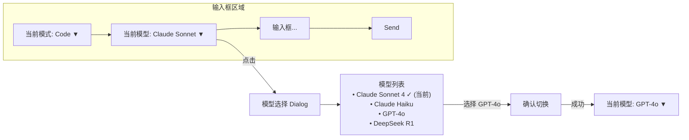
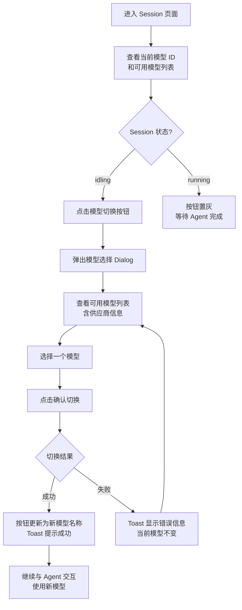

# 模型切换功能支持

**功能名称**: 模型切换功能支持
**PRD 版本**: v1.0
**创建日期**: 2026-05-22
**作者**: ZeroAsh

## 背景与目标

### 1.1 背景

在上一期功能「可用模型展示与 Agent 模式切换」中，我们已经实现了 Agent 工作模式的切换以及当前使用模型的展示。但由于当时 ACP 模型切换协议尚未稳定，模型信息仅作为只读展示，用户无法在 Session 运行中切换 LLM 模型。

在实际使用中，用户在不同任务阶段对模型的需求不同：

- 简单问题问答：希望切换到速度更快、成本更低的模型
- 复杂代码推理：希望切换到推理能力更强的模型
- 特定供应商模型调试：希望切换不同供应商的模型进行对比

此外，当前模型信息仅展示「名称」，缺少可用模型列表的查看入口，用户无法知道当前还有哪些模型可供选择。

### 1.2 目标

- 用户在 Session 界面可查看当前 Session 可用的所有模型列表
- 用户在 Session 闲置时（idling）可切换模型，切换后 Agent 立即使用新模型
- 模型切换的交互方式与模式切换保持一致，降低学习成本
- 已缓存的模型信息在 Session 生命周期内保持一致

### 1.3 成功标准

- Session 创建/恢复后，页面展示当前模型 ID 和可用模型列表
- 模型切换操作在 3 秒内完成（取决于 ACP 响应速度）
- 仅允许在 idling 状态下切换，running 状态下切换入口不可用
- 切换模型后，Agent 后续交互使用新模型

## 用户分析

### 2.1 目标用户

- **多模型使用者**: 根据任务复杂度切换不同模型，平衡速度与质量
- **成本敏感用户**: 在简单任务中使用低成本模型，减少 API 调用费用
- **模型测试用户**: 在同一 Session 中快速切换模型对比输出效果

### 2.2 用户场景

| 场景 | 用户角色 | 目标 | 痛点 |
|--|--|--|--|
| 简单问题快速回答 | 日常使用者 | 切换到轻量模型快速获取答案 | 只能使用启动时预设的模型，无法按需切换 |
| 复杂代码生成 | 开发者 | 切换到最强模型进行深度推理 | 无法在编码过程中升级模型 |
| 模型效果对比 | 测试用户 | 切换模型对比同一问题的输出 | 需要关闭 Session 重建才能换模型 |
| 成本控制 | 重度用户 | 简单任务用便宜模型，复杂任务用好模型 | 无法灵活控制模型的成本消耗 |

## 功能需求

### 3.1 功能概述

在 Session 界面中增加模型列表展示与模型切换功能，与现有的模式切换功能保持一致的交互方式。可用模型列表和当前模型 ID 在 Session 创建或恢复时获取并缓存，在输入框左侧模型切换入口提供切换操作，仅在 Session 闲置（idling）时可操作。

### 3.2 功能列表

#### 功能点 1: Session 模型信息缓存与展示

- **描述**: 在用户创建新 Session 或恢复已结束的 Session 时，系统自动获取该 Session 可用的 LLM 模型列表以及当前使用的模型 ID。模型列表包含每个模型的名称和供应商信息。当前模型 ID 在界面中展示（与当前模式并列展示）。
- **用户价值**: 用户无需手动查询即可看到所有可用模型和当前使用的模型。
- **验收标准**:
  - [ ] 新建 Session 成功后，页面展示当前模型 ID 和可用模型列表
  - [ ] 恢复已结束的 Session 成功后，页面同样展示这些信息
  - [ ] 模型信息在 Session 活跃期间保持一致
  - [ ] 模型信息更新（如 Agent 自动切换模型）时，页面同步刷新

```mermaid
sequenceDiagram
    participant U as User
    participant F as Frontend
    participant A as Agent-API
    participant C as Controller-API
    participant OC as Agent (OpenCode)

    U->>F: 创建/恢复 Session
    F->>A: 请求创建/恢复 Session
    A->>C: 转发指令
    C->>OC: 建立 ACP 连接
    OC-->>C: 返回 Session 信息<br/>包含 models 列表和 currentModelId
    C->>C: 缓存 models 信息
    C-->>A: 返回 Session 创建/恢复结果
    A-->>F: 推送 Session 信息<br/>包含模型列表和当前模型 ID
    F--->>U: 展示当前模型 ID<br/>和可用模型信息
```

#### 功能点 2: 输入框左侧模型切换入口

- **描述**: 在 Session 对话输入框的左侧，增加一个显示当前模型名称（或 ID）的切换按钮，位于模式切换按钮之后。按钮内容格式为 `<当前模型名称>`。点击该按钮弹出模型选择对话框，列出所有可用模型。每个模型项显示模型名称和供应商名称。用户选择一个模型后，系统请求切换模型，切换成功后按钮上的当前模型名称更新。
- **用户价值**: 用户可在不离开对话界面的情况下，直观地查看和切换 LLM 模型。
- **验收标准**:
  - [ ] 输入框左侧模式按钮之后显示当前模型名称按钮
  - [ ] 每个模型项包含模型名称和供应商信息
  - [ ] 当前选中的模型在列表中高亮标记
  - [ ] 选择新模型后，按钮文字更新为新模型名称
  - [ ] 操作过程中有加载状态提示



#### 功能点 3: Idling 状态下允许模型切换

- **描述**: 模型切换操作仅允许在 Session 状态为「idling」时进行。当 Agent 正在生成回复（running）或 Session 处于其他状态（connecting、creating、disconnected、ended）时，切换入口不可用。在 idling 状态下，用户选择新模型后，系统发起模型切换请求，切换成功后新模型立即生效。模型切换不影响当前模式设置。
- **用户价值**: 避免在 Agent 正在工作时打断其生成过程，确保切换操作的安全性。
- **验收标准**:
  - [ ] idling 状态下，模型切换按钮可点击
  - [ ] running 状态下，模型切换按钮置灰或隐藏
  - [ ] 切换过程中按钮显示加载状态
  - [ ] 切换失败时显示明确的错误提示，当前模型保持不变
  - [ ] 切换成功后，后续的 Agent 交互基于新模型进行
  - [ ] 模式切换不影响模型，模型切换不影响模式

#### 功能点 4: 当前模型信息在 Session 头部的展示

- **描述**: 在 Session 页面头部信息区域，展示当前 Session 正在使用的 LLM 模型名称和供应商名称（如需），同时展示当前模型 ID。此展示为只读信息，交互切换通过输入框左侧的模型切换按钮完成。
- **用户价值**: 用户在浏览 Session 整体信息时可确认当前模型配置。
- **验收标准**:
  - [ ] Session 头部展示当前模型名称和供应商
  - [ ] 模型信息随 Session 创建/恢复时一起返回
  - [ ] 模型切换后头部信息同步更新

### 3.3 用户操作流程



### 3.4 页面/界面描述

| 页面 | 描述 | 关键元素 |
|------|------|---------|
| Session 页面 - 输入框区域 | 输入框左侧模式按钮之后新增模型切换按钮 | 当前模型名称 + 下拉箭头图标；点击弹出 Dialog |
| 模型选择 Dialog | 展示 Agent 支持的所有 LLM 模型 | Dialog 标题「切换模型」；模型列表（名称 + 供应商 + 选中态）；确认/取消按钮；加载状态 |
| Session 页面 - 头部区域 | 展示当前 Session 使用的模型信息 | 模型名称 + 供应商（只读文本，与当前模式并列展示） |

### 3.5 异常与边界情况

| 情况 | 预期行为 |
|------|---------|
| Agent 不支持模型切换 | 模型切换按钮隐藏或置灰，提示「当前 Agent 不支持切换模型」 |
| 切换模型时 Agent 断连 | 显示连接失败提示，当前模型保持不变；Session 重连后重新拉取当前模型 |
| 模型切换请求超时 | 显示「切换超时，请重试」，模型不变 |
| Session 状态在切换过程中变化 | 以实际返回结果为准，若切换失败则模型不变 |
| 可用模型列表为空 | 模型切换按钮置灰，提示「无可用模型」 |
| Agent 自主切换了模型 | 页面自动刷新当前模型显示，同步到最新状态 |
| 模型供应商信息不可用 | 模型列表中只显示模型名称，不显示供应商 |
| 模型切换与模式切换同时操作 | 两者独立，互不影响；建议用户先完成一个再操作另一个 |

## 四、非功能需求

### 4.1 性能要求

- 模型切换操作应在 3 秒内完成（取决于 ACP 响应速度）
- 模型列表信息应缓存，避免每次切换重新获取
- 模型切换不阻塞其他操作

### 4.2 安全性要求

- 用户只能切换自己 Session 的模型
- 模型信息仅在当前 Session 上下文中可查看

### 4.3 兼容性要求

- 需要 Agent 端在 `session/new` 和 `session/resume` 的返回结果中提供模型信息（`models.availableModels` + `models.currentModelId`）
- 模型切换请求应通过 `session/set_config_option` 方式（`configId: "model"`），与 ACP 协议标准的 Session Config Options 机制保持一致
- 若 Agent 仅支持旧版方式（`unstable_setSessionModel`），也应兼容处理
- 若 Agent 不支持上述任一方式，功能应优雅降级（隐藏或置灰模型切换入口）

## 五、依赖与约束

### 5.1 依赖

- Agent（OpenCode）需要在 `session/new` 和 `session/resume` 的返回结果中包含 `models` 字段（`{ availableModels, currentModelId }`）
- Agent 需要支持通过 `session/set_config_option` 切换模型（`configId: "model"`），或支持 `unstable_setSessionModel` 方法
- 模型信息同时通过 `configOptions` 中的 `category: "model"` 选项提供，前端应优先使用 `models` 字段获取模型列表，用 `session/set_config_option` 发起切换
- Session 创建/恢复流程需确保返回 `models` 和 `configOptions` 数据
- 上一期功能「可用模型展示与 Agent 模式切换」已完成的模型展示基础设施

### 5.2 约束

- 模型切换仅在 idling 状态下可用
- 可用模型列表和当前模型 ID 以 ACP 协议返回的为准
- 模型切换与模式切换独立运作，两者互不影响

## 六、相关文档

- [可用模型展示与 Agent 模式切换 (shipping)](../shipping/20260522-available-models-and-mode-switch.md) — 上一期功能，包含模型展示和模式切换的基础实现
- [Agent 拉起与交互 (released)](../released/20260518-agent-session-interaction.md)
- [LLM 供应商与模型管理 (released)](../released/20260517-llm-provider-settings.md)
- [Session 信息展示 PRD (released)](../released/20260520-session-reopen-prd.md)
- ACP 协议文档: [Session Config Options](https://agentclientprotocol.com/protocol/session-config-options) — `session/set_config_option` 方法定义，`category: "model"` 选项类型
- ACP 协议文档: [Session Modes](https://agentclientprotocol.com/protocol/session-modes) — 兼容的模式切换协议参考
