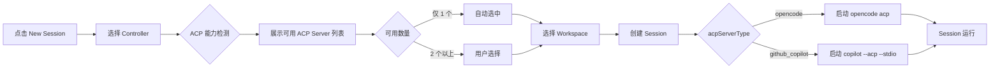

# 多 ACP Server 支持

**功能名称**: 多 ACP Server 支持
**PRD 版本**: v1.0
**创建日期**: 2026-05-26
**作者**: opencode

## 背景与目标

### 1.1 背景

z-agent-gear 作为一站式个人多端管理 Agent 解决方案，核心能力是通过 ACP（Agent Client Protocol）协议将远程控制器上的 AI Agent 能力通过 Web 界面呈现给用户。

当前系统仅支持 OpenCode 作为唯一的 ACP Server。用户在创建 Session 时虽然能看到「ACP Server」选择器，但由于只有一个可用选项，实际上没有选择空间。

随着 GitHub Copilot CLI 也开始支持 ACP 模式（`copilot --acp --stdio`），用户可以在同一台控制器上安装并运行多种 AI Agent。这带来了两个新的需求：

1. **选择性**：不同的任务适合不同的 Agent — GitHub Copilot 擅长快速代码补全和简单对话，OpenCode 擅长复杂的大规模重构和多步骤任务
2. **对比性**：用户可以在同一环境中对比不同 Agent 的表现，选择最适合的工具
3. **兼容性**：目前系统中 AcpServerType 是一个硬编码的单值枚举（`opencode`），所有模块（检测、启动、持久化、展示）都假定只有一个 ACP Server 可用，需要全面扩展

### 1.2 目标

- GitHub Copilot CLI 作为与 OpenCode 并列的可选 ACP Server
- 控制器能够自动检测并上报安装了哪些 ACP Server（OpenCode、GitHub Copilot 或两者都有）
- 用户在创建 Session 时可以选择可用的 ACP Server
- Session 创建后整个生命周期不可更改 ACP Server 类型
- Session 信息中明确标识正在使用的 ACP Server 类型

### 1.3 成功标准

- [ ] 控制器同时安装 OpenCode 和 GitHub Copilot CLI 时，Web 端显示 2 个 ACP Server 选项
- [ ] 用户选择 GitHub Copilot 创建 Session 后，控制器启动 `copilot --acp --stdio` 进程
- [ ] GitHub Copilot ACP Session 的创建、消息发送、消息接收、关闭等完整生命周期正常
- [ ] 控制器上只有其中一个 ACP Server 可用时，Web 端只显示可用的选项
- [ ] 老 Session（acpServerType 为 opencode）兼容性不受影响
- [ ] 历史 Session 列表和详情页明确显示 acpServerType

## 用户分析

### 2.1 目标用户

- 已在本地或远程控制器上安装了 GitHub Copilot CLI 的开发者
- 需要根据任务场景灵活切换 AI Agent 的用户
- 希望对比不同 Agent 编程体验的用户

### 2.2 用户场景

| 场景 | 用户角色 | 目标 | 痛点 |
|--|--|--|--|
| 快速代码片段生成 | 全栈开发者 | 使用 GitHub Copilot 快速生成一段样板代码 | 只能使用 OpenCode，无法利用 Copilot 在代码补全场景的优势 |
| 复杂多步骤重构 | 高级开发者 | 使用 OpenCode 进行大规模代码重构 | 没有选择权，必须使用 OpenCode 处理所有场景 |
| Agent 能力对比 | 技术负责人 | 评估不同 Agent 在具体项目中的表现 | 缺乏在同一环境中无缝切换 Agent 的能力 |
| Copilot 已有用户 | 个人开发者 | 已经习惯使用 GitHub Copilot，希望继续在 Web 界面中使用 | 被迫在终端中使用 Copilot，无法享受 Web 界面的便利 |

## 功能需求

### 3.1 功能概述

在现有 OpenCode ACP Server 基础上，增加 GitHub Copilot CLI 作为第二可选 ACP Server。控制器端的 AcpDetector 扩展为支持多 Server 检测，前端新建 Session 流程中让用户在可用选项中自由选择。Session 创建后固定 ACP Server 类型并在整个生命周期中展示。

### 3.2 功能列表

#### 功能点 1: ACP Server 多检测

- **描述**: 控制器启动后或在 Web 触发检测时，逐一检测所有支持的 ACP Server 是否存在且可用。OpenCode 检测方式仍为执行 `opencode -v`，GitHub Copilot 检测方式为执行 `copilot --version`（验证 CLI 已安装并已登录）。
- **用户价值**: 系统自动发现可用的 Agent，用户无需手动配置
- **验收标准**:
  - [ ] 控制器上安装了 OpenCode 和 Copilot CLI 时，检测结果包含两者
  - [ ] 仅安装 Copilot CLI 时，检测结果只包含 github_copilot
  - [ ] 检测结果包含版本号信息
  - [ ] 检测结果缓存机制不变（1h TTL）

#### 功能点 2: 新建 Session 时选择 ACP Server

- **描述**: 新建 Session 弹框中，ACP Server 下拉列表显示控制器上报的所有可用 Server。默认选中第一个可用选项。用户可在支持的 ACP Server 中自由选择。
- **用户价值**: 用户可以根据当前任务场景选择合适的 Agent
- **验收标准**:
  - [ ] ACP Server 下拉列表只显示当前控制器已检测到并可用的 Server
  - [ ] 每个选项显示 Server 名称和版本号
  - [ ] 用户选择后创建 Session，acpServerType 写入 Session 记录

#### 功能点 3: GitHub Copilot ACP Session 生命周期

- **描述**: 用户选择 GitHub Copilot 创建的 Session，在控制器端启动 `copilot --acp --stdio` 进程（而非 `opencode acp`），通过 ACP 协议转发消息。其他生命周期行为（消息发送/接收、取消、关闭、重连）与 OpenCode 保持一致。
- **用户价值**: GitHub Copilot 用户可以获得与 OpenCode 一致的 Web 交互体验
- **验收标准**:
  - [ ] acpServerType 为 github_copilot 的 Session 启动 `copilot --acp --stdio` 进程
  - [ ] 消息发送和接收行为与 OpenCode Session 一致
  - [ ] 取消生成、关闭 Session 等操作正常
  - [ ] Session 重连行为正常
  - [ ] 历史 Session 的 list/load 正常

#### 功能点 4: ACP Server 类型展示

- **描述**: Session 的详情信息中展示所选的 ACP Server 类型，包括 Session 列表、Session 详情页和 Session Header 等位置。
- **用户价值**: 用户随时了解当前 Session 正在使用哪个 Agent
- **验收标准**:
  - [ ] Session 列表页每条记录显示 acpServerType
  - [ ] Session 详情页 Header 区域显示 acpServerType
  - [ ] acpServerType 以可读形式展示（如 "OpenCode" / "GitHub Copilot"）

### 3.3 用户操作流程

### 3.4 页面/界面描述

| 页面 | 描述 | 关键元素 |
|------|------|---------|
| 新建 Session 弹框 | 选择 Controller 后显示可用 ACP Server 下拉列表 | ACP Server 下拉选择器（显示名称+版本），默认选中第一个 |
| Session 详情页 | 顶部 Header 区域显示 acpServerType 标签 | 在 Controller 名称旁显示小标签 "OpenCode" 或 "GitHub Copilot" |
| Session 列表页 | 每条 Session 记录显示 acpServerType | 列表每行显示 ACP Server 类型标签 |

### 3.5 异常与边界情况

| 情况 | 预期行为 |
|------|---------|
| 用户选择 GitHub Copilot 但控制器上 Copilot 未登录 | 检测时 `copilot --version` 会提示未登录，detector 返回 available=false |
| Session 运行中 GitHub Copilot 进程崩溃 | 与 OpenCode 崩溃行为一致 — Session 状态变为 ended，前端提示错误 |
| 旧 Session（acpServerType 为 opencode）回看 | 正常展示，acpServerType 显示为 "OpenCode" |
| Controller 升级后新增了其他 ACP Server | 无需升级代码，检测逻辑扩展即可 |
| 用户没有安装任何 ACP Server | 检测结果为空列表，新建 Session 时 ACP Server 选择器显示"无可用 Server"提示 |

## 非功能需求

### 4.1 性能要求

- ACP Server 检测时间：单 Server 不超过 2s（`opencode -v` 和 `copilot --version` 均为轻量命令）
- Session 启动时间：与现有 OpenCode Session 一致，不超过 5s

### 4.2 安全性要求

- GitHub Copilot CLI 依赖用户本地已登录的 GitHub 认证，系统不存储任何 Copilot 凭据
- ACP 协议通信内容加密与现有 OpenCode 一致（WebSocket/SSE over HTTPS）

### 4.3 兼容性要求

- 现有 OpenCode Session 完全不受影响，acpServerType 为 opencode 的数据无需迁移
- 不支持 Session 创建后切换 acpServerType

## 依赖与约束

### 5.1 依赖

- GitHub Copilot CLI（`gh copilot` 插件）已安装并登录
- 控制器端需要能执行 `copilot --acp --stdio` 命令

### 5.2 约束

- GitHub Copilot ACP 模式目前为公开预览阶段，协议行为可能有变
- GitHub Copilot 的 ACP 能力可能与 OpenCode 存在差异（如不支持某些 session config option），前期不对齐功能差异，仅保证基础消息通信可用
- 本项目不负责 GitHub Copilot CLI 的安装和认证流程，这些由用户自行完成

## 相关文档

- [GitHub Copilot CLI ACP Server 文档](https://docs.github.com/en/copilot/reference/copilot-cli-reference/acp-server)
- [Agent Client Protocol 官方文档](https://agentclientprotocol.com/)
- [Agent 拉起与交互 PRD](./released/20260518-agent-session-interaction.md)
