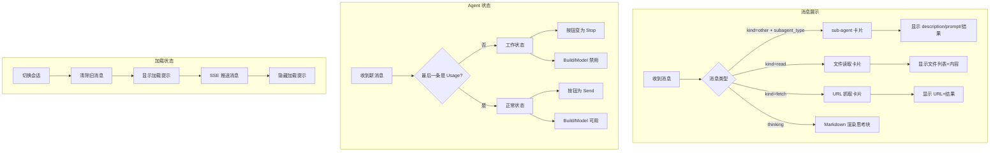

# 用户界面优化二期

**功能名称**: 用户界面优化二期
**PRD 版本**: v1.0
**创建日期**: 2026-05-26
**作者**: opencode

## 背景与目标

### 1.1 背景

一期界面优化完成后，用户界面在以下方面仍有提升空间：

1. **消息展示类型不完整**：AI 返回的消息有多种类型（sub-agent 调用、文件读取、URL 抓取），但目前都以统一格式展示，用户无法区分不同类型的消息及其特有信息（如 sub-agent 的提示词、读取的文件列表、抓取的 URL 来源）
2. **思考过程渲染单一**：AI 的思考过程（Thinking 块）目前仅渲染纯文本，不支持 Markdown，长思考内容不易阅读
3. **SSE 加载无反馈**：切换会话时，如果 SSE 连接尚未建立或加载缓慢，消息列表显示空白，用户无法感知正在加载
4. **输入框空间不足**：一期将最高高度设置为 5rem，用户在输入较长代码或问题时仍感局促
5. **Agent 运行状态不直观**：当前无法直观判断 Agent 是否正在工作中，用户可能在 Agent 运行时误操作切换 build 或 model

### 1.2 目标

- 不同类型消息（sub-agent / read / fetch）使用差异化展示，让用户一眼识别消息类型并获取关键信息
- Thinking 块支持 Markdown 渲染，提升长思考内容的可读性
- 切换会话时消息列表显示加载状态，SSE 连接建立后展示内容
- 输入框最高高度提升至 10rem，满足更长内容的输入需求
- Agent 运行时状态可视化，运行中显示 Stop 按钮并锁定 build/model 切换

### 1.3 成功标准

- 用户看到 sub-agent 消息时知道它是一个子代理调用，能看到描述和提示词
- 用户看到 read 消息时知道 AI 正在读取文件，能看到文件列表和读取结果
- 用户看到 fetch 消息时知道 AI 正在获取 URL 内容，能看到来源地址和结果
- Thinking 块中的 Markdown 格式（如代码块、列表、标题）正确渲染
- 切换会话时不会出现空白消息列表（至少显示 loading 指示器）
- 输入框可以容纳最高约 160px（10rem）的内容
- Agent 运行时发送按钮替换为 Stop 按钮，build/model 切换不可操作

## 用户分析

### 2.1 目标用户

所有使用 Agent Web 进行 AI 编程的用户。

### 2.2 用户场景

| 场景 | 用户角色 | 目标 | 痛点 |
|------|----------|------|------|
| 查看 sub-agent 执行结果 | 开发者 | 了解子代理的任务描述和执行结果 | 当前 sub-agent 消息和普通消息一样，看不到提示词和输出 |
| 查看 AI 读取的文件 | 开发者 | 确认 AI 正在读取哪些文件及内容 | 无法知道 AI 读取了哪些文件 |
| 查看 AI 抓取的 URL 内容 | 开发者 | 确认 AI 获取了哪些网页信息 | 不知道信息来源 URL |
| 阅读 AI 的 Markdown 思考内容 | 开发者 | 清晰阅读带格式的思考过程 | 代码块、列表等格式在纯文本中难以辨认 |
| 切换会话等待加载 | 开发者 | 知道正在加载消息 | 切换后看到空白区域，不确定是否出错 |
| 输入长代码/问题 | 开发者 | 输入完整内容无需手动扩展 | 5rem 高度在输入稍长内容时仍不够 |
| Agent 正在运行时操作 | 开发者 | 知道 Agent 正在工作，能随时停止 | 不确定 Agent 是否还在运行，可能误操作 |

## 功能需求

### 3.1 功能概述

在已有界面基础上，完善消息类型的差异化展示、提升消息可读性、优化加载和输入体验、增加 Agent 运行状态指示。

### 3.2 功能列表

#### 功能点 1: 消息内容差异化展示（sub-agent / read / fetch）

- **描述**: 
  - **sub-agent 消息**（`kind=other`，`rawInput` 包含 `subagent_type`）：展示为专门的 sub-agent 卡片样式。标题区显示 `description`（如"代码审查"），内容区显示发送给子代理的 `prompt`，底部显示子代理返回的结果（`rawOutput.output`），类似于用户消息/AI 消息/edit 消息的展示方式
  - **读取文件消息**（`kind=read`）：展示为文件读取卡片。上方列出 `locations`（文件路径列表），下方展示读取到的文件内容（`$.content.content`），类似于 AI 消息/用户消息/edit 消息的展示方式
  - **抓取 URL 消息**（`kind=fetch`）：展示为 URL 抓取卡片，显示目标 URL（`rawInput.url`）和获取的结果（`rawOutput.output`），类似于 AI 消息/用户消息/edit 消息的展示方式
- **用户价值**: 用户能直观区分消息类型，快速获取各类型的核心信息（子代理的提示词、读取的文件列表、抓取的 URL 来源）
- **验收标准**:
  - [ ] sub-agent 消息卡片标题显示 `description`，内容区显示 `prompt`，底部显示子代理返回结果
  - [ ] read 消息上方显示文件路径列表，下方显示文件内容
  - [ ] fetch 消息显示目标 URL 和获取结果
  - [ ] 三种卡片外观与 AI 消息/用户消息/edit 消息风格一致

#### 功能点 2: Thinking 块支持 Markdown 渲染

- **描述**: AI 的思考过程（Thinking 块）目前以纯文本渲染，改为支持 Markdown 渲染。渲染方式与 AI 消息内容一致（支持代码块语法高亮、列表、标题、链接等），但保持 Thinking 块原有的灰底/折叠样式
- **用户价值**: 长思考内容中的代码块、列表、标题等格式清晰可读
- **验收标准**:
  - [ ] Thinking 块中的代码块正确渲染并带语法高亮
  - [ ] Thinking 块中的列表、标题、链接等 Markdown 格式正确渲染
  - [ ] Thinking 块的灰底/折叠交互样式保持不变

#### 功能点 3: SSE 加载状态

- **描述**: 会话消息列表没有消息时（包括首次加载和切换会话时），显示加载中提示。当 SSE 连接建立并推送到消息后，加载状态自动消失。加载状态应显示在消息列表区域中央
- **用户价值**: 切换会话时用户明确知道正在加载，不会看到空白区域以为是错误
- **验收标准**:
  - [ ] 打开会话时，消息列表为空时显示加载提示
  - [ ] 切换会话时，旧消息清除后立即显示加载提示，新消息到达后消失
  - [ ] SSE 连接失败时显示错误状态而非无限加载

#### 功能点 4: 输入框最高高度提升至 10rem

- **描述**: 将一期设置的 5rem 最高高度调整为 10rem（约 160px），超出后内部滚动。其他行为不变
- **用户价值**: 输入较长代码或问题时空间更充足
- **验收标准**:
  - [ ] 输入框高度随内容增加，最高不超过 10rem
  - [ ] 超过 10rem 后在输入框内滚动
  - [ ] 发送后输入框重置为单行高度

#### 功能点 5: Agent 运行状态指示

- **描述**: 当会话最后一条消息不是 "Usage" 类型时，Agent 状态为"工作中"，此时：
  - 发送按钮替换为 Stop 按钮（点击后发送停止请求）
  - 输入框依然可以输入文字
  - Build 和 Model 选择器不可操作（置灰/禁用）
  - Agent 状态可通过某种视觉指示让用户感知（如按钮区文字变化）
- **用户价值**: 用户清楚知道 Agent 正在工作，不会误切换 build/model，可以随时停止
- **验收标准**:
  - [ ] Agent 工作时发送按钮变为 Stop 按钮
  - [ ] 点击 Stop 按钮发送停止请求
  - [ ] Agent 工作时 Build 和 Model 选择器禁用
  - [ ] Agent 工作时输入框仍可输入
  - [ ] Agent 停止工作后恢复正常状态

### 3.3 用户操作流程

### 3.4 页面/界面描述

| 页面 | 描述 | 关键元素 |
|------|------|----------|
| 会话详情页-消息列表 | 消息内容差异化展示区域 | sub-agent 卡片、read 卡片、fetch 卡片、Markdown 渲染的 Thinking 块、SSE 加载指示器 |
| 会话详情页-输入区 | 底部输入区域 | textarea（最高 10rem）、Send/Stop 按钮（状态切换）、Build 选择器（禁用状态）、Model 选择器（禁用状态） |

### 3.5 异常与边界情况

| 情况 | 预期行为 |
|------|---------|
| SSE 连接超时 | 加载提示显示一段时间后变为错误提示 |
| sub-agent 没有 rawOutput | 只显示 description 和 prompt，不显示结果区域 |
| read 消息 locations 为空 | 只显示读取到的文件内容，不显示文件列表 |
| fetch 消息没有 rawOutput | 只显示 URL，不显示获取结果 |
| Thinking 块中包含无效 Markdown | 按纯文本回退渲染 |
| 快速切换多个会话 | 每次切换都显示加载提示 |
| Agent 工作中收到 Usage 消息 | 状态恢复为正常 |

## 四、非功能需求

### 4.1 性能要求

- 消息类型判断不应影响消息渲染性能
- Markdown 渲染复用已有组件，不增加额外性能开销

### 4.2 安全性要求

无额外安全要求。

### 4.3 兼容性要求

- 保持对现有浏览器（Chrome/Firefox/Safari 最新版本）的兼容
- 保持现有测试通过

## 五、依赖与约束

### 5.1 依赖

- 一期实现的工具调用差异化展示（DiffView, TerminalOutput, ToolCallCard 等组件架构）

### 5.2 约束

- Markdown 渲染方式需与 AI 消息内容保持一致（同一套 Markdown 组件）
- 所有新增消息类型卡片需与已有消息（AI 消息、用户消息、edit 消息）视觉风格统一

## 六、相关文档

- [一期 PRD](file:///home/ash/.zag/worktrees/z-agent-gear/feat-uv02i4/docs/product/reviewed/20260526-ui-optimization.md) — 用户界面优化 v3.0
