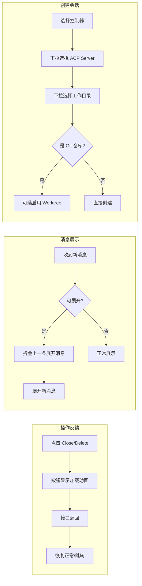

# 用户界面优化

**功能名称**: 用户界面优化
**PRD 版本**: v1.0
**创建日期**: 2026-05-26
**作者**: opencode

## 背景与目标

### 1.1 背景

当前 Agent Web 的用户界面在多个场景下存在体验问题：

1. **操作无反馈**：关闭/删除会话等操作点击按钮后没有加载动画，用户不知道操作是否正在执行，容易重复点击
2. **输入框体验不佳**：模式/模型选择与输入框挤在同一行，输入框不能根据内容自动增高，长消息需要手动拖拽
3. **消息展示混乱**：AI 返回的工具调用只显示最终状态，看不到各阶段的执行过程；可折叠的消息（如思考过程）需要用户手动一个个展开查看；用户发送的多条消息被合并在一起不易区分
4. **创建会话弹窗样式问题**：部分文字在某些主题下不可见，分支名称过长导致布局溢出，工作目录选择使用 Radio 列表占用空间大

### 1.2 目标

- 所有重要操作在请求完成前给予明确的视觉反馈，防止误操作
- 输入区域布局合理，支持自适应高度，提升长消息输入体验
- 消息展示更清晰完整，工具调用过程可追溯，最新内容默认可见
- 创建会话弹窗视觉统一、信息完整、交互高效

### 1.3 成功标准

- 用户无法在同一个操作上连续点击两次（按钮点击后立即 disabled）
- 输入框不需要手动拖拽即可输入多行文本
- 最新一条可展开的消息进入视野时自动展开，无需手动点击
- 工具调用的每个阶段（进行中/完成/失败）在前端都可区分
- 创建会话的操作路径减少纵向滚动

## 用户分析

### 2.1 目标用户

所有使用 Agent Web 进行 AI 编程的用户。

### 2.2 用户场景

| 场景 | 用户角色 | 目标 | 痛点 |
|------|----------|------|------|
| 关闭/删除运行中的会话 | 开发者 | 快速清理不需要的会话 | 点击后界面无反应，不确定是否已触发，可能重复点击 |
| 在会话中输入长段代码/问题 | 开发者 | 连贯地输入多行内容 | 输入框固定高度，需要手动调整，输入时无法看到上下文 |
| 查看 AI 执行工具调用过程 | 开发者 | 了解 AI 正在做什么、执行状态 | 只看得到完成状态，过程中不知道进展 |
| 阅读 AI 的思考过程 | 开发者 | 理解 AI 的推理逻辑 | 每次都需要手动点击展开，新内容不会自动展开 |
| 回顾多条用户消息 | 开发者 | 区分自己不同时间输入的内容 | 连发的多条消息被合并成一条，无法区分 |
| 创建新会话选择工作目录 | 开发者 | 快速从列表中选择目标目录 | Radio 列表在目录多时占空间大，需要大量滚动 |

## 功能需求

### 3.1 功能概述

优化 Agent Web 用户界面的交互细节，覆盖操作反馈、输入体验、消息展示和会话创建四个核心流程，提升日常使用效率。

### 3.2 功能列表

#### 功能点 1: 操作加载状态反馈

- **描述**: 所有调用后端接口的操作按钮在请求未返回时显示加载状态，按钮置灰并显示加载动画，防止重复点击
- **用户价值**: 用户能明确感知操作正在进行，避免焦虑和误操作
- **验收标准**:
  - [ ] 点击"Close"按钮后按钮显示旋转动画且不可再点击
  - [ ] 点击"Delete"按钮后按钮显示旋转动画且不可再点击
  - [ ] 侧边栏切换 Session 时显示加载中状态
  - [ ] 操作完成后按钮恢复正常状态

#### 功能点 2: 输入框布局与自适应高度

- **描述**: 将模式选择（Mode）和模型选择（Model）独立成一行，消息输入框独占另一行；输入框根据内容自动增高，最高 5rem（约 80px），超出后内部滚动
- **用户价值**: 输入区域更宽敞、整洁，输入长内容时不需要手动调整输入框高度
- **验收标准**:
  - [ ] Mode 和 Model 选择显示在输入框上方单独一行
  - [ ] 文本输入区占满整行宽度
  - [ ] 输入单行文本时高度为默认单行高度
  - [ ] 输入多行文本时高度随内容增加，最高不超过 5rem
  - [ ] 超过 5rem 后内容在输入框内滚动
  - [ ] 发送消息后输入框重置为单行高度

#### 功能点 3: 工具调用状态聚合展示

- **描述**: 工具调用卡片按历史状态聚合展示，显示每个阶段（pending → in_progress → completed / failed）的时间线，而不是只展示最终的 completed 状态
- **用户价值**: 用户可以追溯工具调用的完整生命周期，了解当前执行进度
- **验收标准**:
  - [ ] 工具调用从发起(pending)到进行中(in_progress)到完成(completed)或失败(failed)都能展示
  - [ ] 不同状态用不同颜色区分
  - [ ] 已完成的操作能清晰看到每个阶段的变更

#### 功能点 4: 最后一条可展开消息自动展开

- **描述**: 在消息列表中，最后一条可折叠的消息（如思考过程、工具调用等）默认展开显示内容；当新的消息到达时，自动折叠上一条展开的消息，展开最新一条
- **用户价值**: 用户无需手动操作即可查看最新内容，保持阅读连贯性
- **验收标准**:
  - [ ] 页面加载后，最后一条可展开消息默认展开
  - [ ] 新的可展开消息到达时，旧消息自动折叠，新消息展开
  - [ ] 对于多条消息拼成的一条（如连续的 thinking chunk），整条视为一个整体

#### 功能点 5: 用户消息独立展示

- **描述**: 用户连续发送的多条消息不再合并为一条，每条消息独立展示，以便区分不同时间输入的内容
- **用户价值**: 在回顾对话时可以清楚区分每次输入的内容
- **验收标准**:
  - [ ] 用户连续发送两条消息，显示为两个独立的气泡
  - [ ] AI 返回的消息不会与用户消息合并

#### 功能点 6: 创建会话弹窗视觉优化

- **描述**: 修复创建会话弹窗中的 UI 问题：工作目录和 ACP Server 改为下拉选框保持两行信息展示；修复工作目录 checkbox 文字颜色在某些主题下不可见的问题；修复分支名称前缀过长溢出问题
- **用户价值**: 创建会话流程体验更一致，信息清晰可读
- **验收标准**:
  - [ ] 工作目录使用下拉选框，选项保留名称和路径两行展示
  - [ ] ACP Server 使用下拉选框，选项保留类型和版本两行展示
  - [ ] 「启用 Git Worktree 隔离工作目录」文字颜色始终可见
  - [ ] 分支名称前缀超过一定宽度时截断显示
  - [ ] 当前 auto-select 逻辑保留（默认选中第一个）

### 3.3 用户操作流程

### 3.4 页面/界面描述

| 页面 | 描述 | 关键元素 |
|------|------|----------|
| 会话详情页 Header | 顶部操作栏 | Close/Delete 按钮（带 loading 状态） |
| 会话详情页输入区 | 底部输入区域 | Mode 选择器、Model 选择器（第一行）；自适应 textarea + 发送按钮（第二行） |
| 会话详情页消息列表 | 中间消息展示 | 可折叠卡片（最后一条自动展开）、工具调用状态时间线、独立用户消息 |
| 新建会话弹窗 | 模态弹窗 | 控制器选择、ACP Server 下拉、工作目录下拉、Worktree 设置 |

### 3.5 异常与边界情况

| 情况 | 预期行为 |
|------|---------|
| 快速连续点击 Close | 第一次点击后按钮 disabled，后续点击无效 |
| 输入框输入极长文本（超过 5rem） | 输入框高度固定 5rem，内容在内部滚动 |
| 多条工具调用连续返回 | 每个工具调用独立展示各自的状态变化 |
| 同时收到多条新消息 | 只展开最后一条可展开消息 |
| 工作目录下拉选项为空 | 显示"暂无工作区，请先在设置中管理工作区"提示 |
| ACP Server 下拉加载中 | 显示加载状态提示 |

## 四、非功能需求

### 4.1 性能要求

- 加载动画响应迅速，不阻塞用户操作
- 消息列表滚动流畅，大量消息时无卡顿

### 4.2 安全性要求

无额外安全要求。

### 4.3 兼容性要求

- 保持对现有浏览器（Chrome/Firefox/Safari 最新版本）的兼容
- 保持现有测试通过

## 五、依赖与约束

### 5.1 依赖

- 无新增外部依赖

### 5.2 约束

- 下拉选框需要保留选项的详细信息展示（如路径、版本等）

## 六、相关文档

- 无（本次优化不依赖其他 PRD）
