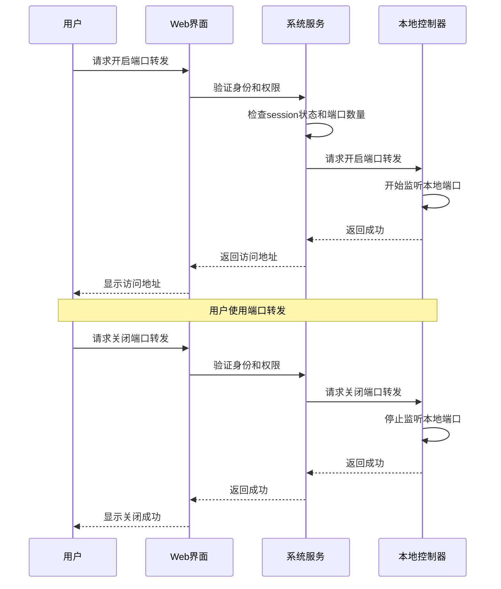

# 端口转发功能

**功能名称**: 本地Agent控制器端口转发
**PRD 版本**: v1.0
**创建日期**: 2026-05-27
**作者**: ZeroAsh

## 背景与目标

### 1.1 背景
用户在使用local-agent-controller运行开发环境时，经常需要将本地开发的服务端口暴露给外部访问。例如：
- Webhook回调测试：第三方服务需要回调本地开发的服务
- 移动设备测试：手机需要访问本地开发的Web应用
- 团队协作：需要临时分享本地开发环境给团队成员

目前用户需要手动配置反向代理或使用第三方工具，操作复杂且安全性无法保证。

### 1.2 目标
提供安全、便捷的端口转发功能，让用户能够：
1. 将本地服务端口安全地暴露给外部访问
2. 控制端口转发的生命周期（与session绑定）
3. 限制端口数量防止资源滥用

### 1.3 成功标准
- 用户能够在30秒内成功开启一个端口转发
- 端口转发功能上线后，用户使用第三方端口转发工具的比例下降50%
- 无安全漏洞或资源滥用事件

## 用户分析

### 2.1 目标用户
主要用户群体：
- 前端开发人员：需要测试Webhook回调、跨域请求
- 移动端开发人员：需要让手机访问本地开发服务
- 全栈开发人员：需要调试前后端联调
- 技术团队负责人：需要临时查看团队成员的开发环境

### 2.2 用户场景

| 场景 | 用户角色 | 目标 | 痛点 |
|------|----------|------|------|
| Webhook测试 | 前端开发 | 让第三方服务回调本地API | 需要公网可访问的URL |
| 移动端调试 | 移动开发 | 让手机访问本地Web应用 | 手机无法直接访问localhost |
| 团队协作 | 团队负责人 | 临时查看成员开发环境 | 需要复杂的网络配置 |
| API调试 | 全栈开发 | 让外部工具测试本地API | 需要稳定的访问地址 |

## 功能需求

### 3.1 功能概述
为local-agent-controller提供端口转发能力，让用户能够将本地服务端口安全地暴露给外部访问，支持最多3个端口同时转发，并与session生命周期绑定。

### 3.2 功能列表

#### 功能点 1: 端口转发管理
- **描述**: 用户可以开启、查看、关闭端口转发
- **用户价值**: 能够将本地服务端口暴露给外部访问
- **验收标准**:
  - [ ] 用户能够为运行中的session开启端口转发
  - [ ] 用户能够查看当前session的所有端口转发状态
  - [ ] 用户能够关闭指定的端口转发
  - [ ] 端口转发与session状态同步（session结束时自动关闭）

#### 功能点 2: 端口数量限制
- **描述**: 单个session最多只能开启3个端口转发
- **用户价值**: 防止资源滥用，保证系统稳定性
- **验收标准**:
  - [ ] 系统限制单个session最多3个端口转发
  - [ ] 当达到限制时，给出清晰的错误提示
  - [ ] 用户能够查看当前已使用的端口数量

#### 功能点 3: 状态绑定
- **描述**: 端口转发与session状态绑定，只有运行中的session才能开启端口转发
- **用户价值**: 确保端口转发的安全性，避免资源泄漏
- **验收标准**:
  - [ ] 只有status为"idling"或"running"的session才能开启端口转发
  - [ ] session状态变为非运行状态时，自动关闭所有端口转发
  - [ ] 尝试为非运行状态的session开启端口转发时，给出清晰的错误提示

#### 功能点 4: 安全访问
- **描述**: 端口转发需要鉴权才能访问，确保安全性
- **用户价值**: 保证端口转发的安全性，防止未授权访问
- **验收标准**:
  - [ ] 访问端口转发需要有效的身份认证
  - [ ] 不同用户的端口转发相互隔离
  - [ ] 内部通信不暴露给外部网络

### 3.3 用户操作流程

### 3.4 页面/界面描述

| 页面 | 描述 | 关键元素 |
|------|------|----------|
| Session详情页 | 显示session的详细信息和端口转发列表 | 端口转发列表、开启按钮、状态指示器 |
| 端口转发开启对话框 | 让用户输入要转发的端口号 | 端口输入框、确认按钮、取消按钮 |
| 端口转发列表项 | 显示单个端口转发的状态和访问地址 | 端口号、访问地址、状态、关闭按钮 |

### 3.5 异常与边界情况

| 情况 | 预期行为 |
|------|----------|
| session非运行状态 | 提示"只能在运行中的session开启端口转发" |
| 已达到3个端口限制 | 提示"单个session最多只能开启3个端口转发" |
| 端口已被占用 | 提示"该端口已被占用，请选择其他端口" |
| 网络连接中断 | 自动重连，重连失败后提示用户 |
| 用户无权访问session | 返回403错误，提示"无权访问该session" |
| 端口转发服务不可用 | 返回503错误，提示"端口转发服务暂时不可用" |

## 四、非功能需求

### 4.1 性能要求
- 端口转发开启延迟：< 2秒
- 并发连接支持：每个端口至少支持100个并发连接
- 内存占用：每个端口转发< 50MB内存

### 4.2 安全性要求
- 所有端口转发访问必须经过身份验证
- 不同用户的端口转发完全隔离
- 内部通信不暴露给外部网络
- 防止端口扫描和暴力破解

### 4.3 兼容性要求
- 支持TCP协议的所有端口
- 支持HTTP/HTTPS/WebSocket等应用层协议
- 兼容主流操作系统（Windows、macOS、Linux）

## 五、依赖与约束

### 5.1 依赖
- 用户认证系统：提供身份验证和权限管理
- Session管理系统：提供session状态管理
- 本地控制器：提供本地端口监听和转发能力
- 实时通信系统：提供系统服务与本地控制器之间的实时通信

### 5.2 约束
- 单个session最多只能开启3个端口转发
- 只有运行中的session（status为idling或running）才能开启端口转发
- 端口转发必须与session生命周期绑定
- 内部通信只能被系统服务访问，不暴露给外部

## 六、相关文档

- [Session管理PRD](./20260526-session-management.md)
- [本地控制器管理PRD](./20260517-agent-controller-v1.md)