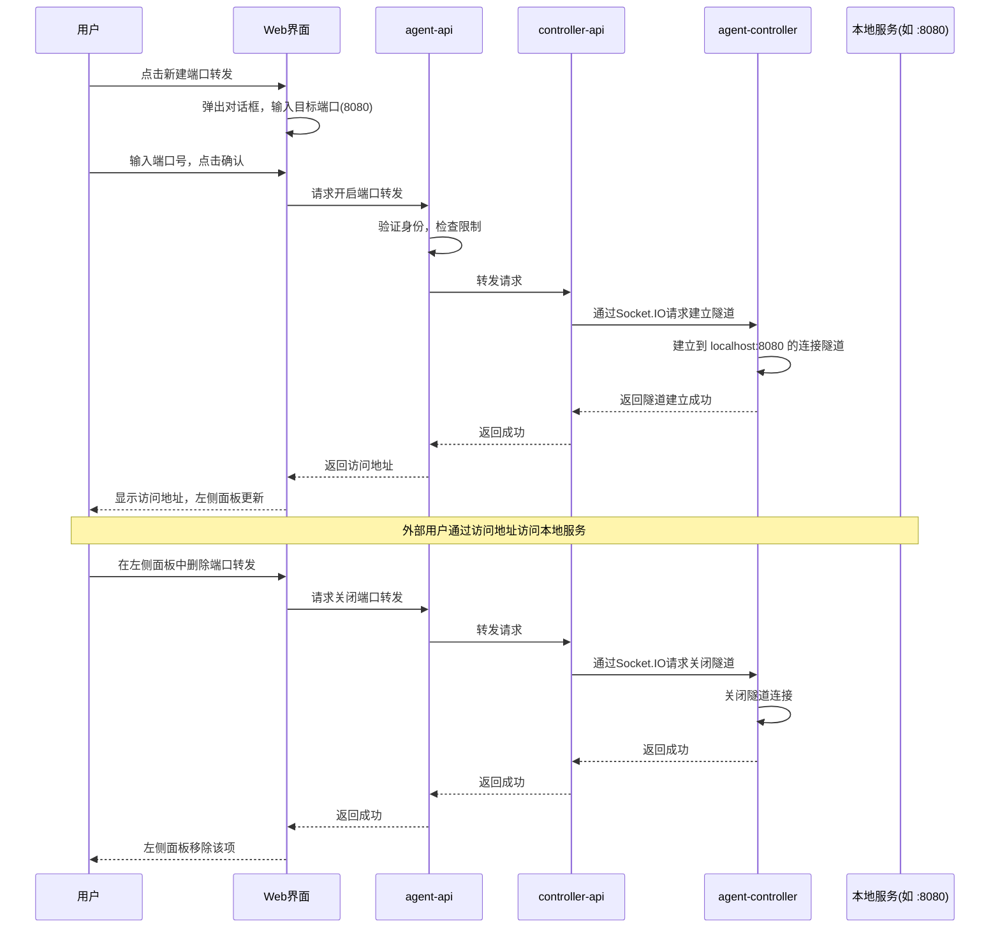

# 端口转发功能

**功能名称**: 本地Agent控制器端口转发
**PRD 版本**: v1.1
**创建日期**: 2026-05-27
**更新日期**: 2026-05-27
**作者**: ZeroAsh

## 背景与目标

### 1.1 背景
用户在使用local-agent-controller运行开发环境时，经常需要从外部访问agent-controller所在机器上运行的本地服务。例如：
- Webhook回调测试：第三方服务需要回调本地开发的服务
- 移动设备测试：手机需要访问本地开发的Web应用
- 团队协作：需要临时分享本地开发环境给团队成员
- API调试：外部工具需要测试本地运行的API

目前用户需要手动配置反向代理或使用第三方工具（如ngrok），操作复杂且安全性无法保证。

### 1.2 目标
提供安全、便捷的端口转发功能，让用户能够：
1. 从外部安全地访问agent-controller所在机器上的本地服务端口
2. 以 controller 为粒度管理端口转发，不受 session 生命周期限制
3. 限制每个 controller 的端口数量防止资源滥用

### 1.3 成功标准
- 用户能够在30秒内成功开启一个端口转发
- 端口转发功能上线后，用户使用第三方端口转发工具的比例下降50%
- 无安全漏洞或资源滥用事件

## 用户分析

### 2.1 目标用户
主要用户群体：
- 前端开发人员：需要测试Webhook回调、跨域请求
- 移动端开发人员：需要让手机访问本地开发服务
- 全栈开发人员：需要调试前后端联调
- 技术团队负责人：需要临时查看团队成员的开发环境

### 2.2 用户场景

| 场景 | 用户角色 | 目标 | 痛点 |
|------|----------|------|------|
| Webhook测试 | 前端开发 | 让第三方服务回调本地API | 需要公网可访问的URL |
| 移动端调试 | 移动开发 | 让手机访问本地Web应用 | 手机无法直接访问localhost |
| 团队协作 | 团队负责人 | 临时查看成员开发环境 | 需要复杂的网络配置 |
| API调试 | 全栈开发 | 让外部工具测试本地API | 需要稳定的访问地址 |

## 功能需求

### 3.1 功能概述
为local-agent-controller提供端口转发能力，让用户能够从外部访问agent-controller所在机器上运行的本地服务。端口转发以 controller 为粒度管理，每个 controller 最多支持 5 个端口同时转发，端口转发的生命周期独立于 session。

**核心原理**：用户指定 agent-controller 所在机器上的一个本地端口（如 8080），系统通过 agent-controller 建立反向隧道，将外部请求经由 controller-api 转发到该本地端口，使本地服务可以从外部访问。

### 3.2 功能列表

#### 功能点 1: 端口转发管理
- **描述**: 用户可以开启、查看、关闭端口转发，端口转发归属于 controller 而非 session
- **用户价值**: 能够从外部访问本地服务端口，且不受 session 生命周期影响
- **验收标准**:
  - [ ] 用户能够为已连接的 controller 开启端口转发
  - [ ] 用户能够查看当前 controller 的所有端口转发状态
  - [ ] 用户能够关闭指定的端口转发
  - [ ] 端口转发独立于 session 生命周期，session 结束不影响已有的端口转发

#### 功能点 2: 端口数量限制
- **描述**: 单个 controller 最多只能开启 5 个端口转发
- **用户价值**: 防止资源滥用，保证系统稳定性
- **验收标准**:
  - [ ] 系统限制单个 controller 最多 5 个端口转发
  - [ ] 当达到限制时，给出清晰的错误提示
  - [ ] 用户能够查看当前已使用的端口数量

#### 功能点 3: 独立生命周期
- **描述**: 端口转发的生命周期独立于 session，仅与 controller 的连接状态相关
- **用户价值**: 用户无需担心 session 重启导致端口转发丢失
- **验收标准**:
  - [ ] session 结束或重启时，端口转发不受影响
  - [ ] 只有 controller 断开连接时，端口转发才会自动关闭
  - [ ] controller 重新连接后，之前的端口转发不会自动恢复（需要用户手动重新创建）

#### 功能点 4: 安全访问
- **描述**: 端口转发需要鉴权才能访问，确保安全性
- **用户价值**: 保证端口转发的安全性，防止未授权访问
- **验收标准**:
  - [ ] 访问端口转发需要有效的身份认证
  - [ ] 不同用户的端口转发相互隔离
  - [ ] 内部通信不暴露给外部网络

#### 功能点 5: 左侧面板展示
- **描述**: 在左侧 session 面板中，controller 节点下增加"端口转发"分类，展示该 controller 下所有正在转发的端口
- **用户价值**: 用户可以直观地查看和管理所有端口转发
- **验收标准**:
  - [ ] 左侧面板中，每个 controller 节点下显示"端口转发"分类
  - [ ] 分类下展示该 controller 所有正在转发的端口（显示端口号和状态）
  - [ ] 点击端口转发项可以查看详情
  - [ ] 支持在面板中直接删除端口转发

#### 功能点 6: 新建端口转发对话框
- **描述**: 用户点击新建端口转发时，弹出对话框让用户输入目标端口号（即 agent-controller 所在机器上运行的本地服务端口）
- **用户价值**: 简洁明了的交互方式
- **验收标准**:
  - [ ] 点击新建按钮后弹出对话框
  - [ ] 对话框中包含端口号输入框（1-65535）
  - [ ] 输入框支持数字输入，带基本校验
  - [ ] 确认后创建端口转发，取消则关闭对话框

### 3.3 用户操作流程

### 3.4 页面/界面描述

| 页面 | 描述 | 关键元素 |
|------|------|----------|
| 左侧Session面板 | 在 controller 节点下显示端口转发分类 | controller 节点、端口转发分类、端口列表项 |
| 端口转发开启对话框 | 让用户输入要转发的本地端口号 | 端口输入框、确认按钮、取消按钮 |
| 端口转发列表项 | 显示单个端口转发的状态和访问地址 | 端口号、访问地址、状态、删除按钮 |

### 3.5 异常与边界情况

| 情况 | 预期行为 |
|------|----------|
| controller 未连接 | 提示"控制器未连接，无法开启端口转发" |
| 已达到5个端口限制 | 提示"单个控制器最多只能开启5个端口转发" |
| 本地端口无服务监听 | 提示"目标端口无服务运行，请检查本地服务" |
| 网络连接中断 | 自动重连，重连失败后提示用户 |
| 用户无权访问 controller | 返回403错误，提示"无权访问该控制器" |
| 端口转发服务不可用 | 返回503错误，提示"端口转发服务暂时不可用" |
| 端口号无效 | 提示"请输入1-65535之间的端口号" |

## 四、非功能需求

### 4.1 性能要求
- 端口转发开启延迟：< 2秒
- 并发连接支持：每个端口至少支持100个并发连接
- 内存占用：每个端口转发< 50MB内存

### 4.2 安全性要求
- 所有端口转发访问必须经过身份验证
- 不同用户的端口转发完全隔离
- 内部通信不暴露给外部网络
- 防止端口扫描和暴力破解

### 4.3 兼容性要求
- 支持TCP协议的所有端口
- 支持HTTP/HTTPS/WebSocket等应用层协议
- 兼容主流操作系统（Windows、macOS、Linux）

## 五、依赖与约束

### 5.1 依赖
- 用户认证系统：提供身份验证和权限管理
- Controller管理系统：提供controller连接状态管理
- 本地控制器：提供到本地端口的隧道连接能力
- 实时通信系统：提供系统服务与本地控制器之间的实时通信

### 5.2 约束
- 单个 controller 最多只能开启 5 个端口转发
- 端口转发独立于 session 生命周期
- 只有已连接的 controller 才能开启端口转发
- 内部通信只能被系统服务访问，不暴露给外部

## 六、相关文档

- [Session管理PRD](./20260526-session-management.md)
- [本地控制器管理PRD](./20260517-agent-controller-v1.md)
