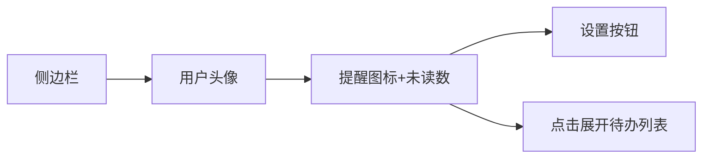
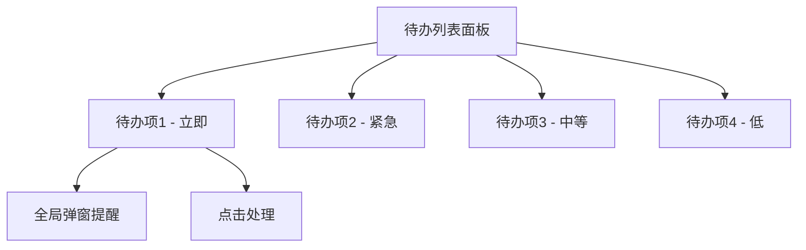
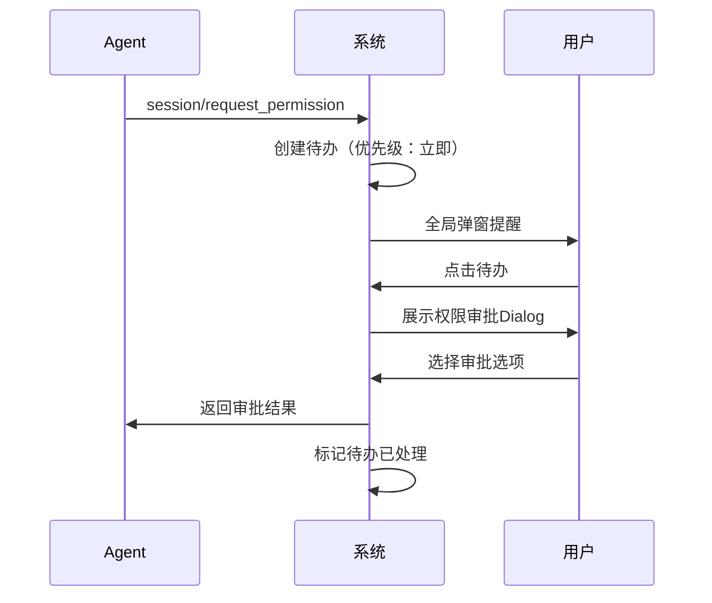
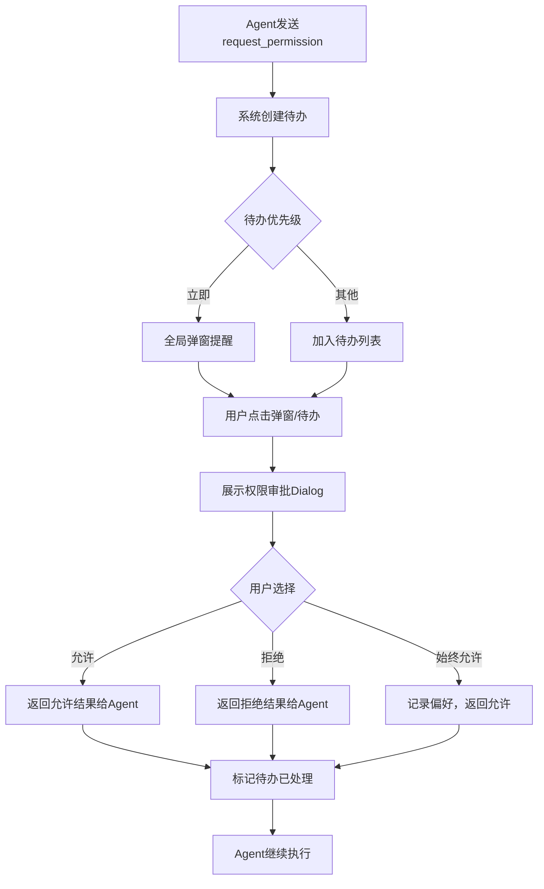

# ACP授权提醒

**功能名称**: ACP授权提醒与待办系统
**PRD 版本**: v1.0
**创建日期**: 2026-05-28
**作者**: ZeroAsh

## 背景与目标

### 1.1 背景

在ACP协议中，Agent执行某些敏感操作（如文件删除、代码执行等）前，会向Client发送`session/request_permission`消息请求用户授权。当前系统中，这条消息会透传到用户侧，但存在以下问题：

- 消息缺乏醒目的视觉提示，用户可能错过重要的权限审批请求
- 没有统一的待办管理系统，用户无法追溯历史审批记录
- 用户可能正在其他界面操作，无法及时感知权限请求
- 缺乏优先级区分，所有消息同等对待

### 1.2 目标

建立完善的ACP授权提醒机制和待办管理系统：

1. 当Agent发送`session/request_permission`时，通过待办系统进行强提醒
2. 待办事项支持优先级分类，权限审批为最高优先级
3. 最高优先级待办支持全局弹窗提醒，确保用户不会错过
4. 用户审批后，结果正确返回给Agent继续执行

### 1.3 成功标准

- 权限审批请求从发出到用户可见的延迟 < 1秒
- 用户对权限审批请求的平均响应时间 < 30秒
- 待办系统的消息送达率 100%
- 用户满意度调查中，权限提醒功能评分 > 4.5/5

## 用户分析

### 2.1 目标用户

主要用户群体：
- 使用Agent进行自动化开发的程序员
- 运行长时间Agent任务的技术人员
- 多项目并行管理的高级用户
- 需要严格控制Agent权限的安全敏感用户

### 2.2 用户场景

| 场景 | 用户角色 | 目标 | 痛点 |
|------|----------|------|------|
| 敏感文件操作审批 | 开发人员 | 确认Agent是否应该删除/修改重要文件 | 消息容易被忽略，导致误操作 |
| 代码执行审批 | 技术人员 | 审核Agent要执行的命令是否安全 | 正在其他界面工作，无法及时看到请求 |
| 批量操作审批 | 项目负责人 | 逐个审批Agent的多个权限请求 | 缺乏统一入口，操作繁琐 |
| 历史审批追溯 | 安全审计人员 | 查看过去的审批记录 | 没有历史记录可查 |

## 功能需求

### 3.1 功能概述

建立完整的ACP授权提醒与待办系统。当Agent发送`session/request_permission`消息时，系统创建「Agent权限审批」待办事项（优先级：立即），通过全局弹窗提醒用户。用户在Dialog中查看操作详情并选择审批选项，审批结果返回给Agent继续执行。

### 3.2 功能列表

#### 功能点 1: 待办事项系统入口

- **描述**: 在侧边栏用户名右侧、设置按钮左侧，增加提醒图标，显示未读消息数量。点击后进入待办任务列表。
- **用户价值**: 用户可以在任何界面快速查看待办事项，不会错过重要提醒
- **验收标准**:
  - [ ] 侧边栏显示提醒图标（铃铛或类似图标）
  - [ ] 图标右侧显示未读消息数量（红色徽标）
  - [ ] 点击图标展开待办任务列表面板
  - [ ] 未读数量实时更新

#### 功能点 2: 待办任务列表

- **描述**: 展示所有待办事项，按优先级排序。支持查看待办详情、处理待办、标记已读等操作。
- **用户价值**: 统一管理所有待办事项，提高工作效率
- **验收标准**:
  - [ ] 待办列表按优先级排序（立即 > 紧急 > 中等 > 低）
  - [ ] 每个待办显示标题、类型、优先级、创建时间
  - [ ] 未读待办有明显视觉区分
  - [ ] 点击待办可查看详情或直接处理
  - [ ] 支持全部标记已读

#### 功能点 3: Agent权限审批待办

- **描述**: 当收到Agent的`session/request_permission`消息时，系统自动创建「Agent权限审批」待办事项，优先级为「立即」。
- **用户价值**: 确保权限审批请求不会被遗漏
- **验收标准**:
  - [ ] 收到权限请求时自动创建待办
  - [ ] 待办标题显示「Agent请求权限审批」
  - [ ] 待办优先级为「立即」
  - [ ] 待办包含工具调用信息（toolCallId）
  - [ ] 待办包含可选审批选项

#### 功能点 4: 权限审批Dialog

- **描述**: 用户点击权限审批待办时，弹出Dialog展示详细信息。Dialog解析`session/request_permission`消息中的`options`和`toolCall.toolCallId`进行展示，其中options显示为审批按钮，toolCallId关联的历史消息在mongo中查询展示。
- **用户价值**: 用户可以清楚了解Agent要执行的操作，做出明智的审批决策
- **验收标准**:
  - [ ] Dialog显示操作详情（通过toolCallId查询历史获取）
  - [ ] Dialog显示所有审批选项（如「允许一次」「拒绝」「始终允许」等）
  - [ ] 点击选项后将结果返回给Agent
  - [ ] 审批完成后待办标记为已处理

#### 功能点 5: 全局弹窗提醒

- **描述**: 「立即」级别的待办事项会触发全局弹窗提醒，无论用户当前在哪个界面，都会收到弹窗通知。
- **用户价值**: 确保重要事项不会被错过
- **验收标准**:
  - [ ] 「立即」优先级待办自动触发全局弹窗
  - [ ] 弹窗显示待办标题和简要信息
  - [ ] 弹窗包含「查看详情」和「稍后处理」按钮
  - [ ] 点击「查看详情」跳转到对应的处理界面
  - [ ] 弹窗支持手动关闭，超时后自动收起

#### 功能点 6: 待办优先级系统

- **描述**: 待办事项支持四种优先级：立即、紧急、中等、低。不同优先级有不同的视觉样式和提醒方式。
- **用户价值**: 用户可以快速识别待办的重要程度，合理安排处理顺序
- **验收标准**:
  - [ ] 支持四种优先级：立即、紧急、中等、低
  - [ ] 「立即」：红色标识，全局弹窗提醒
  - [ ] 「紧急」：橙色标识，声音提醒
  - [ ] 「中等」：黄色标识，无特殊提醒
  - [ ] 「低」：灰色标识，无特殊提醒

### 3.3 用户操作流程

### 3.4 页面/界面描述

| 页面 | 描述 | 关键元素 |
|------|------|----------|
| 侧边栏提醒入口 | 用户名右侧的提醒图标 | 铃铛图标、红色未读数量徽标 |
| 待办列表面板 | 展示所有待办事项 | 优先级标识、待办标题、创建时间、状态 |
| 权限审批Dialog | 展示Agent权限请求详情 | 操作描述、工具调用信息、审批选项按钮 |
| 全局弹窗 | 「立即」级别待办的弹窗提醒 | 标题、简要信息、「查看详情」「稍后处理」按钮 |

### 3.5 异常与边界情况

| 情况 | 预期行为 |
|------|----------|
| Agent断连时有待办未处理 | 待办标记为「已过期」，显示Agent已断开 |
| 用户长时间不响应权限请求 | 超时后自动标记为「已超时」，返回取消结果给Agent |
| 同时收到多个权限请求 | 按接收顺序创建待办，依次弹窗提醒 |
| 用户刷新页面 | 待办列表从服务端重新加载，未读状态保持 |
| 待办数量过多（>100） | 分页加载，优先显示高优先级待办 |
| Dialog中toolCallId关联的消息不存在 | 显示「无法获取操作详情」，仍显示审批选项 |

## 四、非功能需求

### 4.1 性能要求

- 待办创建延迟 < 100ms
- 全局弹窗展示延迟 < 500ms
- 待办列表加载时间 < 1秒
- 支持同时展示 100+ 待办项不卡顿

### 4.2 安全性要求

- 权限审批操作必须经过身份验证
- 审批结果不可篡改，确保传递给Agent的是用户真实意图
- 审批记录持久化保存，支持审计追溯

### 4.3 兼容性要求

- 支持ACP协议中定义的所有PermissionOptionKind
- 兼容未来ACP协议新增的权限类型

## 五、依赖与约束

### 5.1 依赖

- ACP协议：`session/request_permission`消息格式
- 待办系统：新建的待办事项管理模块
- 消息历史：MongoDB中的消息记录，用于查询toolCallId关联的操作详情
- 实时通信：WebSocket/Socket.IO用于实时推送待办更新

### 5.2 约束

- 权限审批必须在Agent等待响应期间完成，超时需处理
- 审批结果必须通过ACP协议标准格式返回
- 待办数据需要持久化存储，支持历史查询

## 六、相关文档

- [ACP协议 - Tool Calls](https://agentclientprotocol.com/protocol/tool-calls#requesting-permission)
- [工作目录历史会话同步](./20260521-acp-session-sync-history.md)
- [Agent控制器管理v1](./20260517-agent-controller-v1.md)
