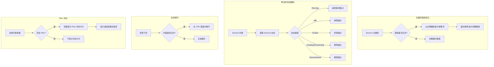

# 前端界面优化三期

**功能名称**: 前端界面优化三期
**PRD 版本**: v1.0
**创建日期**: 2026-05-28
**作者**: opencode

## 背景与目标

### 1.1 背景

二期界面优化完成后，Session 界面在以下方面仍有提升空间：

1. **标题栏路径展示不友好**：Session 标题栏中的工作路径（`cwd`）在路径过长时，会从左侧截断，用户看到的是路径末尾的文件名，无法判断当前所在的工作目录层级。用户更希望看到路径的层级结构（如 `/a/b/c/project` → `.../b/c/project`），而不是被截断为只剩文件名
2. **侧边栏 Session 状态不直观**：Session 列表中的状态图标，worktree 类型的 Session 显示蓝色分支图标，普通 Session 显示一个颜色点。但无论状态如何，普通 Session 的点颜色都是灰色或固定的，用户无法一眼看出哪些 Session 正在运行、哪些已结束
3. **消息内容撑开容器**：消息列表中的消息内容如果过长（如长代码、长文本），会撑开消息气泡容器，导致水平滚动或布局错乱。需要确保消息内容在容器内自动换行
4. **Plan 信息不易发现**：如果 Session 的消息历史中包含 Plan，用户需要滚动到 Plan 所在的位置才能看到。Plan 作为当前任务的执行计划，应该始终可见，方便用户随时了解进度

### 1.2 目标

- Session 标题栏的工作路径过长时，从左侧截断（保留右侧目录层级），并提供 Tooltip 显示完整路径
- Session 列表侧边栏中，每个 Session 的图标替换为按状态显示对应颜色的圆点
- Session 消息列表中，所有消息内容过长时自动换行，不撑开容器
- Session 消息列表中，如果消息历史包含 Plan，将最后一条 Plan 浮动显示在消息列表顶部

### 1.3 成功标准

- 用户在 Session 标题栏看到的路径是从右侧开始展示的目录层级（如 `.../project/src`），而非被截断只剩文件名
- 鼠标悬停在路径上时，显示完整路径
- Session 列表中每个 Session 显示与状态对应颜色的圆点：Running=蓝色脉冲、Idle=绿色、Ended=灰色、Creating/Connecting=黄色、Disconnected=橙色
- 消息气泡宽度不超过容器宽度的 70%，长内容自动换行
- 包含 Plan 的 Session，消息列表顶部始终显示最后一条 Plan 的摘要（如进度百分比和最后一条条目）

## 用户分析

### 2.1 目标用户

所有使用 Agent Web 进行 AI 编程的用户。

### 2.2 用户场景

| 场景 | 用户角色 | 目标 | 痛点 |
|------|----------|------|------|
| 查看 Session 的工作路径 | 开发者 | 快速识别当前 Session 所在的工作目录 | 路径过长时只剩文件名，不知道在哪个项目 |
| 在侧边栏快速识别 Session 状态 | 开发者 | 一眼看出哪些 Session 正在运行 | 所有 Session 的图标看起来一样，无法区分状态 |
| 阅读长消息内容 | 开发者 | 在消息气泡内完整阅读长内容 | 内容撑开容器导致布局错乱或需要水平滚动 |
| 了解当前任务执行计划 | 开发者 | 随时知道 Plan 的执行进度 | Plan 混在消息列表中，需要滚动才能找到 |

## 功能需求

### 3.1 功能概述

对 Session 界面的四个区域进行体验优化：标题栏路径展示、侧边栏状态图标、消息列表换行、Plan 浮动展示。

### 3.2 功能列表

#### 功能点 1: 标题栏工作路径从右侧展示

- **描述**: Session 标题栏中的工作路径（`cwd`）在路径过长时，改为从右侧开始截断（保留目录层级结构），而非当前的从左侧截断。同时在路径元素上添加 `title` 属性，鼠标悬停时显示完整路径
- **用户价值**: 用户能通过路径的右侧部分快速识别当前工作目录的层级结构（如知道是在 `project/src` 下而非其他项目），同时完整路径可通过悬停查看
- **验收标准**:
  - [ ] 路径过长时，从左侧截断并显示省略号，右侧目录名完整展示（如 `.../agent-web/src`）
  - [ ] 鼠标悬停在路径上时，显示完整的路径文本
  - [ ] 路径在正常长度时完整展示，不受影响

#### 功能点 2: 侧边栏 Session 状态圆点

- **描述**: Session 列表侧边栏中，每个 Session 的图标替换为按状态显示对应颜色的圆点。圆点颜色规则与 Session 标题栏中的状态徽章颜色一致：Running=蓝色（带脉冲动画）、Idle=绿色、Ended=灰色、Creating/Connecting=黄色、Disconnected=橙色。Worktree 类型的 Session 在圆点旁保留分支图标
- **用户价值**: 用户一眼就能从侧边栏识别哪些 Session 正在运行、哪些已结束，方便快速切换
- **验收标准**:
  - [ ] 每个 Session 显示与状态对应颜色的圆点
  - [ ] Running 状态的圆点带脉冲动画
  - [ ] Worktree 类型的 Session 在圆点旁保留分支图标
  - [ ] 圆点大小为 8px（`h-2 w-2`）

#### 功能点 3: 消息内容自动换行

- **描述**: Session 消息列表中的消息气泡宽度限制为容器宽度的 70%（`max-w-[70%]`），当消息内容过长时（如长代码块、长文本），内容在气泡内自动换行，不撑开容器。Markdown 渲染的内容本身已支持换行，此处确保纯文本和用户消息也支持换行
- **用户价值**: 长消息内容在气泡内完整展示，无需水平滚动，阅读体验更佳
- **验收标准**:
  - [ ] 消息气泡宽度不超过容器宽度的 70%
  - [ ] 长文本内容在气泡内自动换行
  - [ ] 代码块在气泡内支持水平滚动（不被截断）
  - [ ] 消息布局不因内容过长而错乱

#### 功能点 4: Plan 浮动在消息列表顶部

- **描述**: 如果 Session 的消息历史中包含 Plan 类型的消息，将最后一条 Plan 的摘要（显示完成进度和最后一条条目内容）以浮动卡片的形式固定在消息列表顶部。卡片样式为半透明背景、圆角、带阴影，不随消息列表滚动
- **用户价值**: 用户随时能看到当前任务的执行计划和进度，无需滚动查找 Plan
- **验收标准**:
  - [ ] 消息历史包含 Plan 时，列表顶部显示 Plan 浮动卡片
  - [ ] 浮动卡片显示完成进度（如 "2/5 completed"）
  - [ ] 浮动卡片显示最后一条 Plan 条目的内容摘要
  - [ ] 浮动卡片不随消息列表滚动，始终可见
  - [ ] 消息历史不包含 Plan 时，不显示浮动卡片
  - [ ] 浮动卡片可点击展开/收起完整 Plan

### 3.3 用户操作流程

### 3.4 页面/界面描述

| 页面 | 描述 | 关键元素 |
|------|------|----------|
| Session 标题栏 | 显示 Session 名称、状态、工作路径、时间 | 工作路径（从右侧截断）、Tooltip 完整路径 |
| Session 列表侧边栏 | 显示所有 Session 及其状态 | 状态颜色圆点（Running=蓝/Idle=绿/Ended=灰/Creating=黄/Disconnected=橙） |
| Session 消息列表 | 显示消息对话内容 | 消息气泡（max-width 70%）、自动换行、Plan 浮动卡片 |

### 3.5 异常与边界情况

| 情况 | 预期行为 |
|------|---------|
| 路径为空 | 不显示路径区域 |
| 所有 Session 都是 ended 状态 | 圆点全部显示灰色 |
| 消息内容为空 | 气泡不显示或显示占位符 |
| Plan 只有一个条目 | 浮动卡片显示该条目内容 |
| Plan 条目内容也很长 | 浮动卡片内截断并显示省略号 |
| 消息列表为空且有 Plan | 仍显示 Plan 浮动卡片 |
| 快速切换 Session | Plan 浮动卡片随 Session 数据更新 |

## 四、非功能需求

### 4.1 性能要求

- Plan 浮动卡片的渲染不应影响消息列表的滚动性能
- 状态圆点的颜色切换不应触发重排

### 4.2 安全性要求

无额外安全要求。

### 4.3 兼容性要求

- 保持对现有浏览器（Chrome/Firefox/Safari 最新版本）的兼容
- 保持现有测试通过

## 五、依赖与约束

### 5.1 依赖

- 二期实现的消息类型差异化展示架构
- 已有的 `status-colors.ts` 颜色定义

### 5.2 约束

- 状态圆点颜色需与 Session 标题栏中的状态徽章颜色保持一致
- Plan 浮动卡片的样式需与现有 PlanCard 组件风格统一
- 消息气泡的 70% 宽度限制需保持现有布局不变

## 六、相关文档

- [二期 PRD](../../../docs/product/released/20260526-ui-optimization-phase2.md) — 用户界面优化二期
- [一期 PRD](../../../docs/product/released/20260526-ui-optimization.md) — 用户界面优化一期
