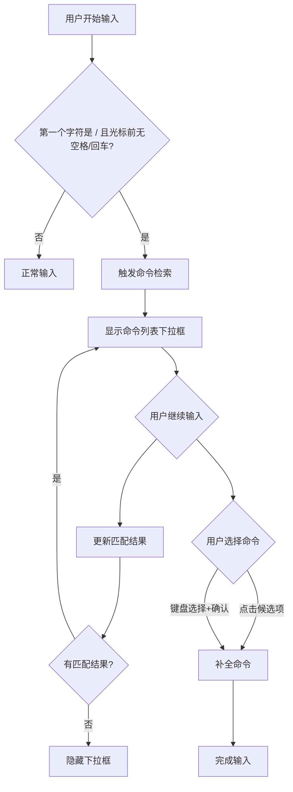

# 命令模式

**功能名称**: 命令模式（Command Mode）
**PRD 版本**: v1.0
**创建日期**: 2026-05-29
**作者**: opencode

## 背景与目标

### 1.1 背景

Agent 提供了多种内置命令（如 `/connect`、`/help` 等），用户在使用这些命令时需要手动输入完整命令名称，效率较低且容易出错。SSE 消息中已存在 `available_commands_update` 事件，可用于通知前端当前可用的命令列表，但前端目前没有对应的 UI 组件来辅助用户快速选择命令。

### 1.2 目标

- 提供命令自动补全和检索功能，提升用户输入命令的效率
- 在用户输入 `/` 时自动触发命令检索，减少用户记忆负担
- 支持模糊匹配，允许用户快速定位目标命令

### 1.3 成功标准

- 用户输入 `/` 后能在 200ms 内显示命令列表
- 模糊匹配准确率达到 100%（顺序匹配正确即为匹配）
- 用户可以通过键盘或鼠标选择命令并完成补全

## 用户分析

### 2.1 目标用户

使用 Agent CLI 交互的所有用户，特别是频繁使用内置命令的高级用户。

### 2.2 用户场景

| 场景 | 用户角色 | 目标 | 痛点 |
|------|---------|------|------|
| 快速输入命令 | 日常用户 | 快速使用常用命令 | 需要记住完整命令名 |
| 探索可用命令 | 新手用户 | 了解有哪些命令可用 | 不知道命令列表 |
| 模糊记忆命令 | 中级用户 | 根据部分记忆找到命令 | 命令名拼写不确定 |

## 功能需求

### 3.1 功能概述

当用户在输入框中输入 `/` 时，触发命令检索功能，显示当前可用命令的下拉列表，支持模糊匹配和自动补全。

### 3.2 功能列表

#### 功能点 1: 可用命令列表管理

- **描述**: 接收 SSE 消息中的 `available_commands_update` 事件，维护当前可用命令列表
- **用户价值**: 确保用户看到的命令列表始终是最新的
- **验收标准**:
  - [ ] 收到 `available_commands_update` 消息时更新命令列表
  - [ ] 命令列表数据结构正确存储

#### 功能点 2: 命令检索触发

- **描述**: 用户在输入框中输入字符时，检测是否为命令检索触发条件
- **用户价值**: 在合适的时机自动触发命令检索
- **验收标准**:
  - [ ] 输入 `/` 且光标前无空格或回车时触发检索
  - [ ] 输入其他字符时不触发命令检索

#### 功能点 3: 模糊匹配检索

- **描述**: 根据用户输入进行顺序模糊匹配，显示匹配的命令列表
- **用户价值**: 允许用户通过部分输入快速定位命令
- **验收标准**:
  - [ ] 支持顺序模糊匹配（如 `cnet` 匹配 `connect`）
  - [ ] 匹配结果按相关性排序
  - [ ] 无匹配结果时隐藏检索框

#### 功能点 4: 命令选择与补全

- **描述**: 用户可通过键盘或鼠标选择命令，完成输入框内容补全
- **用户价值**: 快速完成命令输入，减少手动输入
- **验收标准**:
  - [ ] 点击候选项完成补全
  - [ ] 键盘导航（上/下箭头）选择候选项
  - [ ] 按 Enter 或 Tab 确认选择
  - [ ] 补全后输入框内容格式正确（如 `/connect `）

### 3.3 用户操作流程

### 3.4 页面/界面描述

| 页面 | 描述 | 关键元素 |
|------|------|---------|
| 对话输入框 | 用户输入 prompt 的区域 | 输入框、发送按钮 |
| 命令下拉框 | 显示可用命令的浮层 | 命令列表、高亮匹配文本、滚动条 |

### 3.5 异常与边界情况

| 情况 | 预期行为 |
|------|---------|
| 无可用命令消息 | 不触发命令检索，正常输入 |
| 命令列表为空 | 不显示下拉框 |
| 检索结果为空 | 隐藏下拉框 |
| 输入框失去焦点 | 隐藏下拉框 |
| 连续输入多个 `/` | 仅在第一个 `/` 触发检索 |

## 四、非功能需求

### 4.1 性能要求

- 命令检索响应时间 < 200ms
- 下拉框渲染流畅，无明显卡顿

### 4.2 安全性要求

- 命令列表来源可信（来自 SSE 消息）
- 无需额外安全措施

### 4.3 兼容性要求

- 支持桌面端和移动端浏览器
- 键盘操作与鼠标操作均可用

## 五、依赖与约束

### 5.1 依赖

- SSE 消息中包含 `available_commands_update` 事件
- 现有对话输入框组件

### 5.2 约束

- 命令检索仅在输入框第一个字符为 `/` 时触发
- 模糊匹配为顺序匹配，非子串匹配

## 六、相关文档

- SSE 消息协议文档
- 对话输入框组件文档
