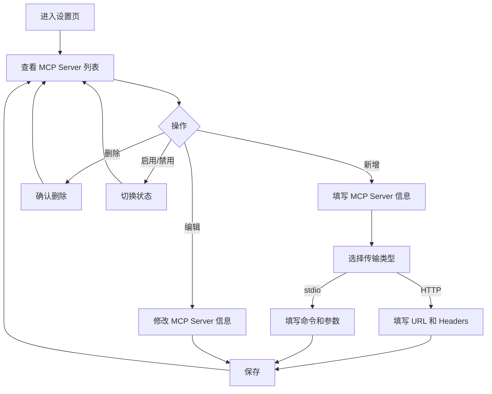
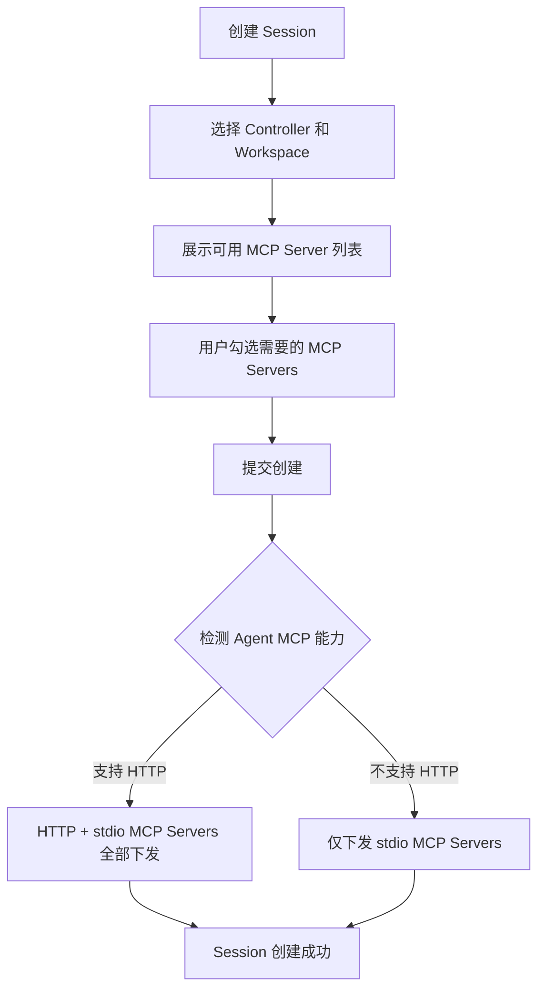

# MCP代理服务管理与配置下发

**功能名称**: MCP代理服务与配置下发
**PRD 版本**: v1.0
**创建日期**: 2026-05-30
**作者**: ZeroAsh

## 一、背景与目标

### 1.1 背景

ACP（Agent Client Protocol）协议支持在创建 Session 时传递 `mcpServers` 参数，让 Agent 连接外部 MCP 服务器获取额外工具能力。例如，用户可以让 Agent 连接 GitHub MCP Server 来操作 GitHub 仓库，或连接数据库 MCP Server 来查询数据。

当前平台的 ACP Session 创建流程中，`mcpServers` 参数始终为空，用户无法为 Agent 配置外部 MCP 服务器。这限制了 Agent 的能力扩展。

### 1.2 目标

1. 用户可以在平台上统一管理外部 MCP Server 配置（增删改查）
2. 创建 Session 时，用户可以选择要使用的 MCP Servers
3. 平台自动检测 Agent 的 MCP 传输能力，选择合适的传输方式下发配置

### 1.3 成功标准

- 用户可以成功创建、编辑、删除、启用/禁用 MCP Server 配置
- 创建 Session 时选择的 MCP Servers 能正确传递给 Agent
- 当 Agent 支持 HTTP MCP 时，HTTP 类型的 MCP Server 能正常工作
- 当 Agent 不支持 HTTP MCP 时，仅下发 stdio 类型的 MCP Server

## 二、用户分析

### 2.1 目标用户

使用 Agent 进行开发工作的用户，需要 Agent 具备访问外部服务（如 GitHub、数据库、文件系统等）的能力。

### 2.2 用户场景

| 场景 | 用户角色 | 目标 | 痛点 |
|------|---------|------|------|
| 使用 Agent 操作 GitHub | 开发者 | 让 Agent 能创建 PR、管理 Issue | Agent 无法直接访问 GitHub API |
| 使用 Agent 查询数据库 | 开发者 | 让 Agent 能查询和分析数据 | Agent 无法连接数据库 |
| 使用 Agent 管理文件 | 开发者 | 让 Agent 能跨目录操作文件 | Agent 文件操作受限于工作目录 |
| 复用已有 MCP 配置 | 开发者 | 多个 Session 共享同一套 MCP Server | 每次都要重新配置 |

## 三、功能需求

### 3.1 功能概述

用户可以在平台上管理 MCP Server 配置，并在创建 Agent Session 时选择要使用的 MCP Servers，平台根据 Agent 能力自动选择传输方式下发配置。

### 3.2 功能列表

#### 功能点 1: MCP Server 配置管理

- **描述**: 用户可以创建、编辑、删除、启用/禁用 MCP Server 配置。支持两种传输类型：
  - **HTTP**: 通过 URL 连接远程 MCP Server，可配置认证 Headers
  - **stdio**: 通过本地命令启动 MCP Server，可配置启动参数和环境变量
- **用户价值**: 一次配置，多次复用。用户无需每次创建 Session 时都输入 MCP Server 信息。
- **验收标准**:
  - [ ] 用户可以创建 HTTP 类型的 MCP Server（填写名称、URL、Headers）
  - [ ] 用户可以创建 stdio 类型的 MCP Server（填写名称、命令、参数）
  - [ ] 用户可以编辑已有 MCP Server 的配置
  - [ ] 用户可以删除不需要的 MCP Server
  - [ ] 用户可以启用/禁用 MCP Server（禁用后不会下发给 Agent）

#### 功能点 2: Session 创建时选择 MCP Servers

- **描述**: 创建 Session 时，用户可以从已配置的 MCP Server 列表中选择本次 Session 要使用的 MCP Servers。
- **用户价值**: 灵活控制每个 Session 的工具能力，不同 Session 可以使用不同的 MCP Server 组合。
- **验收标准**:
  - [ ] 创建 Session 的界面展示用户已启用的 MCP Server 列表
  - [ ] 用户可以勾选/取消勾选 MCP Server
  - [ ] 未选择任何 MCP Server 时，Session 正常创建（MCP 列表为空）
  - [ ] 选择的 MCP Server 信息正确传递给 Agent

#### 功能点 3: Agent MCP 能力检测与传输方式自动选择

- **描述**: 平台在检测 Agent 能力时，同时检测其 MCP 传输能力（是否支持 HTTP、SSE）。创建 Session 时，平台根据 Agent 能力自动选择传输方式：
  - Agent 支持 `mcpCapabilities.http` → HTTP 类型 MCP Server 使用 HTTP 传输
  - Agent 不支持 HTTP → 仅下发 stdio 类型的 MCP Server，跳过 HTTP 类型
- **用户价值**: 用户无需关心 Agent 的技术细节，平台自动处理兼容性。
- **验收标准**:
  - [ ] Agent 能力检测结果中包含 MCP 传输能力（http/sse）
  - [ ] 当 Agent 支持 HTTP 时，HTTP MCP Server 正确下发
  - [ ] 当 Agent 不支持 HTTP 时，HTTP MCP Server 被自动跳过，不报错
  - [ ] stdio 类型的 MCP Server 始终下发（不受 Agent 能力影响）

### 3.3 用户操作流程

#### MCP Server 配置管理流程

#### Session 创建时选择 MCP Servers 流程

### 3.4 页面/界面描述

| 页面 | 描述 | 关键元素 |
|------|------|---------|
| MCP Server 列表页 | 展示用户所有 MCP Server 配置 | 列表（名称、传输类型、URL/命令、状态）、新增按钮、编辑/删除/启禁用操作 |
| MCP Server 新增/编辑弹窗 | 填写 MCP Server 配置信息 | 名称输入框、传输类型选择（HTTP/stdio）、URL 输入框（HTTP）、Headers 编辑器（HTTP）、命令输入框（stdio）、参数输入框（stdio） |
| Session 创建页 | 创建 Session 时选择 MCP Servers | MCP Server 多选列表，展示名称和传输类型 |

### 3.5 异常与边界情况

| 情况 | 预期行为 |
|------|---------|
| Agent 不支持 HTTP MCP | 自动跳过 HTTP 类型 MCP Server，仅下发 stdio 类型 |
| 选择的 MCP Server 已被禁用 | 不下发该 MCP Server |
| 选择的 MCP Server 已被删除 | 不下发该 MCP Server，Session 正常创建 |
| MCP Server URL 无法访问 | Agent 连接 MCP Server 失败，Session 仍可正常使用（无 MCP 工具） |
| 未选择任何 MCP Server | Session 正常创建，Agent 无额外 MCP 工具 |
| Agent 能力检测超时 | 默认不支持 HTTP，仅下发 stdio 类型 |

## 四、非功能需求

### 4.1 性能要求

- MCP Server 配置查询响应时间 < 100ms
- Agent MCP 能力检测结果缓存 1 小时，避免频繁检测

### 4.2 安全性要求

- MCP Server 配置中的敏感信息（如 API Key）存储时应考虑安全性
- HTTP Headers 中的认证信息仅在创建 Session 时传递给 Controller，不持久化到 Session 记录

### 4.3 兼容性要求

- 兼容现有 ACP 协议 v1
- 兼容 stdio 和 HTTP 两种 MCP 传输方式
- 向后兼容：未选择 MCP Server 时，行为与当前一致

## 五、依赖与约束

### 5.1 依赖

| 依赖项 | 说明 |
|--------|------|
| ACP 协议 v1 | MCP Server 配置通过 ACP `session/new` 的 `mcpServers` 参数传递 |
| Agent MCP 能力 | Agent 需要支持 `mcpCapabilities.http` 才能使用 HTTP 类型 MCP Server |
| MCP Server 标准 | 外部 MCP Server 需要实现标准 MCP 协议 |

### 5.2 约束

- HTTP 类型 MCP Server 要求 Agent 支持 `mcpCapabilities.http`
- stdio 类型 MCP Server 要求命令在 Controller 所在机器上可用
- MCP Server 配置为用户级别，不同用户独立管理

## 六、相关文档

- [Issue #93: MCP代理服务与MCP配置下发](https://github.com/Deliay/z-agent-gear/issues/93)
- [ACP 协议: Session Setup - MCP Servers](https://agentclientprotocol.com/protocol/session-setup#mcp-servers)
- [ACP 协议: Initialization - MCP Capabilities](https://agentclientprotocol.com/protocol/initialization#mcp-capabilities)
