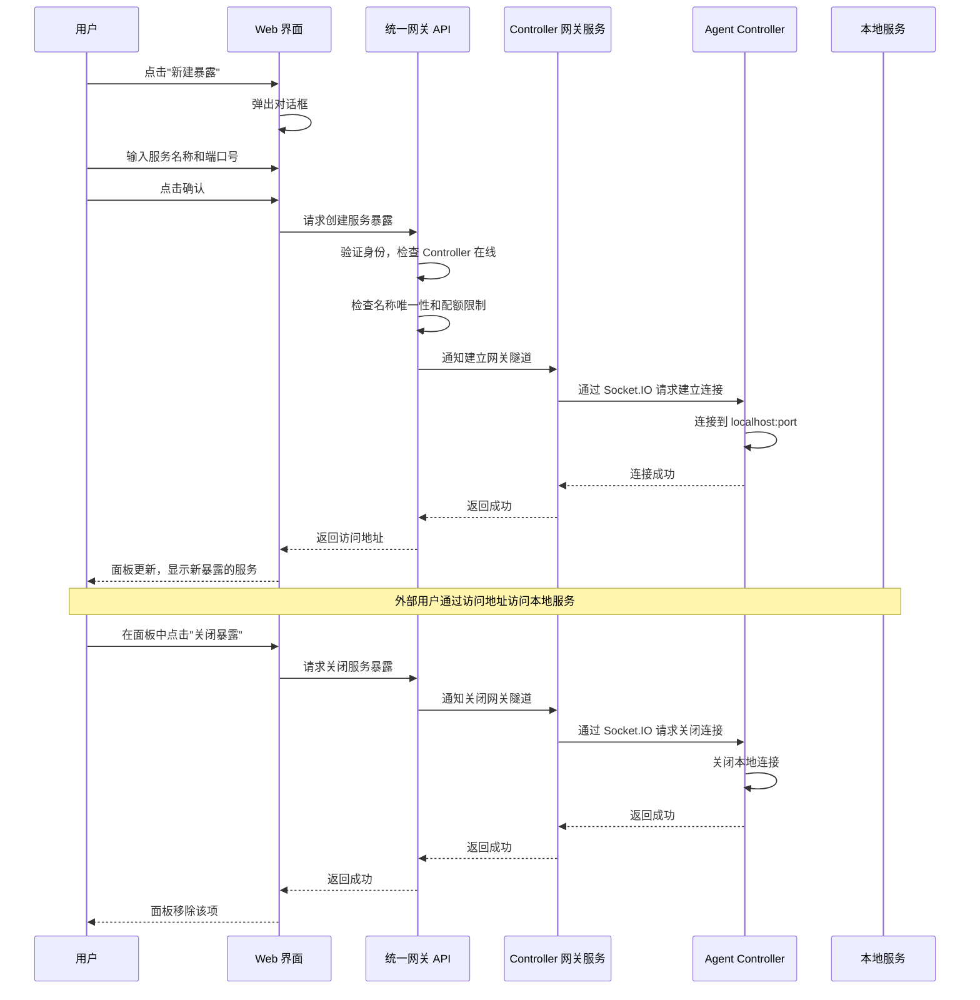

# 统一网关功能

**功能名称**: 统一网关 (Unified Gateway)
**PRD 版本**: v1.0
**创建日期**: 2026-07-07
**作者**: ZeroAsh

## 背景与目标

### 1.1 背景

用户在使用 local-agent-controller 进行开发时，经常需要将本地的服务（Web 应用、API 服务、WebSocket 服务等）暴露给外部访问。当前已有的"端口转发"功能以端口号为粒度进行暴露，用户需要手动输入端口号并记住映射关系，使用门槛较高，难以直观表达"暴露某个服务"的意图。

此外，随着用户使用深度增加，出现了更多场景需求：
- 同一台机器上运行多个同端口不同协议的服务
- 需要标记和管理暴露的服务（名称、描述等元信息）
- 需要临时分享给团队成员，对访问进行控制

将原有"端口转发"升级为"统一网关"，从"暴露端口"转变为"暴露服务"，提供更加直观、易用、可管理的能力。

### 1.2 目标

1. 将"端口转发"升级为"统一网关"，以"服务暴露"为产品语义，而非"端口映射"
2. 用户能够直观地暴露 Controller 所在服务器上的任意 TCP 服务
3. 支持对暴露的服务进行命名和管理，降低使用门槛
4. 保持原有安全性和隔离性，确保访问受控

### 1.3 成功标准

- 用户在 3 次点击内完成一个服务的暴露
- 用户能够直观地查看所有已暴露的服务及其状态
- 90% 的新用户能够无需文档理解如何使用
- 原有端口转发用户平滑迁移，无功能损失

## 用户分析

### 2.1 目标用户

- 前端开发人员：需要暴露本地开发服务给第三方回调或联调
- 后端开发人员：需要暴露本地 API 给移动端或外部系统测试
- 全栈开发人员：需要同时暴露前后端多个服务进行集成测试
- 技术团队负责人：需要临时查看或演示团队成员的本地开发环境

### 2.2 用户场景

| 场景 | 用户角色 | 目标 | 痛点 |
|------|----------|------|------|
| Webhook 回调测试 | 前端开发 | 让第三方服务（如支付宝回调）访问本地 API | 需要公网可访问的 URL，端口号难以记忆 |
| 移动端调试 | 移动开发 | 让真机访问本地开发中的 Web 应用 | 手机无法直接访问 localhost，需额外配置 |
| 团队协作演示 | 团队负责人 | 临时分享本地开发环境给异地同事 | 需要复杂的网络配置或第三方工具 |
| 多服务联调 | 全栈开发 | 同时暴露前端(3000)和后端(8080)进行集成测试 | 需要管理多个端口映射，容易混淆 |
| API 文档分享 | 后端开发 | 将本地 Swagger 文档暴露给前端同事查看 | 每次重启需要重新分享地址 |

## 功能需求

### 3.1 功能概述

统一网关允许用户将 Controller 所在服务器上的本地服务通过一个安全的公网可访问地址暴露给外部。用户只需指定本地服务的端口号，并为其命名，系统即生成一个唯一的访问地址。网关以 Controller 为粒度管理，每个 Controller 最多同时暴露 5 个服务。

### 3.2 功能列表

#### 功能点 1: 服务暴露管理
- **描述**: 用户可以创建、查看、关闭服务的公网暴露。暴露以 Controller 为粒度，独立于 Session 生命周期。用户需要为每个暴露的服务指定名称和端口号。
- **用户价值**: 从"端口映射"转变为"服务暴露"，语义更清晰，管理更直观
- **验收标准**:
  - [ ] 用户能够为已连接的 Controller 创建服务暴露
  - [ ] 创建时需要提供服务名称（必填）和端口号（必填）
  - [ ] 用户能够查看当前 Controller 的所有暴露服务列表
  - [ ] 列表显示服务名称、端口号、访问地址和状态
  - [ ] 用户能够关闭指定的服务暴露
  - [ ] 服务暴露独立于 Session 生命周期

#### 功能点 2: 服务命名与标识
- **描述**: 每个暴露的服务需要有一个用户可识别的名称，用于列表展示和管理。名称在同一 Controller 下唯一。
- **用户价值**: 用户不再需要记忆端口号，通过服务名称即可识别和管理
- **验收标准**:
  - [ ] 创建时必须提供服务名称（1-50 字符）
  - [ ] 同一 Controller 下服务名称不可重复
  - [ ] 列表中以名称为主要标识展示
  - [ ] 支持修改服务名称

#### 功能点 3: 访问地址与一键复制
- **描述**: 每个暴露的服务自动生成唯一的公网可访问地址，用户可一键复制该地址分享给他人。
- **用户价值**: 降低分享成本，无需手动拼接地址
- **验收标准**:
  - [ ] 每个服务暴露后自动生成访问地址
  - [ ] 地址格式为可读的 `{host}/gateway/{controllerId}/{serviceName}`
  - [ ] 提供一键复制功能
  - [ ] 地址在服务暴露期间持续可用

#### 功能点 4: 暴露数量限制
- **描述**: 单个 Controller 最多同时暴露 5 个服务
- **用户价值**: 防止资源滥用，保证系统稳定性
- **验收标准**:
  - [ ] 系统限制单个 Controller 最多 5 个服务暴露
  - [ ] 达到限制时给出清晰的错误提示
  - [ ] 用户能够查看当前已使用的数量配额

#### 功能点 5: 独立生命周期
- **描述**: 服务暴露的生命周期独立于 Session，仅与 Controller 的连接状态相关
- **用户价值**: 用户无需担心 Session 重启导致暴露丢失
- **验收标准**:
  - [ ] Session 结束或重启时，服务暴露不受影响
  - [ ] 只有 Controller 断开连接时，服务暴露才会自动关闭
  - [ ] Controller 重连后，之前的暴露不会自动恢复（需用户手动重新创建）

#### 功能点 6: 安全访问
- **描述**: 所有暴露的服务均需鉴权才能访问
- **用户价值**: 保证暴露服务的安全性，防止未授权访问
- **验收标准**:
  - [ ] 访问暴露的服务需要有效的身份认证
  - [ ] 不同用户的暴露服务相互隔离
  - [ ] 内部通信不暴露给外部网络

#### 功能点 7: 网关面板展示
- **描述**: 在侧边栏中，Controller 节点下增加"统一网关"分类，展示该 Controller 下所有暴露的服务
- **用户价值**: 用户可以直观地查看和管理所有已暴露的服务
- **验收标准**:
  - [ ] 侧边栏中每个 Controller 节点下显示"统一网关"分类
  - [ ] 分类下展示服务名称、端口号和状态
  - [ ] 支持在面板中直接删除服务暴露
  - [ ] 支持一键复制访问地址

#### 功能点 8: 新建暴露对话框
- **描述**: 用户点击新建暴露时弹出对话框，输入服务名称和目标端口号
- **用户价值**: 简洁明了的交互方式
- **验收标准**:
  - [ ] 点击新建按钮后弹出对话框
  - [ ] 对话框中包含服务名称输入框（1-50字符，必填）
  - [ ] 对话框中包含端口号输入框（1-65535，必填）
  - [ ] 输入框带基本校验
  - [ ] 确认后创建暴露，取消则关闭对话框

### 3.3 用户操作流程

### 3.4 页面/界面描述

| 页面 | 描述 | 关键元素 |
|------|------|----------|
| 侧边栏面板 | 在 Controller 节点下显示"统一网关"分类 | Controller 节点、网关分类、暴露服务列表项 |
| 新建暴露对话框 | 让用户输入服务名称和目标端口号 | 服务名称输入框、端口号输入框、确认按钮、取消按钮 |
| 暴露服务列表项 | 显示单个暴露服务的名称、端口、状态和访问地址 | 服务名称、端口号、访问地址/复制按钮、状态标识、删除按钮 |

### 3.5 异常与边界情况

| 情况 | 预期行为 |
|------|----------|
| Controller 未连接 | 提示"控制器未连接，无法创建暴露" |
| 已达到 5 个服务限制 | 提示"单个控制器最多同时暴露 5 个服务，请先关闭其他暴露" |
| 服务名称已存在 | 提示"该服务名称已被使用，请更换名称" |
| 本地端口无服务监听 | 提示"目标端口无服务运行，请检查本地服务是否已启动" |
| 端口号无效（非 1-65535） | 提示"请输入 1-65535 之间的端口号" |
| 服务名称格式不正确 | 提示"服务名称需要 1-50 个字符，仅支持字母、数字、中划线和下划线" |
| 网络连接中断 | 自动重连，重连失败后提示用户 |
| 用户无权访问该 Controller | 提示"无权访问该控制器" |
| 网关服务不可用 | 提示"网关服务暂时不可用，请稍后再试" |

## 四、非功能需求

### 4.1 性能要求

- 服务暴露创建延迟：< 2 秒
- 网关代理延迟：额外增加 < 100ms（相比直接访问）
- 并发连接支持：每个暴露服务至少支持 100 个并发连接
- 内存占用：每个暴露服务占用 < 50MB

### 4.2 安全性要求

- 所有暴露服务访问必须经过身份验证
- 不同用户的暴露服务完全隔离
- 内部通信不暴露给外部网络
- 防止端口扫描和暴力破解

### 4.3 兼容性要求

- 支持任意 TCP 端口的服务暴露
- 兼容 HTTP/HTTPS/WebSocket 等应用层协议
- 兼容主流操作系统（Windows、macOS、Linux）

## 五、依赖与约束

### 5.1 依赖

- 用户认证系统：提供身份验证和权限管理
- Controller 管理系统：提供 Controller 连接状态管理
- 本地控制器：提供到本地端口的数据通道能力
- 实时通信系统：提供系统服务与本地控制器之间的实时通信

### 5.2 约束

- 单个 Controller 最多同时暴露 5 个服务
- 服务暴露独立于 Session 生命周期
- 只有已连接的 Controller 才能创建暴露
- 内部通信只能被系统服务访问，不暴露给外部

## 六、相关文档

- [端口转发功能 PRD v1.1（现有功能将被升级替代）](../released/20260527-port-forwarding-for-local-agent-controller.md)
- [端口转发技术方案](../engineering/proposals/20260527-feat-port-forwarding.md)
- [Controller 管理 PRD](../released/20260517-agent-controller-v1.md)
