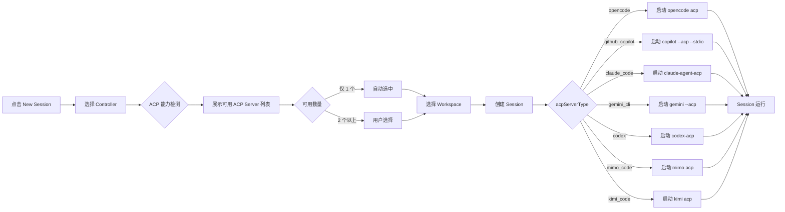

# ACP Server 支持 MiMo Code / Kimi Code CLI

**功能名称**: ACP Server 支持 MiMo Code / Kimi Code CLI
**PRD 版本**: v1.0
**创建日期**: 2026-07-21
**作者**: ZeroAsh

## 背景与目标

### 1.1 背景

z-agent-gear 目前已支持 OpenCode、GitHub Copilot、Claude Code、Gemini CLI、Codex 共五种 ACP Server。AI 编码助手生态持续扩张，两款新的 CLI 工具获得了大量用户关注并已支持 ACP 协议：

- **MiMo Code**（Xiaomi）：小米 MiMo 团队推出的终端 AI 编码助手，MIT 开源，支持 ACP 模式
- **Kimi Code CLI**（Moonshot AI）：月之暗面推出的终端 AI 编码助手，支持 ACP 模式

用户对这两款工具的集成需求日益增长。系统架构已经为多 ACP Server 做好了准备，扩展新的 Server 类型不需要架构变更，仅在现有枚举和检测逻辑上增量添加。

### 1.2 目标

- 支持 MiMo Code 作为新的可选 ACP Server
- 支持 Kimi Code CLI 作为新的可选 ACP Server
- 两种新 Server 的检测、启动、消息通信、关闭等完整生命周期与现有 Server 保持一致
- 用户在创建 Session 时可从全部可用 ACP Server 中自由选择
- 已安装的 Server 自动检测并上报，无需用户手动配置

### 1.3 成功标准

- [ ] 控制器上安装了 MiMo Code 时，检测结果包含 `mimo_code`，前端可看到该选项
- [ ] 控制器上安装了 Kimi Code CLI 时，检测结果包含 `kimi_code`，前端可看到该选项
- [ ] 两种新 Server 的 Session 能够正常创建、收发消息、取消、关闭
- [ ] 旧 Session（opencode / github_copilot / claude_code / gemini_cli / codex）兼容性不受任何影响
- [ ] 任意组合安装时，前端只显示已安装的可用选项
- [ ] 两种新 Server 的版本号在检测结果中正常展示
- [ ] 历史会话导入功能支持在多个 ACP Server 中选择，不限已有的五种

## 用户分析

### 2.1 目标用户

- 已安装 MiMo Code 并希望从 z-agent-gear Web 界面调用的用户
- 已安装 Kimi Code CLI 并希望从 z-agent-gear Web 界面调用的用户
- 持有多款 AI 编码工具，希望在统一界面中根据任务需求灵活切换的用户
- 希望在同一环境中对比不同 Agent 表现的用户

### 2.2 用户场景

| 场景 | 用户角色 | 目标 | 痛点 |
|--|--|--|--|
| MiMo Code 已有用户 | AI 应用开发者 | 在 Web 界面中继续使用 MiMo Code 进行编码 | 被迫在终端中操作 MiMo Code，无法享受 z-agent-gear Web 界面的便利 |
| Kimi 生态用户 | 全栈开发者 | 在项目中利用 Kimi Code CLI 的强大编码能力 | 只能在终端中使用，无法集成到 Web 工作流 |
| 多 Agent 工作流 | 全栈开发者 | 根据不同任务灵活切换不同 Agent | 需要在多个终端窗口间切换，无法统一管理 |
| Agent 选型评估 | 技术负责人 | 在团队中评估哪个 AI Agent 最适合项目需求 | 缺乏在统一工作环境中对比不同 Agent 的能力 |
| 国产 AI 生态用户 | 开发者 | 使用国产优秀 AI 编码工具提升开发效率 | 不同工具各自独立，无法统一调度 |

## 功能需求

### 3.1 功能概述

在已支持的五种 ACP Server 基础上，新增 MiMo Code 和 Kimi Code CLI 两种 ACP Server。控制器端扩展检测逻辑，同时检测新 Server 是否可用；前端新建 Session 流程中自动展示所有可用选项；Session 生命周期行为与现有 Server 保持一致。

### 3.2 功能列表

#### 功能点 1: 新 ACP Server 检测

- **描述**: 在现有检测逻辑基础上，增加对 MiMo Code 和 Kimi Code CLI 的检测。检测方式为验证对应 CLI 是否已安装并可执行。检测结果包含版本号和可用状态，与现有检测机制共享同一个缓存策略。
  - MiMo Code 检测: `mimo --version`
  - Kimi Code CLI 检测: `kimi --version`
- **用户价值**: 系统自动发现新安装的 AI 工具，用户无需任何配置即可使用
- **验收标准**:
  - [ ] 安装了 MiMo Code 时，检测结果包含 `mimo_code` 及版本号
  - [ ] 安装了 Kimi Code CLI 时，检测结果包含 `kimi_code` 及版本号
  - [ ] 未安装时，对应 Server 的 available 为 false，不向前端展示
  - [ ] 检测结果复用现有缓存机制（1h TTL）

#### 功能点 2: 新 ACP Server 的 Session 生命周期

- **描述**: 用户选择新 Server 创建的 Session，在控制器端启动对应 CLI 的 ACP 进程，通过 ACP 协议转发消息。消息发送/接收、取消生成、关闭 Session、Session 重连等行为与现有 Server 保持一致。
  - MiMo Code 启动指令: `mimo acp`
  - Kimi Code CLI 启动指令: `kimi acp`
- **用户价值**: 用户获得与现有 Server 完全一致的 Web 交互体验
- **验收标准**:
  - [ ] acpServerType 为 `mimo_code` 的 Session 正常启动 `mimo acp` 进程
  - [ ] acpServerType 为 `kimi_code` 的 Session 正常启动 `kimi acp` 进程
  - [ ] 两种新 Server 的消息发送和接收行为与现有 Server 一致
  - [ ] 取消生成、关闭 Session 等操作正常
  - [ ] Session 重连行为正常

#### 功能点 3: 历史会话导入支持多 ACP Server 扩展

- **描述**: 从工作目录导入历史会话时，用户可以选择使用哪个 ACP Server 来执行 `session/list` 和 `session/load` 操作。扩展支持 `mimo_code` 和 `kimi_code` 两种新类型。
- **用户价值**: 用户可以从同一个工作目录导入任意 ACP Server 产生的历史会话数据
- **验收标准**:
  - [ ] 历史会话导入流程中支持指定 `mimo_code` 和 `kimi_code` 作为 acpServerType
  - [ ] 使用 `mimo_code` Server 能正确列出并导入其持久化的历史会话
  - [ ] 使用 `kimi_code` Server 能正确列出并导入其持久化的历史会话
  - [ ] 导入后的 Session 记录正确标记对应的 acpServerType

#### 功能点 4: ACP Server 类型展示

- **描述**: 新建 Session 的 ACP Server 选择器中包含全部可用选项。Session 列表和详情页展示对应 ACP Server 类型的可读名称（"MiMo Code" / "Kimi Code" 与其他已有类型并列）。
- **用户价值**: 用户随时了解每个 Session 正在使用的 Agent 类型，选择时一目了然
- **验收标准**:
  - [ ] 新建 Session 时 ACP Server 下拉列表包含全部可用 Server，每个选项显示名称和版本
  - [ ] Session 列表页每条记录显示 acpServerType 的可读标签
  - [ ] Session 详情页 Header 区域显示 acpServerType 可读标签

### 3.3 用户操作流程

### 3.4 页面/界面描述

| 页面 | 描述 | 关键元素 |
|------|------|---------|
| 新建 Session 弹框 | 选择 Controller 后显示可用 ACP Server 下拉列表，包含全部已检测到的 Server，新增 "MiMo Code" 和 "Kimi Code" | ACP Server 下拉选择器（显示名称+版本），默认选中第一个可用选项 |
| 历史会话导入弹框 | 选择 Workspace 后显示该目录下的历史会话，用户可通过 ACP Server 下拉筛选/指定导入来源 | ACP Server 下拉选择器，会话列表，导入按钮 |
| Session 详情页 | 顶部 Header 区域显示 acpServerType 标签，新增 "MiMo Code" / "Kimi Code" 标签 | 在 Controller 名称旁显示小标签 |
| Session 列表页 | 每条 Session 记录显示 acpServerType | 列表每行显示 ACP Server 类型标签 |

### 3.5 异常与边界情况

| 情况 | 预期行为 |
|------|---------|
| 用户选择 MiMo Code 但未安装 | 检测时 available=false，下拉列表中不出现，不会让用户选到 |
| 用户选择 Kimi Code 但未安装 | 检测时 available=false，下拉列表中不出现，不会让用户选到 |
| 新 Server 进程启动失败或崩溃 | 与现有行为一致 — Session 状态变为 ended，前端提示错误 |
| 用户同时安装 7 种 ACP Server | 下拉列表完整显示 7 个选项，默认选中第一个 |
| 旧 Session（之前 5 种）回看 | 完全不受影响，正常展示历史消息 |
| 新 Server 的 ACP 协议版本有差异 | 启动时 SDK 层协商版本，功能降级由 SDK 处理，不影响基础消息通信 |
| 控制器没有任何 ACP Server | 前端显示"无可用 Server"提示，无法创建 Session |

## 非功能需求

### 4.1 性能要求

- 单 Server 检测时间不超过 2s，新增 2 个 Server 后总检测时间不超过 8s（并行检测）
- Session 启动时间与现有 Server 一致，不超过 5s

### 4.2 安全性要求

- 各 CLI 工具的认证凭据由用户自行在本地管理，系统不存储任何第三方凭据
- ACP 协议通信加密与现有实现一致（WebSocket/SSE over HTTPS）

### 4.3 兼容性要求

- 现有五种 ACP Server Session 完全不受影响
- 历史数据无需迁移
- 不支持 Session 创建后切换 acpServerType
- 新 Server 的协议能力差异不做对齐，仅保证基础 ACP 消息通信可用（文本消息的发送和接收）

## 依赖与约束

### 5.1 依赖

- MiMo Code CLI 已在控制器上安装
- Kimi Code CLI 已在控制器上安装

### 5.2 约束

- 本项目不负责各 CLI 工具的安装和认证流程，这些由用户自行完成
- 新增 ACP Server 类型需要定义对应的 enum 值并更新所有相关模块
- MiMo Code 和 Kimi Code CLI 可能独立于本项目的版本迭代，协议兼容性由 CLI 各自保证

## 相关文档

- [ACP Server 支持扩展 PRD](./released/20260705-acp-server-extend.md)
- [多 ACP Server 支持 PRD](./released/20260526-multi-acp-server-support.md)
- [Agent 拉起与交互 PRD](./released/20260518-agent-session-interaction.md)
- [Agent Client Protocol 官方文档](https://agentclientprotocol.com/)
