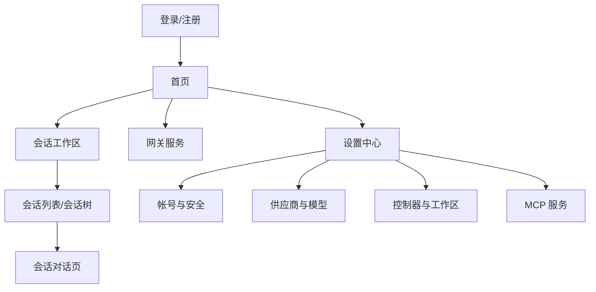
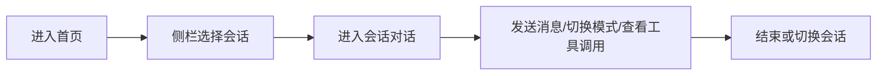

# 整体前端设计优化

**功能名称**: 整体前端设计优化（设计语言升级与视觉重构）
**PRD 版本**: v1.0
**创建日期**: 2026-07-21
**作者**: kimi-cli

## 背景与目标

### 1.1 背景

产品经过多期功能迭代（会话、工作区、网关、GitHub 绑定、MCP 等），功能日趋完整，但界面体验存在以下问题：

1. **缺乏统一的设计语言**：界面没有品牌色，整体为默认灰阶风格；同类元素（如主按钮、状态标识）在不同页面呈现不一致的样式，产品缺乏辨识度。
2. **功能分区不清晰**：首页仅为一句占位文案；导航与会话列表、设置、网关等功能之间缺少清晰的层级与分组，新用户难以建立对产品结构的心智模型。
3. **暗色模式体验不完整**：已提供暗色模式切换能力，但大量界面元素在暗色下对比度不足甚至不可读，暗色模式处于"半成品"状态。
4. **文案语言混杂**：界面中英文混杂（例如同一产品中同时出现"新建"与 "New Session"、"设置"与 "Close / Continue / Delete"），影响专业感与一致性。
5. **图标与视觉元素风格不统一**：同一界面混用表情符号、字符箭头与图形图标，视觉品质参差。

### 1.2 目标

1. 建立一套完整的、具有品牌辨识度的设计语言（色彩、字体排版、间距、圆角、阴影、图标、动效），并覆盖全部页面。
2. 重新梳理功能分区与导航结构，让"会话工作"、"设置管理"、"网关服务"等区域边界清晰、层级合理。
3. 暗色模式达到与亮色模式同等完整、可用的体验。
4. 界面文案统一为简体中文（技术专有名词除外）。
5. 不改变现有功能逻辑与用户已习得的核心操作流程，不改变后端服务接口。

### 1.3 成功标准

| 指标 | 目标 |
|------|------|
| 设计语言覆盖 | 全部页面应用统一设计语言，同类元素视觉表现一致 |
| 暗色模式完整性 | 全部页面在暗色模式下无不可读、无明显对比度问题；关键文本对比度达到 WCAG AA（≥ 4.5:1） |
| 文案一致性 | 界面文案 100% 简体中文（专有名词除外），无中英混排的操作文案 |
| 功能回归 | 现有全部功能操作路径不变，重构后无功能回归 |
| 功能分区 | 用户从任意页面出发，不超过 2 次点击即可到达任一功能区 |

## 用户分析

### 2.1 目标用户

- **个人开发者（主要）**：在本地或私有环境部署本系统，通过浏览器管理多个 Agent 会话、工作区与服务配置，使用频率高、单次使用时长长。
- **多端使用者**：在桌面与移动端浏览器上交替使用，期望两端体验一致且各自合理。

### 2.2 用户场景

| 场景 | 用户角色 | 目标 | 痛点 |
|------|----------|------|------|
| 日常会话工作 | 个人开发者 | 快速找到目标会话并继续对话 | 会话列表层级与状态标识不直观，新建入口样式与其他页面不一致 |
| 长时间使用 | 个人开发者 | 在暗色环境下舒适使用 | 暗色模式下部分状态标识、加载指示不可读 |
| 配置管理 | 个人开发者 | 集中管理帐号、供应商、模型、控制器、MCP 等配置 | 设置页信息密集、分节视觉层级弱，移动端与桌面端导航体验割裂 |
| 首次进入产品 | 新用户 | 理解产品结构，知道下一步该做什么 | 首页只有占位文案，无引导、无产品全貌 |
| 网关服务管理 | 个人开发者 | 查看和管理对外暴露的服务入口 | 网关区域与会话区域视觉权重、布局逻辑不一致 |

## 功能需求

### 3.1 功能概述

对全部界面进行一次整体的设计语言升级与视觉重构：定义并落地统一的设计语言，重组功能分区与导航，补全暗色模式，统一文案与图标体系，优化首页引导。不改变任何功能的业务逻辑与后端接口。

### 3.2 功能列表

#### 功能点 1: 统一设计语言

- **描述**: 建立一套覆盖色彩（含品牌主色与语义色）、字体排版层级、间距节奏、圆角、阴影层级、图标风格与基础动效的设计语言，并应用到全部页面。同类元素（主按钮、次级按钮、危险操作、状态标识、卡片、表单控件）在所有页面呈现一致的视觉与交互反馈。
- **用户价值**: 产品具备品牌辨识度与专业感；一致的视觉语言降低学习成本，用户在任何页面都能凭直觉识别元素含义。
- **验收标准**:
  - [ ] 全部页面呈现统一的品牌主色与语义色体系，无页面间同类元素样式漂移
  - [ ] 主按钮、状态标识、表单控件等在所有页面视觉一致
  - [ ] 标题、正文、辅助文字有清晰统一的字号与字重层级
  - [ ] 全部图标为统一的图形图标风格，无表情符号或字符符号充当图标

#### 功能点 2: 功能分区与导航重构

- **描述**: 重新组织产品信息架构：以"会话"为核心工作区，"设置"为配置中心，"网关"为服务管理区，三者在导航中有清晰分组与一致的入口样式。桌面端与移动端导航结构一致、形态各自适配。
- **用户价值**: 用户能快速建立产品结构心智模型，在任何页面都能明确"我在哪、能去哪"。
- **验收标准**:
  - [ ] 导航中功能区分组清晰，当前所在区域有明确的选中态反馈
  - [ ] 任意功能区之间不超过 2 次点击可达
  - [ ] 桌面端与移动端导航信息架构一致

#### 功能点 3: 首页与空状态引导

- **描述**: 将占位首页升级为有价值的产品首页：展示产品全貌（会话概况、最近活动、快捷入口），并在各列表为空时提供明确的空状态说明与下一步引导。
- **用户价值**: 新用户进入产品即理解结构与下一步动作；老用户可快速回到最近工作。
- **验收标准**:
  - [ ] 首页展示会话概况与快捷入口，不再是占位文案
  - [ ] 各列表空状态有统一的插画/图标 + 说明文案 + 引导操作

#### 功能点 4: 暗色模式完整化

- **描述**: 补全全部页面在暗色模式下的视觉适配，包括状态标识、加载指示、消息气泡、表单、图表色等，确保暗色下可读性与亮色一致。
- **用户价值**: 长时间使用与暗色环境下的舒适体验，暗色模式从"可切换"变为"可日用"。
- **验收标准**:
  - [ ] 逐页走查暗色模式，无不可读文本、无刺眼色块
  - [ ] 关键文本与背景对比度 ≥ 4.5:1（WCAG AA）
  - [ ] 状态颜色在亮/暗两套模式下语义一致且均可辨识

#### 功能点 5: 界面文案统一

- **描述**: 全部界面文案统一为简体中文；技术专有名词（如 Session、Worktree、MCP 等业界通用术语）保留原文并制定统一术语表。同类操作文案措辞统一（如关闭/删除/继续类操作的命名规则）。
- **用户价值**: 语言一致提升专业感与可理解性，降低中英文切换的认知负担。
- **验收标准**:
  - [ ] 操作类文案（按钮、菜单、提示、报错）100% 简体中文
  - [ ] 建立术语表，同一概念全产品使用同一译法/原文
  - [ ] 提示与报错文案语气统一、对用户有行动指导

#### 功能点 6: 核心页面视觉重构

- **描述**: 基于新设计语言重构三个核心区域的视觉：会话页（消息流、输入区、头部信息层级）、设置页（分节导航与内容层级、信息密度）、登录/注册页（品牌呈现）。
- **用户价值**: 高频使用页面获得更清晰的信息层级与更舒适的视觉节奏。
- **验收标准**:
  - [ ] 会话页消息类型（用户/Agent/工具调用/计划等）有清晰一致的视觉区分
  - [ ] 设置页分节明确、信息层级清晰，移动端与桌面端导航实现一致体验
  - [ ] 登录/注册页呈现品牌形象，与产品内视觉一致

### 3.3 用户操作流程

重构后用户的核心操作路径保持不变，信息架构如下：

典型流程（以日常会话为例，路径与重构前一致）：

### 3.4 页面/界面描述

| 页面 | 描述 | 关键元素 |
|------|------|---------|
| 首页 | 产品全貌与快捷入口 | 会话概况、最近活动、新建会话入口、功能区导航卡片 |
| 会话工作区 | 核心工作区，会话树 + 对话页 | 统一状态标识的会话树、消息流、输入区、模式/模型切换 |
| 设置中心 | 集中配置管理 | 分节导航（帐号/供应商/模型/控制器/MCP/GitHub）、统一的节标题与卡片层级 |
| 网关服务 | 对外服务入口管理 | 网关项列表、统一的列表项与操作样式 |
| 登录/注册 | 品牌门面 | 品牌标识、统一表单样式、错误提示 |

### 3.5 异常与边界情况

| 情况 | 预期行为 |
|------|---------|
| 暗色模式下访问任意页面 | 全部元素可读、对比度达标，无未适配的亮色残留 |
| 列表数据为空 | 显示统一空状态（图标 + 说明 + 引导操作） |
| 移动端窄屏访问 | 布局自适应，导航与内容不错乱，功能不缺失 |
| 会话/设置数据加载失败 | 统一的错误提示样式与重试引导 |
| 超长文本（路径、会话名、消息） | 截断/换行策略统一，悬停可见完整内容 |

## 四、非功能需求

### 4.1 性能要求

- 设计语言升级不得引入可感知的性能回退：首屏加载时间、会话页消息渲染流畅度与重构前持平或更优。

### 4.2 安全性要求

- 本次重构不涉及安全模型变更。

### 4.3 兼容性要求

- 支持主流现代浏览器（Chrome / Edge / Firefox / Safari 最近两个大版本）。
- 桌面端与移动端（≥ 360px 宽度）均可用，两端信息架构一致。
- 可访问性：关键文本对比度达到 WCAG AA；交互元素有可见的焦点态。

## 五、依赖与约束

### 5.1 依赖

- 无新增外部系统依赖。

### 5.2 约束

- **非极端情况不得改变后端 API**：本次优化为纯前端范围，不改变任何后端接口与数据契约。
- 不改变现有功能的业务逻辑与用户核心操作路径。
- 建议分期实施（设计语言基础 → 核心页面 → 全量覆盖），每期可独立验收上线。

## 六、相关文档

- [[released/20260526-ui-optimization.md]] — UI 优化一期
- [[released/20260526-ui-optimization-phase2.md]] — UI 优化二期
- [[released/20260528-frontend-ui-optimization.md]] — 前端界面优化三期
- [[released/20260529-dark-mode.md]] — 黑暗模式
- [[released/20260527-mobile-layout.md]] — 移动端布局
