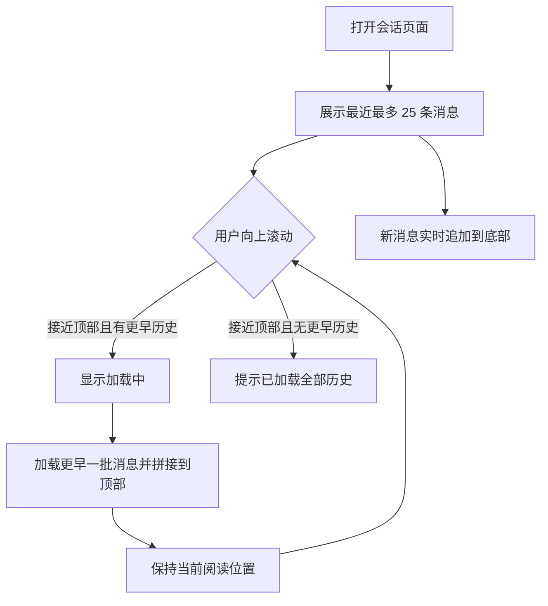

# Session 对话滚动加载

**功能名称**: Session 对话滚动加载
**PRD 版本**: v1.0
**创建日期**: 2026-07-23
**作者**: ZeroAsh

## 背景与目标

### 1.1 背景

当前打开一个 session 会话时，系统会一次性返回最近约 2 次用户发言的完整对话内容。在执行长任务时，Agent 会产生大量会话消息（工具调用、执行结果、思考过程等），导致：

- 打开会话时初始数据量大，加载慢、渲染卡顿
- 用户无法查看更早的历史对话，长任务上下文丢失

### 1.2 目标

- 打开会话时，初始加载的对话数据量最多为 **25 条消息**，保证页面快速打开
- 用户可以在对话界面**向上滚动**，自动加载更早的历史对话，直至加载完全部历史

### 1.3 成功标准

- 任意长度的会话，打开页面时初始消息数不超过 25 条
- 向上滚动可以完整浏览到会话的第一条消息，无消息丢失、无重复
- 加载历史对话时，当前阅读位置不发生跳动
- 会话进行中新消息实时到达时，不影响历史加载的正确性

## 用户分析

### 2.1 目标用户

使用 Agent 执行长任务（如代码开发、批量处理）的个人用户。

### 2.2 用户场景

| 场景 | 用户角色 | 目标 | 痛点 |
|--|--|--|--|
| 长任务执行中查看会话 | 终端用户 | 实时跟进 Agent 执行进展 | 消息量大，页面打开慢、卡顿 |
| 任务完成后回顾过程 | 终端用户 | 回溯 Agent 的完整执行过程 | 只能看到最近内容，更早的历史无法查看 |
| 重新打开历史会话 | 终端用户 | 快速恢复上下文并继续对话 | 初始加载慢，且无法浏览完整历史 |

## 功能需求

### 3.1 功能概述

会话页面初始仅加载最近 25 条消息；用户向上滚动到对话顶部时，自动向前加载更早的历史消息，直至没有更多历史。

### 3.2 功能列表

#### 功能点 1: 初始加载限量

- **描述**: 打开会话页面时，仅加载该会话最近的最多 25 条消息；新消息仍然实时追加展示。
- **用户价值**: 长会话秒开，页面渲染流畅。
- **验收标准**:
  - [ ] 消息总数超过 25 条的会话，打开页面时初始展示的消息不超过 25 条，且展示的是最近的消息
  - [ ] 消息总数不足 25 条的会话，打开页面时展示全部消息
  - [ ] 会话进行中新产生的消息实时追加展示，不受初始限量影响

#### 功能点 2: 向上滚动加载历史

- **描述**: 用户向上滚动对话，滚动位置接近对话顶部时自动加载更早的一批历史消息（每批最多 25 条），并拼接到当前对话上方；加载过程中顶部显示加载状态；没有更多历史时给出"已到最早消息"的提示。
- **用户价值**: 可以完整回溯长任务的全部执行历史。
- **验收标准**:
  - [ ] 滚动到顶部附近自动触发加载，无需点击按钮
  - [ ] 加载完成后，用户当前的阅读位置保持不变（不发生跳动）
  - [ ] 历史消息与已展示消息无重复、无遗漏，顺序正确
  - [ ] 加载至会话第一条消息后，再次上滚不再发起加载，并提示已加载全部历史
  - [ ] 加载历史的同时有新消息实时到达时，历史加载结果不受影响

### 3.3 用户操作流程

### 3.4 页面/界面描述

| 页面 | 描述 | 关键元素 |
|------|------|---------|
| 会话对话页 | 初始展示最近 25 条消息，支持上滚加载历史 | 消息列表、顶部加载中指示、"已加载全部历史"提示 |

### 3.5 异常与边界情况

| 情况 | 预期行为 |
|------|---------|
| 会话消息总数 ≤ 25 条 | 初始展示全部消息，上滚不触发加载 |
| 历史加载请求失败 | 提示加载失败，允许用户再次上滚重试 |
| 加载历史过程中新消息实时到达 | 新消息正常追加到底部，不影响历史拼接 |
| 快速连续上滚 | 不重复发起加载请求，不产生重复消息 |
| 会话不存在或无权限 | 保持现有的错误提示行为 |

## 四、非功能需求

### 4.1 性能要求

- 初始加载数据量恒定（≤ 25 条消息），与会话总长度无关
- 单次历史加载响应迅速，不明显阻塞滚动操作

### 4.2 安全性要求

- 用户只能加载自己会话的历史消息

### 4.3 兼容性要求

- 桌面端与移动端布局下滚动加载均可用

## 五、依赖与约束

### 5.1 依赖

- 无新增外部依赖，基于现有会话消息能力演进

### 5.2 约束

- 初始加载与单次历史加载的数量上限均为 25 条

## 六、相关文档

- 技术提案: [20260723-feat-session-scroll-loading](../../engineering/proposals/20260723-feat-session-scroll-loading.md)
