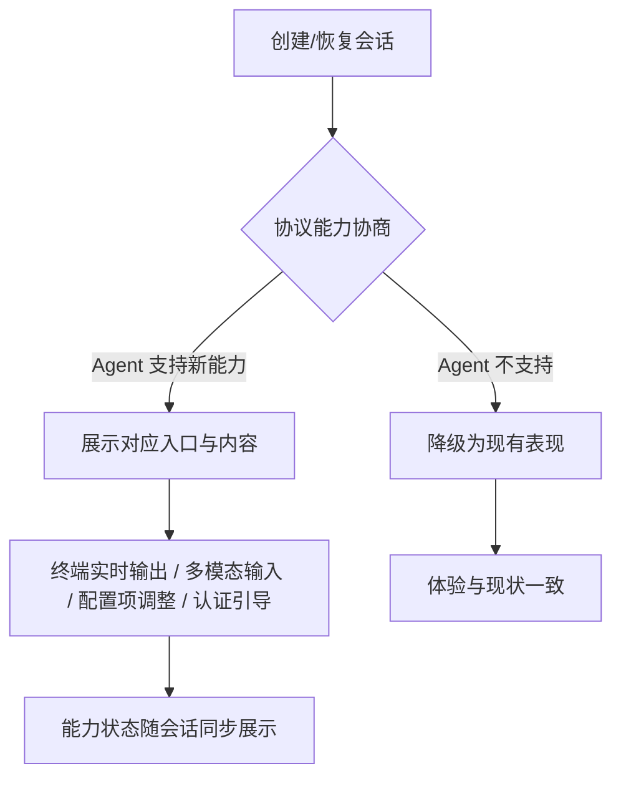

# ACP v1 协议能力补全与展示优化

**功能名称**: ACP v1 协议补全
**PRD 版本**: v1.0
**创建日期**: 2026-08-03
**作者**: Kimi

## 背景与目标

### 1.1 背景

z-agent-gear 通过 ACP（Agent Client Protocol）协议与各厂商的编码 Agent 通信，目前已覆盖会话创建、恢复、提示、取消、权限请求、模式/模型切换、历史会话同步等核心链路，支持 7 种 ACP Server。

但 ACP 协议在 v1 大版本内持续以"能力（Capability）"方式新增稳定特性（非破坏性演进），自 2026 年 2 月起陆续稳定了多项重要能力：会话配置项（Config Options）、会话删除、消息 ID、额外工作目录、请求级取消、布尔配置项、结构化用户输入（Elicitation）等；官方 SDK 也已发布 1.0 稳定版，同时 ACP v2 已进入草案阶段。

当前产品存在三类差距：

1. **已有能力未跟进协议更新**：部分能力仍基于协议早期的不稳定接口实现，存在随 Agent 升级而失效的风险；协议新稳定的若干能力与现有实现尚未兼容。
2. **协议能力存在空白**：终端实时输出、多模态消息（图片/音频/文件上下文）、Agent 登录认证等能力尚未支持，导致部分 Agent 的功能无法在产品中使用。
3. **展示体验未充分利用协议信息**：工具调用类型展示不全、流式消息分组依赖时间猜测、终端类工具调用只显示一串编号，影响可读性。

### 1.2 目标

- 将产品对 ACP 协议的支持对齐到 **ACP v1 当前全部稳定能力**，消除对不稳定接口的依赖。
- 补全用户可感知的协议空白能力：终端输出实时展示、多模态输入输出、Agent 认证、历史会话删除同步、附加工作目录、会话配置项扩展。
- 保持**向前兼容**：所有新能力以协议能力协商结果为准，Agent 不支持时优雅降级，不影响现有 7 种 ACP Server 的正常使用。

### 1.3 成功标准

- 现有 7 种 ACP Server 的核心会话链路（创建/恢复/对话/取消/权限）回归全部通过，无任何功能回退。
- 不再依赖任何协议标记为"不稳定（unstable）"的接口。
- 对支持终端能力的 Agent，工具调用的命令输出可实时展示；对不支持的 Agent，界面表现与现状一致。
- 对声明支持图片/文件上下文输入的 Agent，用户可在输入中附带对应内容；对不支持的 Agent，相关入口不展示。
- 对支持认证机制的 Agent，用户可完成登录与登出；历史会话删除可同步到 Agent 侧。

## 用户分析

### 2.1 目标用户

- 使用 z-agent-gear 统一管理多种编码 Agent 的开发者（多端、远程场景）。

### 2.2 用户场景

| 场景 | 用户角色 | 目标 | 痛点 |
|--|--|--|--|
| 查看 Agent 执行命令的过程 | 开发者 | 实时看到命令输出，判断执行是否符合预期 | 终端类工具调用只显示编号，看不到任何输出 |
| 让 Agent 分析截图/设计稿 | 开发者 | 在消息中附带图片发给 Agent | 输入仅支持纯文本，图片内容无法传达 |
| 让 Agent 参考指定文件 | 开发者 | 把文件内容作为上下文随消息发出 | 只能依赖 Agent 自行读取，远程/容器场景下路径不可达 |
| 使用需要登录的 Agent | 开发者 | 在产品内完成 Agent 账号登录/登出 | 遇到要求认证的 Agent 时流程中断，无法处理 |
| 清理历史会话 | 开发者 | 删除历史会话时 Agent 侧同步清理 | 仅删除本地记录，Agent 侧历史仍然存在 |
| 跨目录协作 | 开发者 | 会话主目录之外再附加只读/参考目录 | 会话只绑定单一工作目录 |
| 调整 Agent 行为开关 | 开发者 | 使用 Agent 提供的开关类配置（如自动确认模式）和推理档位 | 配置项只能查看，部分类型不支持，调整能力受限 |
| 阅读长会话 | 开发者 | 消息按"一条条回复"清晰分组 | 流式消息靠时间窗口猜测分组，偶发粘连或断裂 |

## 功能需求

### 3.1 功能概述

对齐 ACP v1 最新稳定能力，分三个阶段完成：**协议对齐与修复**（消除不稳定接口、补齐已稳定但缺失的基础能力）、**能力补全**（终端、多模态、认证、会话管理扩展）、**前沿跟进**（结构化输入、请求级取消、v2 跟踪）。

### 3.2 功能列表

#### 功能点 1: 协议基础对齐（P0）

- **描述**: 协议通信底座升级到官方稳定版；会话模式/模型等配置的调整改走协议已稳定的"会话配置项"通道，彻底替代不稳定接口；正确处理协议版本协商结果（Agent 回应非预期版本时明确提示用户而非静默异常）。
- **用户价值**: 消除 Agent 升级后模式/模型切换失效的风险，保证现有能力长期可用。
- **验收标准**:
  - [ ] 现有 7 种 ACP Server 的会话创建、恢复、对话、取消、权限请求、模式切换、模型切换全部回归通过
  - [ ] 模式/模型切换不再使用任何协议不稳定接口
  - [ ] Agent 回应不兼容协议版本时，用户能看到明确提示

#### 功能点 2: 会话配置项扩展（P0）

- **描述**: 完整支持协议的"会话配置项"能力：除模式、模型外，支持 Agent 暴露的推理档位（thought level）、模型参数等选择器；支持开关（布尔）类配置项；Agent 优先使用配置项通道时，自动以配置项为准并回退兼容旧的模式通道。
- **用户价值**: Agent 提供的高级配置（如推理深度、速度/质量权衡）在产品中可见可调。
- **验收标准**:
  - [ ] Agent 暴露的配置项按协议语义展示（分类、排序、描述）
  - [ ] 选择器与开关两类配置项均可修改，修改后状态与 Agent 侧一致
  - [ ] 仅支持旧模式通道的 Agent 行为与现状一致（向前兼容）

#### 功能点 3: 工具调用展示补全（P0）

- **描述**: 补全协议定义的全部工具调用类型（删除、移动、搜索、思考等）的图标与展示；正确处理"新建文件"类差异展示；利用协议消息 ID 对流式消息精确分组，替代时间窗口猜测。
- **用户价值**: 工具调用一目了然，长会话消息分组稳定准确。
- **验收标准**:
  - [ ] 协议全部工具类型均有对应的差异化展示
  - [ ] 新建文件的变更以"全文新增"形式清晰展示
  - [ ] Agent 提供消息 ID 时，消息分组与 Agent 输出边界完全一致；不提供时保持现有分组行为

#### 功能点 4: 历史会话删除同步（P0）

- **描述**: 用户删除历史会话时，若 Agent 支持协议的会话删除能力，则同步删除 Agent 侧记录；不支持时仅删除本地记录并明确告知。
- **用户价值**: 历史会话清理彻底，不留孤儿数据。
- **验收标准**:
  - [ ] 支持会话删除能力的 Agent，删除后其历史列表中不再出现该会话
  - [ ] 不支持的 Agent，本地删除行为与现状一致

#### 功能点 5: 终端输出实时展示（P1）

- **描述**: 实现协议终端能力：Agent 执行的命令可实时输出到产品界面；工具调用中嵌入的终端内容展示实时输出与最终退出状态，而非仅显示编号。
- **用户价值**: 命令执行过程透明可见，出错时可立即定位输出。
- **验收标准**:
  - [ ] 支持终端能力的 Agent，其命令输出在界面实时滚动展示，含退出码/信号
  - [ ] 不支持终端能力的 Agent，界面表现与现状一致（降级展示）
  - [ ] 超长输出按协议约定截断，不影响界面性能

#### 功能点 6: 多模态消息（P1）

- **描述**: 输入侧：按 Agent 声明的能力，支持随消息附带图片、音频、文件内容（嵌入资源）与资源链接；输出侧：Agent 回复中的图片、音频、资源类内容块可正确渲染，不再被丢弃。
- **用户价值**: 截图分析、设计稿还原、指定文件上下文等场景可用。
- **验收标准**:
  - [ ] Agent 声明支持图片输入时，输入区出现图片附件入口并可成功发送
  - [ ] Agent 未声明的能力不出现对应入口（按能力协商降级）
  - [ ] Agent 回复中的图片可查看、资源类内容可展开阅读

#### 功能点 7: Agent 认证（P1）

- **描述**: 支持协议认证流程：识别 Agent 声明的认证方式并引导用户完成登录；支持登出；认证过期/失败时给出明确引导。
- **用户价值**: 需要账号登录的 Agent 可在产品内直接使用。
- **验收标准**:
  - [ ] Agent 要求认证时，用户收到明确引导并可完成认证流程
  - [ ] 支持登出，登出后可重新认证
  - [ ] 无认证要求的 Agent 流程完全不受影响

#### 功能点 8: 附加工作目录（P1）

- **描述**: 创建/恢复会话时，除主工作目录外可附加额外目录供 Agent 访问（协议 additionalDirectories 能力，按 Agent 支持情况启用）。
- **用户价值**: 跨仓库参考、共享库只读挂载等场景可用。
- **验收标准**:
  - [ ] 支持该能力的 Agent 可在会话中使用附加目录
  - [ ] 不支持的 Agent 创建会话行为与现状一致

#### 功能点 9: MCP 传输方式扩展（P1）

- **描述**: 会话注入 MCP 服务时，除现有标准输入输出方式外，按 Agent 声明的能力支持 HTTP 方式注入；同时修复现有 MCP 配置在链路中丢失的问题。
- **用户价值**: 可接入更多远程 MCP 服务，已配置的 MCP 服务稳定生效。
- **验收标准**:
  - [ ] 已配置的 MCP 服务在会话中稳定可用（修复丢失问题）
  - [ ] Agent 声明支持 HTTP 传输时，可使用 HTTP 类型的 MCP 服务

#### 功能点 10: 前沿能力跟进（P2）

- **描述**: 跟进协议最新稳定能力：结构化用户输入（Elicitation，Agent 可在会话中向用户索要表单类输入或引导跳转安全页面）、请求级取消；持续关注 ACP v2 草案与 Agent 注册中心（Registry）。
- **用户价值**: 保持协议生态前沿兼容，为 v2 迁移做准备。
- **验收标准**:
  - [ ] 支持 Elicitation 的 Agent 发起结构化输入请求时，用户可填写并提交或取消
  - [ ] 形成 ACP v2 影响评估结论

### 3.3 用户操作流程

### 3.4 页面/界面描述

| 页面 | 描述 | 关键元素 |
|------|------|---------|
| 会话页 | 消息流与工具调用展示 | 工具类型图标（含删除/移动/搜索/思考）、终端实时输出区、图片/资源内容渲染、按消息 ID 分组的回复 |
| 会话页输入区 | 消息输入 | 附件入口（图片/音频/文件，按 Agent 能力显隐）、斜杠命令（现有） |
| 会话配置区 | 会话级配置展示与调整 | 配置项选择器（模式/模型/推理档位/模型参数）、开关类配置项 |
| 认证引导 | Agent 要求登录时展示 | 认证方式说明、操作入口、失败重试提示 |
| 历史会话 | 历史会话管理 | 删除（同步 Agent 侧的能力标识与结果反馈） |
| 新建会话 | 会话创建 | 附加工作目录选择（按 Agent 能力显隐）、MCP 服务选择（现有） |

### 3.5 异常与边界情况

| 情况 | 预期行为 |
|------|---------|
| Agent 不声明某项新能力 | 对应入口隐藏/降级，体验与现状一致，不报错 |
| Agent 回应不兼容协议版本 | 明确提示用户该 Agent 协议版本不受支持 |
| 终端输出超长 | 按协议约定从头截断，界面保持流畅 |
| 会话中取消时存在未决的权限/输入请求 | 自动以"取消"结果应答所有未决请求 |
| Agent 升级导致配置项通道行为变化 | 优先配置项通道，失败时回退旧通道并提示 |
| 附件大小超限 | 发送前提示并阻止 |
| 认证流程中途失败 | 明确错误提示与重试入口，不影响其他会话 |

## 四、非功能需求

### 4.1 性能要求

- 终端实时输出滚动渲染不阻塞消息流；流式消息分组逻辑不引入可感知延迟。

### 4.2 安全性要求

- 认证信息按现有安全规范存储与传输，不出现在日志与消息记录中。
- 附件内容仅发往当前会话绑定的 Agent。

### 4.3 兼容性要求

- **向前兼容是本需求的核心约束**：所有新能力必须基于协议能力协商启用；现有 7 种 ACP Server 在升级前后行为一致，无任何功能回退。
- 旧会话的历史消息展示不受影响。

## 五、依赖与约束

### 5.1 依赖

- ACP 官方协议 v1 稳定版规范与官方 SDK 稳定版。
- 各 ACP Server 对协议新能力的实际支持进度（能力协商天然处理差异）。

### 5.2 约束

- 文件系统能力（fs）维持现有设计决策：不开放，由 Agent 自行处理文件读写。
- 分阶段交付：P0（协议对齐与修复）→ P1（能力补全）→ P2（前沿跟进），每阶段独立可验收、可发布。
- ACP v2 处于草案阶段，本期只做跟踪评估，不做实施。

## 六、相关文档

- ACP 官方协议规范：https://agentclientprotocol.com/
- [[../released/20260518-agent-session-interaction.md]] — Agent 拉起与交互
- [[../released/20260521-acp-session-sync-history.md]] — 工作目录历史会话同步
- [[../released/20260522-available-models-and-mode-switch.md]] — 可用模型与模式切换
- [[../released/20260526-multi-acp-server-support.md]] — 多 ACP Server 支持
- [[../released/20260528-acp-permission-reminder.md]] — ACP 授权提醒
- [[../released/20260530-mcp-proxy-config.md]] — MCP 代理服务配置
- [[../released/20260705-acp-server-extend.md]] — ACP Server 支持扩展
