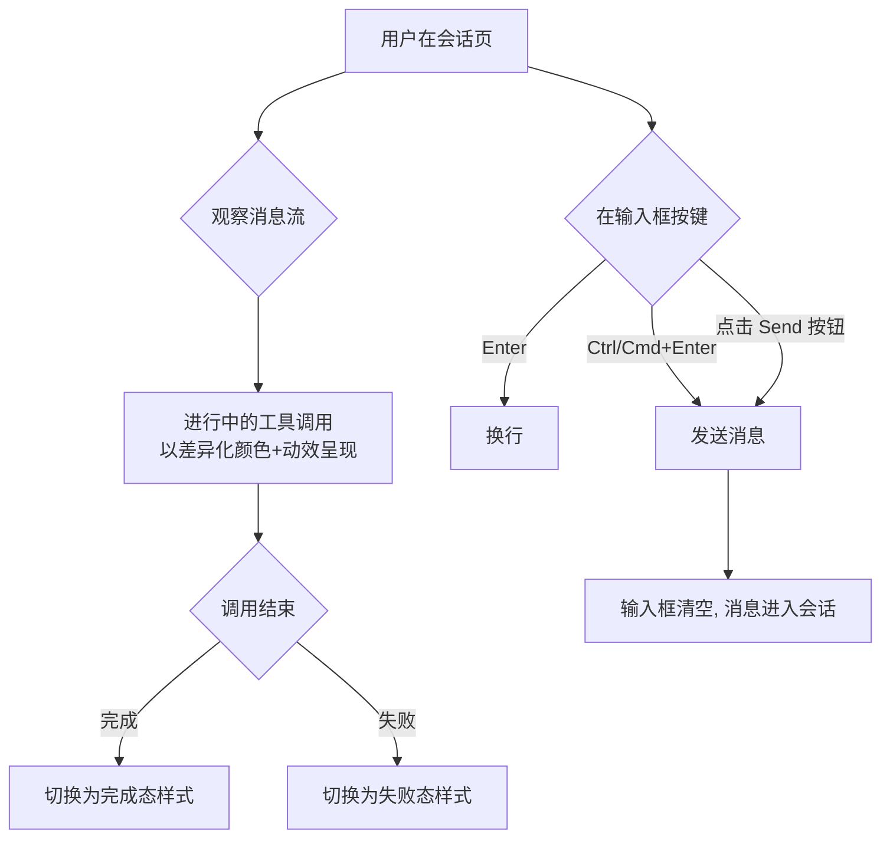

# 对话交互优化

**功能名称**: 对话交互优化
**PRD 版本**: v1.0
**创建日期**: 2026-08-04
**作者**: Kimi

## 背景与目标

### 1.1 背景

当前会话页面存在两处影响使用体验的交互问题：

1. **工具调用状态不可感知**：Agent 执行工具调用时，进行中的调用与已完成的调用在视觉上没有任何差异，用户无法直观判断 Agent 当前是否还在工作、卡在哪一步，只能等待最终状态出现。
2. **回车误发送**：聊天输入框按下回车即发送消息。当用户想输入多行内容（如粘贴代码、分点描述问题）时，极易在输入中途误触回车把半成品消息发出去，打断 Agent 工作并污染会话上下文。

### 1.2 目标

- 进行中的工具调用在消息流中以不同的颜色/动效被一眼识别，与完成、失败状态形成清晰的状态视觉层级。
- 回车键行为改为换行，发送行为收敛为明确的主动操作，杜绝误发送。

### 1.3 成功标准

- 用户在不展开任何卡片的情况下，能一眼分辨出消息流中哪些工具调用正在进行中。
- 进行中的状态在浅色与深色主题下均有足够的辨识度和对比度。
- 用户在输入框按回车不再发送消息；多行输入场景（粘贴代码、换行分段）零误发送。
- 发送操作的可达性不下降：用户仍可通过明显的按钮（及快捷键）一步完成发送。

## 用户分析

### 2.1 目标用户

使用 Agent Web 与 Agent 进行会话的全部终端用户。

### 2.2 用户场景

| 场景 | 用户角色 | 目标 | 痛点 |
|--|--|--|--|
| Agent 执行长任务（读写文件、跑命令） | 终端用户 | 实时掌握 Agent 执行进度 | 进行中的工具调用与已完成的混为一体，无法判断当前进展 |
| 输入多行 prompt（代码片段、分点需求） | 终端用户 | 在输入框内自由换行编辑 | 回车即发送，长文本输入时频繁误发 |
| 在移动端/桌面端深色模式下使用 | 终端用户 | 状态颜色在任何主题下清晰可辨 | 颜色若无主题适配，深色下可能难以区分 |

## 功能需求

### 3.1 功能概述

优化会话页两处交互：为「进行中」状态的工具调用提供差异化视觉呈现；将输入框回车行为从「发送」调整为「换行」，发送仅通过 Send 按钮（及快捷键）触发。

### 3.2 功能列表

#### 功能点 1: 工具调用进行中状态差异化展示

- **描述**: 渲染对话中的工具调用时，若调用处于进行中（in_progress）状态，卡片以区别于已完成/失败状态的颜色展示，并辅以「进行中」的动态视觉效果（如呼吸/脉冲动画），让进行中的调用在消息流中一眼可辨。状态流转（进行中 → 已完成/失败）时视觉样式随之即时切换。
- **用户价值**: 用户可以实时感知 Agent 正在做什么、做到哪一步，减少对 Agent 是否卡住的疑虑。
- **验收标准**:
  - [ ] 进行中的工具调用卡片颜色/样式与已完成、失败状态明显不同
  - [ ] 进行中的卡片带有动态视觉效果，直观传达「正在执行」
  - [ ] 调用完成或失败后，卡片样式即时切换为对应终态样式
  - [ ] 浅色主题与深色主题下均有清晰辨识度
  - [ ] 已完成与失败状态维持现有区分逻辑（成功/失败可区分），不引入回归

#### 功能点 2: 输入框回车行为调整

- **描述**: 聊天输入框中按下回车（Enter）不再发送消息，而是在输入框内换行；发送消息仅通过点击「Send」按钮触发；同时保留 `Ctrl+Enter`（macOS 为 `Cmd+Enter`）快捷键发送，兼顾桌面端输入效率。
- **用户价值**: 用户可以放心地在输入框内编辑多行内容，不再发生误发送；发送动作成为显式操作，意图更明确。
- **验收标准**:
  - [ ] 按 Enter 在输入框内换行，不触发发送
  - [ ] 按 Shift+Enter 换行行为保持不变
  - [ ] 按 Ctrl+Enter / Cmd+Enter 发送消息
  - [ ] 点击 Send 按钮发送消息
  - [ ] 输入为空或纯空白时，任何发送途径均不生效
  - [ ] 发送中/会话停止等现有交互（Stop 按钮、禁用态）不受影响
  - [ ] 命令建议面板（`/` 前缀）打开时，Enter 仍为选中命令而非换行

### 3.3 用户操作流程

### 3.4 页面/界面描述

| 页面 | 描述 | 关键元素 |
|------|------|---------|
| 会话页 - 消息流 | 工具调用卡片按状态着色：进行中为强调色（带动态效果），已完成/失败维持现有样式 | 工具调用卡片、状态标识、进行中动画 |
| 会话页 - 输入区域 | 多行输入框，回车换行；Send 按钮为唯一显式发送入口 | 输入框、Send/Stop 按钮 |

### 3.5 异常与边界情况

| 情况 | 预期行为 |
|------|---------|
| 工具调用长时间处于进行中 | 进行中样式持续展示，无超时样式变更 |
| 进行中状态直接跳变为失败 | 卡片直接切换为失败态样式，不经过完成态 |
| 输入框仅包含空白字符 | 所有发送途径（按钮/快捷键）均不生效 |
| 命令建议面板打开时按 Enter | 选中当前命令，不换行、不发送 |
| 移动端（无物理键盘） | 不受回车行为调整影响，点击 Send 发送 |
| 会话正在停止/输入禁用状态 | 发送途径均禁用，Enter 换行不受影响 |

## 四、非功能需求

### 4.1 性能要求

进行中动效应轻量，不得在长消息流下引起明显的渲染卡顿。

### 4.2 安全性要求

无新增安全要求。

### 4.3 兼容性要求

- 浅色/深色两套主题下状态颜色均需保证辨识度与对比度。
- 桌面端主流浏览器行为一致；macOS 与 Windows/Linux 快捷键（Cmd/Ctrl）均需支持。

## 五、依赖与约束

### 5.1 依赖

无外部依赖；基于现有会话消息流与输入区域交互迭代。

### 5.2 约束

- 不改变消息数据结构与后端接口，纯展示与交互层调整。
- 已完成/失败状态的既有区分能力不得回归。

## 六、相关文档

- [[20260526-ui-optimization]]（已发布，工具调用按状态差异化展示的初版约定）
- 技术提案：`docs/engineering/proposals/20260804-feat-chat-interaction-optimization.md`
