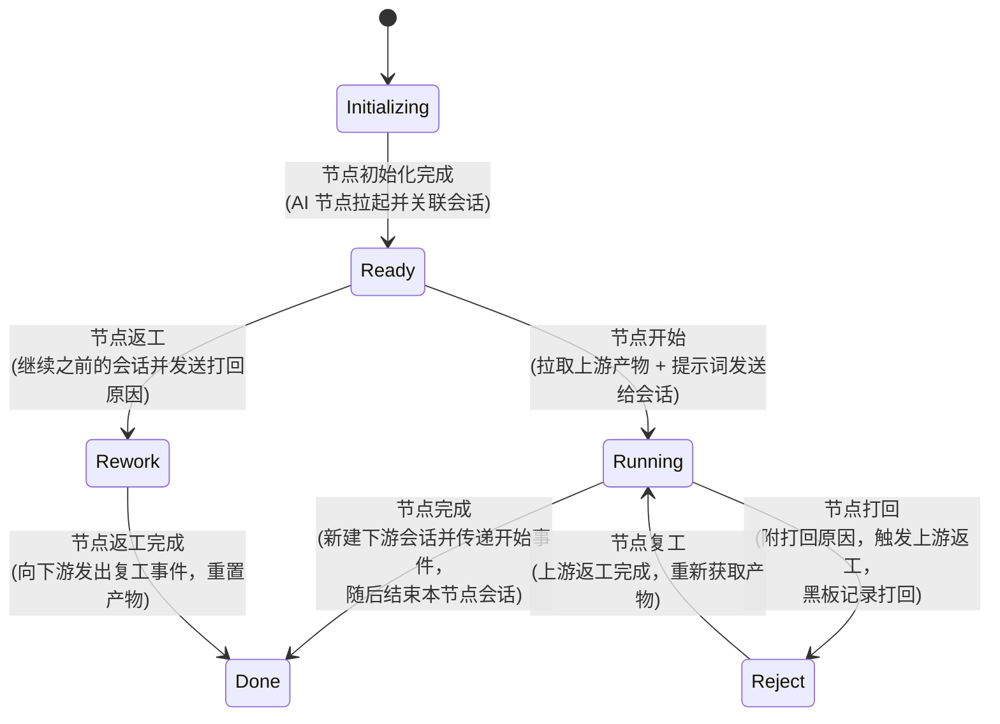
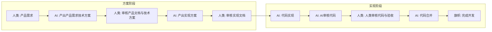
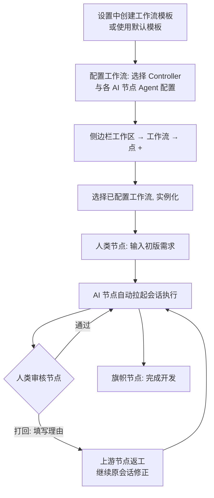

# Agent 工作流（Agent Workflow）

**功能名称**: Agent 工作流
**PRD 版本**: v1.0
**创建日期**: 2026-08-08
**作者**: Kimi

## 一、背景与目标

### 1.1 背景

平台目前已支持在任意 Controller 的工作区下创建 Agent 会话，并通过 Git Worktree 隔离会话工作内容（见 [[../released/20260523-git-worktree-support-prd]]）。但单个会话只能完成单一任务，一个完整的需求开发（产出方案 → 审核 → 实现 → 评审 → 合并）需要用户手动创建多个会话、手动传递上下文、手动跟进进度，存在以下问题：

1. **多会话协作靠人肉串联**：一个需求从产品方案到代码合并需要多个会话接力，会话之间的上下文（产物）完全依赖用户复制粘贴。
2. **进度不可视**：用户无法直观看到一个需求当前推进到哪一步、谁在执行、卡在哪里。
3. **人与 Agent 的职责边界模糊**：哪些环节必须人类确认、哪些环节可以交给 Agent，没有结构化的定义与约束。
4. **质量问题无法回溯**：当 Agent 产出的内容有问题时，只能重新开始，无法将问题「打回」给上游环节让其修正后继续。

### 1.2 目标

建设 **Agent 工作流** 体系：一个横跨多个会话、围绕 GitHub Pull Request 与分支工作的统一工作流能力，使用会话创建时的 Worktree 隔离工作内容。达成以下目标：

1. **流程可定义**：用户可以在设置中自定义工作流（节点、依赖关系、提示词、Agent 配置），平台提供默认工作流模板。
2. **执行可串联**：工作流中的节点按需自动拉起会话，上游节点的产物自动传递给下游节点，人类节点与 AI 节点交替协作。
3. **进度可视**：工作区下新增「工作流」层级，用户可以看到每个工作流实例的节点树、当前执行节点与黑板内容。
4. **质量可控**：任何节点都可以将上游产物「打回」并附带原因，上游节点返工修正后流程自动继续。

### 1.3 成功标准

- 用户可以在设置中创建工作流模板并配置为可用工作流，使用默认「开发工作流」模板零配置实例化一个完整的需求开发流程。
- 工作流实例执行过程中，AI 节点自动拉起会话、自动获取上游产物、自动向下游传递产物，全程无需人工搬运上下文。
- 人类节点审核不通过时可打回上游，上游返工完成后流程自动恢复，打回与返工全程在黑板中留痕。
- 工作流会话不出现在左侧侧边栏的会话列表中，仅在工作流实例视图内可见、可打开。
- 使用默认「开发工作流」模板完成一次真实需求：产出产品文档与技术方案 PR、实现 PR，并最终完成合并。

## 二、用户分析

### 2.1 目标用户

- **个人开发者**：希望把「需求 → 方案 → 实现 → 评审 → 合并」的完整开发流程交给人与 Agent 协作完成，自己只在关键节点把关。
- **多设备 Agent 用户**：希望流程中不同节点可以在不同 Controller（不同机器）上执行，充分利用已有设备资源。

### 2.2 用户场景

| 场景 | 用户角色 | 目标 | 痛点 |
|--|--|--|--|
| 发起一个需求开发 | 开发者 | 输入需求描述后，由 Agent 自动产出产品文档与技术方案并提 PR | 需要手动开会话、写提示词、整理产物 |
| 审核方案并给出意见 | 开发者 | 在审核节点查看 Agent 产出，不满意可打回并说明理由 | 意见无法结构化地传递回上游会话 |
| 跟踪需求开发进度 | 开发者 | 一眼看到需求当前在哪个节点、由谁执行、产物是什么 | 多个会话散落在侧边栏，无法关联 |
| 自定义团队/个人流程 | 进阶用户 | 按自己的习惯定义工作流（增删节点、调整提示词） | 流程只能固化在平台代码里 |

## 三、功能需求

### 3.1 功能概述

在工作区下新增「工作流」层级。工作流是由多个「节点」组成的流程图，节点之间存在依赖关系，节点可以是人类节点、AI 节点或旗帜节点。工作流实例化后，各节点按依赖顺序执行：AI 节点自动拉起会话完成工作并产出「节点产物」，人类节点等待用户操作（完成/打回），节点产物统一存放在「工作流黑板」中供后续节点与人类查阅。

### 3.2 功能列表

#### 功能点 1：工作区下的「工作流」层级

- **描述**: 在左侧侧边栏的工作区下新增「工作流」层级，展示该工作区下的工作流列表与「+」入口；点击「+」可选择一个「已配置工作流」并实例化。工作流必须归属于某个 Controller 的某个工作区下。
- **用户价值**: 工作流与其代码工作区天然绑定，工作流内的会话复用会话创建时的 Worktree 隔离工作内容。
- **验收标准**:
  - [ ] 侧边栏 Controller → 工作区下可见「工作流」层级，展示工作流列表与「+」按钮。
  - [ ] 点击「+」可从「已配置工作流」中选择一个并实例化，实例归属于当前工作区。
  - [ ] 工作区不支持 Git 时，无法实例化需要 Worktree 支持的工作流，并给出明确提示。

#### 功能点 2：工作流会话的归属与展示

- **描述**: 所有由工作流拉起的会话，归属到工作流实例的对应节点下展示，**不再出现在左侧侧边栏的会话列表中**。在工作流实例视图中点击会话，弹出侧面板（side panel）显示会话内容（复用现有会话界面）。
- **用户价值**: 侧边栏保持整洁，工作流会话与手动创建的会话互不干扰；用户在工作流实例内即可完成查看与介入。
- **验收标准**:
  - [ ] 工作流拉起的会话不出现在侧边栏会话列表。
  - [ ] 工作流实例视图中节点下可看到关联会话，点击后弹出侧面板展示会话，可正常查看消息与发送消息。

#### 功能点 3：设置中的「工作流」管理

- **描述**: 设置页新增「工作流」section，分为「工作流模板」与「已配置工作流」两类，并提供「创建工作流模板」与「配置工作流」两个按钮。
  - **工作流模板**：只含描述性信息（节点名称、描述、提示词数组、产物定义、依赖关系、阶段），不包含 Agent 配置。
  - **已配置工作流**：关联到一个 Controller，并为所有 AI 节点选定 Agent 配置（Harness 工具 / Mode / 模型、是否初始化新 Worktree）。
  - 工作流模板与已配置工作流**没有强关联**：已配置工作流是从模板「复制」出来的独立副本，后续更新模板不会影响已配置工作流，界面文案需体现「复制」这一属性。
- **用户价值**: 模板可复用、可分享；配置一次即可在对应 Controller 下反复实例化。
- **验收标准**:
  - [ ] 设置页可见「工作流」section，模板与已配置工作流分开展示。
  - [ ] 「创建工作流模板」可定义节点图（含依赖、提示词、产物、阶段）。
  - [ ] 「配置工作流」可从模板复制并补齐 Controller 与各 AI 节点的 Agent 配置。
  - [ ] 修改模板后，已配置工作流内容不变，文案明确提示其为模板副本。

#### 功能点 4：工作流实例视图

- **描述**: 工作流实例视图包含：按阶段分组的节点树、节点关联的会话、工作流黑板中的所有值。工作流本身没有状态，对外展示的状态为「正在执行中的节点」。
- **用户价值**: 一个页面看全流程：谁在做、做到哪、产出了什么。
- **验收标准**:
  - [ ] 节点树按阶段分组展示，节点上可见名称、状态、返工次数。
  - [ ] 可查看黑板所有键值（含垃圾桶），可查看打回记录。
  - [ ] 实例对外展示的状态为当前执行中的节点名称。

### 3.3 工作流定义细节

#### 3.3.1 工作流

工作流是包含多个「节点」的流程「图」，节点之间存在依赖关系。

- 工作流本身**没有状态**；对外展示的状态 = 正在执行中的节点。
- **工作流黑板**：一个 key-value 字典，供 LLM 与人类读写，用于存放节点产物、打回记录及任意协作信息。
- **黑板垃圾桶**：key-value 结构，保存被移除的黑板信息，可随时查阅。
- 工作流的**第一个节点只允许是人类节点**（当前版本约束）。

#### 3.3.2 节点

节点是工作流中的一个任务单元。

**节点信息**（所有节点共有）：节点 ID、节点名称、节点描述、节点状态、节点创建时间、节点开始时间、节点返工时间、节点返工次数、节点所属阶段。

**节点类型**：

| 类型 | 特有信息 | 说明 |
|--|--|--|
| AI 节点 | Agent 配置（Harness 工具 / Mode / 模型、是否初始化新 Worktree）、节点提示词数组 | 拉起会话执行任务的节点 |
| 人类节点 | 操作人（系统内用户） | 等待人类输入或审核的节点 |
| 旗帜节点 | 无 | 纯展示用，透穿上游事件到下游节点，一般作为终结点 |

**节点提示词数组**：每个 AI 节点强制包含一段系统提示（大意，需完善为正式文案）：「你身处一个工作流系统，你需要合理使用工具拿到你需要的信息，然后在完成工作时也需要使用工具对当前节点进行操作」，其后跟随该节点的具体任务描述。

**节点产物**：存储在工作流黑板中，key 为 `{节点ID}-{节点名称}-产物-{产物title}`，产物 title 在工作流模板中预先定义，value 为产物详情。

#### 3.3.3 节点状态机

- **节点初始化**（Initializing → Ready）：AI 节点需要初始化，拉起对应的「会话」并与当前节点关联。
- **节点开始**（Ready → Running）：AI 节点拉取所有向自己传递开始事件的节点的「节点产物」，与本节点的「节点提示词」结合，发送给会话。
- **节点完成**（Running → Done）：由 AI 通过工具调用或人类点击「完成」触发；触发后「新建」下游节点的「会话」，向下游传递开始事件，然后结束本节点的会话。
- **节点返工**（→ Rework）：「继续」之前的会话，并将「打回原因」发送给该会话。
- **节点返工完成**（Rework → Done）：向下游节点发出「节点复工」事件，并重新设置节点产物。
- **节点打回**（Running → Reject）：人类或 AI 发现上游节点提供的信息有问题时触发，必须给出「打回原因」；触发上游节点的「节点返工」事件，并在黑板中记录一条打回记录。
- **节点复工**（Reject → Running）：当父节点状态从 Rework 变为 Done 时，重新获取产物并继续执行。
- **节点会话兜底**：会话开始时记录节点状态；如果会话从开始到结束期间节点状态始终未发生转移，则向该会话发送兜底提示词（面向 LLM 撰写，大意为：你身处一个自动化系统中，需要使用提供的工具对当前节点进行操作，以便后续节点展开工作）。

#### 3.3.4 提供给 Agent 的工具能力

每个工作流节点会话获得一套**该节点专属**的工具能力（节点作用域，确保会话连接能正确映射到所属节点）。所有工具都需要校验参数合法性，并在参数或状态不合法时给出合理提示。

信息获取类：

| 能力 | 说明 |
|--|--|
| 获得当前节点 ID | 节点作用域映射 |
| 获得父节点 ID | 节点作用域映射 |
| 使用节点 ID 获得节点信息 | 按 ID 查询任意节点 |
| 获得某节点的所有节点产物黑板 keys | 匹配前缀 `{节点ID}-{节点名称}-产物` |
| 获得工作流黑板 keys | 全量 keys |
| 获得工作流黑板 value | 按 key 读取 |
| 移除一个工作流黑板 key | 被移除的信息挪入黑板垃圾桶 |

节点操作类（需校验状态转移是否合法）：

| 能力 | 说明 |
|--|--|
| 操作当前节点「节点完成」 | Running → Done |
| 操作当前节点「节点打回」 | Running → Reject，附打回原因 |
| 操作当前节点「节点返工完成」 | Rework → Done |

### 3.4 默认工作流模板：开发工作流

平台内置默认工作流模板「开发工作流」（需要 Worktree 支持），节点如下（每个阶段使用一个 Worktree）：

| 节点类型 | 节点名称 | 产物（提示词中要求 AI 使用工具写入） | 提示词大意（需完善为正式文案） | 阶段 |
|--|--|--|--|--|
| 人类节点 | 产品需求 | 1. 初版产品需求：文本输入 | N/A | 方案阶段 |
| AI 节点 | 产出产品需求技术方案 | 1. 产品需求和技术方案：分支及两个文件路径及简介；2. 需求总分支：分支名；3. 需求总 PR：PR 地址 | 参照项目中所有 AGENTS.md 产出产品文档与技术提案（没有则参考 docs 目录约定），切出分支并提交方案；如 gh 命令可用且存在该仓库，则提一个需求 PR | 方案阶段 |
| 人类节点 | 审核产品文档与技术方案 | N/A | N/A（打回时弹框输入打回理由） | 方案阶段 |
| AI 节点 | 产出实现方案 | 1. 实现方案：路径及简介 | 参照项目中所有 AGENTS.md 产出实现 plan，切到需求总分支提交实现计划；若用户指出是产品需求或技术方案的问题，则继续向上打回 | 方案阶段 |
| 人类节点 | 审核实现文档 | N/A | N/A | 方案阶段 |
| AI 节点 | 代码实现 | 1. 实现分支；2. 实现 PR | 基于需求总分支切出新分支，按 plan / proposal / product 文档开发，严格遵循 AGENTS.md；如支持 gh 命令且存在该仓库，则创建目标分支为需求总分支的 PR | 实现阶段 |
| AI 节点 | AI审核代码 | N/A | 审核代码实现，任何问题触发打回并填写 review 意见；若自己被打回，则消化打回内容并向上游传递打回信息让其修改 | 实现阶段 |
| 人类节点 | 人类审核代码与验收 | N/A | N/A | 实现阶段 |
| AI 节点 | 代码合并 | N/A | 合并代码实现 PR，随后合并需求总 PR | 实现阶段 |
| 旗帜节点 | 完成开发 | N/A | N/A | 实现阶段 |

### 3.5 用户操作流程

### 3.6 页面/界面描述

| 页面 | 描述 | 关键元素 |
|------|------|---------|
| 侧边栏-工作流层级 | 工作区下的工作流入口 | 工作流列表、「+」实例化按钮、实例状态（当前执行节点） |
| 设置-工作流 section | 模板与已配置工作流管理 | 「创建工作流模板」「配置工作流」按钮、模板/已配置分组、复制关系文案 |
| 工作流实例视图 | 单实例全貌 | 按阶段分组的节点树、节点状态与返工次数、会话入口、黑板与垃圾桶 |
| 会话侧面板 | 实例内查看/介入会话 | 复用现有会话界面 |

### 3.7 异常与边界情况

| 情况 | 预期行为 |
|------|---------|
| 工作区不支持 Git | 禁止实例化需要 Worktree 的工作流，并提示原因 |
| AI 会话结束但节点状态未转移 | 自动向会话发送兜底提示词，引导其使用工具完成节点操作 |
| 打回时上游节点不存在/已终结 | 拒绝打回操作并给出提示 |
| 非法状态转移（如未开始的节点执行完成） | 工具/按钮拒绝操作并给出合理提示 |
| 黑板 key 被移除 | 信息挪入垃圾桶，可追溯 |
| 多个人类节点同时待办 | 各节点独立等待，互不阻塞无依赖关系的分支 |

## 四、非功能需求

### 4.1 性能要求

- 节点事件（完成/打回/复工）到下游会话拉起的延迟应在秒级。

### 4.2 安全性要求

- 节点专属工具能力仅作用于所属节点与其工作流实例，不能越权操作其他实例的节点与黑板。

### 4.3 兼容性要求

- 工作流会话复用现有会话界面与交互，不引入新的会话形态。

## 五、依赖与约束

### 5.1 依赖

- 会话创建时的 Worktree 隔离能力（已上线）。
- 会话的 MCP 工具分发能力（集成式 MCP 注册中心，见 [[20260804-integrated-mcp-registry]]），本期需在此基础上增加「节点作用域」的分发概念。

### 5.2 约束

- 当前版本工作流第一个节点只允许是人类节点。
- 需要 Worktree 支持的工作流只能实例化在支持 Git 的工作区下。

## 六、相关文档

- [[../released/20260523-git-worktree-support-prd]]
- [[20260804-integrated-mcp-registry]]
- 技术提案：`docs/engineering/proposals/20260808-feat-agent-workflow.md`
