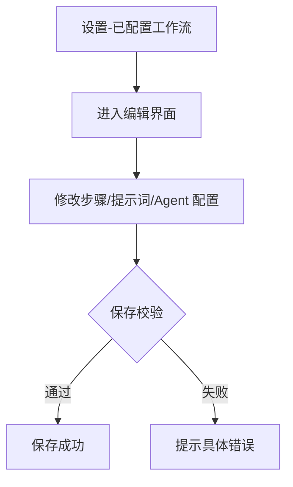
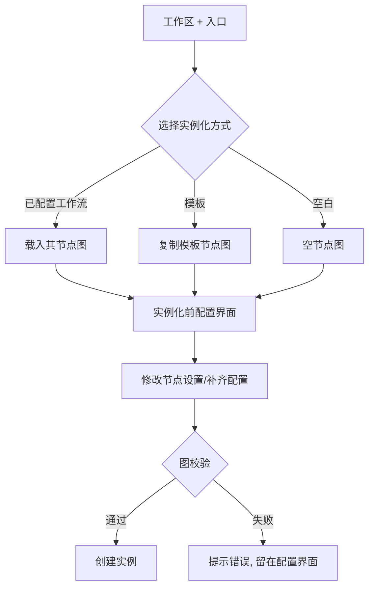
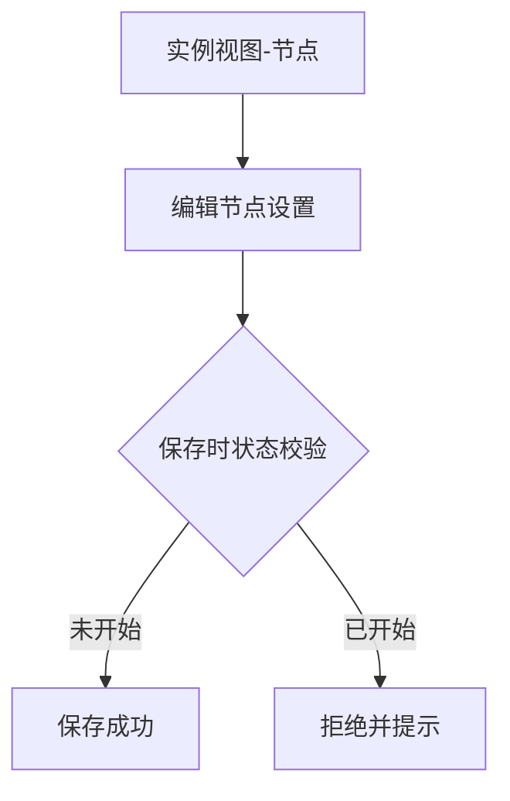
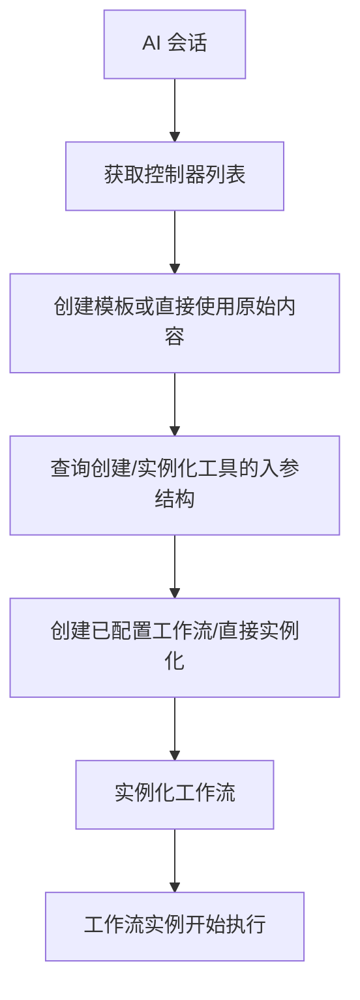

# Agent 工作流二期：工作流管理与实例化机制完善

**功能名称**: Agent 工作流二期（工作流管理与实例化机制完善）
**PRD 版本**: v1.0
**创建日期**: 2026-08-11
**作者**: Kimi

## 一、背景与目标

### 1.1 背景

Agent 工作流一期已上线（见 [[20260808-agent-workflow]]）：用户可以在设置中定义工作流模板、从模板复制出已配置工作流，并在工作区下实例化执行；实例执行过程中 AI 节点自动接力、产物经黑板传递、支持打回返工。在实际使用中暴露出以下问题：

1. **已配置工作流改不动**：已配置工作流一旦生成，步骤（节点与依赖）和提示词就被冻结，写错一条提示词只能删除后重新配置，配置成本被反复支付。
2. **实例化入口单一、试错成本高**：实例化只能从「已配置工作流」发起。想快速跑一个流程，必须先走完「建模板 → 配置工作流 → 实例化」全链路；且实例化动作一步到位，发起前没有机会对本次实例的节点设置做最后调整。
3. **实例节点开跑前无法微调**：实例化完成后、节点尚未开始执行前，用户无法修改节点设置（如本次实例特有的提示词补充），只能眼睁睁看着流程按原样执行。
4. **AI 无法自主编排工作流**：工作流的模板管理、配置与实例化只能在界面上由人类操作。AI 在会话中无法自己创建工作流并发起执行，制约了「AI 编排 AI」的自动化能力。

### 1.2 目标

完善工作流的管理与实例化机制，达成以下目标：

1. **配置可迭代**：已配置工作流支持修改步骤与提示词，配置不再是一次性动作。
2. **实例化低门槛**：实例化支持从已配置工作流、从模板、从空白三种入口，且发起前统一弹出一次配置界面供调整节点设置。
3. **实例可微调**：从未开始执行过的实例节点支持修改，保存时校验节点状态，已开始的一律拒绝。
4. **AI 可编排**：提供「工作流管理工具集」，AI 可以创建/获取/删除工作流模板与已配置工作流、查询控制器列表、并以三种方式实例化工作流；AI 创建的资源记录归属，只允许删除自己创建的。

### 1.3 成功标准

- 用户可以直接编辑一个已配置工作流的步骤与提示词并保存，无需删除重建。
- 用户可以从模板或空白直接发起实例化，在实例化前的配置界面中完成节点设置后一次创建成功。
- 用户可以修改一个从未开始过的实例节点并保存成功；节点开始执行后再修改会被拒绝并给出明确提示。
- AI 在会话中可以通过工作流管理工具集完成「创建模板 → 配置工作流 → 实例化」全流程；AI 无法删除非自己创建的模板与已配置工作流。

## 二、用户分析

### 2.1 目标用户

- **个人开发者**：高频使用工作流跑需求开发流程，需要根据任务灵活调整流程与提示词。
- **进阶用户 / 自动化玩家**：希望让 AI 在会话中自主创建并发起工作流，实现多 Agent 编排。

### 2.2 用户场景

| 场景 | 用户角色 | 目标 | 痛点 |
|--|--|--|--|
| 调整已配置工作流 | 开发者 | 修改某个节点的提示词、增删一个审核节点 | 配置被冻结，只能删了重来 |
| 快速跑一个临时流程 | 开发者 | 从模板或空白直接实例化，跳过预先配置 | 必须先走完整配置链路 |
| 实例发起前最后确认 | 开发者 | 实例化前统一过一遍节点设置（模型、提示词） | 实例化一步到位，无确认环节 |
| 实例开跑前微调 | 开发者 | 给本次实例的某节点补一条特有提示词 | 节点未开始也不能改 |
| AI 自主编排 | AI Agent | 在会话中创建模板、配置并实例化一个工作流 | AI 没有任何工作流管理入口 |

## 三、功能需求

### 3.1 功能概述

在工作流一期的基础上：放开已配置工作流的编辑能力；实例化增加「从模板」「从空白」两个新入口并统一增加实例化前配置界面；实例中未开始的节点开放修改；新增面向 AI 的「工作流管理工具集」，覆盖模板管理、控制器查询、已配置工作流管理与三种方式的实例化。

### 3.2 功能列表

#### 功能点 1：已配置工作流支持修改步骤与提示词

- **描述**: 已配置工作流开放编辑：可以修改名称、增删节点、调整节点依赖与阶段、修改节点名称/描述/提示词数组/产物定义、修改 AI 节点的 Agent 配置（Harness 工具 / Mode / 模型、是否初始化新 Worktree）。保存时对完整节点图做校验（同模板校验规则：nodeKey 唯一、依赖存在、无环、唯一人类首节点等），校验不通过给出具体错误。
- **用户价值**: 配置从「一次性快照」变为「可持续迭代的资产」，改提示词、调流程不再需要推倒重来。
- **验收标准**:
  - [ ] 已配置工作流编辑界面可修改节点图的全部要素（步骤、依赖、提示词、产物、阶段、Agent 配置）。
  - [ ] 保存时执行完整图校验，失败时指出具体问题（重复 key、缺失依赖、成环、首节点非法等）。
  - [ ] 编辑已配置工作流不影响其来源模板，也不影响已存在的实例（实例保有自身快照）。

#### 功能点 2：实例化多入口与实例化前配置界面

- **描述**: 实例化支持三种入口：
  - **从已配置工作流**：沿用一期入口，直接基于已配置工作流发起。
  - **从模板**：选择一个工作流模板，在实例化前配置界面中补齐控制器与各 AI 节点的 Agent 配置后发起（不落地为已配置工作流，除非用户主动保存）。
  - **从空白**：从一个空的工作流开始，在实例化前配置界面中添加节点、定义依赖与提示词后发起。
  - 三种入口在正式实例化之前**统一弹出一次配置界面**，展示完整节点图，允许修改节点设置（名称、描述、提示词、产物、阶段、Agent 配置；从空白入口还允许增删节点与依赖）。确认后一次性完成实例化。
- **用户价值**: 临时流程随想随跑，正式流程发起前有一次完整的确认与微调机会。
- **验收标准**:
  - [ ] 工作区「+」入口下可选择三种实例化方式。
  - [ ] 三种入口均在实例化前弹出配置界面，可修改节点设置，确认后才创建实例。
  - [ ] 从模板实例化不强制落地已配置工作流；从空白实例化可从零搭建节点图。
  - [ ] 配置界面中的节点图校验规则与模板校验一致，非法配置无法确认。

#### 功能点 3：未开始的实例节点支持修改

- **描述**: 已实例化但**从未开始过**的节点，支持在实例视图中修改节点设置（名称、描述、提示词、Agent 配置等）。保存时校验节点当前状态：状态为「未开始」则允许修改；已开始（含执行中、已完成、返工中等任何开始过的状态）则拒绝修改并提示原因。
- **用户价值**: 流程还没推进到的节点可以随时调整，本次实例的临时需求不必回到配置层修改。
- **验收标准**:
  - [ ] 实例视图中未开始节点提供编辑入口，修改并保存后生效。
  - [ ] 保存时做状态校验：节点已开始时拒绝保存并明确提示「节点已开始，不可修改」。
  - [ ] 修改实例节点不影响已配置工作流与模板。

#### 功能点 4：AI 工作流管理工具集

- **描述**: 新增一组面向 AI 的「工作流管理工具集」，作为独立的工具 scope 注册（与一期的节点操作工具集相互独立），可装配到任意会话。工具集包含：
  - **工作流模板管理**：创建 / 获取 / 删除工作流模板。AI 创建的模板记录其归属，只允许删除 AI 自己创建的模板。
  - **控制器列表查询**：获取当前可用的控制器列表（供后续配置与实例化选择）。
  - **已配置工作流管理**：创建 / 获取 / 删除指定控制器下的已配置工作流。同样记录 AI 归属，只允许删除 AI 自己创建的。
  - **实例化**：从模板实例化、从已配置工作流实例化、从工作流原始内容实例化（直接传入完整工作流内容，无需预先落库）。三个实例化工具均要求指定控制器。
  - **入参结构查询**：提供查询工具入参结构（schema）的能力，AI 在调用「创建已配置工作流」「实例化工作流」等入参复杂的工具前，可先获取其参数结构（字段、必填项、嵌套格式与说明），确保按正确结构调用。
- **用户价值**: AI 可以在会话中完成「创建流程 → 配置流程 → 发起流程」的闭环，实现真正的多 Agent 自主编排；入参结构可查让 AI 不靠猜测构造复杂参数；归属约束防止 AI 误删人类或其他用途创建的资源。
- **验收标准**:
  - [ ] 工作流管理工具集作为独立 scope 注册，可装配到普通会话。
  - [ ] AI 可创建/获取/删除模板与已配置工作流；删除非 AI 创建的资源被拒绝并提示。
  - [ ] AI 可获取控制器列表；三种实例化工具均要求控制器参数并按一期实例化语义创建实例。
  - [ ] 从原始内容实例化支持直接传入完整工作流定义，不预先落库。
  - [ ] AI 可查询创建已配置工作流与实例化工具的入参结构，返回的结构与服务端实际校验规则一致。

### 3.3 用户操作流程

**编辑已配置工作流**：

**实例化（三入口统一）**：

**修改未开始实例节点**：

**AI 自主编排工作流**：

### 3.4 页面/界面描述

| 页面 | 描述 | 关键元素 |
|------|------|---------|
| 设置-已配置工作流编辑 | 编辑已配置工作流的完整节点图 | 节点列表、依赖选择、提示词编辑、Agent 配置、保存校验提示 |
| 实例化入口 | 工作区「+」下的实例化方式选择 | 已配置工作流 / 模板 / 空白 三个选项 |
| 实例化前配置界面 | 实例化前的统一配置弹窗 | 节点图预览、节点设置表单、校验错误提示、确认/取消 |
| 实例视图-节点编辑 | 未开始节点的设置编辑入口 | 编辑按钮（未开始可用）、状态校验失败提示 |

### 3.5 异常与边界情况

| 情况 | 预期行为 |
|------|---------|
| 编辑已配置工作流时图校验失败 | 拒绝保存，逐项指出错误（重复 key、缺失依赖、成环、首节点非法等） |
| 已配置工作流存在活跃实例引用时被编辑 | 允许编辑；实例保有自身快照，不受影响 |
| 实例化前配置界面中配置不完整（如 AI 节点缺 Agent 配置） | 无法确认，标出缺失项 |
| 修改已开始/已完成/返工中的实例节点 | 拒绝保存并提示「节点已开始，不可修改」 |
| 保存瞬间节点恰好被引擎开始执行 | 以保存时的状态校验结果为准，已开始则拒绝 |
| AI 删除非自己创建的模板/已配置工作流 | 拒绝并提示归属限制 |
| AI 实例化时未指定控制器或控制器不可用 | 返回明确错误 |
| 从原始内容实例化时工作流内容非法 | 返回与模板校验一致的具体错误 |

## 四、非功能需求

### 4.1 性能要求

- 实例化前配置界面的打开与节点图渲染在常规规模（≤ 30 节点）下保持流畅。

### 4.2 安全性要求

- AI 工作流管理工具集的操作范围限定在当前用户资源内；删除操作强制执行 AI 归属校验。
- 人类在界面上对工作流资源的管理能力不受 AI 归属约束影响（人类对自己资源的管理保持不变）。

### 4.3 兼容性要求

- 一期已有的模板、已配置工作流与实例数据完全兼容，无需迁移。
- 一期的实例化入口（从已配置工作流）行为保持不变，仅增加实例化前配置界面环节。

## 五、依赖与约束

### 5.1 依赖

- Agent 工作流一期（[[20260808-agent-workflow]]）：模板/已配置工作流/实例模型、节点状态机、黑板、节点操作工具集均已上线。
- 工作区 Git Worktree 支持（[[20260523-git-worktree-support-prd]]）。

### 5.2 约束

- 首节点必须是人类节点的一期约束继续生效（含从空白/原始内容搭建的节点图）。
- AI 只能删除自己创建的模板与已配置工作流；AI 创建的资源需可被人类在界面上查看与管理。
- 实例节点修改仅放开「从未开始过」的节点，其他状态一律不放开。

## 六、相关文档

- [[20260808-agent-workflow]]（Agent 工作流一期 PRD）
- 技术提案：`docs/engineering/proposals/20260811-feat-agent-workflow-phase2.md`
