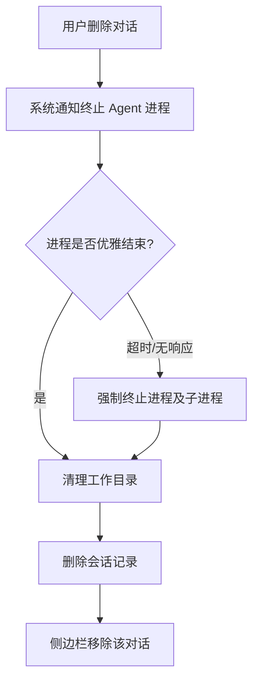
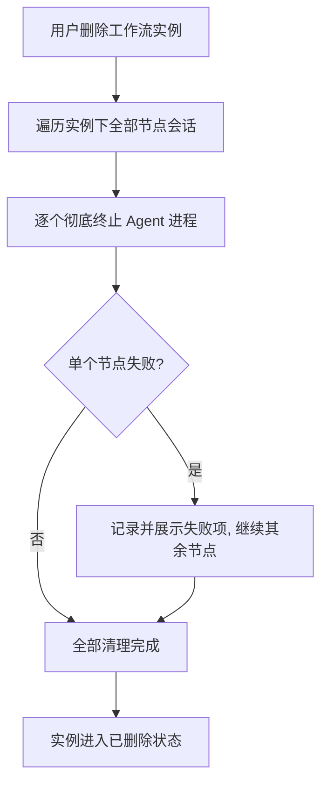
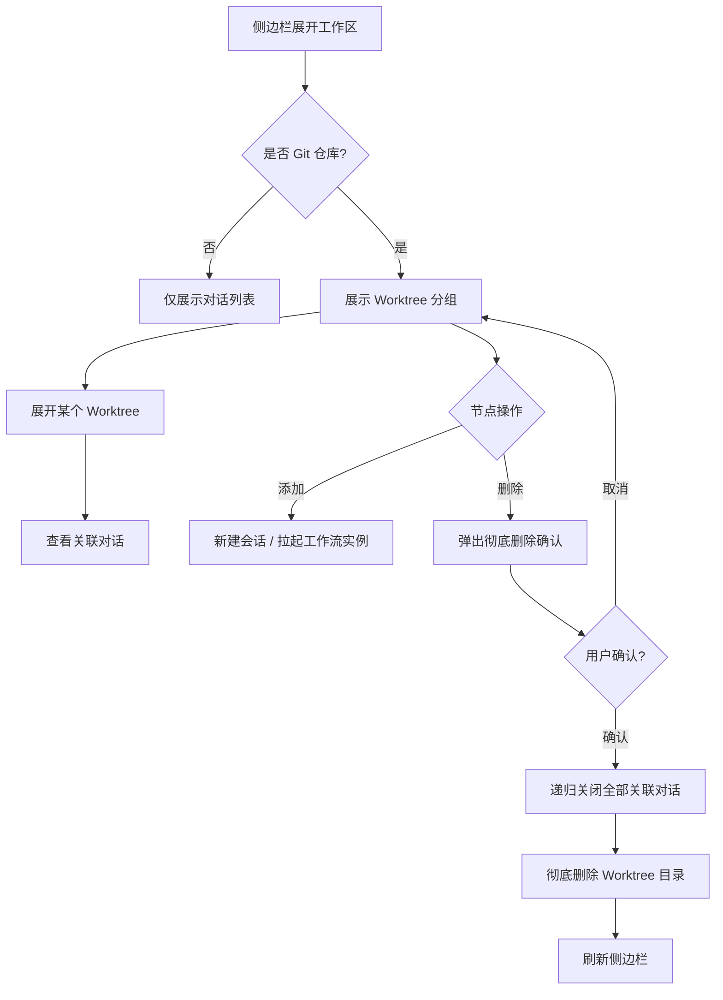

# 会话生命周期与 Worktree 管理增强

**功能名称**: 会话生命周期与 Worktree 管理增强
**PRD 版本**: v1.0
**创建日期**: 2026-08-17
**作者**: AI

## 背景与目标

### 1.1 背景

系统已支持会话（Session）管理和 Git Worktree 隔离工作目录，但在实际使用中暴露出两类问题：

1. **进程残留**: 用户删除单个对话、或在工作中直接删除整个工作流实例时，对应的 Agent 进程（ACP 进程）没有被可靠地彻底销毁。被删除会话的 Agent 进程可能仍在用户机器上运行，持续占用 CPU、内存，甚至继续修改文件，用户却无感知。
2. **Worktree 不可见、不可管**: Worktree 目前只是会话的附属属性，用户无法直观地看到「一个工作区下有哪些 Worktree、每个 Worktree 里有哪些对话」，也无法从 Worktree 维度统一操作（在其下新增对话、拉起工作流、或整体删除）。残留的无会话 Worktree 目录无法被发现和清理。

### 1.2 目标

- 任意入口删除会话（单独对话、工作流实例删除）时，对应的 Agent 进程被**彻底、可靠地销毁**，不留孤儿进程
- 左侧侧边栏以「工作区 → Worktree → 对话」的层级展示，仅当工作区是 Git 仓库时展示 Worktree 分组
- 用户可以在 Worktree 维度添加对话、拉起工作流实例
- 用户可以删除整个 Worktree：明确提示「彻底删除、不可恢复」，确认后递归关闭该 Worktree 下所有对话并彻底删除目录内容

### 1.3 成功标准

- 删除单个对话后，对应 Agent 进程在用户机器上不复存在（进程表可查）
- 删除工作流实例后，该实例下所有节点会话的 Agent 进程均被销毁
- 控制器重启、断线重连等异常场景下，重启后不存在归属已删除会话的孤儿 Agent 进程
- Git 仓库工作区在侧边栏展示 Worktree 分组；非 Git 仓库工作区不展示
- 每个 Worktree 节点可展开，展示与其关联的全部对话
- Worktree 节点提供「添加」（新建对话 / 拉起工作流实例）与「删除」操作
- 删除 Worktree 需经明确警示的确认步骤，确认后该 Worktree 下所有对话被关闭、目录内容被彻底删除且不可恢复

## 用户分析

### 2.1 目标用户

使用本系统进行 AI 辅助开发的开发者，尤其是同时维护多个会话、多个工作流实例、频繁使用 Git Worktree 隔离工作目录的重度用户。

### 2.2 用户场景

| 场景 | 用户角色 | 目标 | 痛点 |
|------|---------|------|------|
| 删除一个不再需要的对话 | 开发者 | 对话及其 Agent 进程一并消失 | 删除后 Agent 进程仍在后台运行，占用资源且可能继续改动文件 |
| 直接删除整个工作流实例 | 开发者 | 实例下所有会话全部终止 | 部分节点会话的进程残留，需要手动排查清理 |
| 查看工作区下有哪些 Worktree | 开发者 | 一目了然地管理并行工作目录 | Worktree 散落在会话列表里，只能靠图标辨认 |
| 在某个 Worktree 里继续开新对话 | 开发者 | 复用已有工作目录追加会话 | 只能从全局入口新建会话，无法指定落到已有 Worktree |
| 某个工作流跑完了，整体清理 | 开发者 | 一键删除 Worktree 及其中全部对话 | 需要逐个删除对话，目录残留还需手动删除 |

## 功能需求

### 3.1 功能概述

本需求包含两大块：一是**会话生命周期管理增强**——保证任何删除路径下 Agent 进程都被彻底销毁；二是**Worktree 可视化管理**——侧边栏按 Worktree 分组展示对话，并支持 Worktree 维度的添加与彻底删除。

### 3.2 功能列表

#### 功能点 1: 删除对话时彻底销毁 Agent 进程

- **描述**: 用户在任意入口删除一个对话（会话）时，系统必须保证该对话对应的 Agent 进程被彻底终止：先在Agent侧优雅结束会话，优雅结束受限时（超时、无响应）强制终止进程；进程终止必须覆盖其派生的全部子进程。终止完成后才继续后续的目录清理与记录删除。即使控制器处于离线、重启等异常状态，进程销毁也不能被静默跳过——恢复在线后必须补做清理。
- **用户价值**: 删除即终结，用户无需担心后台残留进程占用资源或继续修改文件。
- **验收标准**:
  - [ ] 删除对话后，对应 Agent 进程及其子进程在宿主机进程表中不存在
  - [ ] Agent 无响应时，系统在有限时间内强制终止，不会被卡死
  - [ ] 删除操作的清理顺序为：先终止进程，后清理工作目录，最后删除会话记录
  - [ ] 控制器离线时发起的删除，在控制器恢复在线后补做进程清理
  - [ ] 控制器自身重启后，自动识别并清理归属已删除会话的残留进程

#### 功能点 2: 删除工作流实例时销毁全部节点进程

- **描述**: 用户在工作流中直接删除整个工作流实例时，系统递归终止该实例所有节点关联的对话，每个对话都按功能点 1 的标准彻底销毁 Agent 进程。全部清理完成后实例进入已删除状态。
- **用户价值**: 一键终止整个工作流，不留任何残留进程。
- **验收标准**:
  - [ ] 删除工作流实例后，其全部节点会话的 Agent 进程均被销毁
  - [ ] 单个节点清理失败不阻塞其他节点的清理，且失败项对用户可见
  - [ ] 正在运行的节点（生成中）也能被可靠终止

#### 功能点 3: 侧边栏 Worktree 分组展示

- **描述**: 左侧侧边栏中，每个工作区下增加 Worktree 层级，仅当该工作区是 Git 仓库时展示。层级为：控制器 → 工作区 → Worktree → 对话。未使用 Worktree 的对话仍直接挂在工作区下。每个 Worktree 节点可展开/收起，展开后展示所有与该 Worktree 关联的对话（含工作流节点会话）。Worktree 节点展示分支名，空 Worktree（暂无关联对话）也应展示，便于用户发现残留目录。
- **用户价值**: 并行工作目录的结构一目了然，会话归属清晰可见。
- **验收标准**:
  - [ ] Git 仓库工作区展示 Worktree 分组，非 Git 仓库工作区不展示
  - [ ] Worktree 节点展示分支名称
  - [ ] Worktree 节点可展开，列出全部关联对话
  - [ ] 点击对话正常跳转会话页面
  - [ ] 没有关联对话的 Worktree 也能展示
  - [ ] 工作流实例的节点会话按其 Worktree 正确归组

#### 功能点 4: Worktree 节点添加操作

- **描述**: 每个 Worktree 节点提供「添加」按钮，点击后用户可选择两种操作：
  1. **添加单个会话**: 在该 Worktree 目录下新建一个对话（复用现有新建会话流程，工作目录预选为该 Worktree，不再重复创建 Worktree）
  2. **拉起工作流实例**: 在该 Worktree 关联的工作区下拉起一个工作流实例（复用现有工作流实例化流程）
- **用户价值**: 从上下文直接发起后续工作，减少操作路径。
- **验收标准**:
  - [ ] Worktree 节点展示「添加」按钮
  - [ ] 可选择「新建会话」，创建后对话落在该 Worktree 分组下
  - [ ] 可选择「拉起工作流实例」，完成后实例出现在工作流分组中

#### 功能点 5: Worktree 彻底删除

- **描述**: 每个 Worktree 节点提供「删除」按钮。点击后弹出确认提示，明确告知用户：该操作将**递归关闭所有从该 Worktree 路径启动的对话，并彻底删除该 Worktree 文件夹的全部内容，不可恢复**。用户确认后：
  1. 递归终止该 Worktree 路径下启动的所有对话（按功能点 1 标准销毁进程）
  2. 彻底删除 Worktree 目录的全部内容（不做代码暂存、不做保留，不可恢复）
  3. 清理对应的会话记录与侧边栏展示
- **用户价值**: 一步完成整个工作目录的彻底清理，避免逐个删除对话和手动删目录。
- **验收标准**:
  - [ ] Worktree 节点展示「删除」按钮
  - [ ] 删除前弹出确认提示，文案明确包含「彻底删除」「不可恢复」及将关闭的对话数量
  - [ ] 确认后该 Worktree 下所有对话被关闭、进程被销毁
  - [ ] Worktree 目录内容被彻底删除，文件夹不复存在
  - [ ] 取消确认弹窗则不产生任何变更
  - [ ] 删除过程中任一环节失败时向用户展示错误，已完成的部分不回滚、不隐藏

### 3.3 用户操作流程

#### 流程一：删除单个对话

#### 流程二：删除工作流实例

#### 流程三：Worktree 节点操作

### 3.4 页面/界面描述

| 页面 | 描述 | 关键元素 |
|------|------|---------|
| 左侧侧边栏 | 会话区域增加 Worktree 层级 | 控制器、工作区、Worktree 节点（分支名）、对话项 |
| Worktree 节点 | 可展开/收起，带操作按钮 | 分支名、展开箭头、「添加」按钮、「删除」按钮 |
| Worktree 添加菜单 | 点击「添加」后出现的操作选择 | 「新建会话」选项、「拉起工作流实例」选项 |
| Worktree 删除确认弹窗 | 删除前的强警示确认 | 警示文案（彻底删除、不可恢复）、将关闭的对话数量、「确认删除」「取消」按钮 |
| 新建会话对话框 | 从 Worktree 节点进入时预选工作目录 | 工作目录已填为该 Worktree 路径，不再展示 Worktree 创建选项 |

### 3.5 异常与边界情况

| 情况 | 预期行为 |
|------|---------|
| 删除对话时 Agent 进程无响应 | 有限时间等待后强制终止，不阻塞用户操作 |
| 删除对话时控制器离线 | 会话记录正常删除；控制器恢复在线后补做进程清理 |
| 控制器重启后发现残留进程 | 自动识别归属已删除会话的进程并清理 |
| 删除工作流实例时部分节点清理失败 | 不阻塞其余节点；失败项对用户可见 |
| 工作区不是 Git 仓库 | 侧边栏不展示 Worktree 分组 |
| Worktree 下没有关联对话 | 仍展示该 Worktree 节点，便于发现与清理 |
| 删除 Worktree 时其中有对话正在运行 | 先终止全部对话进程，再删除目录 |
| 删除 Worktree 目录失败（如权限不足） | 展示错误提示；已终止的对话不回滚 |
| 同一工作区存在多个 Worktree | 每个 Worktree 独立分组展示、独立操作 |
| 从 Worktree 节点新建会话 | 不再重复创建 Worktree，对话直接使用该目录 |

## 四、非功能需求

### 4.1 性能要求

- 进程强制终止等待上限不超过 10 秒
- 侧边栏 Worktree 分组的加载不明显增加侧边栏整体渲染时间
- 删除 Worktree（含递归关闭对话）在常规规模（10 个对话以内）下 30 秒内完成

### 4.2 安全性要求

- 彻底删除 Worktree 必须经过用户显式确认，且确认文案明确提示不可恢复
- 进程终止与目录删除仅限本系统管理的目录与进程，不得越界操作用户其他文件
- 进程清理指令通过加密通道传输

### 4.3 兼容性要求

- 进程彻底终止能力需覆盖 Windows / Linux / macOS
- 非 Git 仓库工作区、未启用 Worktree 的对话行为保持不变

## 五、依赖与约束

### 5.1 依赖

- 现有会话管理、工作流实例管理能力
- 现有 Git Worktree 创建/清理能力与控制器在线状态管理
- 用户宿主机安装 Git（Worktree 相关功能，版本 >= 2.5）

### 5.2 约束

- Worktree 彻底删除不做代码暂存（与单个对话删除时的暂存策略不同），以「不可恢复」语义为准
- 进程销毁以「彻底」为最高优先级：优雅结束只是优选路径，不能成为残留的理由
- 本需求不改变工作流引擎的节点编排逻辑，仅加强删除路径的清理能力

## 六、相关文档

- [[../released/20260523-git-worktree-support-prd.md]] — Git Worktree 支持
- [[../released/20260523-workspace-git-support-prd.md]] — 工作区 Git 支持
- [[../released/20260808-agent-workflow.md]] — Agent 工作流
- [[20260811-agent-workflow-phase2.md]] — Agent 工作流二期（草稿）
