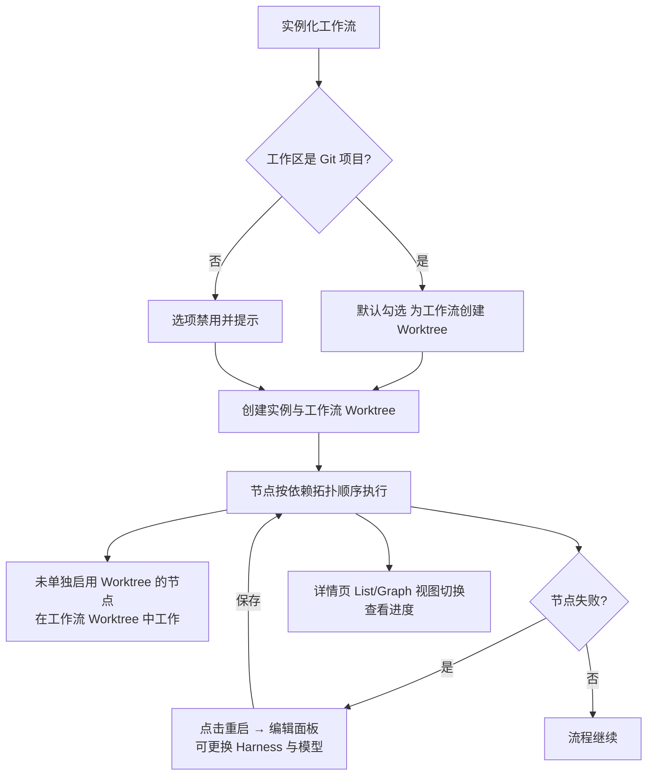

# 工作流优化 0821（Agent Workflow Optimization）

**功能名称**: 工作流优化
**PRD 版本**: v1.0
**创建日期**: 2026-08-21
**作者**: Kimi

## 一、背景与目标

### 1.1 背景

Agent 工作流（见 [[20260808-agent-workflow]]）上线后，用户已能通过模板定义「需求 → 方案 → 实现 → 评审 → 合并」的完整流程并自动串联多个会话。在实际使用中暴露出以下问题：

1. **工作流内多个会话的工作内容互相污染**：当前只有声明「需要 Worktree 支持」的节点才会隔离工作内容，其余节点会话直接在工作区根目录工作。一个工作流内往往有多个 AI 节点先后执行，后执行的会话会看到甚至误改前序会话未提交的内容。
2. **实例化偶发误报「控制器已下线」**：在控制器实际在线的情况下，实例化工作流偶尔提示控制器已下线/能力不可用，刷新页面后又能正常实例化，打断使用流程。
3. **节点顺序调整困难**：编辑工作流（模板/已配置工作流/实例化前的节点图）时，节点只能按固定顺序展示，无法通过拖拽调整展示顺序；而执行时序依赖依赖关系推导，展示顺序与执行顺序对不上时用户难以预判流程走向。
4. **实例详情只有单一列表视图**：节点树按阶段分组平铺，依赖关系不可见，用户无法直观理解「谁在等谁」。
5. **节点执行者信息不透明**：节点上看不到它由哪个 Harness 工具、哪个模型执行，排查问题时需要回到设置页翻配置。
6. **重启节点无法调整执行配置**：节点重启只能按原配置重来；当节点失败原因是 Harness 工具选错时，用户无法在不重建实例的前提下更换工具。

### 1.2 目标

1. **工作流级 Worktree 隔离**：实例化工作流时，若工作区是 Git 项目，支持为整个工作流创建一个专属 Worktree；未单独启用 Worktree 的 AI 节点会话统一在该工作流 Worktree 上工作。
2. **消除实例化误报**：控制器在线时实例化工作流不再误报「控制器已下线/能力不可用」。
3. **编辑体验升级**：编辑节点图时支持拖拽调整节点顺序；执行顺序严格按依赖关系拓扑排序。
4. **详情页多视图**：工作流实例详情页支持 List View（现状）与 Graph View（按依赖关系展示）切换。
5. **节点信息透明**：节点上直接展示其 Harness 工具与模型。
6. **可配置重启**：节点「重启」弹出编辑面板，可更换 Harness 工具等执行配置，保存后以新配置重启节点。

### 1.3 成功标准

- 在 Git 工作区实例化工作流时可一键创建工作流 Worktree，未单独启用 Worktree 的节点会话的工作目录均为该 Worktree 目录。
- 控制器在线状态下连续多次实例化工作流，不再出现「控制器已下线/能力不可用」误报。
- 编辑节点图时可通过拖拽调整节点展示顺序并保存；实例执行顺序与依赖关系一致。
- 实例详情页可在 List View 与 Graph View 间切换，Graph View 正确呈现节点依赖关系。
- 每个 AI 节点上可直接看到 Harness 与模型名称。
- 点击「重启」可在编辑面板中更换 Harness 并保存，节点以新配置重新拉起会话执行。

## 二、用户分析

### 2.1 目标用户

- **个人开发者**：日常使用工作流完成需求开发，需要工作内容隔离、进度可视、失败可快速恢复。
- **进阶用户**：自定义工作流模板，需要灵活编辑节点图并准确预判执行顺序。

### 2.2 用户场景

| 场景 | 用户角色 | 目标 | 痛点 |
|--|--|--|--|
| 在工作区跑完整需求工作流 | 开发者 | 各节点会话工作内容互不污染 | 未启用 Worktree 的节点直接在工作区根目录工作 |
| 实例化工作流 | 开发者 | 一次成功 | 偶发误报控制器已下线，需刷新重试 |
| 自定义工作流节点图 | 进阶用户 | 按自己的习惯排列节点 | 无法拖拽调整顺序，展示顺序与执行顺序对不上 |
| 跟踪工作流进度 | 开发者 | 直观看到节点依赖与当前卡点 | 只有阶段分组列表，依赖关系不可见 |
| 排查节点问题 | 开发者 | 快速确认节点用的 Harness 与模型 | 需要回设置页翻配置 |
| 节点失败重试 | 开发者 | 更换 Harness 后重跑该节点 | 重启只能按原配置重来 |

## 三、功能需求

### 3.1 功能概述

在现有工作流体系上做六处增强：工作流级 Worktree 隔离、实例化误报修复、节点图拖拽排序与按依赖拓扑执行、实例详情多视图（List/Graph）、节点展示 Harness 与模型、可更换执行配置的重启。

### 3.2 功能列表

#### 功能点 1：工作流级 Worktree

- **描述**: 实例化工作流时，若目标工作区是 Git 项目，提供一个「为工作流创建 Worktree」的选项（默认开启）。开启后，平台为该工作流实例创建一个专属 Worktree；实例中**未单独启用「初始化新 Worktree」的 AI 节点**，其会话统一在工作流 Worktree 目录中工作；已单独启用「初始化新 Worktree」的节点维持现有行为（创建节点自己的 Worktree）。工作流实例被删除时，工作流 Worktree 一并清理。工作区不是 Git 项目时，该选项不可选并给出说明。
- **用户价值**: 一次实例化即可获得整流程的工作内容隔离，无需逐节点配置；与现有节点级 Worktree 互不冲突。
- **验收标准**:
  - [ ] Git 工作区实例化工作流时，可见并默认勾选「为工作流创建 Worktree」选项；非 Git 工作区该选项禁用并说明原因。
  - [ ] 开启后，未单独启用 Worktree 的 AI 节点会话的工作目录均为工作流 Worktree 目录。
  - [ ] 单独启用「初始化新 Worktree」的节点仍创建节点自己的 Worktree，行为与现状一致。
  - [ ] 删除工作流实例时，其工作流 Worktree 被一并清理。

#### 功能点 2：实例化误报修复

- **描述**: 修复控制器实际在线、但实例化工作流偶发提示「控制器已下线/能力不可用」的问题；修复后，控制器在线时实例化不再误报，控制器真实离线时仍给出准确提示。
- **用户价值**: 消除需要刷新页面重试的打断，实例化结果可预期。
- **验收标准**:
  - [ ] 控制器在线时，连续多次实例化工作流均不出现「控制器已下线/能力不可用」误报。
  - [ ] 控制器真实离线时，实例化仍被阻止并提示离线原因。

#### 功能点 3：节点图拖拽排序与按依赖执行

- **描述**: 编辑工作流节点图（工作流模板、已配置工作流、实例化前的节点图编辑）时，支持通过拖拽调整节点的展示顺序并保存。工作流执行时，节点的执行顺序严格按照依赖关系拓扑排序：一个节点只有在其所有上游节点完成后才能开始，与展示顺序无关。
- **用户价值**: 展示顺序可自由整理、贴近阅读习惯；执行顺序有明确规则可依，两者不再互相干扰。
- **验收标准**:
  - [ ] 编辑节点图时可拖拽调整节点顺序，保存后再次打开保持该顺序。
  - [ ] 实例执行顺序与依赖关系一致：任一节点在其全部上游节点完成前不会开始。
  - [ ] 拖拽造成的展示顺序变化不影响执行顺序。

#### 功能点 4：实例详情多视图

- **描述**: 工作流实例详情页新增视图切换，支持两种视图：
  - **List View**：现状的按阶段分组节点树。
  - **Graph View**：以图形方式展示节点与依赖关系，节点按依赖顺序从左到右排布，可看到每个节点的状态。
- **用户价值**: 依赖关系一目了然，快速定位流程卡点。
- **验收标准**:
  - [ ] 实例详情页可在 List View 与 Graph View 之间切换，默认 List View。
  - [ ] Graph View 正确呈现节点间的依赖连线与节点状态，排布方向与执行顺序一致。
  - [ ] 两个视图中节点状态实时一致。

#### 功能点 5：节点展示 Harness 与模型

- **描述**: 工作流实例中的 AI 节点，在现有信息（名称、状态、返工次数）基础上，增加展示该节点的「Harness 工具」与「模型」。人类节点与旗帜节点不展示。
- **用户价值**: 无需回设置页即可确认每个节点由谁执行，排查问题更快。
- **验收标准**:
  - [ ] AI 节点上可见 Harness 工具与模型名称。
  - [ ] 通过「可配置重启」更换 Harness 后，节点上展示的信息同步更新。

#### 功能点 6：可配置重启

- **描述**: 节点的「重启」按钮按下后，弹出该节点的编辑面板（复用节点编辑能力），面板中可更换节点的 Harness 工具（及随之联动的 Mode、模型等执行配置）；点击「保存」后，以新配置重启该节点——即关闭当前会话、以新配置拉起全新会话重新执行该节点。节点产物、打回记录、返工次数的保留规则与现有重启一致。
- **用户价值**: 节点失败原因是工具选错时，无需重建整个工作流实例即可换工具重跑。
- **验收标准**:
  - [ ] 点击「重启」弹出编辑面板而非确认框，面板中可更换 Harness 工具及联动的执行配置。
  - [ ] 保存后节点以新配置重新拉起会话执行，产物与打回记录保留规则与现状一致。
  - [ ] 面板中不保存直接关闭时，节点不发生任何变化。

### 3.3 用户操作流程

### 3.4 页面/界面描述

| 页面 | 描述 | 关键元素 |
|------|------|---------|
| 实例化工作流弹窗 | 选择来源并编辑节点图后实例化 | 「为工作流创建 Worktree」选项（Git 工作区默认勾选，非 Git 禁用并提示）、节点图拖拽排序 |
| 工作流模板/已配置工作流编辑 | 编辑节点图 | 节点拖拽排序 |
| 工作流实例详情页 | 单实例全貌 | 视图切换（List/Graph）、Graph View 依赖图、节点上的 Harness 与模型 |
| 节点重启编辑面板 | 更换执行配置并重启 | Harness 选择及联动的 Mode/模型、保存/取消 |

### 3.5 异常与边界情况

| 情况 | 预期行为 |
|------|---------|
| 工作区不是 Git 项目 | 「为工作流创建 Worktree」选项禁用并说明原因，工作流仍可实例化（节点在工作区根目录工作） |
| 工作流 Worktree 创建失败 | 实例化失败并提示原因，不产生半成品实例 |
| 控制器真实离线 | 实例化被阻止并提示离线原因（无误报、不漏报） |
| 拖拽出循环依赖 | 保存时校验并拒绝，提示循环依赖 |
| 重启编辑面板中选择的 Harness 在控制器上不可用 | 保存时校验并给出提示，不执行重启 |
| 删除含工作流 Worktree 的实例 | 工作流 Worktree 与节点级 Worktree 一并清理 |
| Graph View 中节点数量较多 | 视图可正常缩放/平移浏览 |

## 四、非功能需求

### 4.1 性能要求

- Graph View 渲染 50 个节点以内的依赖图应流畅（首屏渲染秒级，拖拽/缩放无明显卡顿）。
- 实例化（含工作流 Worktree 创建）整体耗时不应显著超过现状，Worktree 创建失败需快速失败。

### 4.2 安全性要求

- 工作流 Worktree 仅创建在对应工作区所属的 Controller 上，路径与清理复用现有 Worktree 安全约束（删除白名单等）。

### 4.3 兼容性要求

- 未开启工作流 Worktree 的既有实例行为不变。
- List View 保持现状交互不变，Graph View 为新增视图。
- 既有「重启」的语义（关闭旧会话、全新会话、保留产物与打回记录）不变，仅入口改为编辑面板。

## 五、依赖与约束

### 5.1 依赖

- 会话创建时的 Worktree 隔离能力（已上线，见 [[20260523-git-worktree-support-prd]]）。
- 现有工作流体系（见 [[20260808-agent-workflow]]）与节点编辑能力。

### 5.2 约束

- 工作流级 Worktree 仅在 Git 工作区可用。
- 节点执行顺序由依赖关系唯一决定，拖拽仅影响展示顺序。

## 六、相关文档

- [[20260808-agent-workflow]]
- [[20260811-agent-workflow-phase2]]
- [[20260523-git-worktree-support-prd]]
- 技术提案：`docs/engineering/proposals/20260821-feat-workflow-optimization.md`
