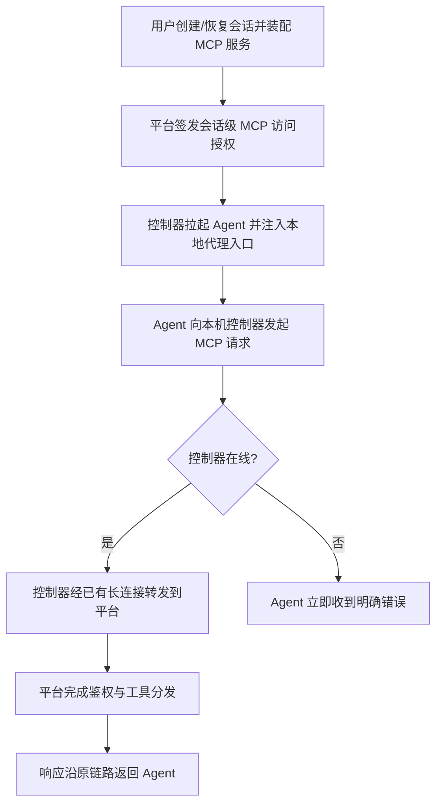

# MCP 传递重构一期（MCP Controller Proxy）

**功能名称**: MCP 传递重构
**PRD 版本**: v1.0
**创建日期**: 2026-08-29
**作者**: Kimi

## 一、背景与目标

### 1.1 背景

当前会话装配 MCP 服务后，Agent 进程需要通过**互联网直接访问平台服务的 MCP 入口**才能调用 MCP 工具。这套链路在实际使用中暴露出以下问题：

1. **平台服务必须对公网开放 MCP 入口**：只要用户要使用 MCP 能力，平台就必须暴露一个公网可达的访问地址，攻击面随之扩大。
2. **请求绕道公网，链路不合理**：Agent 进程与控制器通常运行在同一台用户机器上，MCP 调用却要绕道公网再到平台，延迟高、强依赖用户网络质量，网络抖动会直接表现为工具调用失败。
3. **私有化 / 内网部署困难**：平台没有公网可达地址（如仅内网部署、家庭宽带无公网 IP）时，MCP 能力完全不可用。
4. **凭证暴露面大**：会话级访问凭证需要随请求在公网链路上传输，泄露后的影响面被放大。

事实上，控制器与平台之间本就维持着一条已认证的长连接通道用于会话控制。MCP 访问完全可以复用这条通道，由本地控制器统一代理。

### 1.2 目标

本期为 **Break Change（不兼容变更）**，目标是：

1. **Agent 不再通过互联网访问平台服务**：Agent 进程的所有 MCP 访问都由同机的本地控制器代理，Agent 只与本地控制器通信。
2. **MCP 访问复用控制器已有长连接**：控制器通过其与平台之间已建立的连接转发所有 MCP 请求与响应，不新增 Agent 到平台的独立网络通路。
3. **平台 MCP 公网入口下线**：平台不再需要对 Agent 暴露公网 MCP 访问入口。

### 1.3 成功标准

- 会话装配 MCP 服务后，Agent 的 MCP 工具调用（工具列举、工具调用）在「除控制器长连接外无其他外网通路」的网络环境下全部正常。
- 平台 MCP 公网入口关闭后，新创建会话与恢复会话的 MCP 功能不受影响。
- 旧版本控制器接入时被明确拒绝，并提示用户升级，不产生「静默失败」的会话。
- MCP 调用失败时（控制器离线、会话结束、服务不可用），Agent 侧能收到明确的错误信息而非长时间挂起。

## 二、用户分析

### 2.1 目标用户

- **个人开发者**：日常使用装配了 MCP 服务的会话完成开发任务，关注 MCP 工具调用的稳定性与速度。
- **私有化 / 内网部署用户**：在无公网可达地址的环境部署平台，此前无法使用 MCP 能力。

### 2.2 用户场景

| 场景 | 用户角色 | 目标 | 痛点 |
|--|--|--|--|
| 会话中使用 MCP 工具 | 开发者 | 工具调用稳定、低延迟 | 调用绕道公网，受网络质量影响大，偶发超时失败 |
| 内网环境部署平台 | 私有化部署用户 | 在内网使用完整 MCP 能力 | 平台无公网地址时 MCP 完全不可用 |
| 平台安全运维 | 部署者 | 收敛平台公网暴露面 | 必须为 MCP 保留一个公网入口，且凭证在公网传输 |
| 升级到新版本 | 全部用户 | 平滑感知不兼容变更 | 旧版控制器若静默失效，排查成本高 |

## 三、功能需求

### 3.1 功能概述

将 Agent 的 MCP 访问从「公网直连平台」重构为「本地控制器代理」：Agent 只与同机控制器通信，控制器通过其与平台之间已有的长连接转发全部 MCP 请求；平台侧的 MCP 公网访问入口随之下线。

### 3.2 功能列表

#### 功能点 1: MCP 访问本地代理化

- **描述**: 会话装配 MCP 服务后，Agent 进程发起的所有 MCP 请求（初始化、工具列举、工具调用等）都由同机控制器接收并代理，经控制器与平台之间的已有连接完成转发，Agent 全程不直接访问平台服务。
- **用户价值**: MCP 调用不再依赖用户机器到平台公网入口的网络质量；内网 / 无公网 IP 环境下 MCP 能力可用。
- **验收标准**:
  - [ ] 装配 MCP 的会话中，Agent 发起的 MCP 请求目标地址均为本机控制器，无任何指向平台公网地址的请求
  - [ ] 工具列举与工具调用的功能表现与重构前一致（平台内置工具、用户注册的本地 MCP 命令均可用）
  - [ ] 在仅保留控制器长连接、阻断其他外网访问的网络环境下，MCP 工具调用正常

#### 功能点 2: 平台 MCP 公网入口下线

- **描述**: 平台不再提供面向 Agent 的公网 MCP 访问入口；会话的 MCP 访问鉴权与生命周期管理（签发、吊销）仍然保留，但只在平台内部链路生效。
- **用户价值**: 收敛平台公网攻击面；会话凭证不再出现在 Agent 到平台的公网传输链路上。
- **验收标准**:
  - [ ] 平台对外的 MCP 访问入口关闭后，新旧会话的 MCP 功能均不受影响
  - [ ] 会话结束 / 删除后，对应 MCP 访问立即失效，Agent 侧收到明确错误
  - [ ] 部署配置不再要求平台具备公网可达的 MCP 地址

#### 功能点 3: 版本门禁与升级提示（Break Change 保护）

- **描述**: 本期为不兼容变更，旧版本控制器无法在新平台下提供 MCP 能力。平台在控制器接入时进行版本校验，拒绝不兼容的旧版控制器并给出明确升级提示。
- **用户价值**: 避免旧版控制器接入后 MCP「静默失效」，降低排查成本。
- **验收标准**:
  - [ ] 旧版本控制器接入时被拒绝，拒绝原因明确指向版本不兼容
  - [ ] 用户在控制器侧能看到清晰的升级指引

### 3.3 用户操作流程

### 3.4 页面/界面描述

| 页面 | 描述 | 关键元素 |
|------|------|---------|
| 会话创建对话框 | 装配 MCP 服务的入口，交互不变 | MCP 服务多选列表 |
| MCP 服务管理页 | 管理已注册的 MCP 服务，交互不变 | 服务列表、启用开关 |
| 控制器接入提示 | 旧版控制器被拒绝时的提示 | 版本不兼容说明、升级指引 |

### 3.5 异常与边界情况

| 情况 | 预期行为 |
|------|---------|
| 控制器长连接断开 | Agent 的 MCP 请求立即返回明确错误（连接不可用），不无限挂起；连接恢复后新请求自动恢复 |
| 会话结束 / 被删除 | 该会话的 MCP 访问授权被吊销，后续请求返回明确错误 |
| 平台侧 MCP 服务不可用 | 错误信息沿代理链路透传回 Agent，包含可操作的原因描述 |
| 单次 MCP 调用超时 | 按约定超时时间返回超时错误，不影响后续请求 |
| 旧版本控制器接入 | 被拒绝并提示版本不兼容，不创建会话 |
| 会话恢复（Resume） | MCP 授权重新签发，本地代理入口随之更新，Agent 侧无感 |

## 四、非功能需求

### 4.1 性能要求

- MCP 工具调用的端到端延迟不劣于现有公网直连链路（本地代理引入的额外耗时应为毫秒级）。
- 单个会话的并发 MCP 请求互不影响，单个请求超时不阻塞其他请求。

### 4.2 安全性要求

- 会话级访问凭证不再出现在 Agent 到平台的公网传输链路上。
- 本地代理入口仅监听本机回环地址，不对外网开放。
- 平台侧鉴权与吊销语义保持不变：会话结束即失效。

### 4.3 兼容性要求

- 本期为 **Break Change**：新版平台不兼容旧版本控制器的 MCP 能力，通过版本门禁显式拒绝旧版控制器。
- 用户已注册的 MCP 服务（平台内置工具、本地注册的 MCP 命令）配置数据不受影响，无需重新注册。

## 五、依赖与约束

### 5.1 依赖

- 控制器与平台之间已认证的长连接通道（现有会话控制链路）。
- 现有 MCP 服务注册与装配体系（见 [[20260530-mcp-proxy-config]] 及其后续迭代）。

### 5.2 约束

- 不新增 Agent 到平台的独立网络通路，MCP 流量必须复用控制器已有连接。
- 重构期间平台内置工作流工具（workflow 相关 MCP 能力）必须保持可用，工作流执行不受阻断。

## 六、相关文档

- [[20260530-mcp-proxy-config]] — MCP 代理服务管理与配置下发（现状链路的来源）
- 技术提案：`docs/engineering/proposals/20260829-refactor-mcp-controller-proxy.md`
