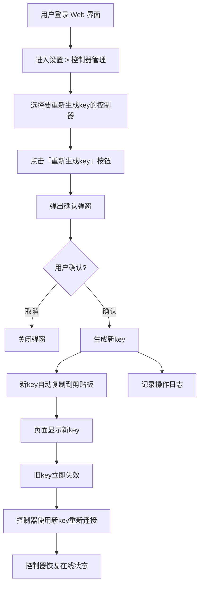

# 控制器Key重新生成

**功能名称**: 控制器Key重新生成
**PRD 版本**: v1.0
**创建日期**: 2026-08-30
**作者**: ZeroAsh

## 背景与目标

### 1.1 背景

在控制器管理功能中，用户需要为已绑定的控制器重新生成key，以应对以下场景：

1. **安全考虑**：当前key可能泄露，需要重新生成以确保安全
2. **定期轮换**：需要定期轮换key以符合安全策略
3. **功能完善**：完善控制器管理功能，提供key管理能力

当前系统仅支持生成新的未绑定key和解绑控制器，不支持为已绑定的控制器重新生成key。这导致用户在需要更换key时，必须先解绑控制器，再重新绑定，流程繁琐且可能导致控制器短暂离线。

### 1.2 目标

- 在控制器管理页面为已绑定的控制器提供「重新生成key」功能
- 新key生成后，旧key立即失效，控制器需要使用新key重新连接
- 操作权限控制为仅控制器所有者可操作
- 操作日志记录谁在什么时间重新生成了哪个控制器的key

### 1.3 成功标准

- 控制器所有者可以在控制器管理页面为已绑定的控制器重新生成key
- 新key生成后自动复制到剪贴板，并在页面显示
- 旧key立即失效，控制器使用新key重新连接后恢复在线状态
- 操作日志记录完整，可追溯

## 用户分析

### 2.1 目标用户

- **控制器所有者**：需要管理自己控制器的key安全
- **安全管理员**：需要定期轮换key以符合安全策略

### 2.2 用户场景

| 场景 | 用户角色 | 目标 | 痛点 |
|--|--|--|--|
| key泄露应急处理 | 控制器所有者 | 怀疑key泄露，立即重新生成新key | 当前需要先解绑再重新绑定，流程繁琐 |
| 安全策略执行 | 安全管理员 | 定期轮换key以符合安全策略 | 缺少便捷的key重新生成功能 |
| 功能完善 | 控制器所有者 | 希望有更好的key管理能力 | 当前key管理功能不完善 |

## 功能需求

### 3.1 功能概述

在控制器管理页面为已绑定的控制器提供「重新生成key」功能，支持控制器所有者为控制器重新生成key，旧key立即失效，新key自动复制到剪贴板并显示在页面上。

### 3.2 功能列表

#### 功能点 1: 重新生成key按钮

- **描述**: 在控制器管理页面，为已绑定的控制器提供「重新生成key」按钮
- **用户价值**: 提供便捷的key重新生成入口，无需解绑再重新绑定
- **验收标准**:
  - [ ] 控制器管理页面为已绑定的控制器显示「重新生成key」按钮
  - [ ] 点击按钮后弹出确认弹窗，提示用户重新生成key后旧key将立即失效
  - [ ] 确认弹窗中显示控制器名称和当前绑定状态
  - [ ] 仅控制器所有者可看到并操作该按钮

#### 功能点 2: 确认弹窗

- **描述**: 点击「重新生成key」按钮后弹出确认弹窗，确认后生成新key
- **用户价值**: 防止误操作，确保用户了解重新生成key的后果
- **验收标准**:
  - [ ] 弹窗标题为「重新生成Key」
  - [ ] 弹窗内容提示：「重新生成key后，旧key将立即失效，控制器需要使用新key重新连接。是否继续？」
  - [ ] 弹窗显示控制器名称和当前绑定状态
  - [ ] 提供「确认」和「取消」按钮
  - [ ] 点击「确认」后生成新key，点击「取消」关闭弹窗

#### 功能点 3: 新key生成与展示

- **描述**: 确认后生成新key，自动复制到剪贴板，并在页面显示
- **用户价值**: 新key生成后立即可用，无需手动复制
- **验收标准**:
  - [ ] 新key生成后自动复制到剪贴板
  - [ ] 新key显示在页面上，用户可手动复制
  - [ ] 页面显示提示：「新Key已生成并复制到剪贴板，请妥善保存」
  - [ ] 旧key立即失效，控制器使用新key重新连接后恢复在线状态

#### 功能点 4: 操作日志记录

- **描述**: 记录谁在什么时间重新生成了哪个控制器的key
- **用户价值**: 提供操作追溯能力，便于审计和问题排查
- **验收标准**:
  - [ ] 重新生成key操作记录到操作日志
  - [ ] 日志包含：操作人、操作时间、控制器名称、操作类型
  - [ ] 操作日志可在系统日志中查询

### 3.3 用户操作流程

### 3.4 页面/界面描述

| 页面 | 描述 | 关键元素 |
|------|------|---------|
| 控制器管理页 | 展示控制器列表，提供重新生成key功能 | 控制器列表、重新生成key按钮、确认弹窗、新key展示区 |
| 确认弹窗 | 确认重新生成key操作 | 控制器名称、当前绑定状态、确认按钮、取消按钮 |
| 操作日志页 | 查看操作日志 | 操作人、操作时间、控制器名称、操作类型 |

### 3.5 异常与边界情况

| 情况 | 预期行为 |
|------|---------|
| 控制器已离线 | 允许重新生成key，控制器重新上线后使用新key连接 |
| 网络断开 | 提示网络错误，重新生成key操作失败 |
| 重复操作 | 每次操作生成新的key，旧key立即失效 |
| 非控制器所有者操作 | 按钮不可见或不可点击，提示无权限 |
| 控制器正在执行任务 | 允许重新生成key，但可能中断当前任务 |

## 四、非功能需求

### 4.1 性能要求

- key重新生成操作响应时间不超过2s
- 新key生成后立即生效，无需等待

### 4.2 安全性要求

- key重新生成操作需要权限验证
- 新key传输和存储需加密
- 操作日志需要安全存储，防止篡改

### 4.3 兼容性要求

- 兼容现有控制器版本
- 重新生成key后，控制器无需升级即可使用新key

## 五、依赖与约束

### 5.1 依赖

- 控制器管理功能（已上线）
- 用户认证系统（已有）
- 操作日志系统（已有）

### 5.2 约束

- 仅控制器所有者可操作
- 重新生成key后，旧key立即失效
- 控制器需要使用新key重新连接

## 六、相关文档

- [[20260517-agent-controller-v1]] — Agent 控制器管理 v1