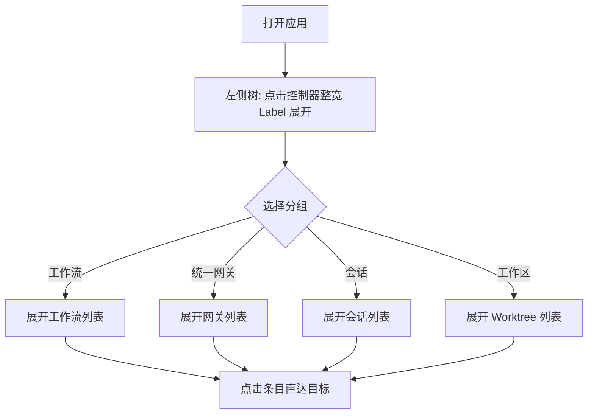
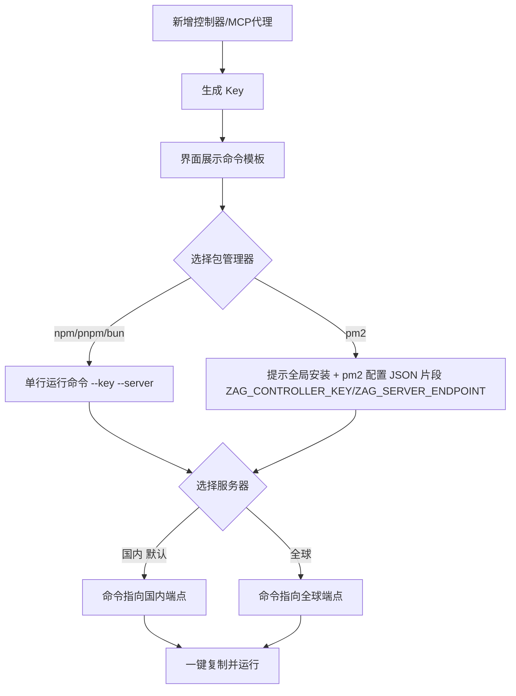
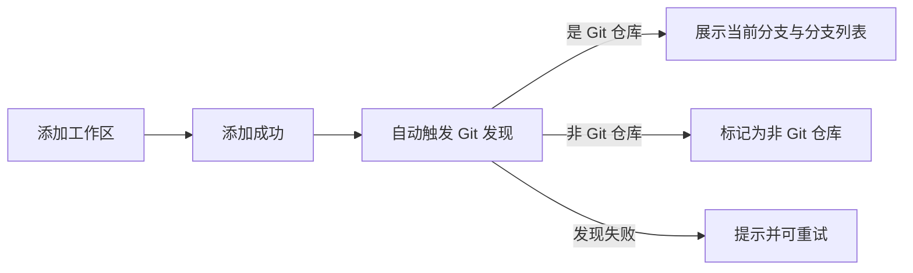

# 综合体验优化一期

**功能名称**: 综合体验优化一期
**PRD 版本**: v1.0
**创建日期**: 2026-09-07
**作者**: ZeroAsh

## 背景与目标

### 1.1 背景

随着工作流、统一网关、Worktree 等能力陆续上线，左侧会话树承载的信息越来越多，当前的树形组织方式暴露出三类体验问题：

1. **导航层级混乱**：工作流挂在工作区之下、统一网关平铺在控制器之下，用户难以快速定位「工作流」「会话」「统一网关」等一级概念；树节点使用缩进折叠，层级深时可读性差。
2. **新手上手门槛高**：新增控制器或 MCP 代理时只展示一个 Key，用户需要自行翻阅文档才能拼出启动命令，接入步骤断裂。
3. **状态感知滞后**：添加工作区后，Git 仓库与分支信息需要用户手动进入工作区才会被发现，添加后无法立即看到分支、创建 Worktree。

### 1.2 目标

1. 重构左侧会话树的信息架构，使「工作流 / 统一网关 / 会话 / 工作区」成为控制器下的四个平级分组，用户一键直达目标列表。
2. 新增控制器 / MCP 代理时提供开箱即用的启动命令模板，用户复制即可运行，无需查阅文档。
3. 添加工作区后立即完成 Git 仓库与分支发现，后续操作（新建会话、创建工作流）零等待。

### 1.3 成功标准

- 用户在左侧树中定位任意工作流 / 网关 / 会话 / Worktree 的点击次数不超过 3 次（展开控制器 → 展开分组 → 点击条目）。
- 新用户拿到控制器启动命令无需离开产品界面，命令可直接复制运行。
- 添加工作区完成后，该工作区的 Git 状态（是否仓库、当前分支、分支列表）无需额外操作即可展示。

## 用户分析

### 2.1 目标用户

- **个人开发者（主要）**：在多台机器上运行控制器，同时管理多个工作区、工作流与会话。
- **新接入用户**：第一次部署控制器或 MCP 代理，对产品命令行参数不熟悉。

### 2.2 用户场景

| 场景 | 用户角色 | 目标 | 痛点 |
|--|--|--|--|
| 在多个工作流之间切换 | 个人开发者 | 快速找到并打开某个工作流 | 工作流埋在工作区层级下，树深且缩进密集，不易扫读 |
| 找到某个进行中/已归档的会话 | 个人开发者 | 按控制器浏览全部会话 | 会话没有独立分组，混在树中难以定位 |
| 在新机器上部署控制器 | 新接入用户 | 复制一条命令直接启动 | 只给 Key 不给命令，需查文档拼装参数 |
| 使用 pm2 托管控制器进程 | 进阶用户 | 以守护进程方式运行控制器 | 不清楚如何用环境变量传递 Key 与服务器地址 |
| 添加新工作区后立即拉分支建会话 | 个人开发者 | 添加完马上看到分支并操作 | Git 信息要进入工作区才加载，流程被卡住 |

## 功能需求

### 3.1 功能概述

对左侧导航进行信息架构重构与视觉优化；在新增控制器 / MCP 代理时提供可配置的启动命令模板；添加工作区时立即触发 Git 与分支发现。

### 3.2 功能列表

#### 功能点 1: 会话树信息架构重构

- **描述**: 左侧树以「控制器」为根，控制器下固定提供四个平级分组：工作流、统一网关、会话、工作区，各自展开后展示对应列表（工作流列表、统一网关列表、会话列表、Worktree 列表）。控制器本身沿现有样式，去掉右侧下拉指示图标。
- **用户价值**: 一级概念平级呈现，定位路径可预期，不再需要理解「工作流挂在工作区下」这类隐含规则。
- **验收标准**:
  - [ ] 每个控制器节点下依次展示「工作流 / 统一网关 / 会话 / 工作区」四个分组入口
  - [ ] 展开任一分组可看到对应条目列表，且可直接跳转/打开
  - [ ] 控制器节点不再显示右侧下拉图标，交互行为其余保持不变

#### 功能点 2: 树节点折叠样式优化

- **描述**: 控制器级节点使用「整宽 Label 折叠」：整个控制器行作为可点击折叠区域，占满侧边栏全部宽度，不再使用缩进式折叠；其下四个分组使用带引导线（竖向连接线）的窄缩进折叠。
- **用户价值**: 折叠区域更大更易点击；引导线帮助用户理解层级归属；窄缩进为列表内容留出更多横向空间。
- **验收标准**:
  - [ ] 控制器行整宽可点击折叠/展开
  - [ ] 四个分组在控制器折叠区内以带引导线的窄缩进样式呈现
  - [ ] 展开状态下条目文本不被缩进过度挤压

#### 功能点 3: 创建工作流支持选择工作区

- **描述**: 创建工作流时新增「工作区」下拉选择框，用户可在创建过程中指定该工作流所属的工作区。
- **用户价值**: 不必先进入目标工作区再创建工作流，减少操作往返。
- **验收标准**:
  - [ ] 创建工作流界面出现工作区下拉框，列出当前控制器下可选工作区
  - [ ] 选择工作区后创建的工作流归属该工作区

#### 功能点 4: 左侧侧边栏优化

- **描述**:
  1. 去掉「会话」标题文字，新建会话按钮只保留图标，并移至侧边栏底部；
  2. 增加侧边栏整体宽度；
  3. 统一网关分组的「新增」按钮改为与工作流分组「新增」按钮相同的样式。
- **用户价值**: 界面更简洁、信息密度更合理；同类操作视觉一致，降低学习成本。
- **验收标准**:
  - [ ] 侧边栏不再出现「会话」标题
  - [ ] 新建会话图标按钮固定在侧边栏底部
  - [ ] 侧边栏宽度较当前版本增加
  - [ ] 统一网关与工作流的新增按钮样式一致

#### 功能点 5: 控制器 / MCP 代理启动命令模板

- **描述**: 新增控制器或 MCP 代理（生成 Key）时，界面同时展示一个启动命令模板。用户可自选包管理器（npm / pnpm / bun / pm2）与服务器区域（全球 / 国内），界面实时给出对应运行指令，例如 `npx agent-gear --key {对应的key} --server {serverEndpoint}`。服务器地址：全球 `https://zag-ctrl-api.fffdan.com`，国内 `https://ctrl.zag.cn.fffdan.com`。默认选中 npm + 国内服务器。选择 pm2 时，界面改为先提示使用包管理工具全局安装（如 `npm install -g agent-gear`），随后给出一段 pm2 应用配置 JSON 代码片段（形如 `{ "apps": [{ ... }] }`），配置中通过环境变量 `ZAG_CONTROLLER_KEY` 与 `ZAG_SERVER_ENDPOINT` 传递 Key 与服务器地址，用户保存为配置文件后以 pm2 启动。
- **用户价值**: 复制即用，无需查阅文档；覆盖常见进程托管方式（pm2）。
- **验收标准**:
  - [ ] 新增控制器与新增 MCP 代理时均展示命令模板
  - [ ] 包管理器支持 npm / pnpm / bun / pm2 四种选项，默认 npm
  - [ ] 服务器支持全球 / 国内两个选项，默认国内，命令中的地址随选择变化
  - [ ] 选择 pm2 时先展示全局安装提示（如 `npm install -g agent-gear`），随后展示 pm2 应用配置 JSON 片段（`{ "apps": [{ ... }] }`），其中通过 `ZAG_CONTROLLER_KEY`、`ZAG_SERVER_ENDPOINT` 环境变量传递配置
  - [ ] 命令中自动填入本次生成的 Key，支持一键复制

#### 功能点 6: 工作区 Git 与分支默认发现

- **描述**: 添加工作区成功后立即自动进行 Git 仓库与分支发现，无需用户进入工作区；发现结果（是否 Git 仓库、当前分支、分支列表）直接可用于后续操作。
- **用户价值**: 添加即就绪，后续新建会话、创建工作流时分支信息零等待。
- **验收标准**:
  - [ ] 添加工作区完成后，无需任何额外操作即可看到该工作区的 Git 状态与分支信息
  - [ ] 非 Git 目录的工作区添加后明确标记为「非 Git 仓库」
  - [ ] 发现过程失败（如控制器离线）时不阻塞添加操作，并给出可重试的提示

### 3.3 用户操作流程

### 3.4 页面/界面描述

| 页面 | 描述 | 关键元素 |
|------|------|---------|
| 左侧侧边栏 | 承载会话树与全局新建入口 | 控制器整宽折叠行、四个分组（带引导线窄缩进）、底部新建会话图标按钮、加宽后的栏体 |
| 创建工作流界面 | 创建工作流的表单/向导 | 新增工作区下拉框 |
| 新增控制器界面 | 生成控制器 Key 的区域 | Key 展示、包管理器选择、服务器选择、命令模板、复制按钮 |
| 新增 MCP 代理界面 | 生成 MCP 代理 Key 的区域 | 同上命令模板组件 |
| 工作区列表项 | 展示单个工作区状态 | Git 状态标记、当前分支、分支信息（添加后即展示） |

### 3.5 异常与边界情况

| 情况 | 预期行为 |
|------|---------|
| 控制器离线时展开其分组 | 展示缓存/最近已知数据，并标记离线状态 |
| 控制器下某分组为空（如无工作流） | 展示空状态提示与该分组的新建入口 |
| 生成的 Key 尚未复制就关闭界面 | 遵循现有 Key 仅展示一次的策略，命令模板随 Key 一并提示用户保存 |
| 添加工作区时控制器离线 | 工作区正常落库，Git 发现标记为待发现/失败，控制器上线后可重试 |
| 添加的工作区路径不是 Git 仓库 | 明确展示「非 Git 仓库」，不展示分支信息 |
| 侧边栏加宽后在小屏/移动端 | 遵循现有移动端布局策略，宽度调整仅作用于桌面端 |

## 四、非功能需求

### 4.1 性能要求

- 树结构展开/折叠交互响应即时，大量条目（数十个工作流/会话）下不卡顿。
- Git 发现为异步进行，不阻塞添加工作区的主流程。

### 4.2 安全性要求

- 命令模板中的 Key 仅在生成时展示，遵循现有 Key 明文不落库的策略。

### 4.3 兼容性要求

- 侧边栏宽度调整与树结构重构需兼容现有桌面端与移动端布局。
- 命令模板覆盖 npm / pnpm / bun / pm2 四种主流方式。

## 五、依赖与约束

### 5.1 依赖

- 现有控制器、工作区、工作流、统一网关、会话数据均已具备，无需新增业务实体。
- Git 发现依赖控制器在线执行探测。

### 5.2 约束

- 控制器节点交互仅移除下拉图标，其余行为沿用现状。
- Key 安全策略不变：明文仅生成时可见。

## 六、相关文档

- 技术提案：`docs/engineering/proposals/20260907-feat-experience-optimization-phase1.md`
