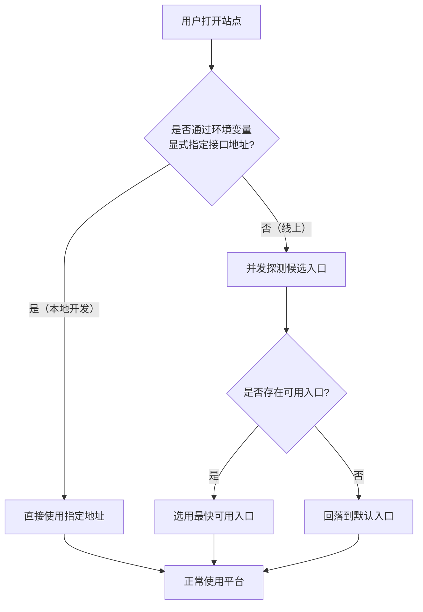

# 前端支持服务器自动选择

**功能名称**: 前端支持服务器自动选择
**PRD 版本**: v1.0
**创建日期**: 2026-09-08
**作者**: Kimi

## 一、背景与目标

### 1.1 背景

线上环境目前有两个可用的 API 入口：

- `https://api.zag.fffdan.com`
- `https://zag-agent-api.fffdan.com`

两个入口指向同一套服务，但不同用户从不同网络环境访问时，两个入口的延迟与可用性并不一致。当前前端固定使用单一入口，用户实际访问速度完全取决于该入口到用户的网络质量——当固定入口对某用户较慢甚至不可达时，即使另一个入口畅通，用户也无法受益。

### 1.2 目标

1. **自动选择最快入口**：线上环境中，前端自动在两个 API 入口之间测速，并选用响应最快的入口提供服务。
2. **本地开发零影响**：本地开发仍然使用环境变量传入的接口地址，自动选择逻辑不介入、不改变本地开发体验。

### 1.3 成功标准

- 线上环境访问时，前端实际使用的 API 入口是两个候选入口中测速最快且可用的一者。
- 当其中一个入口不可用时，前端自动落在可用的入口上，功能不受影响。
- 两个入口均不可用时，前端行为不劣于现状（仍按默认入口发起请求，错误表现与当前一致）。
- 本地开发通过环境变量指定接口地址时，前端严格使用该地址，不发生任何测速与自动切换行为。

## 二、用户分析

### 2.1 目标用户

- **平台使用者（线上）**：通过线上站点使用平台的用户，网络环境各异。
- **开发者（本地）**：在本地进行开发调试的开发者，通过环境变量指定后端地址。

### 2.2 用户场景

| 场景 | 用户角色 | 目标 | 痛点 |
|------|----------|------|------|
| 线上访问平台 | 平台使用者 | 页面与数据加载尽可能快 | 固定入口对自己的网络可能较慢，无法利用更快的另一入口 |
| 固定入口故障/不可达 | 平台使用者 | 平台仍然可用 | 单一入口故障时整个站点不可用 |
| 本地开发调试 | 开发者 | 请求打到本地/指定的后端 | 担心自动选择逻辑干扰本地联调 |

## 三、功能需求

### 3.1 功能概述

线上环境下，前端在启动时自动对候选 API 入口进行测速，选择最快可用的入口作为本次会话的服务入口；本地开发环境通过环境变量指定入口时，跳过测速、直接使用指定地址。

### 3.2 功能列表

#### 功能点 1：线上环境自动测速选择入口

- **描述**: 线上环境中，前端启动时对两个候选 API 入口（`https://api.zag.fffdan.com`、`https://zag-agent-api.fffdan.com`）进行健康探测，选用响应最快且可用的入口。本次会话内平台内所有对该服务的访问（数据查询、实时消息等）统一走选中的入口。
- **用户价值**: 用户始终连接对自己网络最优的入口，获得更快的加载与交互体验；单一入口故障时自动兜底到可用入口。
- **验收标准**:
  - [ ] 线上环境打开站点，实际请求的入口为两个候选入口中测速最快且可用者。
  - [ ] 人为阻断其中一个入口后刷新页面，站点自动使用另一入口，功能正常。
  - [ ] 两个入口均不可用时，站点表现不劣于现状（按默认入口发起请求并正常报错）。
  - [ ] 测速不造成明显的启动卡顿，探测有超时上限，超时后自动按既有结果或默认入口继续。

#### 功能点 2：本地开发环境变量优先

- **描述**: 当通过环境变量显式指定了接口地址时（本地开发的既有方式），前端直接使用该地址，完全不执行测速与自动选择。
- **用户价值**: 本地开发联调行为与现状完全一致，不受新功能干扰。
- **验收标准**:
  - [ ] 本地以环境变量指定接口地址启动时，所有请求均发往该地址。
  - [ ] 本地开发过程中不产生任何对线上候选入口的探测请求。

### 3.3 用户操作流程

### 3.4 页面/界面描述

本功能无界面变更，对用户透明。

| 页面 | 描述 | 关键元素 |
|------|------|---------|
| 无 | 入口选择过程在后台自动完成，无需用户感知与操作 | — |

### 3.5 异常与边界情况

| 情况 | 预期行为 |
|------|---------|
| 其中一个入口超时/不可达 | 自动使用另一可用入口，用户无感知 |
| 两个入口均不可达 | 回落到默认入口，按现状呈现加载失败/错误提示 |
| 探测响应极慢 | 达到超时上限即判定该入口本次不可用，不阻塞整体启动 |
| 同一会话内入口中途变慢或故障 | 本次会话不做动态切换，刷新后重新测速选择 |
| 本地开发指定了接口地址 | 严格使用指定地址，不发起任何探测 |

## 四、非功能需求

### 4.1 性能要求

- 入口探测应与站点启动并行进行，单次探测设置超时上限，整体不显著增加可感知的启动时间。
- 测速结果在单次会话内复用，避免每次操作重复探测。

### 4.2 安全性要求

- 候选入口列表为平台自有域名，不向用户暴露可配置入口，不引入第三方地址。

### 4.3 兼容性要求

- 不改变任何现有功能的行为与界面。
- 本地开发、编排启动等既有开发流程不受任何影响。

## 五、依赖与约束

### 5.1 依赖

- 两个候选入口均提供可用的健康检查能力。

### 5.2 约束

- 候选入口固定为文档中列出的两个线上地址。
- 仅覆盖前端到 API 服务的入口选择，不涉及其他服务地址的选取逻辑。

## 六、相关文档

- 技术提案：[[20260908-feat-frontend-auto-select-server]]
