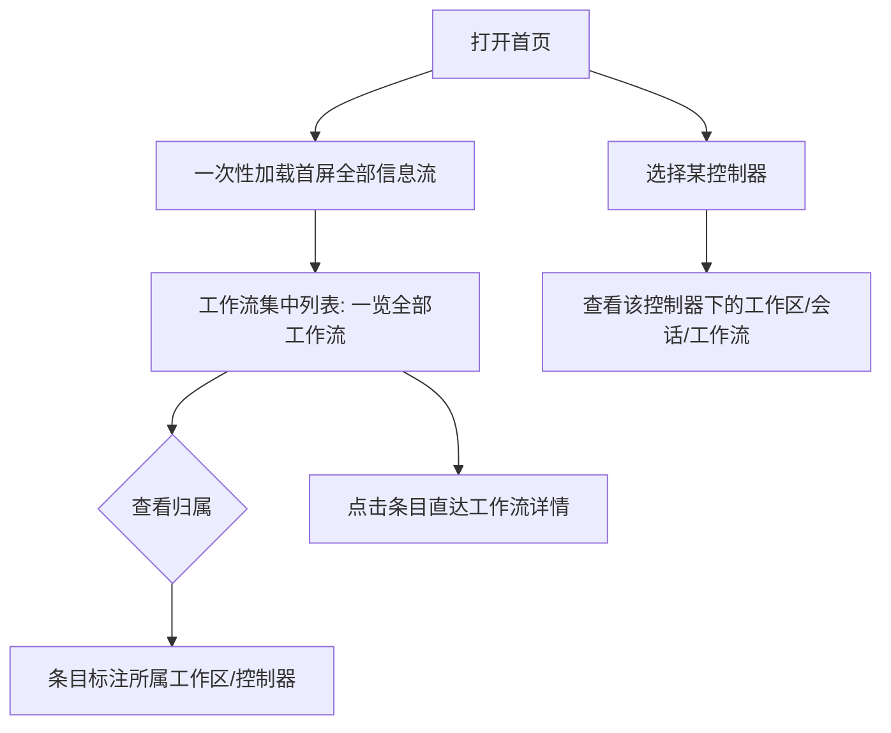

# 首页展示优化

**功能名称**: 首页展示优化
**PRD 版本**: v1.0
**创建日期**: 2026-10-13
**作者**: Kimi

## 背景与目标

### 1.1 背景

当前首页与侧边栏在展示上存在两类体验问题：

1. **工作流分散在工作区之下**：用户想查看全部工作流时，需要逐个展开工作区才能看到其中的工作流，跨工作区对比、定位某个工作流非常不便；当工作区数量增多时，查找成本随之线性上升。
2. **首页信息流分多次加载**：首页的不同信息流（会话统计、控制器状态、工作区、工作流、待办等）各自独立加载，打开首页会串行/并行触发大量请求，首屏内容分批到达、页面多次闪烁重排；工作区与控制器越多，请求越多，加载越慢。

### 1.2 目标

1. 工作流在首页/侧边栏集中展示，用户无需逐个工作区展开即可一览全部工作流，同时保留其归属信息（所属工作区、所属控制器）。
2. 支持以「控制器」为维度浏览其下的工作区、会话、工作流，归属关系清晰可查。
3. 首页各信息流整合为一次加载：打开首页只发起一次数据获取，首屏内容一次性到达。

### 1.3 成功标准

- 用户在不展开任何工作区的情况下，可以看到全部工作流列表，并能识别每条工作流所属的工作区与控制器。
- 用户可以选定某个控制器，查看该控制器下的工作区、会话、工作流。
- 首页打开时仅发起一次数据请求即可完成首屏渲染；工作区/控制器数量增加时请求次数不变。
- 首页首屏数据一次到达，不出现因多路请求先后返回导致的多次闪烁重排。

## 用户分析

### 2.1 目标用户

- **个人开发者（主要）**：在多台机器上运行控制器，同时管理多个工作区、会话与工作流，需要快速总览全局状态。
- **重度工作流用户**：并行运行多个工作流，需要跨工作区一览全部工作流的进展。

### 2.2 用户场景

| 场景 | 用户角色 | 目标 | 痛点 |
|--|--|--|--|
| 查看所有工作流的进展 | 重度工作流用户 | 一览全部工作流及其状态 | 工作流分散在各工作区下，需逐个展开查找 |
| 查看某台机器上的工作情况 | 个人开发者 | 按控制器查看其工作区、会话、工作流 | 缺少按控制器维度的统一视图，归属关系靠记忆 |
| 打开首页了解全局动态 | 个人开发者 | 快速看到会话、控制器、工作流、待办等概览 | 首页分多路加载，内容分批出现、闪烁重排，机器/工作区越多越慢 |

## 功能需求

### 3.1 功能概述

将工作流从「按工作区分组展示」改为「集中展示」；提供按控制器浏览工作区、会话、工作流的能力；将首页各信息流的多次数据加载整合为一次加载。

### 3.2 功能列表

#### 功能点 1: 工作流集中展示

- **描述**: 工作流不再按工作区分组分散展示，而是在同一列表中集中呈现全部工作流。每条工作流条目标注其所属工作区与所属控制器，便于用户区分与定位。条目仍可点击直达工作流详情，归档工作流的查看入口保留。
- **用户价值**: 一览全局工作流，无需逐个工作区展开，跨工作区定位成本从「逐区翻找」降为「一眼扫读」。
- **验收标准**:
  - [ ] 工作流以一个集中列表展示，不再按工作区分组
  - [ ] 每条工作流条目展示其所属工作区与所属控制器
  - [ ] 点击条目可直达对应工作流详情
  - [ ] 归档工作流仍可在集中列表中查看（折叠或筛选形式）

#### 功能点 2: 按控制器浏览工作区 / 会话 / 工作流

- **描述**: 支持以控制器为维度查看其下的工作区列表、会话列表与工作流列表。用户在集中展示的工作流、会话条目上可以识别其归属控制器；按控制器筛选/浏览时，仅展示该控制器下的对应内容。
- **用户价值**: 多台机器并存时，归属关系清晰可查，快速回答「这台机器上跑着什么」。
- **验收标准**:
  - [ ] 可查看指定控制器下的工作区列表
  - [ ] 可查看指定控制器下的会话列表
  - [ ] 可查看指定控制器下的工作流列表
  - [ ] 集中展示的工作流、会话条目可识别其归属控制器

#### 功能点 3: 首页信息流一次加载

- **描述**: 首页首屏所需的各信息流（会话概览、控制器状态、工作区、工作流、待办等）整合为一次数据获取：打开首页只发起一次请求，全部首屏数据一次返回、一次渲染。数据仍保持周期性自动更新，更新时同样只发起一次请求。
- **用户价值**: 首屏更快、更稳定，消除多路请求先后返回造成的闪烁重排；工作区与控制器增多时加载耗时不随之恶化。
- **验收标准**:
  - [ ] 打开首页首屏仅发起一次数据请求
  - [ ] 首屏各信息流（会话、控制器、工作区、工作流、待办）在同一次返回中到达
  - [ ] 周期性自动更新时每轮仅发起一次请求
  - [ ] 工作区/控制器数量增加时，请求次数保持不变
  - [ ] 某一路数据为空或获取失败时，其余信息流正常展示

### 3.3 用户操作流程

### 3.4 页面/界面描述

| 页面 | 描述 | 关键元素 |
|------|------|---------|
| 首页 | 全局概览，一次加载全部信息流 | 会话概览、控制器状态、集中工作流列表、待办等；各区块同批渲染 |
| 工作流集中列表 | 全部工作流的统一列表 | 工作流条目（名称、状态、所属工作区、所属控制器）、归档入口、点击直达详情 |
| 控制器视图 | 按控制器浏览归属内容 | 控制器选择、其下工作区列表、会话列表、工作流列表 |

### 3.5 异常与边界情况

| 情况 | 预期行为 |
|------|---------|
| 工作流所属工作区已被删除或停用 | 条目仍展示，所属工作区标记为「未知工作区」或置灰 |
| 控制器离线 | 该控制器及其下条目仍可展示（最近已知数据），并标记离线状态 |
| 某控制器下无工作区/会话/工作流 | 对应列表展示空状态提示 |
| 首页一次性加载失败 | 展示整体错误提示与重试入口，重试仍是一次请求 |
| 首页部分信息流为空（如暂无工作流） | 对应区块展示空状态，其余区块正常展示 |
| 工作区/控制器数量很多 | 请求次数不变，列表展示保持流畅 |

## 四、非功能需求

### 4.1 性能要求

- 首页首屏数据获取合并为一次请求，首屏渲染不因多路请求先后返回而多次重排。
- 工作区/控制器数量增加时，首页请求次数与首屏加载耗时不显著恶化。
- 自动更新周期与现状保持一致，更新时每轮仅一次请求。

### 4.2 安全性要求

- 用户仅能看到自己名下的控制器、工作区、会话与工作流，集中展示与按控制器浏览均不泄露其他用户数据。

### 4.3 兼容性要求

- 集中展示与一次加载需兼容现有桌面端与移动端布局。
- 不改变工作流详情、会话详情等既有页面的使用方式。

## 五、依赖与约束

### 5.1 依赖

- 现有控制器、工作区、会话、工作流数据均已具备归属信息（工作流、工作区、会话均有所属控制器），无需新增业务实体。

### 5.2 约束

- 工作流条目从分组改为平铺集中展示后，必须保留归属工作区/控制器的可见性，避免同名条目无法区分。
- 首页数据自动更新能力保留，仅改变获取方式。

## 六、相关文档

- 技术提案：`docs/engineering/proposals/20261013-feat-unified-home-display.md`
