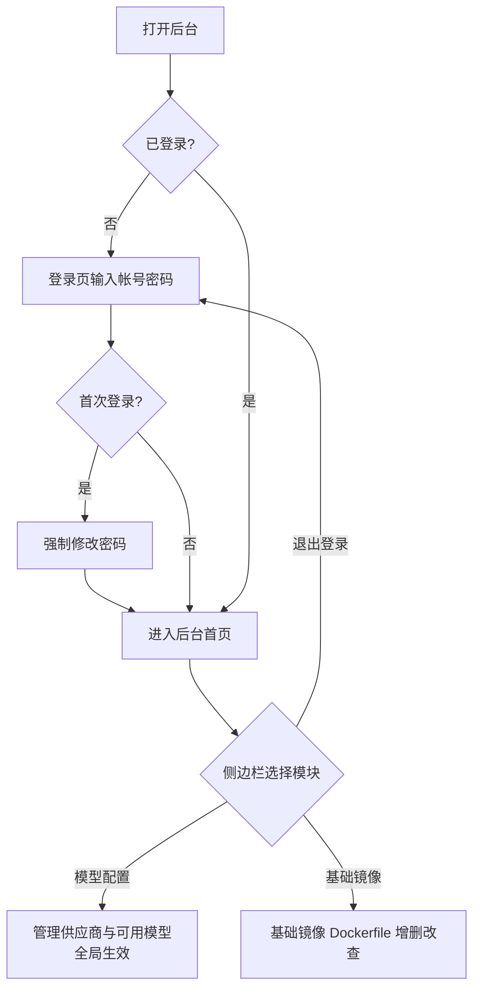

# 云控制器管理后台一期

**功能名称**: 云控制器管理后台
**PRD 版本**: v1.0
**创建日期**: 2026-10-14
**作者**: Kimi

## 背景与目标

### 1.1 背景

当前系统仅支持本地控制器，用户的大模型供应商、可用模型等配置都散落在本地环境中，缺乏统一的管理入口。后续系统将逐步迭代支持云上控制器，因此需要先搭建一个独立的管理后台，作为云端能力的运营与配置入口，集中管理全局共享的配置数据。

### 1.2 目标

1. 搭建一个独立的管理后台（含独立的管理服务与管理界面），与普通用户使用的客户端完全分离。
2. 管理员可以登录后台（仅登录、不开放注册），首次登录时强制修改默认密码。
3. 管理员可以在后台配置大模型供应商与可用模型，配置的模型对所有用户的可用模型列表全局生效。
4. 管理员可以在后台维护基础镜像的 Dockerfile（本期仅做内容的增删改查，镜像构建后续迭代实现）。

### 1.3 成功标准

- 管理员使用默认帐号 `admin` / `admin1234567` 可成功登录后台，且首次登录必须完成密码修改后才能进入后台功能页。
- 后台采用「左侧边栏 + 右侧内容区」的经典后台布局，各功能模块可从侧边栏导航进入。
- 管理员在后台新增/启用的供应商与模型，能在所有用户的可用模型列表中展示；停用后不再展示。
- 管理员可以对基础镜像 Dockerfile 进行创建、查看、编辑、删除操作，数据持久保存。

## 用户分析

### 2.1 目标用户

- **平台管理员（唯一角色）**：负责维护平台级共享配置（大模型供应商、可用模型、基础镜像）的运营人员，即系统所有者本人。

### 2.2 用户场景

| 场景 | 用户角色 | 目标 | 痛点 |
|--|--|--|--|
| 首次接手后台 | 平台管理员 | 登录后台并改掉默认密码 | 默认密码公开，直接使用存在安全风险 |
| 为全平台配置大模型 | 平台管理员 | 统一配置供应商与可用模型，让配置对所有用户生效 | 当前只能各用户自行配置，无法统一管控 |
| 维护基础镜像定义 | 平台管理员 | 登记和维护各基础镜像的 Dockerfile 内容 | 缺少统一管理入口，镜像定义无落库记录 |

## 功能需求

### 3.1 功能概述

搭建独立的云控制器管理后台：提供管理员登录（首次强制改密）、经典后台布局，并支持全局大模型供应商与可用模型配置、基础镜像 Dockerfile 的增删改查。

### 3.2 功能列表

#### 功能点 1: 管理员登录与首次强制改密

- **描述**: 后台提供登录页，仅支持登录、不提供注册入口。系统内置默认管理帐号 `admin`，初始密码 `admin1234567`。管理员首次使用默认密码登录成功后，必须设置新密码才能进入后台；完成修改前无法访问其他任何功能。后续登录使用新密码。
- **用户价值**: 保证后台只有管理员可进入，且默认密码不会被长期使用，降低安全风险。
- **验收标准**:
  - [ ] 登录页仅提供登录能力，无任何注册入口
  - [ ] 使用 `admin` / `admin1234567` 可以登录
  - [ ] 首次登录成功后进入「修改密码」流程，未完成修改无法进入后台其他页面
  - [ ] 修改密码后，旧密码失效，新密码可用于登录
  - [ ] 密码错误时给出明确提示，不泄露帐号是否存在以外的信息

#### 功能点 2: 后台整体布局

- **描述**: 后台采用经典的后台管理布局：左侧为固定侧边栏导航，右侧为内容区。侧边栏列出各功能模块入口（模型配置、基础镜像等），点击后右侧内容区切换对应页面。侧边栏提供退出登录入口。
- **用户价值**: 符合后台管理系统的通用使用习惯，功能模块一目了然、易于扩展。
- **验收标准**:
  - [ ] 登录后页面为左侧边栏 + 右侧内容布局
  - [ ] 侧边栏包含「模型配置」「基础镜像」等功能入口
  - [ ] 点击侧边栏入口可切换右侧内容区页面，当前所在模块有高亮标识
  - [ ] 可从侧边栏退出登录，退出后回到登录页

#### 功能点 3: 全局大模型供应商与可用模型配置

- **描述**: 后台提供「模型配置」模块，管理员可维护大模型供应商（新增、编辑、删除、启用/禁用）与可用模型（从供应商同步模型列表、自定义模型、启用/禁用、排序），交互能力与现有客户端中的「供应商设置 / 可用模型」保持一致。差异在于：后台配置的数据是全局共享的，后台中启用的模型会出现在所有用户的可用模型列表中，禁用后从列表中移除。
- **用户价值**: 平台级统一管控大模型接入，用户无需各自配置即可使用平台提供的模型。
- **验收标准**:
  - [ ] 可新增供应商（名称、类型、接口地址、凭据），保存前校验连通性，凭据不明文展示
  - [ ] 可编辑、删除、启用/禁用供应商；删除供应商时其下模型一并移除
  - [ ] 供应商保存后自动同步其模型列表，也可手动添加自定义模型
  - [ ] 可启用/禁用单个模型、调整模型排序
  - [ ] 后台启用的模型在所有用户的可用模型列表中可见，禁用后不再可见

#### 功能点 4: 基础镜像 Dockerfile 管理

- **描述**: 后台提供「基础镜像」模块，管理员可维护基础镜像记录，每条记录包含名称、描述与 Dockerfile 文本内容。本期仅支持增删改查：列表展示、新建、编辑、删除。镜像的构建、推送等能力本期不做，后续迭代实现。
- **用户价值**: 基础镜像定义集中登记、版本可追溯，为后续镜像构建能力打底。
- **验收标准**:
  - [ ] 列表页展示全部基础镜像（名称、描述、更新时间）
  - [ ] 可新建基础镜像：填写名称、描述、Dockerfile 内容
  - [ ] 可编辑已有基础镜像的全部字段
  - [ ] 可删除基础镜像，删除前有二次确认
  - [ ] 同名基础镜像不允许重复创建

### 3.3 用户操作流程

### 3.4 页面/界面描述

| 页面 | 描述 | 关键元素 |
|------|------|---------|
| 登录页 | 后台唯一入口，仅登录 | 帐号输入框、密码输入框、登录按钮、错误提示 |
| 修改密码页 | 首次登录强制进入 | 新密码输入框、确认密码输入框、提交按钮 |
| 后台框架 | 登录后的整体布局 | 左侧边栏（模块导航、退出登录）、右侧内容区 |
| 模型配置页 | 全局供应商与模型管理 | 供应商列表（新增/编辑/删除/启停）、模型列表（同步/自定义/启停/排序） |
| 基础镜像页 | 基础镜像 Dockerfile 管理 | 镜像列表（名称/描述/更新时间）、新建/编辑表单（Dockerfile 文本编辑）、删除确认 |

### 3.5 异常与边界情况

| 情况 | 预期行为 |
|------|---------|
| 使用默认密码登录但未改密，直接访问后台其他地址 | 仍被引导回修改密码流程 |
| 修改密码时两次输入不一致 | 提示不一致，不提交 |
| 新密码过于简单（长度过短） | 提示密码强度要求，不提交 |
| 未登录或登录态过期访问后台页面 | 跳转回登录页 |
| 供应商凭据或接口地址错误 | 保存时提示连通性校验失败，不保存 |
| 删除仍有模型的供应商 | 提示将一并移除其下模型，确认后执行 |
| 新建同名基础镜像 | 提示名称已存在，不保存 |
| 供应商/模型/镜像列表为空 | 展示空状态与新增引导 |

## 四、非功能需求

### 4.1 性能要求

- 后台各列表页在百级数据量内加载与操作流畅，无明显卡顿。

### 4.2 安全性要求

- 管理帐号密码加密存储，不明文落库、不明文传输。
- 供应商凭据加密存储，界面仅脱敏展示。
- 未登录状态不可访问后台任何接口与页面。
- 后台仅面向管理员，不开放注册，不暴露任何用户自助入口。

### 4.3 兼容性要求

- 后台面向桌面端浏览器使用，兼容主流现代浏览器；本期不要求移动端适配。

## 五、依赖与约束

### 5.1 依赖

- 现有客户端中的「供应商设置 / 可用模型」功能已上线，后台的模型配置模块与其交互能力对齐，且配置结果需对所有用户的可用模型列表生效。

### 5.2 约束

- 管理后台为独立的后台服务与独立的前端界面，与普通用户客户端分离。
- 基础镜像本期仅做 Dockerfile 内容的增删改查，不包含镜像构建、推送等能力。
- 后台不支持注册，管理员帐号由系统内置。

## 六、相关文档

- 技术提案：`docs/engineering/proposals/20261014-feat-admin-console.md`
