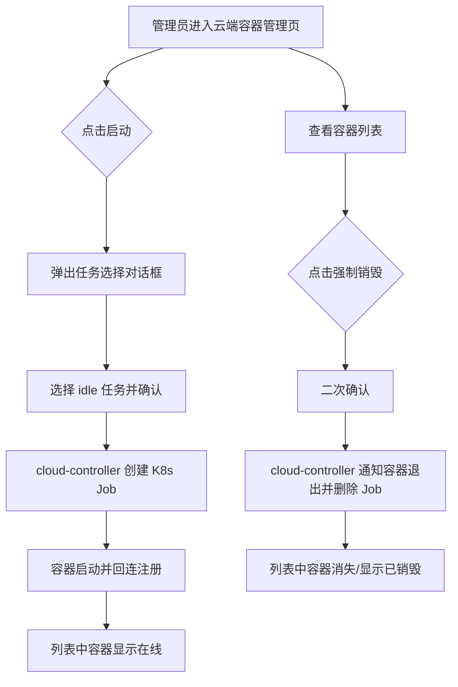

# 云Agent二期：云端工作容器（cloud-controller）

**功能名称**: 云Agent二期 —— K8s 云端工作容器管理
**PRD 版本**: v1.0
**创建日期**: 2026-10-14
**作者**: ZeroAsh

## 背景与目标

### 1.1 背景

当前 Agent Gear 的 Agent 控制器（agent-gear）主要运行在用户本地机器上，由本地 controller 承载会话与构建任务。随着管理后台（云控制器管理后台一期）上线，平台具备了统一的运营入口，下一步需要将 Agent 的执行环境搬到云端：在 K8s 集群中按需拉起标准化的工作容器，让用户的工作流、独立会话以及管理后台的构建类任务都能在云端容器中执行，摆脱对用户本地环境的依赖。

### 1.2 目标

- 提供一个部署在 K8s 集群内的云控制器（cloud-controller），通过 K8s API 管理指定命名空间下的工作容器（以 Job 形式拉起）。
- 工作容器启动后自动回连 cloud-controller 并接受其控制，连接地址随容器注入并携带鉴权 token，未授权方无法接入。
- 提供标准化的默认工作容器镜像，预装 Node.js、Git、GitHub CLI、Docker 构建工具链及主流 Agent CLI，开箱即用。
- 管理后台可查看 cloud-controller 管理的全部工作容器，可手动启动空容器用于测试，并可强制销毁异常容器。
- 工作容器与业务实体（管理后台任务、用户工作流、独立会话）建立关联，为后续任务调度打基础。

### 1.3 成功标准

- cloud-controller 部署到 K8s 后，可通过管理后台一键启动一个 idle 工作容器，容器在 3 分钟内完成拉起并成功回连。
- 管理后台容器列表与 K8s 命名空间内实际 Job 状态一致，容器在线/退出状态准确可见。
- 强制销毁按钮触发后，对应容器退出且 K8s Job 被删除，列表中状态同步更新。
- 使用默认镜像启动的容器内，`node`、`git`、`gh`、`docker buildx` 及各 Agent CLI 均可直接使用。
- 未携带合法 token 的连接请求会被 cloud-controller 拒绝。

## 用户分析

### 2.1 目标用户

- **平台管理员/运营人员**：通过管理后台管理云端工作容器，进行测试启动与异常容器清理。
- **普通用户（前台）**：后续通过工作流或独立会话使用云端工作容器执行任务（本期完成关联模型与管理能力，调度入口在后续迭代开放）。

### 2.2 用户场景

| 场景 | 用户角色 | 目标 | 痛点 |
|--|--|--|--|
| 验证云端容器链路 | 管理员 | 手动启动一个空容器确认环境可用 | 没有可视化入口，只能手写 K8s 资源 |
| 清理异常容器 | 管理员 | 强制销毁卡死/不再需要的工作容器 | 需要直接操作 K8s，门槛高、风险大 |
| 云端执行构建任务 | 管理员 | 管理后台任务在云端容器中运行 | 本地环境不稳定、资源不足 |
| 云端跑工作流/会话 | 普通用户 | 工作流或独立会话在云端容器中执行 | 依赖本地在线的 controller |

## 功能需求

### 3.1 功能概述

在 K8s 集群中部署 cloud-controller，负责在指定命名空间下拉起、跟踪、销毁工作容器（K8s Job）；工作容器使用标准化镜像，启动后通过注入的通讯地址（含鉴权 token）回连 cloud-controller 并接受控制；管理后台提供容器列表、测试启动与强制销毁能力。

### 3.2 功能列表

#### 功能点 1: cloud-controller 云端控制器

- **描述**: 新增部署在 K8s 集群内的 cloud-controller 服务，接入 K8s API，管理指定命名空间下的工作容器。工作容器以 K8s Job 形式拉起，每个容器对应一个业务用途：管理后台用户任务（一般为构建）、前台用户的工作流、或独立会话。cloud-controller 记录容器与业务实体的关联关系。
- **用户价值**: 云端执行环境的统一管控入口，容器生命周期可追溯、可管理。
- **验收标准**:
  - [ ] cloud-controller 可通过 K8s API 在指定命名空间创建、查询、删除 Job
  - [ ] 每个工作容器在创建时可标记用途类型（后台任务 / 工作流 / 独立会话 / 空闲测试）并记录关联对象
  - [ ] cloud-controller 仅管理其配置的命名空间，不影响其他命名空间

#### 功能点 2: 工作容器回连与控制

- **描述**: 工作容器启动时，通过环境变量注入 cloud-controller 的通讯地址，地址中携带一次性鉴权 token；容器内使用 agent-gear（本项目 Agent 控制器）连接到 cloud-controller，接受其控制。容器启动后默认不做任何任务；当 cloud-controller 侧触发销毁后，容器进程退出并被 K8s 回收。
- **用户价值**: 容器即起即用、受控可销毁，鉴权 token 保证只有平台拉起的容器能接入。
- **验收标准**:
  - [ ] 容器启动后自动回连 cloud-controller 并注册上线
  - [ ] 通讯地址携带鉴权 token，伪造/缺失 token 的连接被拒绝
  - [ ] 触发销毁后容器内进程主动退出，Job 进入终止态并被清理
  - [ ] 容器未收到任务时保持空闲在线，不自动退出

#### 功能点 3: 默认工作容器镜像

- **描述**: 提供默认工作容器镜像，基于 Ubuntu 构建，面向内网环境预置全部依赖：
  - Ubuntu 软件源替换为内网 mirror：`https://nexus.internal.fffdan.com/repository/ubuntu-proxy/`
  - 预装 Node.js、Git、GitHub CLI、Docker 构建工具 buildx、sysbox（容器内运行 Docker 的运行时）；Node.js 的 npm 镜像源设置为 `https://nexus.internal.fffdan.com/repository/npm-proxy/`
  - Docker 镜像拉取走内网代理：Docker Hub 镜像使用 `core.harbor.internal.fffdan.com/docker-hub-proxy/{image}`（如 `ubuntu:latest` → `core.harbor.internal.fffdan.com/docker-hub-proxy/ubuntu:latest`），ghcr.io 镜像使用 `core.harbor.internal.fffdan.com/ghcr/{image}`
  - 通过 npm 全局预装以下包：
    - `agent-gear`
    - `@agentclientprotocol/claude-agent-acp`
    - `@agentclientprotocol/codex-acp`
    - `@opencode/cli`
    - `@openai/codex`
    - `@anthropic-ai/claude-code`
    - `@google/gemini-cli`
  - 镜像启动命令为：使用 agent-gear 连接到 cloud-controller（连接参数来自注入的环境变量）
- **用户价值**: 内网环境开箱即用的标准化执行环境，避免每个任务重复安装工具链。
- **验收标准**:
  - [ ] 镜像在内网环境可无代理构建成功
  - [ ] 容器内 `node`、`git`、`gh`、`docker buildx` 可用
  - [ ] 容器内上述 7 个 npm 全局包均可正常执行
  - [ ] 容器内拉取 Docker Hub / ghcr.io 镜像时自动走内网代理地址
  - [ ] 容器默认启动命令即回连 cloud-controller，无需额外参数

#### 功能点 4: 管理后台容器管理

- **描述**: 管理后台新增云端容器管理页，展示 cloud-controller 管理的所有工作容器（Job）及其状态、用途、关联对象与创建时间；提供「启动」按钮用于测试启动空容器；每行提供「强制销毁」按钮。
- **用户价值**: 管理员无需接触 K8s 即可完成容器的查看、测试启动与清理。
- **验收标准**:
  - [ ] 容器列表展示全部工作容器及其状态（创建中/在线/已退出/销毁中）与用途关联信息
  - [ ] 点击「启动」弹出对话框让管理员选择要启动的任务，本期仅提供「idle」任务（什么都不做）
  - [ ] 点击「强制销毁」并确认后，对应容器退出、Job 被删除，列表状态同步
  - [ ] 仅管理员可访问该页面与操作

### 3.3 用户操作流程

### 3.4 页面/界面描述

| 页面 | 描述 | 关键元素 |
|------|------|---------|
| 云端容器管理页 | 展示 cloud-controller 管理的全部工作容器 | 容器列表（名称、状态、用途、关联对象、创建时间、在线时长）、「启动」按钮、「强制销毁」按钮 |
| 启动对话框 | 选择要启动的任务 | 任务下拉选择（本期仅「idle」）、确认/取消按钮 |
| 强制销毁确认框 | 防止误销毁 | 容器名称提示、确认/取消按钮 |

### 3.5 异常与边界情况

| 情况 | 预期行为 |
|------|---------|
| 容器启动失败（镜像拉取失败、资源不足等） | 列表中标记为失败状态并展示原因，可强制销毁清理 |
| 容器回连超时未注册 | cloud-controller 标记为异常，管理员可强制销毁 |
| 销毁指令发出但容器无响应 | 强制删除 K8s Job，确保资源回收 |
| 容器异常退出（OOM 等） | 列表状态更新为已退出，并保留退出原因 |
| 非法 token 的连接请求 | 拒绝连接并记录日志 |
| 非管理员访问容器管理页 | 拒绝访问 |

## 四、非功能需求

### 4.1 性能要求

- 容器列表查询在 100 个容器规模下响应时间不超过 2 秒。
- idle 容器从创建到回连上线的耗时目标不超过 3 分钟（内网镜像预热后）。

### 4.2 安全性要求

- 工作容器与 cloud-controller 的通讯必须携带一次性鉴权 token，token 随容器销毁失效。
- cloud-controller 的 K8s 权限收敛到指定命名空间，仅具备 Job 的增删查能力。
- 管理后台容器管理功能仅对管理员开放。

### 4.3 兼容性要求

- 默认镜像基于 Ubuntu 最新 LTS，适配内网 mirror 与镜像代理地址。
- cloud-controller 与现有本地 controller 体系并存，互不影响。

## 五、依赖与约束

### 5.1 依赖

- 已上线的云控制器管理后台一期（admin 管理后台）。
- 可用的 K8s 集群及指定命名空间，cloud-controller 具备该命名空间的 Job 管理权限。
- 内网 mirror 服务（Nexus Ubuntu/npm 代理、Harbor 镜像代理）可用。
- agent-gear（本项目 Agent 控制器）已发布 npm 包，可被镜像预装。

### 5.2 约束

- 本期工作容器启动后仅支持 idle（什么都不做），任务/工作流/会话的实际调度在后续迭代开放，但关联模型本期建立。
- 工作容器以 K8s Job 形式管理，不引入其他工作负载类型。
- 镜像内软件源与镜像仓库地址使用内网地址，不依赖公网。

## 六、相关文档

- [[20261014-admin-console.md]] — 云控制器管理后台一期 PRD
- 技术提案：`docs/engineering/proposals/20261014-feat-cloud-agent-phase2.md`
