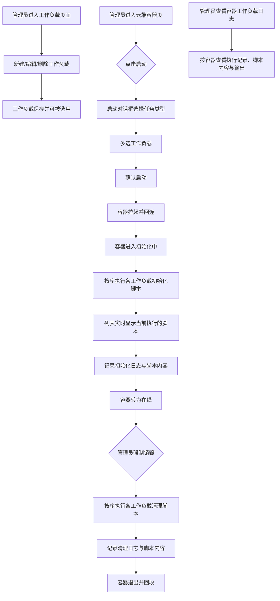

# 云控制器工作负载（Workload）功能

**功能名称**: 云控制器工作负载管理
**PRD 版本**: v1.1
**创建日期**: 2026-10-17
**作者**: ZeroAsh

> v1.1 变更：容器新增「初始化中」状态并展示当前正在执行的工作负载脚本；工作负载执行记录留存当时执行的脚本内容，便于问题调查。

## 背景与目标

### 1.1 背景

云Agent二期已上线：管理后台可以启动云端工作容器，容器启动后回连云控制器并保持空闲在线。但目前所有容器都是「裸环境」，启动后什么都不做，也没有环境初始化手段。实际使用中，不同任务需要不同的环境准备（例如拉取指定仓库、安装项目依赖、配置凭据），容器关闭前也需要收尾动作（例如上传产物、清理临时数据）。每次靠人工进入容器操作既低效又不可复制，因此需要提供可复用的「工作负载」能力：管理员在后台预定义初始化脚本与清理脚本，拉起容器时按需挂载，容器生命周期内自动执行并留存执行日志。

### 1.2 目标

- 管理后台提供工作负载管理页面，支持工作负载的创建、查看、编辑、删除（CRUD），工作负载包含名称、初始化脚本、清理脚本。
- 管理后台启动云端容器时，支持多选挂载已存在的工作负载。
- 容器拉起后由云控制器下发并按序执行所挂载工作负载的初始化脚本，容器关闭时按序执行清理脚本。
- 容器在初始化脚本执行期间呈现「初始化中」状态，并展示当前正在执行的工作负载脚本。
- 工作负载脚本的执行过程与结果产生日志并持久化存储（含当时执行的脚本内容留档），管理员可在后台查看。

### 1.3 成功标准

- 管理员可在后台完成工作负载的新建、编辑、删除，列表展示准确。
- 启动容器对话框中可多选工作负载，容器拉起后所选的初始化脚本被完整执行。
- 初始化脚本执行期间容器显示「初始化中」，且能看到当前正在执行哪个工作负载的脚本；全部完成后容器转为「在线」。
- 触发容器销毁时，所选的清理脚本在容器退出前被执行。
- 每个工作负载的每次执行都有记录（初始化/清理阶段、成功/失败状态、当时执行的脚本内容、输出日志），后台可按容器查看。

## 用户分析

### 2.1 目标用户

- **平台管理员/运营人员**：定义和维护工作负载，启动挂载工作负载的容器，查看容器初始化进度与工作负载执行日志。

### 2.2 用户场景

| 场景 | 用户角色 | 目标 | 痛点 |
|--|--|--|--|
| 预置常用环境初始化 | 管理员 | 将重复的初始化动作（克隆仓库、装依赖）固化为工作负载 | 每个容器手工操作，无法复用 |
| 启动带环境的容器 | 管理员 | 拉起容器时选择一个或多个工作负载自动完成初始化 | 容器启动后是裸环境，需等待人工介入 |
| 观察初始化进度 | 管理员 | 看到容器处于初始化中、当前正在跑哪个脚本 | 容器状态黑盒，不知道初始化是否卡住 |
| 容器退出前收尾 | 管理员 | 容器关闭时自动执行清理脚本（上传产物、清理数据） | 容器销毁后现场丢失，无法补救 |
| 排查初始化失败 | 管理员 | 查看某次执行的脚本内容与输出日志 | 无留档，失败原因不可追溯 |

## 功能需求

### 3.1 功能概述

在管理后台新增「工作负载」管理能力：工作负载由名称、初始化脚本、清理脚本构成；启动云端容器时支持多选挂载工作负载；容器拉起后由云控制器下发并按序执行初始化脚本（期间容器显示「初始化中」并展示当前执行的脚本）、关闭时按序执行清理脚本；每次执行的阶段、状态、脚本内容与输出日志持久化存储，并可在后台按容器查看。

### 3.2 功能列表

#### 功能点 1: 工作负载管理页面（CRUD）

- **描述**: 管理后台新增「工作负载」页面，展示全部工作负载（名称、脚本摘要、创建/更新时间），支持新建、编辑、删除。工作负载字段：
  - 名称（必填，用于标识与选择）
  - 初始化脚本（init script）：在拉起容器时执行的脚本，可为空
  - 清理脚本（post script）：在关闭容器时执行的脚本，可为空
  - 删除需二次确认；脚本为多行文本编辑。
- **用户价值**: 常用环境准备与收尾动作沉淀为可复用资产，一次定义多次使用。
- **验收标准**:
  - [ ] 工作负载列表正确展示名称、创建/更新时间
  - [ ] 可新建工作负载（名称为必填；两个脚本至少其一非空才可保存）
  - [ ] 可编辑已有工作负载，保存后列表同步更新
  - [ ] 删除需确认，删除后不再出现在启动容器的选择列表中
  - [ ] 仅管理员可访问该页面与操作

#### 功能点 2: 启动容器时挂载工作负载

- **描述**: 云端容器管理页的「启动」对话框中，在任务类型之外新增工作负载多选控件，展示当前全部可选工作负载（名称），管理员可选择 0 个或多个。确认启动后，容器携带所选工作负载拉起。容器列表中可看到容器挂载的工作负载。
- **用户价值**: 按需组合环境，一次拉起即得到初始化完成的容器。
- **验收标准**:
  - [ ] 启动对话框中可多选工作负载，默认不选
  - [ ] 容器拉起后，所选工作负载的初始化脚本按选择顺序依次执行
  - [ ] 容器列表/详情中展示容器挂载的工作负载名称
  - [ ] 不选择工作负载时行为与现状一致

#### 功能点 3: 容器「初始化中」状态与当前执行脚本展示

- **描述**: 挂载了初始化脚本的容器，在回连后开始执行初始化脚本，期间容器状态显示为「初始化中」，并展示当前正在执行的工作负载脚本名称；全部初始化脚本执行完毕（无论成功失败）后容器转为「在线」。未挂载初始化脚本的容器不出现该状态，回连后直接「在线」。
- **用户价值**: 初始化进度可视化，能分辨容器是「卡住」还是「正在跑脚本」。
- **验收标准**:
  - [ ] 挂载初始化脚本的容器回连后进入「初始化中」状态
  - [ ] 容器列表中「初始化中」的容器展示当前正在执行的工作负载名称
  - [ ] 当前执行的工作负载随脚本推进实时切换
  - [ ] 初始化脚本全部结束后容器转为「在线」
  - [ ] 未挂载初始化脚本的容器回连后直接「在线」

#### 功能点 4: 容器关闭时执行清理脚本

- **描述**: 容器被销毁（管理后台强制销毁）时，在容器进程退出前按序执行所挂载工作负载的清理脚本，全部清理脚本执行完毕（或超时）后容器再退出。
- **用户价值**: 产物上传、数据清理等收尾动作自动完成，避免现场丢失。
- **验收标准**:
  - [ ] 触发销毁后，所选工作负载的清理脚本按选择顺序依次执行
  - [ ] 清理脚本全部完成或超时后容器才退出并被回收
  - [ ] 清理脚本执行设有超时上限，超时后强制退出，避免容器卡死

#### 功能点 5: 工作负载执行日志存储与查看

- **描述**: 工作负载脚本（初始化与清理）每次执行的阶段（初始化/清理）、执行状态（执行中/成功/失败/超时）、**当时执行的脚本内容**与输出日志被持久化存储（脚本留档便于事后调查）。管理后台在云端容器页面可按容器查看其工作负载执行记录与日志内容。
- **用户价值**: 执行过程完整可追溯，即使工作负载后续被修改或删除，也能还原当时实际执行的脚本。
- **验收标准**:
  - [ ] 每个工作负载的每次执行生成一条记录：所属容器、工作负载、阶段、状态、起止时间、执行的脚本内容、输出日志
  - [ ] 执行中的记录状态为「执行中」并实时可刷新
  - [ ] 后台可按容器查看全部工作负载执行记录及日志内容
  - [ ] 容器已退出/销毁后日志仍可查看
  - [ ] 脚本执行失败不影响其他工作负载记录的完整性

### 3.3 用户操作流程

### 3.4 页面/界面描述

| 页面 | 描述 | 关键元素 |
|------|------|---------|
| 工作负载管理页 | 工作负载列表与 CRUD 入口 | 列表（名称、脚本摘要、更新时间）、「新建」按钮、每行「编辑」「删除」按钮 |
| 工作负载编辑对话框 | 新建/编辑共用 | 名称输入框、初始化脚本多行编辑框、清理脚本多行编辑框、保存/取消按钮 |
| 工作负载删除确认框 | 防止误删 | 工作负载名称提示、确认/取消按钮 |
| 云端容器启动对话框 | 启动容器并挂载工作负载 | 任务类型选择、工作负载多选列表、确认/取消按钮 |
| 云端容器列表 | 展示容器状态与初始化进度 | 状态列（含「初始化中」）、初始化中的容器展示当前执行的工作负载名称、挂载的工作负载列表 |
| 容器工作负载日志视图 | 按容器查看工作负载执行情况 | 容器信息、执行记录列表（工作负载、阶段、状态、时间）、执行的脚本内容与输出日志展示 |

### 3.5 异常与边界情况

| 情况 | 预期行为 |
|------|---------|
| 初始化脚本执行失败（非零退出） | 标记该工作负载初始化失败并记录日志，继续执行后续脚本，全部结束后容器照常转「在线」（初始化失败不阻断容器使用） |
| 初始化脚本执行超时 | 单条脚本超过时限后强制终止并标记超时，继续执行后续脚本 |
| 初始化中容器长时间无进展（掉线/卡死） | 按既有离线巡检处理，状态与日志如实反映 |
| 清理脚本执行失败 | 标记失败并记录日志，继续执行后续清理脚本，最终正常退出 |
| 清理脚本执行超时 | 超过上限后强制终止并标记超时，容器继续退出流程 |
| 容器被强制销毁且长时间无响应 | 走既有强制删除通道回收，清理脚本记录为未完成 |
| 容器异常退出（OOM 等）未触发销毁流程 | 清理脚本可能未执行，对应记录标记为未执行/缺失 |
| 删除正被容器引用中的工作负载 | 已产生的执行记录保留当时脚本内容与名称快照，仅影响后续启动选择 |
| 启动后、执行前工作负载被编辑 | 以执行时下发的脚本内容为准留档，不受后续编辑影响 |
| 工作负载名称为空或脚本均为空 | 表单校验拒绝保存并提示 |
| 非管理员访问工作负载页面 | 拒绝访问 |

## 四、非功能需求

### 4.1 性能要求

- 工作负载列表在 200 条规模下查询响应不超过 2 秒。
- 单条工作负载日志存储上限应有保护（超大输出截断存储，保留尾部关键内容）。
- 「初始化中」容器的当前执行脚本信息随列表刷新可见，无额外高频轮询压力。

### 4.2 安全性要求

- 工作负载管理及日志查看仅对管理员开放。
- 脚本由云控制器仅下发给挂载该工作负载的对应容器，未经鉴权的连接无法获取脚本内容。
- 脚本在容器内执行，凭据等敏感信息由脚本作者自行管理；日志内容按普通后台数据保护。

### 4.3 兼容性要求

- 不挂载工作负载的容器行为与现有版本完全一致（无「初始化中」状态）。
- 旧版本已存在的容器记录不受影响，日志视图中无工作负载记录即可。

## 五、依赖与约束

### 5.1 依赖

- 已上线的云控制器管理后台（工作负载页面挂载于管理后台）。
- 已上线的云Agent二期（云端容器拉起/销毁/回连链路）。
- 默认工作容器镜像可更新（容器内 Agent 控制器需支持接收并执行下发的脚本）。

### 5.2 约束

- 本期工作负载仅在管理后台手动启动容器时可选；工作流/会话等任务类型挂载工作负载在后续迭代开放。
- 工作负载仅由名称、初始化脚本、清理脚本构成，不引入参数化/变量机制。
- 清理脚本仅在「正常销毁」路径保障执行，异常退出不保证执行。

## 六、相关文档

- [[20261014-cloud-agent-phase2.md]] — 云Agent二期（K8s 云端工作容器）PRD
- [[20261014-admin-console.md]] — 云控制器管理后台一期 PRD
- 技术提案：`docs/engineering/proposals/20261017-feat-cloud-controller-workload.md`
