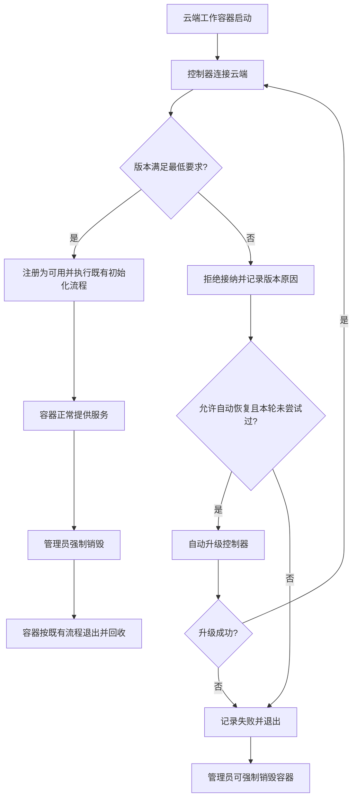

# 云端工作容器控制器版本兼容与自动恢复

**功能名称**: 云端工作容器控制器版本门禁与自升级
**PRD 版本**: v1.0
**创建日期**: 2026-10-17
**作者**: ZeroAsh

## 背景与目标

### 1.1 背景

当前云端仅区分控制器的大版本。使用 `2.1.0` 的 `agent-gear` 连接最新云控制器时，仍会被视为兼容控制器，但它并不具备当前云端工作容器所需的完整能力，导致初始化脚本无法调度；销毁容器时也可能进入长时间等待，表现为容器卡住。此时缺少清晰的版本提示和自动恢复手段，管理员只能人工定位版本、升级控制器并清理容器。

### 1.2 目标

- 在控制器被接纳为可用之前验证其完整版本，不再仅凭大版本判断兼容性。
- 对低于最低要求的控制器自动执行升级，升级成功后自动重连，无需管理员进入容器操作。
- 不兼容控制器不得进入可用状态，不得接收初始化或清理任务。
- 升级失败或升级后仍不兼容时明确失败、停止重试，并保留强制销毁能力。
- 已满足要求的控制器保持现有连接、任务执行和销毁行为不变。

### 1.3 成功标准

- 使用 `2.1.0` 控制器连接时，系统识别其低于本期最低版本 `2.2.0`，不会将其标记为可用；自动升级成功后能够重连，初始化脚本调度与强制销毁均恢复正常。
- 使用 `2.2.0` 及后续兼容版本的控制器连接时直接通过验证，不触发额外升级。
- 版本缺失、无法识别或低于最低版本的控制器均不能绕过验证进入可用状态。
- 自动升级失败或升级后仍不兼容时，不产生无限升级或重连；日志能够说明当前版本、最低要求和失败原因，管理员仍可强制销毁容器。
- 版本兼容与自动恢复验收用例全部通过，既有兼容控制器回归用例不出现行为退化。

## 用户分析

### 2.1 目标用户

- **平台管理员**：启动、观察和强制销毁云端工作容器，期望版本差异不造成容器不可用或卡住。
- **平台维护人员**：发布云控制器与工作容器运行环境，期望最低版本要求明确、升级过程可追溯、失败可收敛。

### 2.2 用户场景

| 场景 | 用户角色 | 目标 | 痛点 |
|--|--|--|--|
| 旧控制器接入最新云端 | 平台管理员 | 容器自动恢复到兼容状态并继续初始化 | 旧版本被误接纳，任务无响应，需要人工排查 |
| 兼容控制器正常接入 | 平台管理员 | 直接使用既有容器能力 | 不增加额外升级等待或行为变化 |
| 升级通道暂时不可用 | 平台维护人员 | 快速定位失败并清理异常容器 | 反复重试会掩盖根因并长期占用资源 |
| 销毁版本异常的容器 | 平台管理员 | 强制销毁仍然可靠 | 不兼容控制器不响应清理动作，容器看似卡住 |

## 功能需求

### 3.1 功能概述

为云端工作容器增加控制器完整版本门禁和自动恢复能力：云端在接纳控制器前验证最低版本；版本过低时，由容器运行环境自动升级控制器并重连；升级无法成功时明确终止恢复并保留强制销毁路径。

### 3.2 功能列表

#### 功能点 1: 控制器最低版本验证

- **描述**: 云端在控制器注册为可用之前验证其完整版本。本期最低版本为 `2.2.0`，达到最低版本且属于当前兼容范围的控制器可继续注册；低于最低版本、版本缺失或无法识别的控制器不得被标记为可用，也不得接收工作容器任务。
- **用户价值**: 在任务下发前阻断能力不足的控制器，避免容器进入看似在线但无法执行工作的状态。
- **验收标准**:
  - [ ] `2.1.0` 控制器被拒绝接纳，并收到明确的最低版本提示
  - [ ] `2.2.0` 及后续兼容版本可正常注册，不触发自动升级
  - [ ] 版本比较按数字版本段执行，后续较高的次版本不会被字符串顺序误判
  - [ ] 版本缺失或格式无法识别时拒绝接纳，不执行任务调度
  - [ ] 被拒绝的控制器不会改变容器为可用状态，也不会收到初始化或清理任务

#### 功能点 2: 自动升级并重连

- **描述**: 控制器因版本不符合要求而被拒绝后，容器运行环境自动获取当前可用的兼容版本，替换旧控制器并重新发起连接。升级与重连过程无需管理员进入容器执行命令。
- **用户价值**: 将原本需要人工排查和操作的恢复过程自动化，缩短容器不可用时间。
- **验收标准**:
  - [ ] `2.1.0` 被拒绝后自动开始升级，日志中可看到升级开始
  - [ ] 升级成功后自动重连，通过版本验证后继续正常初始化流程
  - [ ] 自动恢复后能够调度初始化脚本，并能响应强制销毁
  - [ ] 已兼容控制器不触发该恢复流程
  - [ ] 普通网络断线重连不被误判为版本不兼容，不触发升级

#### 功能点 3: 有界失败与强制销毁保障

- **描述**: 自动升级和升级后的重连必须有明确上限。升级失败、升级后版本仍不符合要求或重连仍被拒绝时，容器输出明确错误并停止本轮自动恢复；管理员可使用既有强制销毁入口回收容器。
- **用户价值**: 避免升级重试形成死循环，确保异常容器始终有明确终态和清理出口。
- **验收标准**:
  - [ ] 单次容器运行内版本不匹配触发的自动升级最多执行一次
  - [ ] 升级失败时记录失败原因，不继续无限重连或升级
  - [ ] 升级后仍不兼容时明确退出，不再次自动升级
  - [ ] 未完成兼容注册的控制器不会延长强制销毁的任务等待
  - [ ] 升级过程中收到销毁信号时停止恢复并退出，不再次拉起控制器

#### 功能点 4: 恢复过程可观测

- **描述**: 在既有容器日志中记录版本拒绝、当前版本、最低版本、升级结果和重连结果；不新增独立管理页面。
- **用户价值**: 管理员能够区分网络故障、版本不兼容和升级失败，缩短定位时间。
- **验收标准**:
  - [ ] 版本拒绝日志包含当前版本与最低版本要求
  - [ ] 升级成功日志包含升级后的版本，随后可观察到重连结果
  - [ ] 升级失败日志包含可读原因
  - [ ] 日志不输出控制器密钥、访问令牌或其他敏感信息

### 3.3 用户操作流程

### 3.4 页面/界面描述

| 页面/界面 | 描述 | 关键元素 |
|------|------|---------|
| 云端容器列表 | 沿用既有状态与强制销毁入口，不新增版本管理功能 | 容器状态、强制销毁操作 |
| 容器运行日志 | 展示版本拒绝、自动升级与重连过程 | 当前版本、最低版本、升级结果、失败原因 |

### 3.5 异常与边界情况

| 情况 | 预期行为 |
|------|---------|
| 控制器版本恰好等于最低版本 | 正常通过，不触发升级 |
| 控制器低于最低版本 | 拒绝接纳并尝试一次自动升级，成功后重连 |
| 控制器版本缺失或无法识别 | 按不兼容处理，不得进入可用状态；自动恢复后仍无法识别则退出 |
| 升级来源不可用或安装失败 | 记录失败原因并退出，不无限重试 |
| 升级成功但云端仍判定不兼容 | 明确退出，不再次升级，保留强制销毁入口 |
| 普通网络波动导致断线 | 沿用既有重连，不触发版本升级 |
| 自动升级期间收到销毁信号 | 停止恢复过程并退出，不重新拉起控制器 |
| 已是异常状态的存量旧容器 | 可通过既有强制销毁能力清理；重建后使用具备自动恢复能力的运行环境 |

## 四、非功能需求

### 4.1 性能要求

- 版本验证应在连接注册阶段完成，不增加任务执行期的额外检查或等待。
- 已兼容控制器不得因为本需求增加自动升级耗时。
- 自动升级仅在版本不匹配时触发一次，不得形成持续重试造成的资源消耗。

### 4.2 安全性要求

- 自动升级仅使用工作容器既定的软件来源与安装方式，不允许控制器响应内容指定任意下载地址或执行任意脚本。
- 版本与错误日志不得包含控制器密钥、连接令牌等敏感信息。
- 版本验证不能替代既有连接鉴权，未通过鉴权的连接不得进入版本验证后的注册流程。

### 4.3 兼容性要求

- 本期最低控制器版本为 `2.2.0`；满足最低版本且属于当前兼容范围的控制器行为不变。
- 本地控制器既有连接场景不随本期云端门禁改变。
- 未挂载工作负载的容器行为不变；挂载工作负载的兼容容器仍按既有初始化、清理和销毁语义执行。

## 五、依赖与约束

### 5.1 依赖

- 工作容器可访问既定的软件来源，并能获取满足最低版本要求的控制器发布版本。
- 云端容器强制销毁能力保持可用。
- 新启动的工作容器使用包含自动恢复能力的运行环境。

### 5.2 约束

- 本期只覆盖云端工作容器内的控制器版本恢复，不新增本地控制器自动升级能力。
- 本期不新增版本配置页面，也不允许管理员按容器绕过最低版本要求。
- 自动恢复最多尝试一次；已经运行且不具备自动恢复能力的旧运行环境，需通过销毁重建完成一次性替换。
- 自动升级不扩展为通用依赖更新机制，仅处理控制器版本不兼容。

## 六、相关文档

- [[20261017-cloud-controller-workload.md]] — 云控制器工作负载功能 PRD
- [[20261014-cloud-agent-phase2.md]] — 云Agent二期 PRD
- 技术提案：`docs/engineering/proposals/20261017-feat-controller-version-requirement.md`
