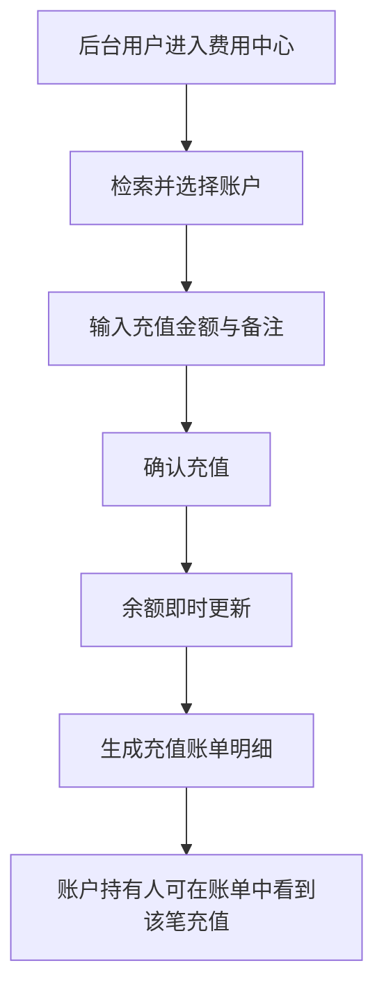
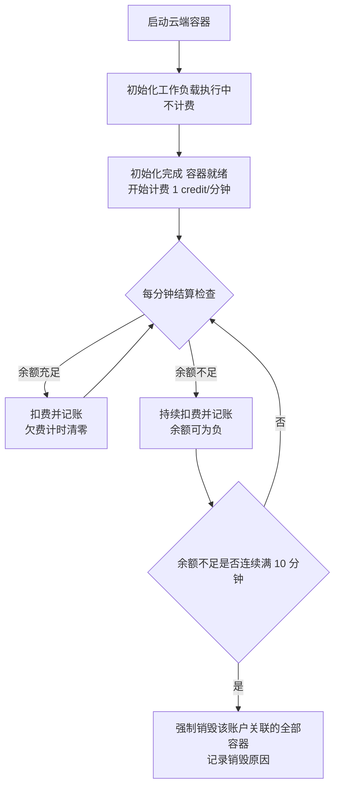
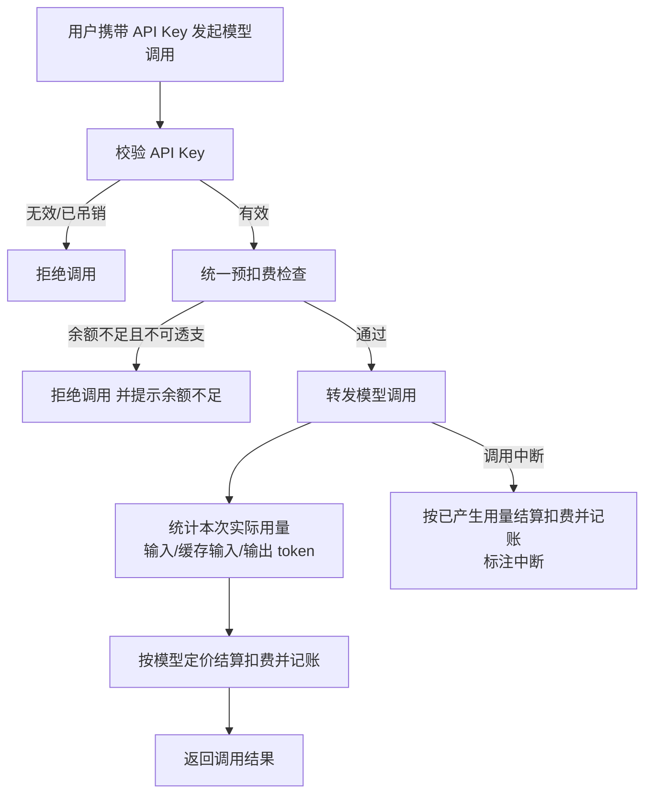

# 费用中心（Credits 计费）

**功能名称**: 后台费用中心与 Credits 计费体系
**PRD 版本**: v1.0
**创建日期**: 2026-10-18
**作者**: ZeroAsh

## 背景与目标

### 1.1 背景

平台已经具备两类可计量的资源消耗能力，但目前完全没有计量与收费手段：

1. **云端工作容器**。用户可以拉起云端工作容器并挂载工作负载，容器运行期间持续占用平台资源，占用时长没有任何记录与分摊。
2. **模型调用**。后台已接入多家大模型供应商，但缺少对外的调用入口与用量计费，模型调用成本由平台整体承担，无法按用户区分。

由此带来三个问题：

- **成本不可见**：用户不知道自己消耗了多少资源，平台也无法向用户分摊成本。
- **资源不可控**：没有余额约束，容器可以无限期运行、模型可以无限量调用，缺少自动止损手段。
- **账目不可查**：没有消费明细，出了争议无法追溯每一笔消耗。

因此需要建设统一的费用中心：以独立的点数货币 **credits** 计价，覆盖前台用户与后台用户两类账户，对容器与模型两类消费统一计量、统一记账、统一执行余额规则。

### 1.2 目标

- 建立统一的 **credits 账户与账单体系**，同时服务前台用户与后台用户，每一笔消费都有明细可查。
- **云端工作容器按分钟计费**：自初始化工作负载完成、容器就绪起计费，1 分钟 1 credit；账户欠费时持续扣费，连续 10 分钟余额不足则强制销毁该账户关联的容器。
- **模型调用按 token 计费**：模型可配置「输入 / 缓存输入 / 输出」每百万 token 的 credits 单价；平台对外提供兼容 OpenAI 风格的独立模型调用入口；前台用户与后台用户均可生成自己的 API Key，凭 Key 调用并计费。
- **余额规则清晰**：后台账户支持透支（余额可为负时仍可调用）；前台账户仅支持预付费，不提供自助充值渠道，只能由后台充值；余额不足且不支持透支时拒绝调用。
- **账目可追溯、可核算**：每次消费逐笔记录明细，账户内账单序号从 0 连续递增；页面展示的余额为快速核算值，并提供精确核算能力；账单支持按分钟 / 小时 / 天汇总查看。
- **余额检查规则统一**：所有扣费场景在扣费前经过同一套余额检查（统一的预扣费检查），各处行为一致、提示一致。

### 1.3 成功标准

- 为任一账户充值后，账户余额与账单明细立即可见、可核对；账单序号从 0 起连续递增，无跳号。
- 启动云端工作容器并完成初始化后，账单中出现按分钟计费的消费明细，费用与运行时长吻合（1 分钟 1 credit）。
- 账户余额不足以继续支付容器费用时，消费仍持续记录；连续 10 分钟余额不足后，该账户关联的容器被强制销毁，且账单与容器记录中可查到原因。
- 使用 API Key 调用模型后，账单中出现按 token 计费的消费明细，费用与调用量（输入 / 缓存输入 / 输出）吻合；调用中途断开的调用同样有计费明细。
- 余额不足且不支持透支的账户发起模型调用时被拒绝，并得到明确的「余额不足」提示；支持透支的账户在余额为负时仍可正常调用。
- 后台费用中心可以完成：账户查看、充值、账单明细查看、汇总查看、模型定价设置、API Key 管理；前台用户可以查看自己的余额、账单与 API Key。
- 页面余额与精确核算结果一致（精确核算为对全部账单明细的合计）。

## 用户分析

### 2.1 目标用户

- **前台用户（开发者）**：使用云端工作容器跑任务、使用 API Key 调用模型的终端用户，只支持预付费。
- **后台用户（平台运营/管理员）**：管理费用中心、为账户充值、配置模型定价；其自身账户支持透支。
- **平台管理者**：通过账单与汇总掌握整体资源消耗情况。

### 2.2 用户场景

| 场景 | 用户角色 | 目标 | 痛点 |
|--|--|--|--|
| 跑一个云端容器任务 | 前台用户 | 只为实际运行时长付费 | 目前容器占用资源无计量，成本无法分摊 |
| 用 API Key 接入模型能力 | 前台用户 | 按实际 token 用量付费，费用可预估 | 没有对外调用入口，也没有用量计费 |
| 账户余额用完 | 前台用户 | 明确知道欠费了、会发生什么 | 没有余额与欠费提示，服务被停时不明原因 |
| 给客户/团队充值 | 后台用户 | 快速给指定账户充值 credits | 没有账户与充值手段 |
| 追查一笔消耗 | 后台用户 | 看到每一笔消费的时间、来源、明细 | 无账单明细，争议无法追溯 |
| 控制失控的资源占用 | 后台用户 | 欠费的容器在宽限后自动止损 | 无自动止损，欠费容器可无限运行 |
| 为模型设定价格 | 后台用户 | 按输入/缓存输入/输出分别定价 | 模型无定价能力，调用成本无法回收 |

## 功能需求

### 3.1 功能概述

建设以 credits 为计价货币的账户与账单体系：后台提供费用中心（账户、充值、账单、汇总、模型定价、API Key 管理）；云端工作容器按分钟计费并在长期欠费时自动销毁；模型调用通过兼容 OpenAI 风格的独立入口凭 API Key 调用、按 token 计费；所有扣费前统一经过余额检查，所有消费统一记入账单明细。

### 3.2 功能列表

#### 功能点 1: 账户与账单体系（前台 + 后台用户）

- **描述**: 为每个前台用户与后台用户建立 credits 账户。账户展示余额、透支能力、欠费状态。账户内每一笔消费、充值都形成一条账单明细，账单序号在同一账户内从 0 开始递增，且连续不跳号。账单为追加式记录，不可修改、不可删除。
- **用户价值**: 用户随时知道自己花了多少、还剩多少；平台有一致、可信的账目。
- **验收标准**:
  - [ ] 前台用户与后台用户均有自己的账户，可查看余额与账单
  - [ ] 新账户初始余额为 0，账单序号从 0 开始
  - [ ] 每笔充值、消费各生成一条账单明细，含时间、类型、金额、入账后余额、来源说明
  - [ ] 账单序号在同一账户内连续递增、无跳号、无重复
  - [ ] 账单明细不可被修改或删除

#### 功能点 2: 后台充值

- **描述**: 后台用户在费用中心选择任一账户（前台或后台账户）进行充值，输入充值金额与备注，充值即时入账，生成一条充值账单明细并更新余额。前台不提供自助充值渠道，仅支持后台充值。
- **用户价值**: 平台可以灵活地为用户发放额度；前台用户无需对接支付渠道即可使用服务。
- **验收标准**:
  - [ ] 后台可按用户名/账户检索并选择充值目标
  - [ ] 充值金额为正数，支持小数精度（0.01 credits）
  - [ ] 充值后余额立即更新，账单中出现充值明细（含操作人与备注）
  - [ ] 前台界面不提供任何自助充值/支付入口

#### 功能点 3: 云端工作容器按分钟计费

- **描述**: 云端工作容器自「初始化工作负载完成、容器就绪」起开始计费，费率 1 credit/分钟，不足 1 分钟按 1 分钟计，销毁时结清尾部时长。账户欠费时**不中断扣费**，消费持续累计（余额可为负）。任一账户处于「余额不足」状态连续满 10 分钟时，强制销毁该账户关联的全部容器，销毁原因可查。
- **用户价值**: 用户只为实际占用时长付费；平台对失控的资源占用有自动止损手段。
- **验收标准**:
  - [ ] 容器初始化期间不计费，初始化完成后开始计费
  - [ ] 计费时长与容器就绪至销毁的实际时长吻合，1 分钟 1 credit
  - [ ] 账户欠费时扣费继续，账单持续记录，余额可为负
  - [ ] 余额不足连续满 10 分钟后，该账户关联的全部容器被强制销毁
  - [ ] 余额在宽限期内恢复（如充值）则不销毁，欠费计时重置
  - [ ] 强制销毁的容器记录中可查到「余额不足」原因

#### 功能点 4: 模型调用计费与开放调用入口

- **描述**: 后台接入的模型支持配置计费价格：输入、缓存输入、输出分别按「每百万 token 多少 credits」定价，可开启/关闭该模型的计费。平台对外提供一个**兼容 OpenAI 风格的独立模型调用入口**，前台用户与后台用户均可在自己的界面生成、吊销自己的 API Key，凭 Key 调用并计费到自己账户。计费规则：**调用前执行余额检查（预扣费检查），单次调用完成后按实际用量扣费**；用量统计包含输入、缓存输入、输出 token；**调用中断（客户端断开、上游中断、超时）也按已产生用量计费**。余额不足且不支持透支时拒绝调用并给出明确提示。
- **用户价值**: 用户以标准方式接入模型能力、按量付费；平台回收模型成本。
- **验收标准**:
  - [ ] 后台可为模型分别设置输入/缓存输入/输出每百万 token 价格，并开关计费
  - [ ] 前台用户与后台用户均可生成、复制、吊销自己的 API Key，Key 只在生成时完整可见
  - [ ] 使用 API Key 可通过开放入口调用已配置的模型（支持普通与流式返回）
  - [ ] 调用前执行余额检查：余额不足且不支持透支时拒绝调用，提示明确
  - [ ] 调用完成后账单出现按 token 的消费明细，费用与定价、用量吻合（含输入/缓存输入/输出分别列示）
  - [ ] 中断的调用同样产生计费明细，标注为中断调用
  - [ ] 无效/吊销的 API Key 调用被拒绝

#### 功能点 5: 透支与预付费规则

- **描述**: 后台账户支持透支：余额为负时仍允许模型调用与容器运行计费（余额持续累计为负）。前台账户仅支持预付费：余额不足且不支持透支时，模型调用被拒绝；容器消费按功能点 3 的欠费规则处理（持续扣费直至强拆）。账户金额允许为负数。
- **用户价值**: 后台运营不因临时欠费中断服务；前台用户风险可控，规则简单明确。
- **验收标准**:
  - [ ] 后台账户余额为负时模型调用可正常进行
  - [ ] 前台账户余额不足时模型调用被拒绝并提示
  - [ ] 账户余额可展示为负数，账单明细中余额列可为负
  - [ ] 后台可在费用中心查看账户的透支能力设置

#### 功能点 6: 账单明细、余额核算与汇总

- **描述**: 每次消费/充值都记录账单明细；页面展示的余额为快速核算值（快照），提供「精确核算」能力对账户全部账单明细重新合计，两者结果应一致。账单支持按**分钟 / 小时 / 天**三种粒度的汇总（reduce sum），用于费用中心的汇总视图与趋势展示，无需扫描全部明细即可快速得到任意时段的消费合计。
- **用户价值**: 对账有据可查；汇总视图秒开，支撑费用分析与争议裁决。
- **验收标准**:
  - [ ] 账单明细可按时间范围、类型（消费/充值）、来源（容器/模型）筛选与分页查看
  - [ ] 每个账户可发起精确核算，核算结果与快照余额一致（不一致时以明细合计为准并给出提示）
  - [ ] 汇总视图支持按分钟/小时/天查看消费合计与笔数
  - [ ] 汇总结果与同口径的明细合计一致

#### 功能点 7: 统一的计费前检查（预扣费检查）

- **描述**: 平台只有一套余额检查规则（预扣费检查）：任何扣费发生前——无论是容器分钟计费还是模型调用计费——都经过同一套检查，由它统一判断「是否余额不足」「是否允许透支」「应拒绝还是继续记账」。不允许各扣费场景各自实现检查逻辑，保证行为、口径、提示一致。
- **用户价值**: 规则只有一份，用户感知到的限制处处一致；平台后续新增计费场景时无需重新发明规则。
- **验收标准**:
  - [ ] 模型调用与容器计费的余额判定口径一致（同一套检查）
  - [ ] 「余额不足」的提示文案与处理方式在各处一致
  - [ ] 新增计费来源时只需接入统一检查，无需自带余额逻辑

### 3.3 用户操作流程

#### 后台充值流程

#### 云端容器计费与欠费处置流程

#### 模型调用计费流程

### 3.4 页面/界面描述

| 页面 | 描述 | 关键元素 |
|------|------|---------|
| 后台 · 费用中心（账户列表） | 全部前台/后台账户概览 | 账户、用户、余额、透支能力、欠费状态、消费合计；检索与筛选；充值入口 |
| 后台 · 账户详情与账单 | 单个账户的账单与核算 | 余额卡片（快照/精确核算）、账单明细表（序号、时间、类型、金额、入账后余额、来源、描述）、按分钟/小时/天汇总视图、充值按钮 |
| 后台 · 充值对话框 | 对指定账户充值 | 金额输入（0.01 精度）、备注、确认 |
| 后台 · 模型定价设置 | 模型计费配置 | 每模型「输入/缓存输入/输出」每百万 token 价格、计费开关 |
| 后台 · API Key 管理 | 后台用户管理自己的调用密钥 | Key 列表（名称、前缀、状态、最后使用时间）、生成、吊销、生成时一次性展示完整 Key |
| 前台 · 我的费用 | 前台用户查看自己的消费 | 余额、欠费提示、账单明细、按天/小时汇总、充值引导文案（联系后台充值） |
| 前台 · API Key 管理 | 前台用户管理自己的调用密钥 | Key 列表、生成、吊销、完整 Key 仅生成时可见 |

### 3.5 异常与边界情况

| 情况 | 预期行为 |
|------|---------|
| 余额不足发起模型调用（不支持透支） | 拒绝调用，返回明确的「余额不足」提示（兼容 OpenAI 风格的错误格式），账单不产生消费明细 |
| 余额不足发起模型调用（支持透支） | 放行调用，扣费后余额为负 |
| 模型调用中途断开/超时/上游中断 | 按已产生的实际用量计费，明细标注为中断调用 |
| 容器运行中账户欠费 | 不停止扣费，消费持续记账，余额持续为负 |
| 欠费连续满 10 分钟 | 强制销毁该账户关联的全部容器，销毁原因标注「余额不足」；欠费计时重置 |
| 宽限期内充值到账 | 欠费计时清零，容器继续运行，不销毁 |
| 容器初始化失败/未完成 | 不计费（仅就绪后起算） |
| 容器就绪后立即销毁 | 不足 1 分钟按 1 分钟计费，销毁时结清 |
| API Key 无效、已吊销或属于其他用户 | 拒绝调用，提示密钥无效 |
| 调用了未开启计费/未定价的模型 | 按约定口径处理：未开启计费的模型不扣费并记录调用；定价不完整的模型拒绝调用并提示管理员补全定价 |
| 充值金额非法（0、负数、超精度） | 拒绝并提示 |
| 并发消费同一账户 | 账单序号不重不漏，余额不出现丢失更新 |
| 精确核算与快照余额不一致 | 以明细合计为准，给出提示并可触发校准 |
| 账户被冻结 | 拒绝新的调用与容器启动，已运行容器按欠费规则处理 |

## 四、非功能需求

### 4.1 性能要求

- 费用中心的账单列表与汇总视图响应应在秒级内完成（汇总基于预聚合，不随账单总量线性变慢）。
- 计费前检查对模型调用延迟的影响应可忽略（目标 < 50ms 额外延迟）。
- 容器分钟计费的结算允许分钟级延迟，但不漏计、不重复计。

### 4.2 安全性要求

- API Key 完整值仅在生成时展示一次，平台侧不可明文找回；吊销后立即失效。
- 账单明细为追加式，任何角色不可修改、删除历史账单；更正只能通过新的更正条目。
- 充值、透支能力调整、强制销毁等敏感操作记录操作人，可审计。
- 模型调用入口的鉴权只认 API Key，不暴露供应商凭据；供应商密钥不透出。

### 4.3 兼容性要求

- 模型调用入口兼容 OpenAI 风格的请求/响应与错误格式，主流 OpenAI SDK 客户端无需修改代码即可接入（仅替换入口地址与 API Key）。
- 存量容器、模型、用户功能不受影响；存量用户首次使用时自动获得初始余额为 0 的账户。

## 五、依赖与约束

### 5.1 依赖

- 云端工作容器能力（启动/初始化/销毁），提供计费起点与强拆动作。
- 模型与供应商管理能力，提供模型定价与调用转发的基础。
- 前台用户体系与后台用户体系，作为账户主体。

### 5.2 约束

- credits 为平台内独立点数货币，**不接入真实支付渠道**；前台充值只能由后台人工完成。
- 计费价格由后台配置，本期不做价格版本管理与历史价格追溯（按调用发生时点的定价结算）。
- 费用精度：计费与展示保留 0.01 credits；token 计费不足 0.01 credits 按 0.01 credits 计。
- 「余额不足」判定与「10 分钟宽限」为全平台统一口径，由统一的预扣费检查给出。

## 六、相关文档

- [[20261014-cloud-agent-phase2.md]] — 云Agent二期（K8s 云端工作容器）
- [[20261017-cloud-controller-workload.md]] — 云控制器工作负载功能
- [[../../engineering/proposals/20261018-feat-credits-billing.md]] — 本需求技术提案
- [[../AGENTS.md]] — 产品文档管理规范
