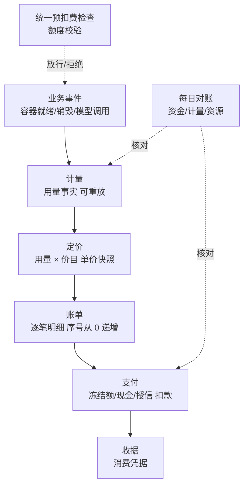
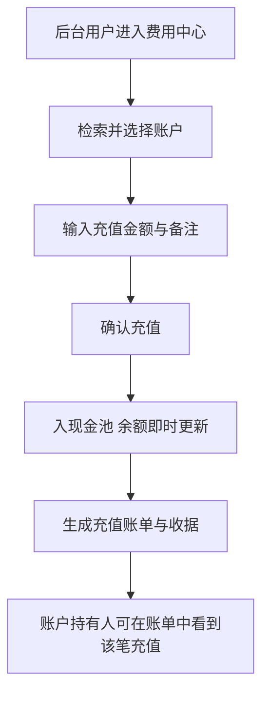
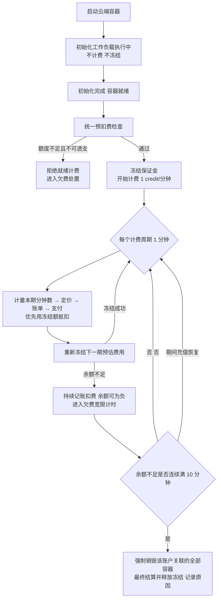
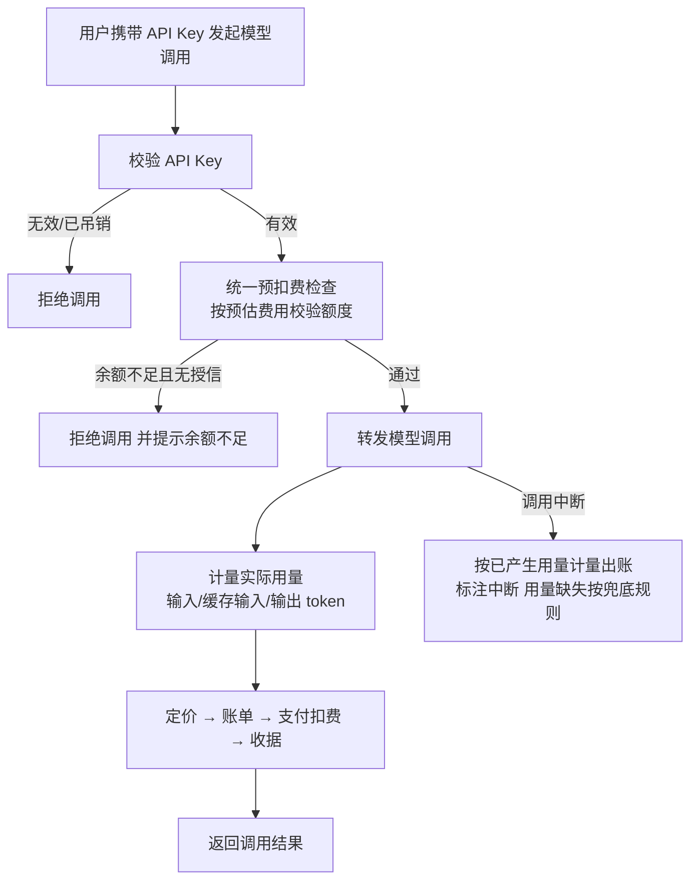

# 费用中心（Credits 计费）

**功能名称**: 后台费用中心与 Credits 计费体系
**PRD 版本**: v2.0
**创建日期**: 2026-10-18
**作者**: ZeroAsh
**版本说明**: v2.0（2026-10-18，返工重设计）按「业务事件 → 计量(Metering) → 定价(Pricing) → 账单(Invoice) → 支付(Payment) → 收据(Receipt)」计费管线重构全部计费口径：消费事实（计量）与资金变动（支付）分离、引入资金池/预扣冻结/收据/对账机制，容器采用「保证金 + 周期实扣」的预扣策略；同步 §1.2/§1.3/§3.2/§3.3/§3.5/§4/§5 口径。

## 背景与目标

### 1.1 背景

平台已经具备两类可计量的资源消耗能力，但目前完全没有计量与收费手段：

1. **云端工作容器**。用户可以拉起云端工作容器并挂载工作负载，容器运行期间持续占用平台资源，占用时长没有任何记录与分摊。
2. **模型调用**。后台已接入多家大模型供应商，但缺少对外的调用入口与用量计费，模型调用成本由平台整体承担，无法按用户区分。

由此带来三个问题：

- **成本不可见**：用户不知道自己消耗了多少资源，平台也无法向用户分摊成本。
- **资源不可控**：没有余额约束，容器可以无限期运行、模型可以无限量调用，缺少自动止损手段。
- **账目不可查**：没有消费明细，出了争议无法追溯每一笔消耗。

因此需要建设统一的费用中心：以独立的点数货币 **credits** 计价，覆盖前台用户与后台用户两类账户。计费过程按业界通行的六段管线组织，确保「事实可追溯、资金可核对」：

- **业务事件只描述发生了什么**（不带「扣多少钱」的指令）；
- **计量记录事实**（用了多少分钟、多少 token），事实不因价格调整而改变，可重放、可复核；
- **定价把事实翻译成钱**（用量 × 价目），价格调整只影响新发生的消费；
- **账单把费用落到账户**（每笔一条，序号连续）；
- **支付从账户资金中扣款**（含预扣冻结的结算）；
- **收据给出最终凭据**（用量、单价、金额、余额一目了然）。

### 1.2 目标

- 建立统一的 **credits 账户与资金体系**：账户资金区分现金（后台充值）、授信额度（透支能力）与冻结额（在途预留）；前台用户与后台用户均有账户，每笔消费/充值都有账单与收据。
- 计费全程遵循 **「业务事件 → 计量 → 定价 → 账单 → 支付 → 收据」** 六段管线：消费事实与资金变动分离，任何一笔扣款都能回溯到计量事实与价目。
- **云端工作容器按分钟计费**：自初始化工作负载完成、容器就绪起计费，1 分钟 1 credit；采用「保证金 + 周期实扣」预扣策略——就绪时冻结一笔保证金，之后每个计费周期按实际时长结算并重新冻结下一期；账户欠费时持续记账扣费，连续 10 分钟余额不足则强制销毁该账户关联的容器并释放冻结。
- **模型调用按 token 计费**：模型可配置「输入 / 缓存输入 / 输出」每百万 token 的 credits 单价；平台对外提供兼容 OpenAI 风格的独立模型调用入口；前台用户与后台用户均可生成自己的 API Key，凭 Key 调用并计费。计费规则：调用前执行统一的预扣费检查（额度校验），单次调用完成后按实际用量出账扣费；中断的调用也按已产生用量计费。
- **余额规则清晰**：后台账户支持透支（授信额度内允许负余额调用）；前台账户仅支持预付费，不提供自助充值渠道，只能由后台充值；余额不足且无透支能力时拒绝调用。
- **账目可追溯、可核算**：每次消费逐笔记录账单明细（账户内账单序号从 0 连续递增）；页面展示的余额为快速核算值（快照），并提供精确核算能力；账单支持按分钟 / 小时 / 天汇总查看；每笔扣款完成生成收据。
- **额度检查规则统一**：所有「扣费前」的余额判断（容器开通与周期续期、模型调用）都经过同一套预扣费检查，不允许各处自建规则。
- **对账兜底**：资金、计量、资源三条对账线保证不漏计、不多扣、不留僵尸冻结。

### 1.3 成功标准

- 为任一账户充值后，账户余额与账单、收据立即可见、可核对；账单序号从 0 起连续递增，无跳号。
- 启动云端工作容器并完成初始化后：账单中出现按分钟计费的消费明细与对应收据，费用与运行时长吻合（1 分钟 1 credit）；账户上有与运行状态对应的冻结额，容器销毁后冻结额如数释放/结清。
- 账户余额不足以继续支付容器费用时，消费仍持续记录；连续 10 分钟余额不足后，该账户关联的容器被强制销毁，冻结额释放，账单与容器记录中可查到原因。
- 使用 API Key 调用模型后，账单中出现按 token 计费的消费明细与收据，费用与调用量（输入 / 缓存输入 / 输出）及当时价目吻合；调用中途断开的调用同样有计费明细。
- 余额不足且不支持透支的账户发起模型调用时被拒绝，并得到明确的「余额不足」提示；支持透支的账户在授信额度内余额为负时仍可正常调用。
- 任取一笔扣款，可完整回溯：收据 → 账单 → 定价（单价快照）→ 计量（用量事实）→ 业务事件（来源），链路无断点。
- 后台费用中心可以完成：账户查看、充值、账单与收据查看、汇总查看、模型定价设置、API Key 管理；前台用户可以查看自己的余额、账单、收据与 API Key。
- 页面余额与精确核算结果一致（精确核算为对全部资金流水的合计）；对账任务运行后资金/计量/资源三线无差错或差错有据可查。

## 用户分析

### 2.1 目标用户

- **前台用户（开发者）**：使用云端工作容器跑任务、使用 API Key 调用模型的终端用户，只支持预付费。
- **后台用户（平台运营/管理员）**：管理费用中心、为账户充值、配置模型定价；其自身账户支持透支（授信）。
- **平台管理者**：通过账单、收据与汇总掌握整体资源消耗情况，并通过对账保证账实相符。

### 2.2 用户场景

| 场景 | 用户角色 | 目标 | 痛点 |
|--|--|--|--|
| 跑一个云端容器任务 | 前台用户 | 只为实际运行时长付费，预付资金有保障 | 目前容器占用资源无计量，成本无法分摊 |
| 用 API Key 接入模型能力 | 前台用户 | 按实际 token 用量付费，费用可预估 | 没有对外调用入口，也没有用量计费 |
| 账户余额用完 | 前台用户 | 明确知道欠费了、会发生什么、如何恢复 | 没有余额与欠费提示，服务被停时不明原因 |
| 给客户/团队充值 | 后台用户 | 快速给指定账户充值 credits | 没有账户与充值手段 |
| 追查一笔消耗 | 后台用户 | 看到每一笔消费的用量、单价、金额与凭据 | 无账单与收据，争议无法追溯 |
| 控制失控的资源占用 | 后台用户 | 欠费的容器在宽限后自动止损 | 无自动止损，欠费容器可无限运行 |
| 为模型设定价格 | 后台用户 | 按输入/缓存输入/输出分别定价，调价不影响历史 | 模型无定价能力，调用成本无法回收 |
| 核对账实是否相符 | 平台管理者 | 定期核对资金、用量、资源三者一致 | 无对账手段，坏账只能靠人工翻记录 |

## 功能需求

### 3.1 功能概述

建设以 credits 为计价货币的账户与账单体系，全部消费按「业务事件 → 计量 → 定价 → 账单 → 支付 → 收据」管线处理：后台提供费用中心（账户、充值、账单与收据、汇总、模型定价、API Key 管理、对账结果）；云端工作容器按分钟计费（保证金 + 周期实扣），长期欠费自动销毁止损；模型调用通过兼容 OpenAI 风格的独立入口凭 API Key 调用、按 token 计费；所有扣费前统一经过预扣费检查；所有资金变动有不可篡改的流水，定期对账兜底。

### 3.2 功能列表

#### 功能点 1: 账户与资金体系（前台 + 后台用户）

- **描述**: 为每个前台用户与后台用户建立 credits 账户。账户资金分为三部分：**现金**（后台充值入账）、**授信额度**（允许负余额的透支能力，后台账户有、前台账户无）、**冻结额**（在途消费预留的保证金，不可再用于其他消费）。账户展示余额（可用余额 = 现金 + 授信额度 − 冻结额）、欠费状态。账户内每一笔消费、充值、冻结、解冻都形成资金流水；每一笔消费出账形成账单明细（序号从 0 连续递增）。账单与流水均为追加式记录，不可修改、不可删除。
- **用户价值**: 用户随时知道自己花了多少、还剩多少、多少在途被冻结；平台账目一致、可信。
- **验收标准**:
  - [ ] 前台用户与后台用户均有自己的账户，可查看余额、冻结额与账单
  - [ ] 新账户初始余额为 0，账单序号从 0 开始，连续不跳号
  - [ ] 每笔充值、消费各生成一条账单明细，含时间、类型、金额、入账后余额、来源说明
  - [ ] 容器运行期间账户上可见对应的冻结额，销毁后冻结额结清/释放
  - [ ] 账单与资金流水不可被修改或删除

#### 功能点 2: 计费管线（业务事件 → 计量 → 定价 → 账单 → 支付 → 收据）

- **描述**: 全部消费按六段管线处理，各段职责单一、可独立核对：
  1. **业务事件**：容器就绪/销毁、模型调用完成/中断等事实事件，事件只描述「发生了什么」，不携带扣费指令；重复投递的事件不产生重复计费。
  2. **计量**：把事件换算成用量事实（容器：计费分钟数；模型：输入/缓存输入/输出 token 数），计量记录是事实、可重放、可复核，不因调价而改变。
  3. **定价**：按价目表把用量换算成费用（用量 × 单价）；账单上保留计价时点的单价快照；价格调整只影响新发生的消费。
  4. **账单**：按笔出账，形成账单明细（账户内序号从 0 递增）。
  5. **支付**：从账户资金扣款（优先使用该笔消费的冻结额/保证金，其次现金，最后授信），生成资金流水。
  6. **收据**：扣款完成后生成收据，列明用量、单价、金额、支付后余额，作为消费凭据。
- **用户价值**: 每一笔钱都有据可查、可以逐段复核；出了争议能定位到是计量、定价还是扣款环节的问题。
- **验收标准**:
  - [ ] 任一消费可回溯完整链路：收据 → 账单 → 单价快照 → 用量事实 → 业务事件
  - [ ] 重复的业务事件不产生重复计量与重复扣费
  - [ ] 调价后新消费按新价、老账单保持原单价快照不变
  - [ ] 每笔扣款完成都有收据，收据金额与账单一致
  - [ ] 计量记录可重新核对（重放后结果一致）

#### 功能点 3: 后台充值

- **描述**: 后台用户在费用中心选择任一账户（前台或后台账户）进行充值，输入充值金额与备注，充值即时入现金池，生成账单与收据。前台不提供自助充值渠道，仅支持后台充值。
- **用户价值**: 平台可以灵活地为用户发放额度；前台用户无需对接支付渠道即可使用服务。
- **验收标准**:
  - [ ] 后台可按用户名/账户检索并选择充值目标
  - [ ] 充值金额为正数，支持 0.01 credits 精度
  - [ ] 充值后余额立即更新，账单与收据中出现充值记录（含操作人与备注）
  - [ ] 前台界面不提供任何自助充值/支付入口

#### 功能点 4: 云端工作容器按分钟计费（保证金 + 周期实扣）

- **描述**: 云端工作容器自「初始化工作负载完成、容器就绪」起开始计费，费率 1 credit/分钟，不足 1 分钟按 1 分钟计，销毁时结清尾部时长。预扣策略采用**保证金 + 周期实扣**：
  - 就绪时冻结一笔**保证金**（预扣费检查通过才允许就绪计费）；
  - 每个计费周期（1 分钟）按实际运行时长结算本期费用（优先用冻结额抵扣），并**重新冻结下一期**的预估费用；
  - 容器销毁时做最终结算并释放剩余冻结。
  账户余额不足以重新冻结下一期时，**不中断计费**：消费持续累计记账（余额可为负），进入欠费宽限期；任一账户连续 10 分钟余额不足时，强制销毁该账户关联的全部容器，释放其全部冻结额，销毁原因可查。
- **用户价值**: 用户只为实际占用时长付费，预付资金被占用的额度很小（最多一个周期+保证金）；平台对失控的资源占用有自动止损手段，不会无限欠费。
- **验收标准**:
  - [ ] 容器初始化期间不计费、不冻结，就绪后开始计费并冻结保证金
  - [ ] 计费时长与容器就绪至销毁的实际时长吻合，1 分钟 1 credit
  - [ ] 每个周期的结算与下一期冻结都有记录，可查当前冻结额
  - [ ] 账户欠费时扣费继续，账单持续记录，余额可为负
  - [ ] 余额不足连续满 10 分钟后，该账户关联的全部容器被强制销毁，冻结额释放
  - [ ] 余额在宽限期内恢复（如充值）则不销毁，欠费计时重置
  - [ ] 强制销毁的容器记录中可查到「余额不足」原因
  - [ ] 无论容器以何种方式消失（正常销毁/强拆/异常），冻结额最终都会结清或释放，不残留

#### 功能点 5: 模型调用计费与开放调用入口

- **描述**: 后台接入的模型支持配置计费价格：输入、缓存输入、输出分别按「每百万 token 多少 credits」定价，可开启/关闭该模型的计费。平台对外提供一个**兼容 OpenAI 风格的独立模型调用入口**，前台用户与后台用户均可在自己的界面生成、吊销自己的 API Key，凭 Key 调用并计费到自己账户。计费规则：**调用前执行统一的预扣费检查（按预估费用校验额度），单次调用完成后按实际用量出账扣费**；用量统计包含输入、缓存输入、输出 token；**调用中断（客户端断开、上游中断、超时）也按已产生用量计费**；用量缺失时按兜底规则计量（见 3.5），保证不逃费。余额不足且不支持透支时拒绝调用并给出明确提示。
- **用户价值**: 用户以标准方式接入模型能力、按量付费；平台回收模型成本。
- **验收标准**:
  - [ ] 后台可为模型分别设置输入/缓存输入/输出每百万 token 价格，并开关计费
  - [ ] 前台用户与后台用户均可生成、复制、吊销自己的 API Key，Key 只在生成时完整可见
  - [ ] 使用 API Key 可通过开放入口调用已配置的模型（支持普通与流式返回）
  - [ ] 调用前执行统一预扣费检查：余额不足且不支持透支时拒绝调用，提示明确
  - [ ] 调用完成后账单出现按 token 的消费明细与收据，费用与定价、用量吻合（输入/缓存输入/输出分别列示）
  - [ ] 中断的调用同样产生计费明细，标注为中断调用
  - [ ] 无效/吊销的 API Key 调用被拒绝

#### 功能点 6: 透支与预付费规则（授信额度）

- **描述**: 后台账户支持透支：拥有授信额度，可用余额为负（在授信额度内）时仍允许模型调用与容器运行计费。前台账户仅支持预付费（无授信额度）：余额不足时，模型调用被拒绝；容器消费按功能点 4 的欠费规则处理（持续扣费直至强拆）。账户余额可以为负数。
- **用户价值**: 后台运营不因临时欠费中断服务；前台用户风险可控，规则简单明确。
- **验收标准**:
  - [ ] 后台账户余额为负（授信内）时模型调用可正常进行
  - [ ] 前台账户余额不足时模型调用被拒绝并提示
  - [ ] 账户余额可展示为负数，账单明细中余额列可为负
  - [ ] 后台可在费用中心查看/调整账户的授信额度

#### 功能点 7: 账单明细、收据、余额核算与汇总

- **描述**: 每次消费/充值都记录账单明细并生成收据；页面展示的余额为快速核算值（快照），提供「精确核算」能力对账户全部资金流水重新合计，两者结果应一致。账单支持按**分钟 / 小时 / 天**三种粒度的汇总（reduce sum），用于费用中心的汇总视图与趋势展示，无需扫描全部明细即可快速得到任意时段的消费合计。
- **用户价值**: 对账有据可查；汇总视图秒开，支撑费用分析与争议裁决。
- **验收标准**:
  - [ ] 账单明细可按时间范围、类型（消费/充值）、来源（容器/模型）筛选与分页查看
  - [ ] 每笔消费可查看对应收据（用量、单价、金额、余额）
  - [ ] 每个账户可发起精确核算，核算结果与快照余额一致（不一致时以流水合计为准并给出提示）
  - [ ] 汇总视图支持按分钟/小时/天查看消费合计与笔数
  - [ ] 汇总结果与同口径的明细合计一致

#### 功能点 8: 统一的预扣费检查（额度校验）

- **描述**: 平台只有一套「扣费前」的额度检查规则：容器就绪时的保证金冻结、容器周期续期的重新冻结、模型调用前的额度校验，全部经过同一套检查，由它统一判断「额度是否足够」「是否允许透支/授信」「应拒绝还是放行并记账」。不允许各扣费场景各自实现检查逻辑，保证行为、口径、提示一致。
- **用户价值**: 规则只有一份，用户感知到的限制处处一致；平台后续新增计费场景时无需重新发明规则。
- **验收标准**:
  - [ ] 容器与模型的额度判定口径一致（同一套检查）
  - [ ] 「余额不足」的提示文案与处理方式在各处一致
  - [ ] 新增计费来源时只需接入统一检查，无需自带余额逻辑

#### 功能点 9: 对账与差错处理

- **描述**: 平台内置三条对账线，定期自动运行，费用中心可查看结果并手动触发：
  1. **资金对账**：账户余额（快照）与全部资金流水合计比对，发现不一致以流水为准校准并记录差错；
  2. **计量对账**：计费用量与原始业务事件比对，发现漏计、重复计；
  3. **资源对账**：进行中的计费预留与实际存活的容器比对，发现「资源已消失但预留未释放」的僵尸预留并强制结算释放（含预留到期自动结算，不依赖业务侧一定送达销毁事件）。
- **用户价值**: 账实相符有制度保障，坏账、漏扣、僵尸冻结能被系统性发现和修复。
- **验收标准**:
  - [ ] 三条对账线定期执行，结果（通过/差错数/差错明细）在费用中心可见
  - [ ] 资金差错以流水为准自动校准，并保留差错记录
  - [ ] 僵尸预留在对账中被发现并强制结算释放
  - [ ] 预留超期后自动结算，不长期悬挂

### 3.3 用户操作流程

#### 计费管线全景

#### 后台充值流程

#### 云端容器计费流程（保证金 + 周期实扣）

#### 模型调用计费流程

### 3.4 页面/界面描述

| 页面 | 描述 | 关键元素 |
|------|------|---------|
| 后台 · 费用中心（账户列表） | 全部前台/后台账户概览 | 账户、用户、余额、冻结额、授信额度、欠费状态、消费合计；检索与筛选；充值入口 |
| 后台 · 账户详情与账单 | 单个账户的账单、收据与核算 | 余额卡片（快照/冻结/精确核算）、账单明细表（序号、时间、类型、金额、入账后余额、来源、描述）、收据查看、按分钟/小时/天汇总视图、充值按钮 |
| 后台 · 充值对话框 | 对指定账户充值 | 金额输入（0.01 精度）、备注、确认 |
| 后台 · 模型定价设置 | 模型计费价目配置 | 每模型「输入/缓存输入/输出」每百万 token 价格、计费开关 |
| 后台 · API Key 管理 | 后台用户管理自己的调用密钥 | Key 列表（名称、前缀、状态、最后使用时间）、生成、吊销、生成时一次性展示完整 Key |
| 后台 · 对账中心 | 三条对账线的运行与差错 | 资金/计量/资源对账结果、差错明细、手动触发按钮 |
| 前台 · 我的费用 | 前台用户查看自己的消费 | 余额与冻结额、欠费提示、账单明细、收据查看、按天/小时汇总、充值引导文案（联系后台充值） |
| 前台 · API Key 管理 | 前台用户管理自己的调用密钥 | Key 列表、生成、吊销、完整 Key 仅生成时可见 |

### 3.5 异常与边界情况

| 情况 | 预期行为 |
|------|---------|
| 余额不足发起模型调用（无授信） | 拒绝调用，返回明确的「余额不足」提示（兼容 OpenAI 风格的错误格式），不产生账单 |
| 余额不足发起模型调用（有授信） | 放行调用，扣费后余额为负（不超授信额度） |
| 模型调用中途断开/超时/上游中断 | 按已产生的实际用量计量出账，明细标注为中断调用 |
| 模型调用用量无法获得（计量缺失） | 按兜底规则计量（按请求上限/已收内容估算），保证不逃费，明细标注为估算 |
| 容器运行中账户欠费 | 不停止计费，消费持续记账，余额持续为负，进入宽限计时 |
| 欠费连续满 10 分钟 | 强制销毁该账户关联的全部容器，最终结算并释放冻结，原因标注「余额不足」；欠费计时重置 |
| 宽限期内充值到账 | 欠费计时清零，容器继续运行，不销毁 |
| 容器初始化失败/未完成 | 不计费、不冻结（仅就绪后起算） |
| 容器就绪后立即销毁 | 不足 1 分钟按 1 分钟计费，销毁时结清并释放剩余冻结 |
| 容器异常消失（未收到销毁事件） | 资源对账发现僵尸预留，强制结算释放冻结；对应回收探测到容器已删则不再计费 |
| 预留到期未释放 | 自动结算并释放，不长期悬挂 |
| 重复的业务事件/重复结算 | 幂等处理，不重复计量、不重复扣费 |
| 释放/结算时余额不够 | 允许余额为负（形成欠费账单），同时完成冻结释放，不阻塞资源释放 |
| 跨计费周期/账期的长时段消费 | 按时间切分到各周期/账期分别出账，不在结束时一次性出账 |
| 价格调整 | 新消费按新价计费，历史账单保持计价时点的单价快照 |
| API Key 无效、已吊销或属于其他用户 | 拒绝调用，提示密钥无效 |
| 调用了未开启计费/未定价的模型 | 未开启计费的模型不扣费但记录调用；定价不完整的模型拒绝调用并提示管理员补全定价 |
| 充值金额非法（0、负数、超精度） | 拒绝并提示 |
| 并发消费同一账户 | 账单序号不重不漏，余额/冻结额不出现丢失更新 |
| 精确核算与快照余额不一致 | 以资金流水合计为准，给出提示并自动校准、保留差错记录 |
| 账户被冻结 | 拒绝新的调用与容器启动，已运行容器按欠费规则处理 |

## 四、非功能需求

### 4.1 性能要求

- 费用中心的账单列表与汇总视图响应应在秒级内完成（汇总基于预聚合，不随账单总量线性变慢）。
- 预扣费检查对调用延迟的影响应可忽略（目标 < 50ms 额外延迟）；预扣费检查是计费链路中唯一的同步卡点，必须快速失败。
- 容器周期结算允许周期级延迟，但不漏计、不重复计；结算中断后可重新执行且结果一致。

### 4.2 安全性要求

- API Key 完整值仅在生成时展示一次，平台侧不可明文找回；吊销后立即失效。
- 账单、收据、资金流水均为追加式，任何角色不可修改、删除历史记录；更正只能通过新的更正条目。
- 充值、授信调整、强制销毁等敏感操作记录操作人，可审计。
- 模型调用入口的鉴权只认 API Key，不暴露供应商凭据；供应商密钥不透出。

### 4.3 兼容性要求

- 模型调用入口兼容 OpenAI 风格的请求/响应与错误格式，主流 OpenAI SDK 客户端无需修改代码即可接入（仅替换入口地址与 API Key）。
- 存量容器、模型、用户功能不受影响；存量用户首次使用时自动获得初始余额为 0 的账户。
- 计费链路的任何一段故障恢复后可重放重算，不要求人工补偿。

## 五、依赖与约束

### 5.1 依赖

- 云端工作容器能力（启动/初始化/销毁），提供业务事件、计费起点与强拆动作。
- 模型与供应商管理能力，提供价目配置与调用转发的基础。
- 前台用户体系与后台用户体系，作为账户主体。

### 5.2 约束

- credits 为平台内独立点数货币，**不接入真实支付渠道**；充值只能由后台人工完成。
- **金额以整数最小单位运算**（0.01 credits 为最小记账单位，禁止浮点直接参与资金计算）；token 计费不足 0.01 credits 按 0.01 credits 计（向上取整）。
- 计量事实与定价分离：价目调整只影响新消费，历史账单保留单价快照，价目历史保留以便对账。
- 「余额不足」判定与「10 分钟宽限」为全平台统一口径，由统一的预扣费检查给出。

## 六、相关文档

- [[20261014-cloud-agent-phase2.md]] — 云Agent二期（K8s 云端工作容器）
- [[20261017-cloud-controller-workload.md]] — 云控制器工作负载功能
- [[../../engineering/proposals/20261018-feat-credits-billing.md]] — 本需求技术提案
- [[../AGENTS.md]] — 产品文档管理规范
