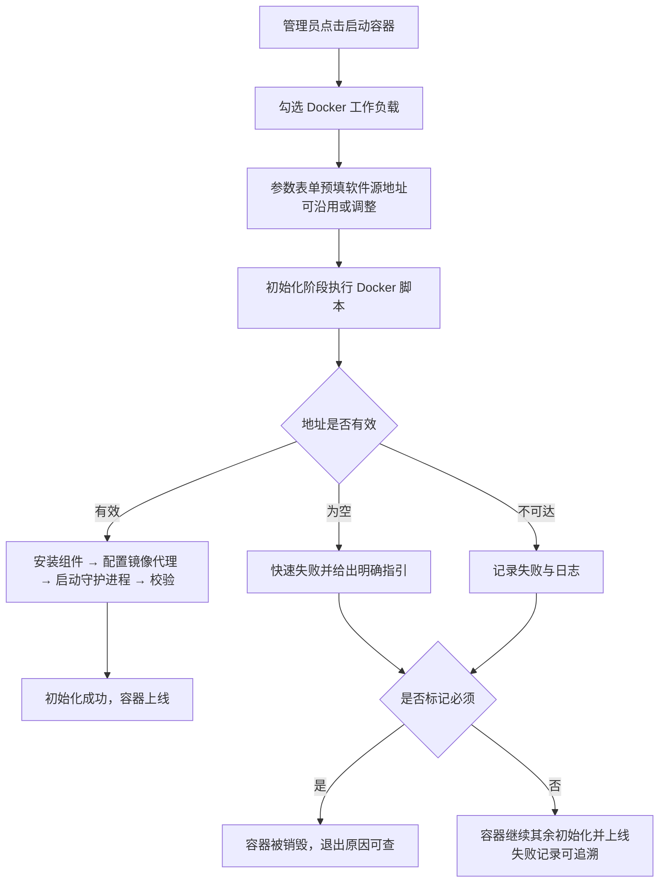
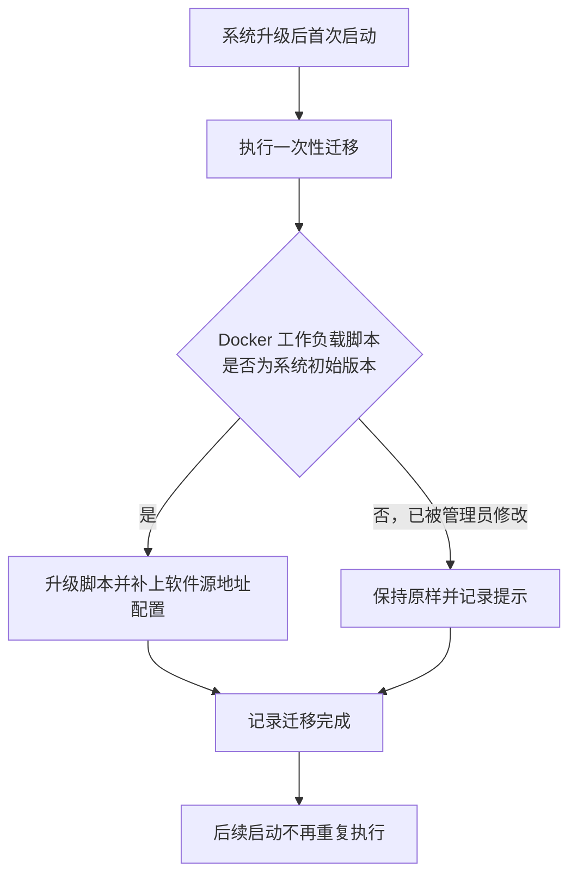

# Docker CE 软件源地址补齐：修复「Docker」工作负载初始化必然失败

**功能名称**: 「Docker」工作负载软件源地址配置（修复初始化必然失败）
**PRD 版本**: v1.0
**创建日期**: 2026-10-18
**作者**: ZeroAsh

## 背景与目标

### 1.1 背景

工作负载四期（[[20261018-workload-phase4.md]]）把 Docker 的安装与配置从工作容器基础环境整体下沉到「Docker」预制工作负载。当时内网还没有 Docker CE 软件源代理仓库，因此安装来源采用了保守口径：**由运行环境注入、脚本内不提供默认地址**，缺失时快速失败并提示。

四期上线后暴露出一个必然失败的缺口：

1. **地址没有任何地方可填**。系统里既没有可以填写该地址的工作负载配置项，也没有其他环节会把它注入容器。管理员即使想配置也无从下手，提示中要求的「注入」在当前产品形态下无法完成。
2. **初始化因此一定失败**。基础环境瘦身之后，容器里不再预装 Docker，初始化必然走到「需要安装」这一步，又因安装来源缺失而失败。也就是说，选择「Docker」工作负载从未成功过。
3. **失败后果被放大**。若启动时把「Docker」标为「必须」（工作负载三期口径），初始化失败会直接销毁容器；即便不标「必须」，容器也是带着不可用的 Docker 上线，使用者要到任务失败才发现。

与此同时，运维已经创建并验证了内网 Docker CE 软件源代理仓库（`https://nexus.internal.fffdan.com/repository/docker-ce-apt/`，软件包索引与校验公钥均可正常获取）。因此本期把这个真实可达的地址**填进「Docker」工作负载**，并把它做成管理员看得见、可调整的配置项，彻底消除「必然失败」。

### 1.2 目标

- 「Docker」工作负载自带已填好的 Docker CE 软件源地址（内网软件源代理），默认配置下选择该工作负载即可完成初始化，不再必然失败。
- 软件源地址成为工作负载的可见配置项：启动容器时可查看、可按环境调整，无需修改脚本。
- 存量环境平滑升级：未被管理员定制过的「Docker」工作负载自动补上地址；定制过的不被覆盖，并给出明确提示。
- 保留清晰的失败兜底：地址确实缺失或不可达时，失败原因与指引在执行记录中一目了然。

### 1.3 成功标准

- 新环境与存量环境均可在「Docker」工作负载的参数表单中看到已填好的软件源地址，按默认值启动容器：初始化成功，Docker 命令与镜像构建可用、镜像拉取走内部镜像代理（与四期体验一致）。
- 启动容器时可修改软件源地址，改后该次启动按新地址安装。
- 人为清空地址后启动：初始化快速失败，执行记录中给出明确指引；是否销毁容器仍遵循「必须」标记口径。
- 地址指向不可达来源时：该工作负载记录失败并保留日志，其余行为与四期一致。
- 存量环境升级后：未定制的「Docker」工作负载自动获得地址与新脚本；被定制过的不被覆盖，升级记录中可见提示。

## 用户分析

### 2.1 目标用户

- **平台管理员/运营人员**：维护预制工作负载、启动云端工作容器并挂载工作负载、排查环境初始化问题。

### 2.2 用户场景

| 场景 | 用户角色 | 目标 | 痛点 |
|--|--|--|--|
| 启动带 Docker 的工作容器 | 管理员 | 勾选「Docker」后初始化一次通过 | 现在无论怎么配置都失败，Docker 能力完全不可用 |
| 换一个软件源环境 | 管理员 | 启动时直接改地址，不动脚本 | 地址写死或没地方填，只能改预制脚本 |
| 排查初始化失败 | 管理员 | 从执行记录看出是地址缺失还是地址不可达 | 失败信息笼统，难以定位是配置缺失 |
| 升级存量环境 | 管理员 | 升级后预制工作负载恢复可用，自己改过的内容不丢 | 担心系统覆盖自己定制过的脚本 |

## 功能需求

### 3.1 功能概述

为「Docker」预制工作负载补齐 Docker CE 软件源地址配置项（默认填入内网软件源代理地址），初始化按该地址安装所需组件；配套一次性升级机制，让存量环境中未被定制过的工作负载自动获得该配置。

### 3.2 功能列表

#### 功能点 1: 软件源地址随「Docker」工作负载提供（默认已填）

- **描述**: 「Docker」工作负载新增「Docker CE 软件源地址」配置项，默认值为内网软件源代理地址。启动容器勾选「Docker」后，参数表单中预填该默认值，管理员可直接沿用，也可按本次环境调整；未做修改时按默认值执行。
- **用户价值**: 开箱即用——不再需要任何额外配置即可完成 Docker 环境初始化；同时保留按环境调整的灵活性。
- **验收标准**:
  - [ ] 「Docker」工作负载的参数表单中出现「Docker CE 软件源地址」，默认值已填入内网软件源代理地址
  - [ ] 按默认值启动容器并选择「Docker」，初始化成功且 Docker 命令、镜像构建、镜像拉取（走内部镜像代理）可用
  - [ ] 启动时修改地址，该次初始化按修改后的地址安装
  - [ ] 工作负载管理页可查看该配置项及其默认值，管理员可调整默认值

#### 功能点 2: 初始化按填写的地址执行，缺失时给出明确指引

- **描述**: 「Docker」工作负载初始化时按配置项中的地址获取安装所需组件与校验公钥；地址允许在启动时逐次调整。地址为空时保持四期的快速失败口径，并在执行记录中给出包含正确地址形态的指引；地址不可达时记录失败与日志。组件已安装或守护进程已就绪时跳过对应步骤（幂等不变）。
- **用户价值**: 失败原因可定位、可自助修复；重复初始化不产生副作用。
- **验收标准**:
  - [ ] 地址为空且需安装时，初始化快速失败，执行记录中给出明确指引（含正确的地址形态示例）
  - [ ] 地址不可达时，该工作负载记录失败并保留日志，容器行为遵循「必须」标记口径
  - [ ] 重复执行初始化脚本不重复安装，已就绪时直接成功

#### 功能点 3: 存量环境一次性升级

- **描述**: 系统升级时通过一次性迁移，为「Docker」工作负载补上软件源地址配置，并把初始化脚本升级为使用该配置的版本：
  - 仅当脚本内容仍是系统初始版本（管理员未修改过）时才自动升级；
  - 管理员修改过的脚本保持原样不覆盖，升级记录中给出提示，由管理员参照新版本自行调整；
  - 已升级过的环境不重复升级。
- **用户价值**: 存量环境无需人工介入即恢复可用，同时尊重管理员的定制。
- **验收标准**:
  - [ ] 未定制过的「Docker」工作负载在升级后自动获得软件源地址与新脚本
  - [ ] 定制过的脚本不被覆盖，升级记录中可见提示
  - [ ] 重复执行迁移不产生重复变更

### 3.3 用户操作流程

#### 启动容器（含 Docker）

#### 存量环境升级

### 3.4 页面/界面描述

本期不涉及新增页面；变化体现在既有页面的配置内容：

| 页面 | 描述 | 关键元素 |
|------|------|---------|
| 启动容器对话框 | 勾选「Docker」后出现参数表单，软件源地址预填默认值 | 软件源地址输入框、「必须」开关 |
| 工作负载管理/编辑对话框 | 「Docker」工作负载可见「Docker CE 软件源地址」参数及其默认值 | 参数列表、默认值编辑 |
| 工作负载执行日志视图 | 安装来源缺失或不可达时可见对应输出 | 执行记录、脚本快照、输出日志 |
| 升级记录 | 存量升级结果可见，定制过的脚本有提示 | 迁移记录、提示信息 |

### 3.5 异常与边界情况

| 情况 | 预期行为 |
|------|---------|
| 软件源地址被清空 | 若组件尚未安装，初始化快速失败并给出明确指引（含正确地址形态示例）；容器是否销毁遵循「必须」标记口径 |
| 软件源地址不可达 | 该工作负载记录失败并保留日志；容器是否销毁遵循「必须」标记口径 |
| 软件源地址填写形态有误（如多写路径） | 安装阶段报错，输出日志可见，管理员按指引修正地址后重建容器 |
| 组件已安装、守护进程已就绪 | 跳过安装与启动，直接校验通过（幂等） |
| 未选择 Docker 工作负载，任务脚本中调用 Docker | 命令不存在，任务失败并在输出中可见（与既有「未选择即不可用」口径一致） |
| 存量环境中 Docker 脚本被管理员修改过 | 一次性迁移不覆盖，记录提示；管理员参照新版本自行调整 |
| 已启动/已结束的容器 | 不受影响；重建后才使用新配置 |

## 四、非功能需求

### 4.1 性能要求

- 软件源走内网代理，安装耗时与四期口径一致，控制在分钟级以内，进度与输出在执行记录中可见。
- 配置项为单个文本项，启动对话框渲染与提交无额外开销。

### 4.2 安全性要求

- 默认地址仅指向内网软件源代理，不指向公网；管理员调整为其他来源时责任在管理员，工作负载脚本仍仅管理员可查看与编辑。
- 校验公钥随软件源一同获取，安装仍走签名校验，不降低安装链路的安全性。

### 4.3 兼容性要求

- 不改变既有能力边界：未选择「Docker」工作负载即不可用 Docker；「必须」标记的失败语义不变。
- 已启动/已结束的容器及其执行记录不受影响。
- 存量环境一次性升级不覆盖管理员定制；定制脚本由管理员自行跟进。
- 初始化脚本的幂等、超时、日志截断等执行语义均不变。

## 五、依赖与约束

### 5.1 依赖

- 运维已创建并持续维护内网 Docker CE 软件源代理仓库（`https://nexus.internal.fffdan.com/repository/docker-ce-apt/`），且在容器初始化阶段可达。
- 工作负载一期的参数能力与一次性迁移机制已上线。

### 5.2 约束

- 本期只解决「安装来源地址缺失」问题，不改变 Docker 能力范围、不调整工作负载的依赖与「必须」语义。
- 配置在容器启动时生效，已运行容器需重建后才使用新地址。
- 一次性升级只处理「Docker」预制工作负载，其他预制项（Node.js / .NET / Aspire）不变更。

## 六、相关文档

- [[20261018-workload-phase4.md]] — 工作负载四期 PRD（安装来源下沉工作负载，本期直接前因）
- [[20261018-workload-phase1.md]] — 工作负载一期 PRD（参数能力基线）
- [[20261018-workload-phase3.md]] — 工作负载三期 PRD（「必须」标记硬失败口径）
- 技术提案：`docs/engineering/proposals/20261018-fix-docker-ce-apt-source.md`
