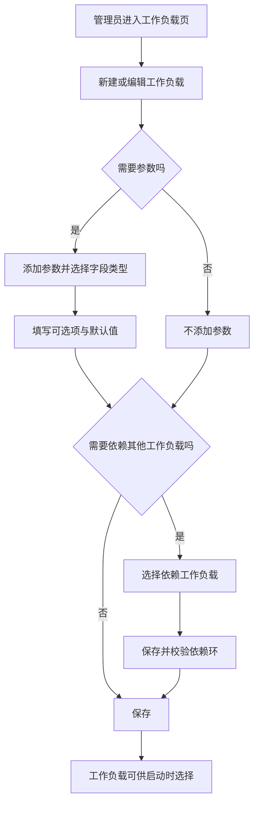
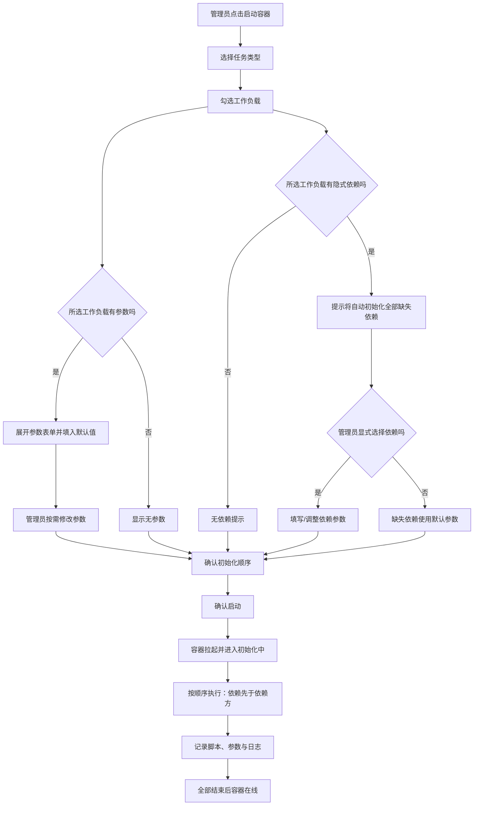
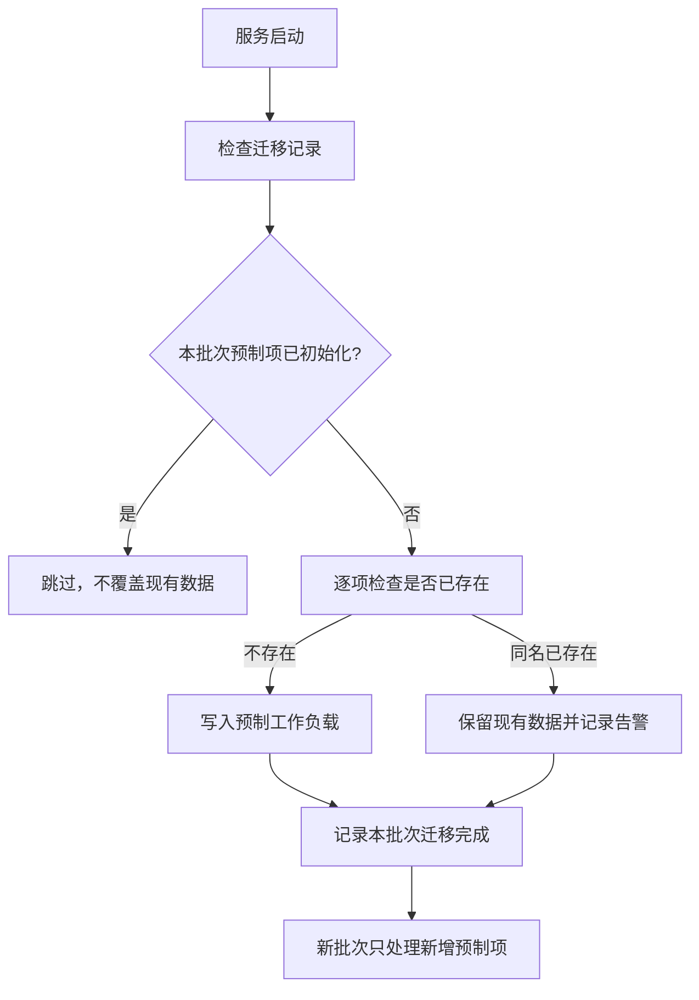

# 工作负载一期：参数、依赖与预制工作负载

**功能名称**: 工作负载参数化、隐式依赖与预制工作负载
**PRD 版本**: v1.2
**创建日期**: 2026-10-18
**作者**: ZeroAsh

> v1.1 变更（返工）：Aspire 预制工作负载改为通过官方安装脚本 `curl -sSL https://aspire.dev/install.sh | bash` 安装 **Aspire CLI**，并以 `aspire --version` 校验；不再使用 `dotnet workload install aspire`（该 workload 不会提供 `aspire` CLI）。
>
> v1.2 变更（返工）：工作负载依赖从「最多一个」调整为「支持多个依赖」；Aspire 预制工作负载依赖 **Docker** 和 **.NET** 两个工作负载。

## 背景与目标

### 1.1 背景

平台已经支持管理员在管理后台维护「工作负载」（名称 + 初始化脚本 + 清理脚本），启动云端工作容器时按需挂载，由系统在容器初始化阶段按序执行脚本。但当前能力仍有三类明显缺口：

1. **工作负载不可参数化**。同一个「Node.js 环境」工作负载，22 与 20 版本、npm 与 pnpm 的组合只能靠复制多份工作负载或人工改脚本来实现；每次启动无法按任务填写参数。
2. **工作负载之间无法声明依赖**。例如 Aspire 必须先有 Docker 与 .NET，当前只能依赖管理员每次手动多选，漏选就会初始化失败；同时管理员又希望能显式选择被依赖的工作负载并调整它的参数。
3. **常用环境仍固化在容器镜像里**。Docker、Node.js、.NET 等环境被写死在镜像构建期或容器入口，无法像普通工作负载一样被选择、查看、调整和追踪；每次新增常用环境都要重建镜像。

因此需要在一期补齐「参数表单 + 隐式依赖 + 预制工作负载」三项能力，让工作负载从「一段固定脚本」升级为「可配置、可组合、可演进的初始化单元」。

### 1.2 目标

- 工作负载可以声明一组参数；参数表单为空表示该工作负载没有配置项；一旦声明表单，每个参数必须有默认值。
- 启动容器时，管理员可以为每个已选工作负载填写参数；未填写的参数自动使用默认值；参数值随初始化执行落档可查。
- 工作负载可以声明「依赖一个或多个工作负载」；选择被依赖方时自动带上全部依赖（隐式依赖），前端明确提示；管理员仍可显式选择依赖并调整其参数，且同一工作负载在一次容器初始化中只执行一次。
- 通过一次性迁移初始化四个预制工作负载：Docker、Node.js、.NET、Aspire；已初始化过的不再重复初始化，未来新增的预制项通过新的迁移批次继续初始化。
- 将 dockerd 的启动职责从容器入口迁移到「Docker」预制工作负载，使「是否启用容器内 Docker」成为可选择的能力。

### 1.3 成功标准

- 管理员可以在工作负载编辑页配置 0~N 个参数，四种字段类型（下拉单选、下拉多选、文本、布尔）均可正常保存与回显；未配置参数的工作负载不出现参数表单。
- 配置了参数表单的工作负载无法在「参数没有默认值」的情况下保存。
- 启动容器时，选中带参数的工作负载即可看到参数表单，默认值已填好；修改后的值在初始化脚本中生效，并在执行记录中可追溯。
- 选择「Aspire」时，界面提示将自动初始化 Docker 和 .NET；不手动勾选这两个依赖也能成功完成初始化；显式勾选并调整参数时，以其参数为准，且每个依赖只执行一次。
- Docker、Node.js、.NET、Aspire 四个预制工作负载在升级后自动出现且只出现一次；管理员修改或删除后不会被后续启动重新覆盖/恢复。
- 选择「Docker」工作负载后容器内 Docker 可用；不选择时容器照常启动，仅不提供 Docker 守护进程。
- 选择「Node.js」工作负载并填写版本、包管理器后，对应版本的 Node.js 成为默认版本，所选包管理器可用，包管理器使用内部 registry。
- 选择「.NET」工作负载后可使用 .NET SDK；选择「Aspire」时在其之前自动完成 Docker 与 .NET 初始化。

## 用户分析

### 2.1 目标用户

- **平台管理员/运营人员**：维护工作负载、配置参数与依赖、启动容器并按需填写参数、排查初始化结果。

### 2.2 用户场景

| 场景 | 用户角色 | 目标 | 痛点 |
|--|--|--|--|
| 按任务选择 Node.js 版本 | 管理员 | 同一次启动中指定 Node.js 版本和包管理器 | 每个版本/包管理器组合都要复制一份工作负载或改脚本 |
| 复用带参数的环境模板 | 管理员 | 一份工作负载通过参数适配多个项目 | 参数写死在脚本里，无法在启动时调整 |
| 只选 Aspire 也能跑起来 | 管理员 | 选中 Aspire 后自动补齐 Docker 与 .NET | 容易漏选依赖，初始化到一半失败 |
| 显式调整被依赖环境 | 管理员 | 自己选择 Docker/.NET 并改参数，Aspire 复用这份配置 | 自动依赖与手动选择重复执行、参数互相覆盖 |
| 首次升级即获得常用环境 | 管理员 | 升级后直接看到 Docker/Node.js/.NET/Aspire | 需要人工逐个新建，脚本容易写错 |
| 避免预制项反复出现 | 管理员 | 删除或改造后的预制工作负载保持现状 | 每次重启都被系统重新写回，无法定制 |
| 排查参数是否正确 | 管理员 | 查看某次初始化用了哪些参数 | 只看到脚本和日志，不知道实际入参 |

## 功能需求

### 3.1 功能概述

工作负载新增「参数表单」和「依赖工作负载」两类配置；启动容器时按工作负载逐个填写参数，系统自动展开隐式依赖并保证每个工作负载只初始化一次；同时内置 Docker、Node.js、.NET、Aspire 四个预制工作负载，由一次性迁移写入，后续只增不改。

### 3.2 功能列表

#### 功能点 1: 工作负载参数表单配置

- **描述**: 在新建/编辑工作负载时，管理员可以配置该工作负载的参数表单：
  - 参数表单可以为空；为空表示该工作负载没有可配置项。
  - 每个参数包含：参数标识、显示名称、字段类型、默认值；下拉单选/下拉多选还需要配置可选项。
  - 支持的字段类型：**下拉单选**、**下拉多选**、**文本**、**布尔**。
  - 每个参数必须有默认值；默认值必须符合字段类型与可选项约束。
  - 参数标识在工作负载内唯一，用于在初始化脚本中引用该参数。
  - 支持新增、删除、调整参数顺序；保存前校验参数标识唯一、可选项非空且不重复、默认值合法。
- **用户价值**: 一份工作负载通过参数适配不同项目/版本，减少重复工作负载。
- **验收标准**:
  - [ ] 可以不配置任何参数并正常保存工作负载
  - [ ] 四种字段类型均可配置并正确回显
  - [ ] 下拉单选/多选必须至少有一个可选项，默认值必须属于可选项
  - [ ] 文本与布尔参数可设置合法默认值
  - [ ] 参数标识重复、为空或格式非法时拒绝保存并提示具体位置
  - [ ] 缺少默认值的参数无法保存
  - [ ] 编辑参数表单后，已启动/已完成的容器历史记录不受影响

#### 功能点 2: 启动容器时填写工作负载参数

- **描述**: 云端容器启动对话框中，每选中一个带参数表单的工作负载，就展开对应的参数填写区：
  - 默认值自动填入，管理员可按需修改。
  - 下拉单选从可选项中选择一个；下拉多选可勾选多个；文本为单行/多行输入；布尔为开关。
  - 参数表单为空的工作负载不显示参数区，仅显示「无参数」提示。
  - 未修改的参数按默认值提交；提交前按配置校验，非法值阻止启动并定位到具体工作负载与参数。
- **用户价值**: 启动时即可完成环境定制，无需进入容器后手工调整。
- **验收标准**:
  - [ ] 选中带参数的工作负载后展示参数区，默认值已填好
  - [ ] 四种字段类型的输入控件与配置类型一致
  - [ ] 未填写/未修改的参数使用默认值
  - [ ] 非法参数值（不在可选项、类型不符、超出长度）阻止启动并提示
  - [ ] 参数为空的工作负载不展示参数输入控件
  - [ ] 同一次启动中多个工作负载的参数互不干扰

#### 功能点 3: 参数在初始化/清理脚本中生效并可追溯

- **描述**: 管理员填写的参数在对应工作负载的初始化脚本（以及清理脚本，如该工作负载有清理脚本）执行时可用；执行记录中保留本次执行使用的参数值快照，便于排查。工作负载后续被修改或删除，不影响历史记录中的参数与脚本快照。
- **用户价值**: 参数真正驱动初始化行为，且事后可还原「当时用了什么参数」。
- **验收标准**:
  - [ ] 文本、单选、多选、布尔参数均可在脚本中读取
  - [ ] 多选参数以可枚举的列表形式提供给脚本
  - [ ] 执行记录展示本次执行的参数值（含默认值与管理员修改后的值）
  - [ ] 工作负载被编辑/删除后，历史执行记录仍显示原参数值
  - [ ] 未填写参数时脚本使用默认值，且记录中展示默认值

#### 功能点 4: 工作负载隐式依赖

- **描述**: 工作负载可以声明「依赖一个或多个工作负载」：
  - 一个工作负载在一期最多声明 5 个依赖，且不能依赖自己。
  - 启动容器时，如果选中了带依赖的工作负载而没有显式选中全部依赖，系统自动把缺失的依赖加入本次初始化，并在界面提示「将自动初始化 XXX、YYY」。
  - 隐式依赖使用其默认参数初始化。
  - 管理员仍可以显式选中被依赖的工作负载并调整参数；此时以管理员填写的参数为准，不再使用默认参数。
  - 依赖必须先于依赖方初始化；同一工作负载在一次容器初始化中只会执行一次（无论被显式、隐式还是多条依赖路径选中多少次）。
  - 多个依赖之间按其配置顺序初始化；例如 Aspire 的依赖顺序为 Docker → .NET，则初始化顺序为 Docker → .NET → Aspire。
  - 不允许形成依赖环；保存工作负载依赖时必须校验。
- **用户价值**: 减少漏选导致的初始化失败，同时保留管理员对被依赖环境的控制权。
- **验收标准**:
  - [ ] 工作负载可选择多个工作负载作为依赖，并展示在列表中
  - [ ] 选择带依赖的工作负载时，界面明确提示将自动初始化全部缺失依赖
  - [ ] 不手动选择依赖时，全部依赖都会被初始化一次，且先于依赖方完成
  - [ ] 多个依赖按配置顺序初始化（Aspire：Docker → .NET → Aspire）
  - [ ] 显式选择依赖并修改参数时，依赖使用修改后的参数
  - [ ] 显式、隐式或多条依赖路径同时指向同一依赖时，该依赖只初始化一次
  - [ ] 自己依赖自己、依赖环、依赖不存在时无法保存/无法启动并给出明确提示
  - [ ] 依赖初始化失败时，依赖方仍继续初始化，失败在执行记录中可见（与现有失败策略一致）
  - [ ] 展开依赖后超过单次挂载上限时阻止启动并提示

#### 功能点 5: 预制工作负载

- **描述**: 系统内置以下四个预制工作负载，升级后自动出现在工作负载列表中，并标记为「预制」：

  | 预制工作负载 | 参数 | 依赖 | 初始化行为 |
  |--|--|--|--|
  | Docker | 无 | 无 | 启动容器内 Docker 守护进程（dockerd），就绪后初始化完成 |
  | Node.js | 版本（文本，默认 22）；包管理器（多选，可选 npm/pnpm/bun/yarn，默认 npm） | 无 | 用 nvm 安装指定版本并设为默认；安装所选包管理器；配置内部 npm registry |
  | .NET | 无 | 无 | 安装最新 LTS 版本 .NET SDK，并使其在容器内可用 |
  | Aspire | 无 | Docker、.NET | 在 Docker 与 .NET 就绪后通过官方安装脚本安装 Aspire CLI，并用 `aspire --version` 校验 |

  - 预制工作负载初始化后与普通工作负载一样可查看、编辑、删除；系统不会在后续启动时覆盖管理员的修改。
  - 预制工作负载只在首次引入时写入；已初始化的不会重复写入。
  - 后续版本新增预制工作负载时，通过新的迁移批次写入，只补充新增项，不影响已存在项。
  - Docker 守护进程的启动职责从容器入口迁移到「Docker」工作负载：未选择「Docker」时容器不再自动启动 dockerd。
- **用户价值**: 常用环境开箱即用、可组合、可追踪，减少手工建负载与镜像重建。
- **验收标准**:
  - [ ] 升级后工作负载列表出现 Docker、Node.js、.NET、Aspire，且各只出现一次
  - [ ] 四个预制项带「预制」标识，依赖关系正确（Aspire → Docker、.NET）
  - [ ] 管理员修改/删除预制项后，服务重启不会覆盖或恢复
  - [ ] 后续新增预制项通过新迁移写入，不影响已存在项
  - [ ] 选择 Docker 后容器内 docker 命令可用；不选择时容器正常上线但无 dockerd
  - [ ] Node.js 按填写的版本安装并设为默认；所选包管理器可用；registry 指向内部地址
  - [ ] .NET 安装最新 LTS 后 `dotnet` 可用
  - [ ] Aspire 在 Docker 与 .NET 完成后初始化，`aspire --version` 可正常输出版本号，且两个依赖各只初始化一次

#### 功能点 6: 工作负载与执行记录展示增强

- **描述**: 工作负载列表展示「预制」标识、参数数量与依赖对象；执行记录展示本次执行的参数快照；启动对话框展示本次初始化顺序与隐式依赖提示。
- **用户价值**: 管理员能快速理解一个工作负载需要什么参数、依赖谁，以及本次启动实际会执行什么。
- **验收标准**:
  - [ ] 工作负载列表展示预制标识、参数数量、依赖名称
  - [ ] 启动对话框展示展开后的初始化顺序，隐式依赖有明确标识/提示
  - [ ] 执行记录详情展示参数值，并与脚本快照、输出日志一起可查看
  - [ ] 没有参数/依赖时展示为「无」，不出现空白区块

### 3.3 用户操作流程

#### 配置带参数与依赖的工作负载

#### 启动容器：填写参数并展开隐式依赖

#### 预制工作负载迁移

### 3.4 页面/界面描述

| 页面 | 描述 | 关键元素 |
|------|------|---------|
| 工作负载管理页 | 工作负载列表与 CRUD 入口 | 列表（名称、预制标识、参数数量、依赖、脚本摘要、更新时间）、新建按钮、编辑/删除按钮 |
| 工作负载编辑对话框 | 新建/编辑工作负载，含参数与依赖配置 | 名称、初始化脚本、清理脚本、参数列表（标识/名称/类型/可选项/默认值/删除）、添加参数按钮、依赖选择器、保存/取消 |
| 参数编辑区 | 配置单个参数 | 字段类型下拉、可选项编辑器（下拉单选/多选）、默认值控件（随类型切换）、参数标识与显示名称 |
| 依赖选择区 | 选择 0~5 个依赖 | 依赖工作负载多选、已选依赖列表、清除依赖、依赖环提示 |
| 云端容器启动对话框 | 启动容器并挂载工作负载 | 任务类型、工作负载多选、隐式依赖提示、每个工作负载的参数表单、初始化顺序预览、确认/取消 |
| 云端容器列表 | 展示容器状态与初始化进度 | 状态列（含「初始化中」）、当前执行的工作负载名称、挂载的工作负载列表 |
| 工作负载执行日志视图 | 按容器查看执行情况 | 执行记录列表（工作负载、阶段、状态、时间）、参数快照、脚本快照、输出日志 |

### 3.5 异常与边界情况

| 情况 | 预期行为 |
|------|---------|
| 参数表单为空 | 视为没有配置项，启动时不展示参数区，脚本按自身逻辑执行 |
| 参数缺少默认值 | 拒绝保存工作负载并提示具体参数 |
| 下拉单选/多选的默认值不在可选项内 | 拒绝保存并提示 |
| 下拉单选/多选未配置可选项 | 拒绝保存并提示 |
| 参数标识重复/为空/格式非法 | 拒绝保存并提示具体位置 |
| 启动时参数值非法 | 阻止启动，提示具体工作负载与参数；已填写的其他参数保留 |
| 启动时未提交某个参数 | 使用该参数默认值 |
| 工作负载配置了参数但脚本未使用 | 允许保存与启动；参数仅作为入参提供，不强制脚本消费 |
| 工作负载依赖自己 | 拒绝保存 |
| 工作负载形成依赖环（A→B→A） | 拒绝保存，并提示环路径 |
| 依赖的工作负载被删除 | 启动时拒绝并提示依赖不存在；管理员可编辑依赖或选择其他工作负载 |
| 显式选择的依赖参数与隐式默认参数冲突 | 以显式选择的参数为准 |
| 显式与隐式重复选中同一工作负载 | 只初始化一次，保留显式参数；位置由依赖顺序决定（依赖先于依赖方） |
| 同一依赖被多个依赖方或多条路径引用 | 只初始化一次，所有依赖方共享同一份参数 |
| 多个依赖之间存在先后关系 | 按依赖配置顺序初始化；依赖自身若还有依赖，继续前置展开 |
| 依赖展开后超过单次挂载上限 | 阻止启动并提示展开后的数量 |
| 依赖初始化失败 | 记录失败与日志，继续执行依赖方；依赖方可自行决定是否成功 |
| 容器初始化过程中工作负载被编辑/删除 | 本次初始化使用下发时的脚本与参数快照；后续启动使用新配置 |
| 容器断线重连 | 已完成的初始化不重跑；未完成批次按现有重连策略继续/收敛 |
| 预制项与管理员已有工作负载同名 | 保留已有数据，不覆盖；记录告警，预制项不重复写入 |
| 管理员修改预制项 | 保留修改；后续启动不回滚 |
| 管理员删除预制项 | 保持删除；后续启动不恢复（如需恢复由管理员手动新建） |
| 未选择 Docker 工作负载 | 容器不启动 dockerd，docker 命令不可用，但容器其他功能正常 |
| Node.js 版本安装失败 | 该工作负载记录失败并保留日志；容器仍可继续后续工作负载并上线 |
| Node.js 包管理器安装失败 | 记录失败；已成功的项保持；后续项继续执行 |
| .NET 下载/安装失败 | 记录失败；Aspire 仍会尝试执行并留下失败日志（其 Docker/.NET 前置检查会失败）；容器可上线 |
| Aspire CLI 安装失败（如内部源不可达） | 记录失败；容器可上线，管理员可查看日志 |
| Docker 守护进程启动失败 | 记录失败与 dockerd 日志尾部；容器可上线但 Docker 不可用 |
| 预制迁移执行失败 | 记录错误，不阻断服务启动；下次启动时按未完成的迁移重试 |
| 迁移已记录完成但预制项被删除 | 不重新写入（符合「初始化过不再初始化」） |

## 四、非功能需求

### 4.1 性能要求

- 工作负载列表在 200 条规模下，包含参数与依赖信息时查询响应不超过 2 秒。
- 启动对话框的参数表单渲染与展开依赖的计算应在 1 秒内完成（100 条工作负载、单负载 20 个参数规模）。
- 依赖展开最多 10 个工作负载，计算不应造成明显等待。
- 参数与脚本快照落库不得显著增加初始化耗时（相对于脚本执行本身可忽略）。

### 4.2 安全性要求

- 工作负载配置、参数填写与执行日志仅对管理员开放。
- 参数值按普通后台数据保护，**不得用于存放密码、Token 等敏感凭据**；界面需明确提示。
- 参数只能作为脚本的入参，不得改变系统对脚本执行边界、超时与权限的控制。
- 预制工作负载脚本使用内部 registry/安装源，避免初始化过程访问不可信外部源（.NET 安装脚本按需求使用官方地址，可通过环境变量替换为内部代理）。

### 4.3 兼容性要求

- 未配置参数、未配置依赖的工作负载行为与现有版本完全一致。
- 未选择任何工作负载的容器行为与现状一致。
- 升级前已经启动/结束的容器与执行记录不受影响；历史记录缺少参数时展示为空。
- 旧版本工作容器不认识新增参数时，脚本仍按默认值运行，不阻断初始化（新版本镜像提供完整参数能力）。
- 预制工作负载首次写入不影响管理员已存在的同名/其他工作负载。

## 五、依赖与约束

### 5.1 依赖

- 已上线的云控制器管理后台与「工作负载」能力（CRUD、启动挂载、初始化/清理批次、执行日志）。
- 云端工作容器镜像可更新（容器内 Agent 需支持参数注入与预制脚本所需的命令）。
- Node.js 预制项依赖内部 nvm/GitHub raw/Node.js 发行包/npm registry 代理。
- .NET/Aspire 预制项依赖外网或内部代理可访问 .NET 安装脚本、Aspire CLI 安装脚本与 NuGet 源。
- Docker 预制项依赖工作容器具备启动 dockerd 的运行权限（sysbox 等运行时）。

### 5.2 约束

- 一期每个工作负载最多声明 5 个依赖；支持多依赖，但不支持条件依赖/版本范围依赖。
- 一期不支持敏感参数（密码/密钥）与参数间联动、条件显示。
- 参数只在容器启动时填写；容器启动后不支持在线修改本次初始化参数。
- 预制工作负载采用「一次性迁移」语义：已初始化过的不再自动初始化；后续新增预制项必须通过新的迁移批次。
- 工作负载初始化失败不阻断容器上线（沿用现有策略），失败信息通过执行记录呈现。
- Docker 守护进程改为按需启动后，未挂载 Docker 工作负载的容器不保证 docker 命令可用。
- Aspire 预制项本期无参数，仅提供「依赖 Docker 与 .NET + 安装 Aspire CLI 并用 `aspire --version` 校验」的最小能力。

## 六、相关文档

- [[20261017-cloud-controller-workload.md]] — 云控制器工作负载功能 PRD（本期能力的基线）
- [[20261014-cloud-agent-phase2.md]] — 云Agent二期（K8s 云端工作容器）
- [[20261014-admin-console.md]] — 云控制器管理后台一期
- 技术提案：`docs/engineering/proposals/20261018-feat-workload-phase1.md`
