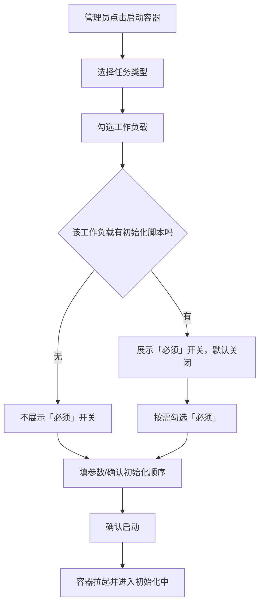
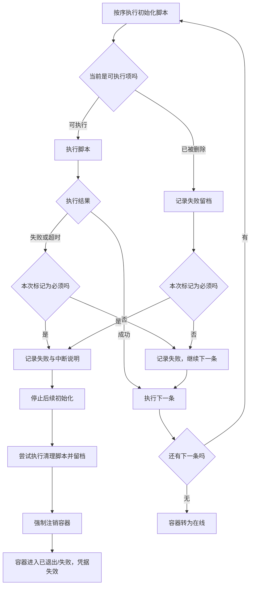
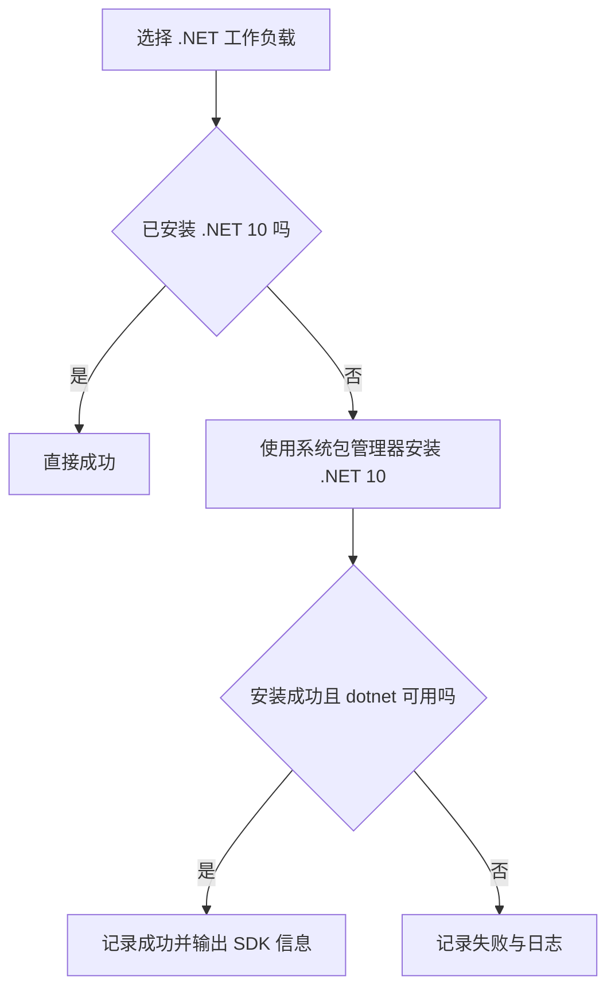
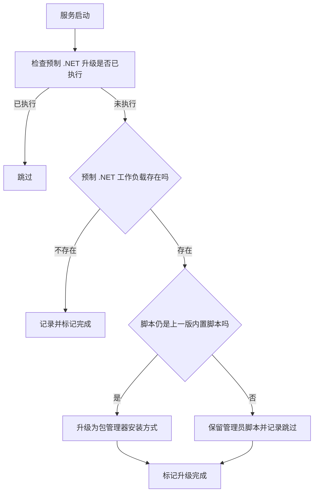

# 工作负载三期：必须工作负载硬失败与 .NET 安装优化

**功能名称**: 工作负载「必须」标记与 .NET 包管理器安装
**PRD 版本**: v1.0
**创建日期**: 2026-10-18
**作者**: ZeroAsh

## 背景与目标

### 1.1 背景

平台已具备完整的工作负载能力：管理员在管理后台维护工作负载（名称 + 初始化脚本 + 清理脚本 + 参数 + 依赖），启动云端工作容器时按需挂载，系统按序执行初始化脚本；此外还内置了 Docker、Node.js、.NET、Aspire 四个预制工作负载（见 `20261017-cloud-controller-workload.md`、`20261018-workload-phase1.md`）。

但当前策略是「初始化失败不阻断容器上线」：任意工作负载初始化失败（脚本非零退出或超时）都只记录失败日志，容器照常转为「在线」。这带来两个问题：

1. **容器可能带着残缺环境进入「在线」**。当某个工作负载是任务运行的前提（例如 .NET、Docker、某内部工具链）时，它初始化失败意味着容器根本不可用，却仍以「在线」暴露给使用者；后续必须人工发现并销毁，浪费资源也污染可用容器列表。管理员需要一个表达「这个工作负载是必须的，失败就别让容器活下来」的手段。
2. **.NET 预制工作负载的安装方式与内网环境不匹配**。当前 .NET 预制脚本通过下载官方 `dotnet-install.sh` 脚本安装 SDK，依赖外部网络/代理的可用性；而工作容器镜像与内网环境已统一采用系统包管理器（apt）走内网源。继续用安装脚本既慢又脆弱，需要改为通过包管理器安装 .NET 10。

因此本期补齐两项能力：一是「必须」标记与失败即强制注销容器（不重试、不退避）；二是 .NET 预制工作负载改用包管理器安装。

### 1.2 目标

- 启动容器时，管理员可以对每一个已选工作负载单独设置「必须」；默认为非必须。
- 标记为「必须」的工作负载，其初始化脚本执行失败（非零退出）或超时时：立即停止后续初始化，云端容器被强制注销（销毁），不会进入「在线」，也不进行重试/退避。
- 未标记「必须」的工作负载保持现有行为：失败只记录日志，容器照常继续后续初始化并上线。
- 「必须」状态与失败原因在后台可见：启动时可设置、初始化顺序预览中可辨认、执行记录与容器退出原因中可追溯。
- .NET 预制工作负载改用系统包管理器（apt）安装 .NET 10，并保持「安装后 `dotnet` 可用、Aspire 依赖 .NET 前置检查通过」的既有结果。
- 已部署环境中的预制 .NET 工作负载在没有被管理员改动过的情况下升级到新的安装方式；管理员自定义过的脚本不被覆盖。

### 1.3 成功标准

- 启动容器时，勾选任一工作负载后可为其勾选/取消「必须」，提交后该设置在容器执行计划中生效。
- 将某工作负载标记为「必须」并让其初始化脚本失败：容器不会进入「在线」，状态最终为已退出/失败，退出原因为「必须工作负载 XXX 初始化失败」，后续未执行的初始化脚本不再执行。
- 未标记「必须」的工作负载初始化失败时，容器仍按现状继续后续脚本并转为「在线」。
- 「必须」工作负载初始化超时（超过单条初始化超时）与失败同样触发强制注销。
- 容器被强制注销后不会自动重连、重试或恢复；使用该容器的一次性凭据立即失效。
- 强制注销前仍按既有流程执行清理脚本（若有），并保留完整的初始化/清理执行记录。
- 选择 .NET 预制工作负载后，`dotnet` 可用且为 .NET 10；安装过程通过系统包管理器完成，不依赖官方安装脚本地址。
- 升级后，未经管理员修改的预制 .NET 工作负载脚本被更新到包管理器安装方式；管理员修改过的脚本保持不变。

## 用户分析

### 2.1 目标用户

- **平台管理员/运营人员**：维护工作负载、启动容器、为必须的环境设置硬约束、排查初始化失败与容器退出原因。

### 2.2 用户场景

| 场景 | 用户角色 | 目标 | 痛点 |
|--|--|--|--|
| 任务强依赖某环境 | 管理员 | 明确「这个环境没装好就别给我容器」 | 失败的容器仍以在线状态出现，需人工识别并销毁 |
| 避免残缺容器被使用 | 管理员 | 环境初始化失败时容器直接消失 | 残缺容器混在可用列表中，误用后才发现问题 |
| 同一工作负载时有时无的强约束 | 管理员 | 同一次启动里按任务决定某负载是否必须 | 约束只能写死在脚本或工作负载定义里，无法按启动调整 |
| 排查为什么容器没了 | 管理员 | 知道是哪个必须负载失败导致注销 | 容器突然消失且无明确原因，需翻日志推断 |
| 内网安装 .NET | 管理员 | 用与镜像一致的包管理器装 .NET 10 | 安装脚本走外网、慢且不稳定，失败率高 |
| 升级后 .NET 安装方式生效 | 管理员 | 不用手工重写预制脚本 | 预制脚本已入库，升级不会自动更新 |

## 功能需求

### 3.1 功能概述

在启动容器的挂载选择中，为每个已选工作负载增加「必须」开关；标记为必须的工作负载初始化失败（失败或超时）时，系统立即中断本次初始化并强制注销该容器（不重试、不退避），同时保留执行记录与退出原因。此外，把预制 .NET 工作负载的安装方式从官方安装脚本改为系统包管理器安装 .NET 10，并对存量预制项做「未被改动才升级」的一次性更新。

### 3.2 功能列表

#### 功能点 1: 启动容器时为工作负载设置「必须」

- **描述**: 云端容器启动对话框的工作负载选择区，为每个已勾选的工作负载提供「必须」开关（默认关闭）：
  - 「必须」是对本次启动所选工作负载的设置，不改变工作负载定义本身；同一工作负载在不同启动中可以是必须或非必须。
  - 取消勾选工作负载时，其「必须」设置一并清除；重新勾选回到默认（非必须）。
  - 没有初始化脚本的工作负载不提供「必须」开关（没有可失败的初始化行为）。
  - 提交时「必须」随本次选择一起进入执行计划。
- **用户价值**: 按任务粒度表达「环境没装好就失败」，无需复制工作负载或改脚本。
- **验收标准**:
  - [ ] 每个已勾选且有初始化脚本的工作负载旁出现「必须」开关，默认关闭
  - [ ] 可独立设置多个工作负载为必须，互不影响
  - [ ] 取消勾选后再勾选，重置为非必须
  - [ ] 没有初始化脚本的工作负载不展示「必须」开关
  - [ ] 提交后的执行计划中能体现哪些工作负载被标记为必须

#### 功能点 2: 必须工作负载初始化失败即强制注销容器

- **描述**: 当本次启动中被标记为「必须」的工作负载，在初始化阶段出现以下任一情况：
  - 初始化脚本非零退出（失败）；
  - 初始化脚本超过单条初始化超时（超时）；
  - 该必须工作负载在执行前已被删除（无法执行）；

  系统立即终止本次初始化的后续执行，并对该容器执行强制注销：容器不再进入「在线」，其执行计划中尚未执行的初始化脚本不再执行，容器最终进入已退出/失败状态，退出原因指明是哪个必须工作负载初始化失败。

- **用户价值**: 强依赖环境得不到满足时，容器不再以「在线」暴露给使用者。
- **验收标准**:
  - [ ] 必须工作负载初始化失败后，容器不会转为「在线」
  - [ ] 失败后剩余未执行的初始化脚本不再执行
  - [ ] 容器最终状态为已退出/失败，且退出原因包含「必须工作负载 <名称> 初始化失败」
  - [ ] 必须工作负载初始化超时同样触发强制注销
  - [ ] 必须工作负载在执行前被删除同样触发强制注销
  - [ ] 非必须工作负载失败时容器行为与现状一致（继续后续脚本并可在线）
  - [ ] 强制注销后容器不会重新回到在线状态

#### 功能点 3: 必须失败后不重试、不退避

- **描述**: 必须工作负载失败触发的注销是「直接失败」：容器不会被重试初始化、不会自动重连恢复、不会退避后再次尝试；容器的一次性接入凭据立即失效，任何后续回连尝试都被拒绝。注销流程仍遵循既有的先执行清理脚本（如有）再退出的顺序。
- **用户价值**: 明确的终态，避免失败容器在后台反复重试占用资源、迷惑排障。
- **验收标准**:
  - [ ] 必须工作负载失败后，容器不进行任何初始化重试
  - [ ] 容器被注销后无法再次回连成功（凭据失效）
  - [ ] 注销流程仍先尝试执行清理脚本（如有），再完成退出
  - [ ] 清理脚本的执行记录与初始化记录一并保留

#### 功能点 4: 必须状态与失败原因可视化

- **描述**: 在启动对话框的初始化顺序预览中，被标记为必须的工作负载有明确标识；工作负载执行记录中，每条记录能体现其是否为本次启动的「必须」项；容器列表/详情的退出原因能直接看到是哪个必须工作负载失败导致注销。
- **用户价值**: 管理员能快速确认「我标记了什么」以及「为什么容器被注销」。
- **验收标准**:
  - [ ] 初始化顺序预览中必须项有清晰标识
  - [ ] 执行记录可区分「必须」与「非必须」项
  - [ ] 容器退出原因包含导致注销的必须工作负载名称
  - [ ] 历史容器（未使用必须标记）展示与现状一致，不出现空白或错误标识

#### 功能点 5: .NET 预制工作负载改用包管理器安装

- **描述**: 预制工作负载「.NET」的初始化方式改为使用系统包管理器安装 .NET 10：
  - 以系统包管理器完成安装，不再下载官方 `dotnet-install.sh` 安装脚本；
  - 安装后 `dotnet` 命令可用，且 .NET 10 SDK 可用；
  - 安装源与镜像一致，走内部软件源，不访问不可信外部源；
  - 脚本保持幂等：已满足 .NET 10 时直接成功退出。
  - 安装包名/安装源等可按环境配置（默认使用 .NET 10）。
- **用户价值**: 安装更快、更稳定，与镜像/内网源策略统一。
- **验收标准**:
  - [ ] 选择 .NET 预制工作负载后，`dotnet` 可用且显示 .NET 10 SDK
  - [ ] 安装过程不依赖官方 `dotnet-install.sh` 地址
  - [ ] 重复执行 .NET 工作负载不产生副作用（幂等）
  - [ ] Aspire 预制工作负载的前置检查（.NET 可用）在 .NET 安装方式变更后仍通过
  - [ ] 安装失败时给出可读错误与日志，且沿用既有失败处理策略

#### 功能点 6: 存量预制 .NET 工作负载一次性升级

- **描述**: 对已部署环境，在服务升级后一次性检查预制 .NET 工作负载：若其脚本仍与上一版内置脚本一致（即管理员未修改过），则升级为包管理器安装方式；若管理员已修改过，则保留管理员脚本并记录跳过，不覆盖其内容。升级完成后不再重复执行。
- **用户价值**: 无需人工逐个重写已入库的预制脚本。
- **验收标准**:
  - [ ] 未修改过的预制 .NET 脚本升级后使用包管理器安装
  - [ ] 管理员修改过的预制 .NET 脚本保持不变，并有跳过记录
  - [ ] 预制项不存在时不报错、不阻断服务启动
  - [ ] 升级只执行一次，重启不重复覆盖

### 3.3 用户操作流程

#### 启动容器并设置必须工作负载

#### 必须工作负载失败的处理

#### .NET 预制工作负载安装

#### 存量预制 .NET 脚本升级

### 3.4 页面/界面描述

| 页面 | 描述 | 关键元素 |
|------|------|---------|
| 云端容器启动对话框 | 启动容器并挂载工作负载 | 任务类型、工作负载多选、每个已选工作负载的「必须」开关、参数表单、初始化顺序预览（必须项标识）、确认/取消 |
| 云端容器列表 | 展示容器状态与退出原因 | 状态列、当前执行工作负载、退出原因（必须失败时指明工作负载名称） |
| 工作负载执行日志视图 | 按容器查看执行情况 | 执行记录列表（工作负载、阶段、状态、是否必须、时间）、脚本快照、参数快照、输出日志 |
| 工作负载管理页 | 工作负载列表与 CRUD（本期无新增字段） | 沿用现状 |

### 3.5 异常与边界情况

| 情况 | 预期行为 |
|------|---------|
| 必须工作负载脚本非零退出 | 记录失败，停止后续初始化，强制注销容器 |
| 必须工作负载脚本超时 | 记录超时，停止后续初始化，强制注销容器 |
| 必须工作负载被执行前删除 | 记录失败留档，停止后续初始化，强制注销容器 |
| 必须工作负载没有初始化脚本 | 不提供「必须」开关；即使被设置也不产生硬失败语义 |
| 非必须工作负载失败/超时 | 维持现状：记录失败，继续后续脚本，容器可上线 |
| 必须工作负载是其他工作负载的依赖 | 依赖先执行；依赖失败且其本身被标记必须时按必须处理；未被标记必须时按普通失败继续 |
| 多个必须工作负载同时存在 | 任意一个必须项失败即触发注销；先失败者决定退出原因 |
| 必须项是本次初始化的最后一条且失败 | 仍然触发注销（不因「没有后续条目」而放行上线） |
| 容器在必须项执行期间断线 | 掉线不改变判定；必须项结果为失败/超时（含看门狗判定）时仍触发注销 |
| 强制注销时容器已无活跃连接 | 无法下发清理脚本，清理记录标记为未执行；容器仍被回收 |
| 清理脚本本身失败 | 记录失败，不阻断注销；注销仍完成 |
| 要求「必须」的工作负载脚本为空 | 视为没有可失败的初始化；不会因该负载触发注销 |
| 启动对话框未设置任何必须项 | 行为与现状完全一致 |
| .NET 安装包在内网源不存在 | 记录失败与日志；沿用既有失败策略（非必须则容器可上线） |
| .NET 已安装但版本不是 10 | 按需安装/升级到 .NET 10；已满足则幂等跳过 |
| 预制 .NET 已被管理员删除 | 升级检查时视为不存在，跳过且不重建 |
| 预制 .NET 已被管理员修改 | 保留管理员脚本，不覆盖，记录跳过 |
| 旧版本工作容器不认识「必须」字段 | 忽略该字段，初始化照常执行；因本期由服务端判定，不影响旧容器执行脚本 |

## 四、非功能需求

### 4.1 性能要求

- 启动对话框新增「必须」开关不引入额外查询，渲染与展开计算维持现有 1 秒内（100 条工作负载）水平。
- 必须失败触发的强制注销应在数秒内开始（不等待初始化批次自然结束），注销流程本身沿用既有销毁耗时上界。
- .NET 工作负载安装耗时受包管理器与内网源影响；已安装场景应快速幂等返回。

### 4.2 安全性要求

- 「必须」设置与执行记录仅对管理员可见、可操作。
- 强制注销复用既有销毁通道，不新增对外可达的删除路径。
- 容器一次性凭据在注销时失效，避免失败容器继续持有可用凭据。
- 工作负载管理与日志查看仍仅对管理员开放。

### 4.3 兼容性要求

- 未设置任何必须项的启动行为与现有版本完全一致。
- 历史容器与其执行记录不受影响；缺少「必须」信息时按「非必须」展示。
- 旧版本工作容器忽略「必须」字段，脚本执行与回报协议不变。
- 未改动过的预制 .NET 脚本被升级；管理员改动过的保持不变。
- Aspire 预制工作负载在 .NET 安装方式变更后仍能通过前置检查。

## 五、依赖与约束

### 5.1 依赖

- 已上线的工作负载能力与预制工作负载（`20261017-cloud-controller-workload`、`20261018-workload-phase1`）。
- 云端工作容器镜像与内网软件源可提供 .NET 10 安装包。
- 强制注销依赖既有云控制器销毁链路（清理脚本批次、Job 回收）。

### 5.2 约束

- 「必须」是本此启动的挂载选项，不是工作负载定义的永久属性；工作负载定义本身本期不新增字段。
- 「必须」只作用于初始化阶段；清理脚本失败不触发额外行为（此时容器本就在注销流程中）。
- 必须失败即注销，不支持「重试 N 次后再注销」或退避重试。
- .NET 工作负载通过系统包管理器安装，不再以官方安装脚本作为主路径。
- 预制 .NET 升级采用「未被改动才覆盖」的保守语义，避免覆盖管理员定制。

## 六、相关文档

- [[20261018-workload-phase1.md]] — 工作负载一期（参数、依赖与预制工作负载）
- [[20261017-cloud-controller-workload.md]] — 云控制器工作负载功能 PRD
- [[20261014-cloud-agent-phase2.md]] — 云Agent二期（K8s 云端工作容器）
- [[20261014-admin-console.md]] — 云控制器管理后台一期
- 技术提案：`docs/engineering/proposals/20261018-feat-workload-phase3.md`
