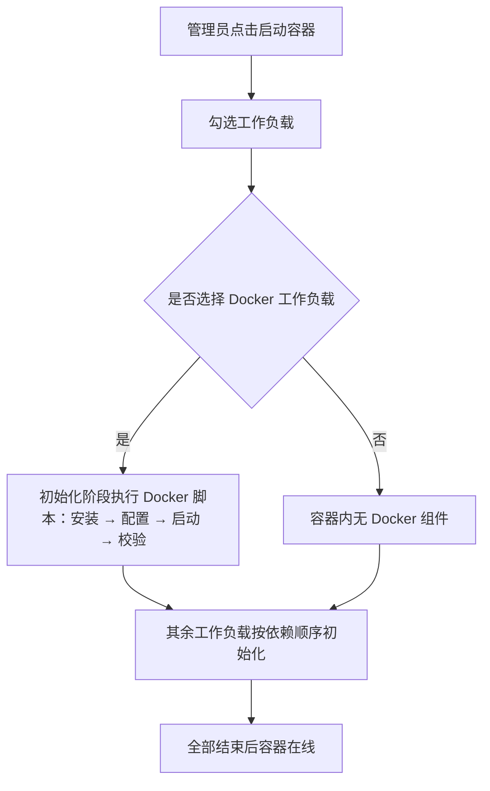
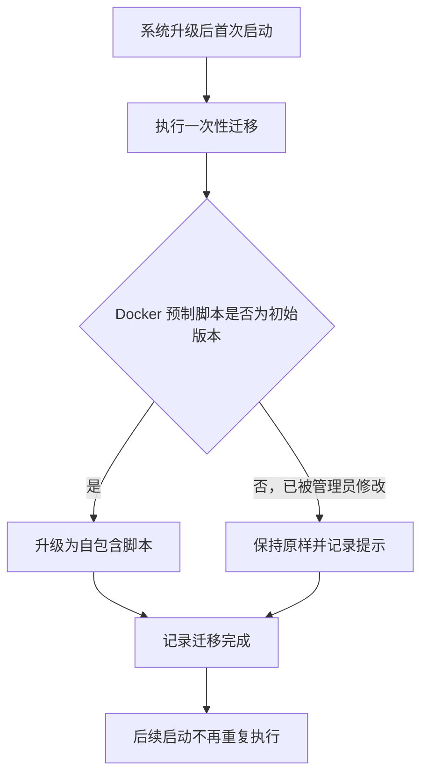

# 工作负载四期：工作容器基础环境瘦身

**功能名称**: 工作容器基础环境瘦身（Docker/.NET 能力下沉工作负载）
**PRD 版本**: v1.0
**创建日期**: 2026-10-18
**作者**: ZeroAsh

## 背景与目标

### 1.1 背景

工作负载一期已经把「Docker 守护进程的启动职责」从容器入口迁移到了「Docker」预制工作负载，但常用环境的**安装与配置**仍然部分固化在云端工作容器的基础环境中：

1. **Docker 组件仍随基础环境预装**。Docker 命令行、镜像构建组件与容器运行时组件在构建基础环境时就被装好，即使启动容器时完全不选择「Docker」工作负载，这些组件也依旧存在。基础环境因此臃肿、构建变慢，且带上了一批并非每个任务都需要的软件。
2. **.NET 相关配置残留在基础环境中**。.NET / Aspire 的安装源配置以基础环境默认值的形式残留，与「.NET 环境由工作负载提供」的口径不一致。
3. **同一能力的职责被拆在两处**。Docker 的「安装」在基础环境、「启动」在工作负载脚本，管理员在管理后台看到的工作负载脚本并不是这个环境的完整真相，排查环境问题时需要同时翻看两处，容易误判。

一期已经证明「环境能力 = 可选择、可查看、可调整的工作负载」是更好的形态。本期把 Docker 与 .NET 的**全部**安装与配置职责下沉到对应预制工作负载脚本，让基础环境回归「所有容器都需要的最小通用能力」。

### 1.2 目标

- 云端工作容器基础环境不再包含任何 Docker 专有组件与配置，也不再包含 .NET / Aspire 相关的安装源配置；只保留所有容器都需要的最小通用能力（其中 Node.js 运行时是容器内 Agent 的运行基础，予以保留）。
- 「Docker」预制工作负载自包含：从安装、配置到启动、校验全部由该工作负载的初始化脚本完成，选择它之后的体验与瘦身前一致。
- 「.NET」「Aspire」预制工作负载保持一期行为，不依赖基础环境中的任何 Docker/.NET 残留配置。
- 存量环境平滑升级：管理员未改动过的预制工作负载脚本自动升级为自包含版本；改动过的不被覆盖，并给出明确提示。

### 1.3 成功标准

- 不选择任何工作负载启动容器：容器正常上线，容器内不存在 Docker 相关组件，也不存在 .NET 组件；其余功能（Agent 连接、任务执行）不受影响。
- 选择「Docker」工作负载启动容器：初始化完成后容器内 Docker 可用，包括镜像拉取（走内部镜像代理）与镜像构建能力，体验与瘦身前一致。
- 选择「.NET」/「Aspire」工作负载启动容器：行为与一期一致，.NET SDK 可用、Aspire CLI 可校验。
- 基础环境构建产物中不再包含 Docker 相关软件包与 .NET 相关配置，构建耗时与产物体积下降。
- 存量环境升级后：未被管理员修改过的「Docker」预制工作负载脚本自动升级为自包含版本；被修改过的不被覆盖，升级记录中可见提示。

## 用户分析

### 2.1 目标用户

- **平台管理员/运营人员**：构建与维护云端工作容器基础环境、启动容器并按需挂载工作负载、排查环境初始化问题。

### 2.2 用户场景

| 场景 | 用户角色 | 目标 | 痛点 |
|--|--|--|--|
| 跑一个纯 Node.js 任务 | 管理员 | 容器里只有需要的环境 | 不需要 Docker，但 Docker 组件仍然预装在每个容器里 |
| 调整 Docker 安装来源 | 管理员 | 像改工作负载脚本一样改 Docker 的安装方式 | 安装固化在基础环境里，必须重建并重新发布基础环境 |
| 排查 Docker 初始化失败 | 管理员 | 在工作负载执行记录里看到完整过程 | 安装过程发生在基础环境构建期，执行记录里看不到 |
| 缩减基础环境维护面 | 管理员 | 基础环境只保留通用能力 | Docker/.NET 配置散落在基础环境中，每次升级都要回归验证 |
| 存量环境升级 | 管理员 | 升级后预制工作负载继续可用 | 担心自己改过的脚本被系统覆盖 |

## 功能需求

### 3.1 功能概述

将 Docker 与 .NET 的安装、配置职责从云端工作容器基础环境中完全移除，全部并入对应预制工作负载的初始化脚本；配套提供一次性升级机制，让存量环境中未被定制过的预制脚本自动迁移为自包含版本。

### 3.2 功能列表

#### 功能点 1: 基础环境瘦身

- **描述**: 云端工作容器基础环境移除全部 Docker 专有内容（Docker 命令行、镜像构建组件、容器运行时组件及其专有依赖、相关安装源配置）与 .NET / Aspire 相关的安装源配置残留。基础环境保留所有容器都需要的通用能力：系统基础工具、Git、Node.js 运行时（容器内 Agent 的运行基础）及内部软件源代理配置。
- **用户价值**: 基础环境更小、构建更快、维护面更窄；不包含未选择能力的组件，环境边界清晰。
- **验收标准**:
  - [ ] 新基础环境中不存在 Docker 命令行、镜像构建组件与容器运行时组件
  - [ ] 新基础环境中不存在 .NET / Aspire 相关安装源配置残留
  - [ ] 新基础环境构建成功，且构建产物中不含 Docker 相关软件包
  - [ ] 通用能力（系统工具、Git、Node.js 运行时、内部软件源代理）保持可用
  - [ ] 不选择任何工作负载时容器正常上线，Agent 连接与任务执行不受影响

#### 功能点 2: 「Docker」预制工作负载自包含

- **描述**: 「Docker」预制工作负载的初始化脚本升级为自包含版本，按顺序完成：安装 Docker 命令行 / 镜像构建组件 / 容器运行时组件 → 配置内部镜像代理 → 启动 Docker 守护进程并等待就绪 → 校验 Docker 与镜像构建能力可用。脚本幂等：组件已安装则跳过安装，守护进程已就绪则跳过启动。安装来源默认走内部软件源，并可按环境覆盖。
- **用户价值**: Docker 环境的完整生命周期对管理员可见、可调、可追踪；调整安装方式只需编辑工作负载脚本，不再需要重建基础环境。
- **验收标准**:
  - [ ] 在瘦身后的基础环境上选择「Docker」工作负载，初始化完成后 Docker 命令可用
  - [ ] 镜像拉取走内部镜像代理（与瘦身前行为一致）
  - [ ] 镜像构建能力可用
  - [ ] 重复执行该脚本不会重复安装，已就绪时直接成功
  - [ ] 安装来源不可达时记录失败与日志，容器仍可上线
  - [ ] 未选择「Docker」工作负载的容器内不存在 Docker 组件与守护进程

#### 功能点 3: 「.NET」「Aspire」预制工作负载去残留依赖

- **描述**: 「.NET」预制工作负载的初始化脚本保持一期口径（自包含完成安装与校验），不依赖基础环境中的任何 .NET / Aspire 安装源配置残留；「Aspire」保持不变。安装来源需要按环境调整时，管理员直接编辑对应工作负载脚本即可。
- **用户价值**: .NET / Aspire 环境的真相只有一个来源——工作负载脚本本身。
- **验收标准**:
  - [ ] 在瘦身后的基础环境上选择「.NET」，初始化完成后 .NET SDK 可用
  - [ ] 选择「Aspire」时仍自动先初始化 Docker 与 .NET，且各只初始化一次
  - [ ] 基础环境不再提供 .NET / Aspire 安装源默认值后，脚本行为不变

#### 功能点 4: 存量预制脚本一次性升级

- **描述**: 系统升级时通过一次性迁移，将「Docker」预制工作负载脚本升级为自包含版本：
  - 仅当脚本内容仍是初始版本（管理员未修改过）时才自动升级；
  - 管理员修改过的脚本保持原样不覆盖，并在升级记录中给出提示，由管理员参照新脚本自行调整；
  - 已升级过的环境不重复升级。
- **用户价值**: 存量环境无需人工介入即可获得与瘦身基础环境配套的新脚本，同时尊重管理员的定制。
- **验收标准**:
  - [ ] 未修改过的「Docker」预制脚本被升级为自包含版本
  - [ ] 修改过的脚本不被覆盖，升级记录中可见提示
  - [ ] 重复执行迁移不产生重复变更
  - [ ] 全新环境首次初始化即得到自包含版本脚本

### 3.3 用户操作流程

#### 启动容器（瘦身后）

#### 存量环境升级

### 3.4 页面/界面描述

本期不涉及新增页面；工作负载管理、启动对话框、执行记录等界面沿用一期能力。变化仅体现在脚本内容与执行记录：

| 页面 | 描述 | 关键元素 |
|------|------|---------|
| 工作负载编辑对话框 | 「Docker」预制工作负载的初始化脚本展示为自包含版本 | 初始化脚本（含安装、配置、启动、校验完整内容） |
| 工作负载执行日志视图 | Docker 初始化失败时可在执行记录中看到安装阶段的输出 | 执行记录、脚本快照、输出日志 |

### 3.5 异常与边界情况

| 情况 | 预期行为 |
|------|---------|
| 未选择 Docker 工作负载，任务脚本中调用 Docker | 命令不存在，任务失败并在输出中可见（与一期「未选择即不可用」口径一致） |
| Docker 组件安装来源不可达 | 该工作负载记录失败并保留日志；容器继续后续初始化并上线 |
| Docker 守护进程启动失败 | 记录失败与守护进程日志尾部；容器可上线但 Docker 不可用 |
| 重复执行 Docker 脚本（如重连后批次续跑） | 已安装/已就绪的部分跳过，幂等收敛 |
| 存量环境中 Docker 预制脚本被管理员修改过 | 一次性迁移不覆盖，记录提示；管理员参照新脚本自行调整 |
| 定制过的旧脚本遇到瘦身后的新基础环境 | 脚本因缺少预装组件而失败，执行记录可见；管理员更新脚本后恢复 |
| 瘦身后的基础环境运行旧版本 Agent | 版本门禁与自升级行为不变，不受本期影响 |
| 未选择任何工作负载 | 容器正常上线，仅无 Docker/.NET 组件 |

## 四、非功能需求

### 4.1 性能要求

- 基础环境构建产物不再包含 Docker 相关软件包层，构建耗时与体积较瘦身前下降。
- 选择「Docker」工作负载的容器，初始化耗时会增加（组件安装发生在初始化阶段），单次增加应控制在分钟级以内，且进度与输出在执行记录中可见。

### 4.2 安全性要求

- Docker 组件安装来源默认走内部软件源代理，可按环境覆盖为其他可信来源。
- 工作负载脚本仍仅管理员可查看与编辑；脚本执行边界、超时与权限控制不变。
- 基础环境预装组件减少后，容器默认攻击面相应缩小。

### 4.3 兼容性要求

- 未选择 Docker/.NET 相关工作负载的容器，行为与现状一致（除组件不再预装外）。
- 已启动/已结束的容器及其执行记录不受影响。
- 存量环境的一次性升级不覆盖管理员定制；定制脚本由管理员自行跟进。
- 版本门禁、容器重连、初始化失败不阻断上线等既有策略均不变。

## 五、依赖与约束

### 5.1 依赖

- 工作负载一期的参数、依赖与预制工作负载能力（含一次性迁移机制）已上线。
- Docker 组件的安装来源（内部软件源代理）在容器初始化阶段可访问。
- 容器具备运行 Docker 守护进程所需的运行权限（与一期一致）。

### 5.2 约束

- Node.js 运行时保留在基础环境中（容器内 Agent 的运行基础），不属于本期瘦身范围。
- 一次性升级只处理「Docker」预制脚本；「.NET」「Aspire」脚本本身已是自包含口径，无需迁移。
- 基础环境变更后需要重新构建并发布，存量运行中的容器需重建后才使用新基础环境（沿用既有发布口径）。

## 六、相关文档

- [[20261018-workload-phase1.md]] — 工作负载一期 PRD（参数、依赖与预制工作负载，本期基线）
- [[20261017-cloud-controller-workload.md]] — 云控制器工作负载功能 PRD
- [[20261014-cloud-agent-phase2.md]] — 云Agent二期（K8s 云端工作容器）
- 技术提案：`docs/engineering/proposals/20261018-feat-workload-phase4.md`
