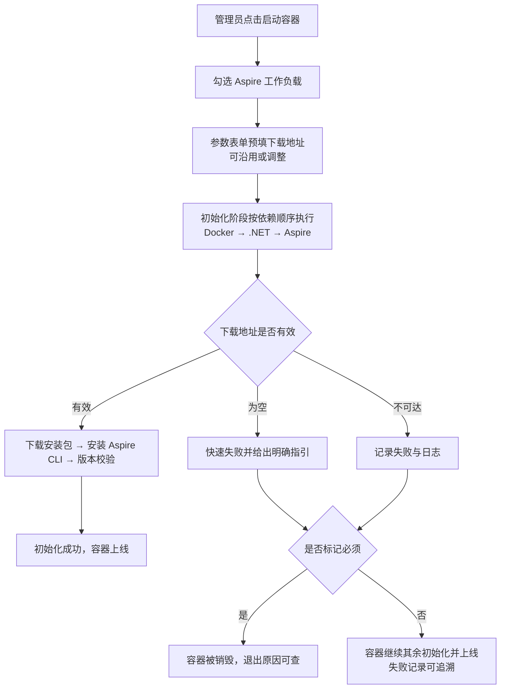
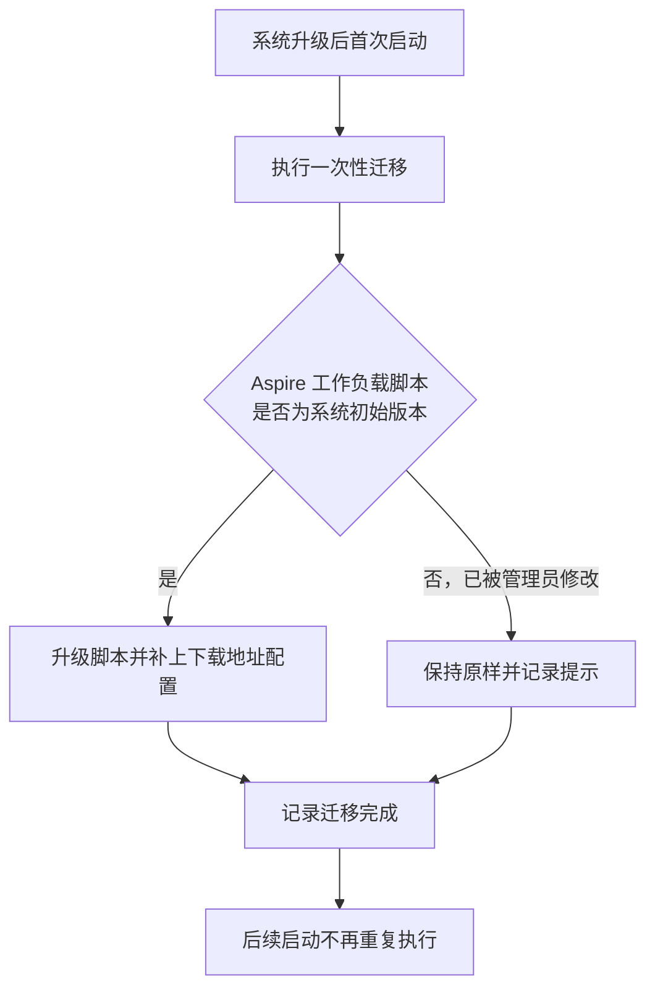

# Aspire 工作负载下载代理：Aspire CLI 改由内网代理下载

**功能名称**: 「Aspire」工作负载下载来源代理（Aspire CLI 内网代理下载）
**PRD 版本**: v1.0
**创建日期**: 2026-10-19
**作者**: ZeroAsh

## 背景与目标

### 1.1 背景

「Aspire」预制工作负载负责在云端工作容器中提供 Aspire CLI（依赖「Docker」与「.NET」两个前置工作负载）。目前它的初始化过程经由官方安装渠道获取 Aspire CLI，安装包**默认从公网官方地址下载**（`https://aka.ms/dotnet/9/aspire/ga/daily/aspire-cli-linux-x64.tar.gz`）。

这与平台「统一走内网软件源/代理」的策略不一致：

1. **Aspire 是少数仍直连公网的下载**。Node.js 依赖内网包仓库代理、.NET 依赖内网软件源代理、Docker 组件依赖内网软件源代理（[[20261018-docker-ce-apt-source.md]]）、工作容器基础环境的系统源也全部走内网代理，唯独 Aspire CLI 仍从公网获取。
2. **公网直连带来实际问题**。内网环境出网受限或不稳定时初始化直接失败；即使能出网，公网下载慢且流量不可控、不可审计；官方安装渠道的内容随公网变化，行为不完全可预期。
3. **下载来源无处可调**。管理员想换用内网缓存或其他可信来源时，只能修改工作负载脚本本身，缺少像其他工作负载那样「看得见、可按环境调整」的下载来源配置。

与此同时，运维已为 Aspire CLI 安装包创建内网缓存代理（`https://nexus.internal.fffdan.com/repository/misc-cache/dotnet/aspire-cli-linux-x64.tar.gz`），内容为官方安装包的内网缓存，已实测可达。参照 Docker CE 软件源地址补齐（[[20261018-docker-ce-apt-source.md]]）的同思路，本期把这个真实可达的内网代理地址**填进「Aspire」工作负载**，并做成管理员看得见、可调整的配置项。

### 1.2 目标

- Aspire CLI 安装包的下载**默认走内网缓存代理**，默认配置下选择「Aspire」工作负载即可完成初始化，不再依赖公网。
- 下载地址成为工作负载的可见配置项：启动容器时可查看、可按环境调整（换代理、指回官方或其他可信来源），无需修改脚本。
- 存量环境平滑升级：未被管理员定制过的「Aspire」工作负载自动改为代理下载；定制过的不被覆盖，并给出明确提示。
- 保留清晰的失败兜底：地址缺失或不可达时，失败原因与指引在执行记录中一目了然。

### 1.3 成功标准

- 新环境与存量环境均可在「Aspire」工作负载的参数表单中看到已填好的内网代理下载地址；按默认值启动容器：初始化成功，Aspire 命令可执行并通过版本校验，全程不访问公网。
- 启动容器时可修改下载地址，改后该次启动按新地址下载安装。
- 人为清空地址后启动：初始化快速失败，执行记录中给出明确指引；是否销毁容器仍遵循「必须」标记口径。
- 地址指向不可达来源时：该工作负载记录失败并保留日志，其余行为与现状一致。
- 存量环境升级后：未定制的「Aspire」工作负载自动获得地址配置与新脚本；被定制过的不被覆盖，升级记录中可见提示。

## 用户分析

### 2.1 目标用户

- **平台管理员/运营人员**：维护预制工作负载、启动云端工作容器并挂载工作负载、排查环境初始化问题。

### 2.2 用户场景

| 场景 | 用户角色 | 目标 | 痛点 |
|--|--|--|--|
| 启动带 Aspire 的工作容器 | 管理员 | 勾选「Aspire」后初始化一次通过 | 安装包要从公网下载，慢且不稳定，容易失败 |
| 内网隔离环境交付 | 管理员 | 不出公网也能初始化 Aspire 环境 | 出网受限时 Aspire 初始化必然失败 |
| 换一个下载来源 | 管理员 | 启动时直接改地址，不动脚本 | 地址写死在脚本里，只能改预制脚本 |
| 排查初始化失败 | 管理员 | 从执行记录看出是地址缺失还是地址不可达 | 失败信息笼统，难定位是来源问题 |
| 升级存量环境 | 管理员 | 升级后预制工作负载恢复走内网，自己改过的内容不丢 | 担心系统覆盖自己定制过的脚本 |

## 功能需求

### 3.1 功能概述

把 Aspire CLI 安装包的下载来源换成内网缓存代理，并把下载地址做成「Aspire」工作负载的可见配置项（默认已填内网代理地址），初始化按该地址下载安装并校验；配套一次性升级机制，让存量环境中未被定制过的工作负载自动获得该配置。

### 3.2 功能列表

#### 功能点 1: 下载地址随「Aspire」工作负载提供（默认已填内网代理）

- **描述**: 「Aspire」工作负载新增「Aspire CLI 下载地址」配置项，默认值为内网缓存代理地址（`https://nexus.internal.fffdan.com/repository/misc-cache/dotnet/aspire-cli-linux-x64.tar.gz`）。启动容器勾选「Aspire」后，参数表单中预填该默认值，管理员可直接沿用，也可按本次环境调整；未做修改时按默认值执行。
- **用户价值**: 开箱即用——不依赖公网、无需任何额外配置即可完成 Aspire 环境初始化；同时保留按环境调整下载来源的灵活性。
- **验收标准**:
  - [ ] 「Aspire」工作负载的参数表单中出现「Aspire CLI 下载地址」，默认值已填入内网缓存代理地址
  - [ ] 按默认值启动容器并选择「Aspire」，初始化成功且 Aspire 命令可执行、版本校验通过，全程不访问公网
  - [ ] 启动时修改地址，该次初始化按修改后的地址下载安装
  - [ ] 工作负载管理页可查看该配置项及其默认值，管理员可调整默认值

#### 功能点 2: 初始化按填写的地址下载安装，缺失时给出明确指引

- **描述**: 「Aspire」工作负载初始化时按配置项中的地址获取 Aspire CLI 安装包并完成安装，随后校验 Aspire 命令真实可用；不再经由官方安装渠道、不再访问公网地址。地址为空时快速失败，并在执行记录中给出包含正确地址形态的指引；地址不可达时记录失败与日志。Aspire 已安装时跳过下载、直接校验（幂等）。依赖检查口径不变：仍要求「Docker」与「.NET」就绪后才安装。
- **用户价值**: 下载来源可控、可审计；失败原因可定位、可自助修复；重复初始化不产生副作用。
- **验收标准**:
  - [ ] 地址为空且需安装时，初始化快速失败，执行记录中给出明确指引（含正确的地址形态示例）
  - [ ] 地址不可达时，该工作负载记录失败并保留日志，容器行为遵循「必须」标记口径
  - [ ] 重复执行初始化脚本不重复下载，已安装时直接校验通过
  - [ ] 安装完成后以 Aspire 命令可执行并通过版本校验为成功判据（不以下载成功为准）

#### 功能点 3: 存量环境一次性升级

- **描述**: 系统升级时通过一次性迁移，为「Aspire」工作负载补上下载地址配置，并把初始化脚本升级为内网代理下载版本：
  - 仅当脚本内容仍是系统初始版本（管理员未修改过）时才自动升级；
  - 管理员修改过的脚本保持原样不覆盖，升级记录中给出提示，由管理员参照新版本自行调整；
  - 已升级过的环境不重复升级。
- **用户价值**: 存量环境无需人工介入即切到内网代理下载，同时尊重管理员的定制。
- **验收标准**:
  - [ ] 未定制过的「Aspire」工作负载在升级后自动获得下载地址配置与新脚本
  - [ ] 定制过的脚本不被覆盖，升级记录中可见提示
  - [ ] 重复执行迁移不产生重复变更

### 3.3 用户操作流程

#### 启动容器（含 Aspire）

#### 存量环境升级

### 3.4 页面/界面描述

本期不涉及新增页面；变化体现在既有页面的配置内容：

| 页面 | 描述 | 关键元素 |
|------|------|---------|
| 启动容器对话框 | 勾选「Aspire」后出现参数表单，下载地址预填默认值 | Aspire CLI 下载地址输入框、「必须」开关 |
| 工作负载管理/编辑对话框 | 「Aspire」工作负载可见「Aspire CLI 下载地址」参数及其默认值 | 参数列表、默认值编辑 |
| 工作负载执行日志视图 | 下载来源缺失或不可达时可见对应输出 | 执行记录、脚本快照、输出日志 |
| 升级记录 | 存量升级结果可见，定制过的脚本有提示 | 迁移记录、提示信息 |

### 3.5 异常与边界情况

| 情况 | 预期行为 |
|------|---------|
| 下载地址被清空 | 若 Aspire 尚未安装，初始化快速失败并给出明确指引（含正确地址形态示例）；容器是否销毁遵循「必须」标记口径 |
| 下载地址不可达 | 该工作负载记录失败并保留日志；容器是否销毁遵循「必须」标记口径 |
| 下载地址填写形态有误（如指向非安装包地址） | 下载或解压阶段报错，输出日志可见，管理员按指引修正地址后重建容器 |
| Aspire 已安装 | 跳过下载，直接校验通过（幂等） |
| 前置「Docker」/「.NET」未就绪 | 与现状一致：「Aspire」初始化报明前置未就绪并失败，不进入下载 |
| 未选择 Aspire 工作负载，任务脚本中调用 Aspire | 命令不存在，任务失败并在输出中可见（与既有「未选择即不可用」口径一致） |
| 存量环境中 Aspire 脚本被管理员修改过 | 一次性迁移不覆盖，记录提示；管理员参照新版本自行调整 |
| 已启动/已结束的容器 | 不受影响；重建后才使用新配置 |

## 四、非功能需求

### 4.1 性能要求

- 安装包走内网缓存代理下载，安装耗时较公网直连下降且更稳定，整体控制在分钟级以内，进度与输出在执行记录中可见。
- 配置项为单个文本项，启动对话框渲染与提交无额外开销。

### 4.2 安全性要求

- 默认地址仅指向内网缓存代理，不指向公网；管理员调整为其他来源时责任在管理员，工作负载脚本仍仅管理员可查看与编辑。
- 下载与安装链路不再执行来自公网的安装脚本内容，安装包来源固定、可审计。

### 4.3 兼容性要求

- 不改变既有能力边界：未选择「Aspire」工作负载即不可用 Aspire；「Aspire」仍依赖「Docker」与「.NET」并按依赖顺序初始化；「必须」标记的失败语义不变。
- 已启动/已结束的容器及其执行记录不受影响。
- 存量环境一次性升级不覆盖管理员定制；定制脚本由管理员自行跟进。
- 初始化脚本的幂等、超时、日志截断等执行语义均不变。

## 五、依赖与约束

### 5.1 依赖

- 运维已创建并持续维护内网 Aspire CLI 安装包缓存代理（`https://nexus.internal.fffdan.com/repository/misc-cache/dotnet/aspire-cli-linux-x64.tar.gz`），且在容器初始化阶段可达。
- 工作负载一期的参数能力与一次性迁移机制已上线。
- 「Docker」与「.NET」预制工作负载提供前置环境（本期不变更）。

### 5.2 约束

- 本期只解决「下载来源」问题，不改变 Aspire 能力范围、不调整「Aspire」工作负载的依赖关系与「必须」语义。
- 配置在容器启动时生效，已运行容器需重建后才使用新地址。
- 一次性升级只处理「Aspire」预制工作负载，其他预制项（Docker / Node.js / .NET）不变更。

## 六、相关文档

- [[20261018-docker-ce-apt-source.md]] — Docker CE 软件源地址补齐 PRD（同思路前例：内网代理地址做成工作负载配置）
- [[20261018-workload-phase1.md]] — 工作负载一期 PRD（参数能力与预制工作负载基线）
- [[20261018-workload-phase3.md]] — 工作负载三期 PRD（「必须」标记硬失败口径）
- [[20261018-workload-phase4.md]] — 工作负载四期 PRD（安装来源下沉工作负载）
- 技术提案：`docs/engineering/proposals/20261019-feat-aspire-workload-proxy.md`
