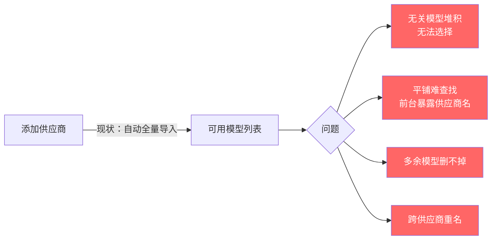
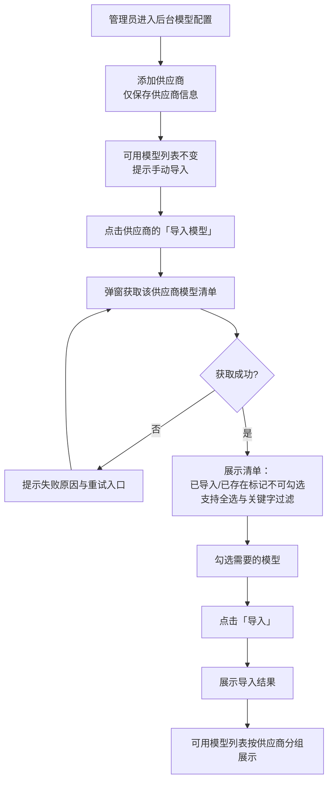
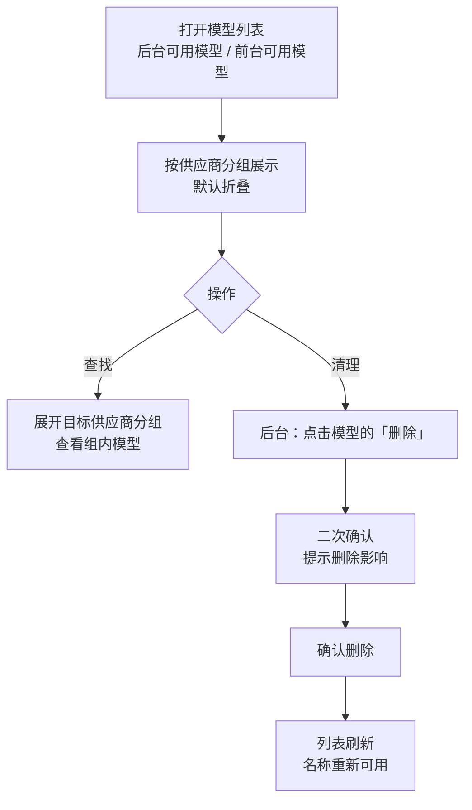

# 内建 API 渠道一期上线后问题修复（供应商与模型管理）

**功能名称**: 内建 API 渠道供应商与模型管理优化
**PRD 版本**: v1.1
**创建日期**: 2026-10-20
**作者**: ZeroAsh
**版本说明**:
- v1.0（2026-10-20）初版：供应商模型手动导入、模型按供应商分组折叠（前台「系统内置」）、可用模型删除、后台模型禁止重名。
- v1.1（2026-10-20，返工修订）① 明确功能点 1 仅作用于后台，前台用户侧供应商添加仍保持自动同步模型（现状不变）；② 会话内「切换模型」列表移出本期分组范围（该列表来源为各 Agent 侧探测结果，不携带供应商信息，无法实现有意义的供应商分组），功能点 2 收敛为后台与前台「可用模型」两处；③ 功能点 4 的历史改名记录明确为后台可查看的「重名整理记录」（原名→新名、供应商、时间），可逐条核对。

## 背景与目标

### 1.1 背景

计费与内建 API 渠道一期已经上线：管理员在后台接入模型供应商，供应商提供的模型成为平台可用模型，前台用户可以选用，外部也可以通过模型调用 API 按模型名调用并计费。

上线后收集到一批供应商与模型管理相关的问题，集中在四个方面：

1. **模型导入不可控**。后台添加供应商时，系统会自动把该供应商的全部模型一次性导入可用模型列表。管理员没有选择权，可用模型列表被大量用不到的模型淹没，也难以在其中找到真正需要的模型。
2. **模型列表难查找、前台暴露了不该暴露的信息**。模型数量增多后，后台与前台的模型列表都是平铺展示，查找困难；前台还直接展示了后台供应商的名称，而用户并不需要、也不应该关心平台内部接了哪家供应商。
3. **模型删不掉**。导入后发现不需要的模型只能禁用，无法从可用模型列表中删除，列表越积越乱。
4. **模型重名**。不同供应商可能提供同名模型，导致后台模型列表出现重名条目，无法区分；由于调用侧按模型名寻址，重名还会造成调用目标不确定。

### 1.2 目标

- **导入完全由管理员控制**：后台添加供应商后不再自动导入模型；管理员通过「导入模型」弹窗查看上游模型清单，勾选哪个导入哪个。前台用户侧供应商管理保持现状（添加后自动同步模型），不受本次调整影响。
- **模型列表按供应商分组、默认折叠**：后台与前台的「可用模型」列表都按供应商分组展示，默认折叠，组内可快速定位。
- **前台统一「系统内置」标识**：后台添加的模型在前台展示时不再显示原本的模型供应商，统一显示「系统内置」。
- **可用模型支持删除**：后台可用模型中任意模型（含导入模型与自定义模型）都可以删除。
- **后台模型禁止重名**：后台模型名全局唯一（跨供应商也不允许重名），导入与新建时即时校验并给出明确提示。

### 1.3 成功标准

- 后台新增供应商后，可用模型列表**不新增任何模型**，界面明确提示需要手动导入；
- 任一供应商点击「导入模型」，弹窗在数秒内展示该供应商的模型清单，勾选导入后，可用模型列表新增的模型与勾选结果一致；已导入的模型在清单中被标记且不可重复导入；
- 后台与前台「可用模型」列表默认按供应商分组折叠，展开后组内模型完整；
- 前台任何位置都不出现后台供应商名称，后台来源模型一律显示「系统内置」；
- 后台可用模型中任意模型均可删除，删除后前台不再展示，调用侧按该模型名调用返回「模型不存在」；
- 后台无法通过导入或新建产生重名模型，界面给出明确的重名提示，历史重名数据被一次性整理为不重名，改名对照在后台「重名整理记录」中逐条可查。

## 用户分析

### 2.1 目标用户

| 用户角色 | 说明 |
|--|--|
| 平台管理员 | 在后台接入模型供应商、维护可用模型清单与定价 |
| 前台用户 | 在前台查看可用模型并选用模型进行会话/调用 |
| API 调用方 | 按模型名调用平台模型接口的外部用户 |

### 2.2 用户场景

| 场景 | 用户角色 | 目标 | 痛点 |
|--|--|--|--|
| 接入新供应商 | 平台管理员 | 只把真正要用的模型加入可用模型 | 现状自动全量导入，列表被无关模型淹没 |
| 日常查找模型 | 平台管理员 / 前台用户 | 快速定位某个模型并确认其状态 | 平铺列表查找困难，模型多时尤甚 |
| 前台查看可用模型 | 前台用户 | 看清有哪些模型可用、属于哪一类 | 直接看到平台内部供应商名称，信息无意义且不妥 |
| 清理误导入模型 | 平台管理员 | 把不需要的模型从列表移除 | 只能禁用不能删除，列表越来越乱 |
| 同名模型冲突 | 平台管理员 / API 调用方 | 每个模型名唯一、调用目标确定 | 跨供应商同名模型并存，列表与调用目标都混乱 |

## 功能需求

### 3.1 功能概述

把内建 API 渠道的模型管理从「自动全量导入 + 平铺展示」调整为「手动勾选导入 + 按供应商分组折叠展示」，并补齐模型删除与重名检查两项管理能力。

### 3.2 功能列表

#### 功能点 1: 供应商模型手动导入（仅后台）

- **描述**:
  - 后台添加供应商后**不再自动导入模型**，可用模型列表保持不变；界面提示管理员可通过「导入模型」手动导入。
  - 每个供应商提供「导入模型」入口。点击后弹窗实时获取该供应商的模型清单，逐项展示模型名并提供勾选框，支持全选/取消全选与关键字过滤；已导入的模型在清单中明确标记「已导入」且不可重复勾选；与已有模型重名的条目标记「已存在」且不可勾选。
  - 管理员勾选后点击「导入」，仅所选模型进入可用模型列表，弹窗展示导入结果；导入过程中可取消，取消不影响已完成的导入。
  - 已导入过模型的供应商再次打开弹窗，可以继续勾选增量导入。
  - **范围限定**：本功能只调整后台。前台用户侧的供应商管理保持现状——用户添加自己的供应商后仍自动同步该供应商的模型，不提供「导入模型」入口，行为与能力均不变。
- **用户价值**: 管理员对可用模型清单拥有完全控制权，列表只包含真正需要的模型。
- **验收标准**:
  - [ ] 后台添加供应商成功后，可用模型列表无任何新增模型，并出现「请通过导入模型手动导入」提示
  - [ ] 点击「导入模型」后弹窗展示该供应商的模型清单，包含全选与关键字过滤
  - [ ] 已导入的模型标记「已导入」且不可勾选；重名条目标记「已存在」且不可勾选
  - [ ] 勾选导入后，新增模型与勾选一致，导入结果有明确反馈
  - [ ] 上游获取失败时弹窗给出明确失败提示与重试入口，不影响已有模型
  - [ ] 前台用户侧添加供应商后仍自动同步其模型，行为与现状一致

#### 功能点 2: 模型按供应商分组折叠展示

- **描述**:
  - 后台「可用模型」按供应商分组展示，**默认全部折叠**；组头展示供应商名称与模型数量，点击组头展开/收起该组，组内模型保持既有的启停、排序等能力。
  - 前台设置「可用模型」同样按供应商分组、默认折叠；**后台添加的模型统一归入「系统内置」分组**，组头与组内条目均不再显示原本的模型供应商名称。
  - 分组不改变既有模型的可用性、顺序与启停状态。
  - **范围限定**：会话内的「切换模型」列表本期**保持现状**（不参与分组）。该列表展示的是各 Agent 自身探测到的模型，条目不携带供应商信息，无法实现有意义的供应商分组；如后续需要，须先由 Agent 侧补充模型来源信息，另立需求评审（见 §5.2 约束）。
- **用户价值**: 模型多时也能快速定位；用户只看到「系统内置」这类面向用户的分类，不接触平台内部供应商信息。
- **验收标准**:
  - [ ] 后台可用模型按供应商分组、默认折叠，组头含供应商名与数量，展开后组内模型完整
  - [ ] 前台可用模型按供应商分组、默认折叠，后台来源模型归入「系统内置」组
  - [ ] 前台任何位置均不出现后台供应商名称
  - [ ] 启停、排序、自定义模型等既有能力在分组视图下不退化
  - [ ] 会话内「切换模型」列表保持现状，不因本期改动退化

#### 功能点 3: 可用模型支持删除

- **描述**:
  - 后台「可用模型」中任意模型（含导入模型与自定义模型）都提供删除操作，删除前二次确认并说明影响：删除后前台不再展示该模型，调用侧按该模型名调用将返回「模型不存在」。
  - 删除后列表即时刷新；同一供应商下可再次导入同名模型（名称重新可用）。
  - 前台用户仅可删除自己创建的自定义模型（现状保留）；「系统内置」模型在前台不可删除。
- **用户价值**: 管理员可以清理误导入或不再使用的模型，保持可用模型清单干净准确。
- **验收标准**:
  - [ ] 后台可用模型中导入模型与自定义模型均有删除入口，删除前有二次确认与影响说明
  - [ ] 删除成功后列表即时刷新，该模型不再出现
  - [ ] 删除后前台不再展示该模型，按该模型名调用返回「模型不存在」
  - [ ] 删除后同名模型可重新导入/新建
  - [ ] 前台「系统内置」模型无删除入口

#### 功能点 4: 后台模型禁止重名

- **描述**:
  - 后台模型名**全局唯一**：同一后台内，不同供应商的模型也不允许同名（模型名是调用侧寻址依据，必须唯一）。
  - 新建自定义模型与导入模型时即时校验重名：界面在提交前给出明确的「模型名已存在」提示并阻止提交；导入弹窗中重名条目直接标记「已存在」不可勾选。
  - 系统兜底保证不出现重名：即使并发操作，也拒绝产生重名模型并给出明确提示。
  - **历史重名数据一次性整理**：已存在的同名模型中保留最早创建的一个使用原名，其余由系统自动改名，**改名对照记录持久保存并在后台「重名整理记录」中可查**（逐条展示原名→新名、所属供应商、整理时间），管理员可逐条核对处理；整理过程不删除任何数据。
- **用户价值**: 模型清单无歧义，调用侧按模型名寻址结果确定；历史改名可核对、可追溯。
- **验收标准**:
  - [ ] 新建自定义模型输入已存在的模型名时，提交前提示重名并阻止提交
  - [ ] 导入弹窗中与已有模型重名的条目不可勾选
  - [ ] 后台无法通过任何入口产生重名模型，失败时提示明确
  - [ ] 历史重名模型经一次性整理后不再重名，无数据丢失
  - [ ] 后台「重名整理记录」可查看全部改名对照（原名→新名、供应商、时间），条目数与实际改名数一致

### 3.3 用户操作流程

模型手动导入流程：

模型浏览与删除流程：

### 3.4 页面/界面描述

| 页面 | 描述 | 关键元素 |
|--|--|--|
| 后台-模型配置（供应商区） | 供应商列表与管理 | 「导入模型」入口、添加供应商（不再自动导入模型）、提示文案 |
| 后台-导入模型弹窗 | 按供应商获取并勾选导入模型 | 模型清单、勾选框、全选、关键字过滤、「已导入」「已存在」标记、导入/取消按钮、导入结果反馈 |
| 后台-可用模型 | 分组折叠的模型清单 | 供应商分组（默认折叠）、组头（名称+数量）、组内模型（启停/排序/删除）、删除确认弹窗 |
| 后台-新建自定义模型弹窗 | 手动添加自定义模型 | 供应商选择、模型名输入、即时重名提示 |
| 后台-重名整理记录 | 历史重名整理的改名对照（只读） | 原名→新名、所属供应商、整理时间，逐条可核对 |
| 前台设置-可用模型 | 用户侧模型清单 | 「系统内置」与各供应商分组（默认折叠）、组内模型（自定义模型可删除） |
| 前台会话-切换模型 | 会话内模型切换（保持现状） | 模型列表、当前模型标识（本期不参与分组，见 §5.2 约束） |

### 3.5 异常与边界情况

| 情况 | 预期行为 |
|--|--|
| 供应商凭据失效 / 上游接口不可用 | 导入弹窗明确提示获取失败与原因，提供重试；不影响该供应商已导入的模型 |
| 上游模型清单为空 | 弹窗提示「暂无可导入的模型」 |
| 勾选项与已有模型重名（跨供应商） | 该条目标记「已存在」，不可勾选 |
| 勾选项已在该供应商下导入过 | 该条目标记「已导入」，不可勾选 |
| 导入过程中个别条目失败 | 明确提示成功与失败明细，已成功部分保留 |
| 导入过程中取消/关闭弹窗 | 已完成的导入保留，未开始的不执行 |
| 删除正在被调用使用的模型 | 允许删除；删除后按该模型名调用返回「模型不存在」，已生成的历史账单与计费记录不受影响 |
| 删除供应商 | 其名下模型一并删除（现状保持） |
| 并发产生重名模型 | 系统兜底拒绝后写入的请求，并给出明确提示 |
| 历史重名数据整理 | 同名保留最早创建的一个原名，其余自动改名并逐条记入「重名整理记录」；不删除数据 |
| 前台用户侧添加供应商 | 保持现状自动同步该供应商模型，不受后台手动导入调整影响 |
| 会话内「切换模型」列表无供应商信息 | 保持现状展示，不强行分组；后续如需分组由 Agent 侧补充来源信息后另立需求 |
| 前台用户查看「系统内置」模型 | 仅可查看与选用，不可删除、不可查看其来源供应商 |

## 四、非功能需求

### 4.1 性能要求

- 「导入模型」弹窗获取上游模型清单应在数秒内完成，超时给出明确提示；不阻塞后台其他操作。
- 模型列表分组折叠后，展开/收起交互即时响应；模型数量较多（数百个）时列表浏览与过滤不明显卡顿。

### 4.2 安全性要求

- 供应商凭据仅保存在平台内部，任何前端界面（含导入弹窗）不展示、不回传明文凭据。
- 前台仅暴露面向用户的信息：模型名与「系统内置」标识，不暴露后台供应商名称、地址等内部信息。

### 4.3 兼容性要求

- 已导入的模型、其定价与计费记录不受影响；历史账单、收据与用量记录保持可查。
- 模型调用接口的行为口径不变，仅在模型被删除或被重名整理后按新清单寻址。
- 前台用户自定义模型能力（新建/删除/启停/排序）保持不变。
- 前台用户侧供应商管理行为保持不变：添加供应商仍自动同步该供应商模型，本期仅调整后台的导入方式。

## 五、依赖与约束

### 5.1 依赖

- 依赖既有供应商管理能力（供应商的新增、编辑、启停、删除、凭据保存与连通能力）。
- 依赖既有可用模型能力（模型启停、排序、自定义模型、定价配置）。

### 5.2 约束

- 不改变模型调用与计费口径；不改变前台用户自定义模型的管理范围。
- 「系统内置」为面向用户的统一展示名，不提供按后台供应商细分的前台分组。
- 本期不做模型改名/编辑能力；重名整理产生的自动改名仅用于历史数据一次性处理，改名对照在后台「重名整理记录」中只读可查。
- 本期仅调整后台供应商的模型导入方式；前台用户侧供应商添加后自动同步模型的行为保持现状。
- 会话内「切换模型」列表的数据来源（各 Agent 自身探测结果）不在本期改造范围：该列表条目不携带供应商信息，无法实现有意义的供应商分组；如后续需要分组，须先由 Agent 侧补充模型来源信息，另立需求评审。

## 六、相关文档

- [[20260517-llm-provider-settings|LLM 供应商与模型管理]]（既有能力基线）
- [[20261014-admin-console|云控制器管理后台一期]]（后台全局供应商/模型）
- [[20261018-credits-billing|费用中心（Credits 计费）]]（模型调用与计费口径）
- [[../../engineering/proposals/20261020-fix-api-channel-model-fixes|技术提案：内建 API 渠道一期上线后问题修复]]
