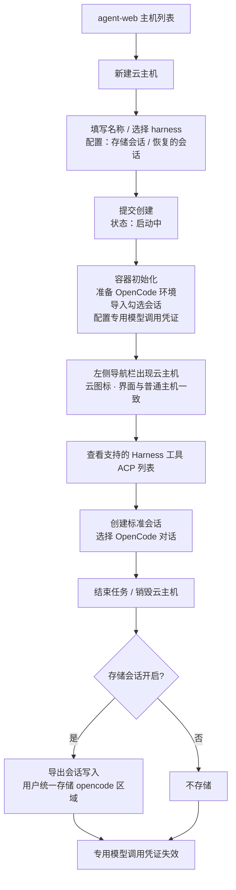
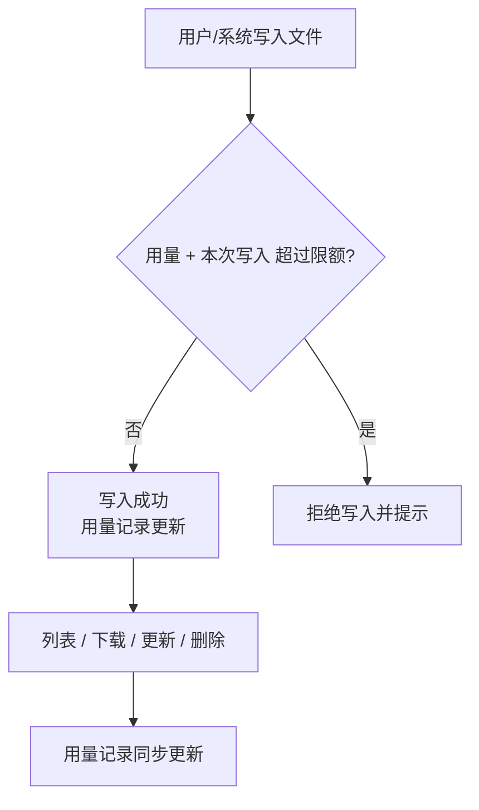

# 容器启动任务支持 harness 类型：OpenCode 云主机与统一存储

**功能名称**: 容器启动任务 harness 类型、OpenCode 云主机、统一存储
**PRD 版本**: v2.0
**创建日期**: 2026-10-20
**作者**: ZeroAsh

> v2.0 变更（需求重构返工）：
>
> 1. **交付面反转**：直接呈现在 agent-web（前台）交付，后台（管理后台）本期不做；
> 2. **产品模型变更**：拉起的 harness 容器作为一台「主机」——即此前由控制器管理的那类机器——呈现在左侧导航栏，界面与普通「主机」完全一致（都是支持的 Harness 工具（ACP）列表），区别仅在使用**云的图标**；
> 3. **用户命名**：前台新建 harness 容器时允许用户命名；
> 4. **标准会话**：harness 容器内的控制器天然支持 OpenCode ACP，直接走系统内已经存在的标准「会话」进行呈现与交互。
>
> 会话存储/恢复（OpenCode 会话存取）、统一存储、容器专用模型调用凭证与计费口径等功能保持一期范围，但全部转为**前台用户口径**（见 §3.2 / §5）。

## 背景与目标

### 1.1 背景

云端工作容器目前只有一种启动任务类型——「空闲」：容器拉起后处于待命状态，由使用者进入后自行操作。平台已经在前几期补齐了「工作负载」能力（启动时按需初始化环境、参数化配置、依赖展开、执行留档），以及「主机」体系：用户机器上运行的控制器接入后成为一台「主机」，在左侧导航栏展示，其上可查看支持的 Harness 工具（ACP）列表、创建并使用标准「会话」。

随着云端 Agent 使用场景成熟，出现了一类高频诉求：**用户希望容器一启动就已经是一台可用的「主机」**——装好指定的 coding harness（AI 编程工具）、出现在自己的主机列表里、用标准会话直接干活，会话可留存、下次接着用，模型调用直接走平台计费。

因此本期把启动任务从「空闲」扩展为「harness」，并在**前台（agent-web）**交付完整体验：

1. 选择 harness 启动任务后，必须进一步选择一个受支持的 harness。项目第一期先支持 **OpenCode** 作为第一个 harness 工作负载。
2. 拉起的 harness 容器作为一台「主机」呈现在左侧导航栏：界面与普通主机一致（支持的 Harness 工具（ACP）列表、标准会话），使用云的图标以示区别；新建时由用户命名。
3. 主机内的控制器天然支持 OpenCode ACP，会话直接走系统既有的标准「会话」机制呈现。
4. 会话可存可取：容器结束时把 OpenCode 会话存储到统一存储，下次新建时可勾选恢复。
5. 会话等产物需要一个**统一存储**：按用户划分目录、支持类 S3 的文件管理能力、记录用量并可限额。

### 1.2 目标

- 前台用户可在 agent-web 新建云主机（harness 容器）：为它**命名**、选择受支持的 harness（一期为 OpenCode）、配置参数「存储会话」与「恢复的会话」；后台管理入口本期不做。
- 云主机创建成功后作为一台「主机」出现在左侧导航栏，**界面与普通主机完全一致**（支持的 Harness 工具（ACP）列表、工作区、标准会话），使用**云的图标**；其状态（在线/离线/启动中）与普通主机同口径展示。
- 在云主机上创建的会话即标准「会话」：选择 OpenCode 作为 Harness 工具后可直接对话交互，体验与普通主机一致。
- 勾选「恢复的会话」后，容器初始化完成时所选会话已导入并以该主机的历史/标准会话呈现，可继续对话。
- 开启「存储会话」后，容器结束时 OpenCode 会话自动导出并存入该用户统一存储目录下的 OpenCode 会话区，下次新建云主机时可在「恢复的会话」中看到并选择。
- 云主机内调用模型时使用**本次容器专用的模型调用凭证**：计费归属本次任务，有效期与容器一致，容器结束后立即失效。
- 模型可用范围与计费口径（前台）：按用户的**个人可用模型列表**提供；用户调用其**自定义模型**不计费，调用**系统提供的模型**计费。
- 提供统一存储能力：按「用户类型 / 用户 ID」划分用户目录，提供类 S3 的对象增删改查与列表能力，独立记录每个用户的存储用量，超过限额时禁止写入请求；后台用户不限量，前台用户限量（本期不做限额的运营配置与执行）。

### 1.3 成功标准

- 前台「新建云主机」入口可用：填写名称、选择 harness（一期唯一 OpenCode）、配置参数后提交；名称为空或未选 harness 时无法提交并有明确提示。
- 创建成功后，左侧导航栏出现该云主机：名称即用户命名，带云图标；点击进入的界面与普通主机一致，可见支持的 Harness 工具（ACP）列表（含 OpenCode）。
- 在云主机上创建 OpenCode 会话并正常对话，体验与普通主机上的标准会话一致。
- 使用「恢复的会话」新建云主机后，进入该主机可在历史/标准会话中看到所选会话并继续；未勾选恢复时无历史会话。
- 开启「存储会话」的云主机正常结束（销毁）后，其 OpenCode 会话出现在该用户统一存储的 OpenCode 会话区，并且在下一次新建云主机的「恢复的会话」选项中可被选中；关闭「存储会话」时不产生会话存储。
- 云主机内调用系统提供的模型时，平台产生对应计费记录并计入该用户的计费账户；调用用户自定义模型时不产生计费记录；容器结束后该专用调用凭证不可再用。
- 用户可以通过统一存储能力对本人目录下的对象进行上传、下载、覆盖（更新）、删除与列表；列表结果与实际存储一致。
- 每个用户的存储用量可查询，用量独立记录；达到限额的用户写入被拒绝并得到明确提示（本期前台用户不限额，机制先行）。
- 后台（管理后台）本期不出现任何新增的 harness/云主机入口与页面，既有「空闲」容器能力不受影响。

## 用户分析

### 2.1 目标用户

- **前台用户**（一期主要用户）：在 agent-web 里自助拉起自己的云主机、命名管理它、在上面跑标准会话，会话与产物统一留存、可恢复；模型费用计入自己的计费账户。
- **平台运营**（本期仅口径预留）：未来治理存储用量与限额、查看计费归属；后台管理面二期接入。

### 2.2 用户场景

| 场景 | 用户角色 | 目标 | 痛点 |
|--|--|--|--|
| 一键拉起云端「主机」 | 前台用户 | 新建即得到一台可用的 OpenCode 主机 | 自备机器、装环境、配模型门槛高、耗时长 |
| 主机列表统一管理 | 前台用户 | 云主机和本地主机在同一列表里管理 | 云资源与本地主机割裂，入口分散 |
| 接着上次的会话继续干活 | 前台用户 | 勾选上次会话，新建后直接继续 | 会话随容器销毁而丢失 |
| 任务收尾自动留存会话 | 前台用户 | 容器结束时会话自动存好 | 手工导出、手工上传，容易漏存 |
| 模型调用直接计费到自己 | 前台用户 | 云主机里调用模型按自己的账户计费 | 共用大账号 key 无法归因，账单混乱 |
| 自定义模型不产生费用 | 前台用户 | 用自带的自定义模型不被扣费 | 担心自带模型也被平台计费 |
| 会话与产物有地方放 | 前台用户 | 会话、导出物存到自己的统一目录 | 文件散落各处，换容器就找不到 |
| 存储用量可控 | 平台运营 | 掌握每个用户占用了多少存储 | 无用量记录，无法治理 |

## 功能需求

### 3.1 功能概述

前台新增「新建云主机」能力：用户命名并选择受支持的 harness（一期 OpenCode）与参数（存储会话、恢复的会话）后，系统拉起 harness 容器；容器就绪后作为一台「主机」出现在左侧导航栏（云图标），界面与普通主机一致——支持的 Harness 工具（ACP）列表、标准会话一应俱全。容器初始化时准备 OpenCode 环境、按需恢复会话、注入本次专用的模型调用凭证；容器结束时按需导出会话并存入统一存储。统一存储为每个用户划分独立目录，提供类 S3 的文件管理与用量记录能力。后台管理面本期不做。

### 3.2 功能列表

#### 功能点 1: 前台新建云主机（harness 容器）

- **描述**: 前台提供「新建云主机」入口，创建表单包含：
  - **名称**（必填）：用户自由命名，作为该主机在导航栏与主机界面的显示名称。
  - **任务类型**：固定为「Harness」（云主机即 harness 任务类型；空闲容器仍属后台能力，本期不在前台暴露）。
  - **选择受支持的 harness**（必填）：一期受支持列表为「OpenCode」；未选择不允许提交。
  - **存储会话**（开关）：容器结束时是否将会话存储到统一存储；默认开启，可修改。
  - **恢复的会话**（下拉多选）：从当前用户**已存储的 OpenCode 会话**中多选，导入后可在该主机的历史/标准会话中继续；选项为空时给出空态提示，不影响创建。
  - 创建后进入「启动中」状态，就绪后自动出现在主机列表。
- **用户价值**: 前台自助获得一台云端「主机」，无需自备机器与环境。
- **验收标准**:
  - [ ] 名称、harness 选择为必填；缺失时无法提交并提示
  - [ ] 参数区展示「存储会话」开关与「恢复的会话」多选，默认值正确
  - [ ] 「恢复的会话」仅展示当前用户已存储的 OpenCode 会话
  - [ ] 创建后主机列表出现「启动中」状态的云主机，名称即用户命名
  - [ ] 后台不出现本期新增的 harness 入口

#### 功能点 2: 云主机以「主机」形态呈现

- **描述**: 拉起的 harness 容器作为一台「主机」——即此前由控制器管理的那类机器——呈现：
  - 出现在**左侧导航栏**主机列表中，与普通主机同列展示（名称、在线状态）。
  - **界面与正常「主机」一致**：进入后可见的界面与普通主机相同，都是**支持的 Harness 工具（ACP）列表**，以及工作区、会话入口。
  - 区别仅在**使用云的图标**：云主机使用云图标（普通主机维持现状）。
  - 状态口径与普通主机一致（在线/离线/启动中/已结束），随心跳更新。
- **用户价值**: 云主机无缝融入既有主机体验，零学习成本。
- **验收标准**:
  - [ ] 云主机出现在左侧导航栏主机列表，名称为用户命名
  - [ ] 云主机条目使用云图标，普通主机展示不变
  - [ ] 进入云主机的界面与普通主机一致，包含支持的 Harness 工具（ACP）列表
  - [ ] 在线/离线状态与实际一致（容器结束后显示离线/已结束）
  - [ ] 普通主机的展示与交互完全不受影响

#### 功能点 3: 标准会话交互（OpenCode ACP）

- **描述**: 云主机内的控制器**天然支持 OpenCode ACP**：
  - 云主机的 Harness 工具（ACP）列表中展示 OpenCode（可用/版本与普通主机同口径）。
  - 用户在云主机上创建会话时选择 OpenCode，会话即系统内已有的**标准「会话」**：进入会话的界面、交互、模式/模型切换、历史消息等呈现与普通主机完全一致。
  - 会话的工作区沿用主机工作区机制（云主机自带默认工作区）。
- **用户价值**: 不为云主机另造会话体系，功能与体验与本地主机同构。
- **验收标准**:
  - [ ] 云主机的 Harness 工具（ACP）列表包含 OpenCode 且可用
  - [ ] 在云主机上创建的会话就是标准「会话」，界面与普通主机一致
  - [ ] 对话、模式/模型切换、历史消息等既有会话能力正常
  - [ ] 云主机自带默认工作区，无需手工配置即可建会话

#### 功能点 4: 会话存储（存储会话）

- **描述**: 「存储会话」开关（布尔）：
  - 开启后，云主机结束（销毁）时系统自动导出该容器内的 OpenCode 会话并存入该用户的统一存储 OpenCode 会话区。
  - 关闭时不进行任何会话存储。
  - 同一用户的多次云主机会话互不覆盖（按主机/会话可区分）。
- **用户价值**: 会话不随容器销毁而丢失。
- **验收标准**:
  - [ ] 开启时容器结束后会话出现在用户统一存储的 OpenCode 会话区
  - [ ] 关闭时容器结束后不产生会话存储
  - [ ] 多次云主机的存储互不覆盖、可区分来源

#### 功能点 5: 会话恢复（恢复的会话）

- **描述**: 「恢复的会话」下拉多选：
  - 可选项为当前用户**已存储的 OpenCode 会话**，每项可辨识（会话标识/名称、来源与存储时间等）。
  - 后台先行提供「查询已存储 OpenCode 会话」的接口能力供页面按调用用户过滤渲染；本期因交付面在前台，选项查询直接面向前台用户本人（只返回自己的会话）。
  - 支持多选、可清空；未选择时主机无历史会话。
  - 勾选的会话在主机初始化阶段被导入，进入后以该主机的**历史/标准会话**呈现，可直接继续对话。
  - 勾选的会话在启动后从选项语义上「消费」（历史记录仍可追溯本次恢复了哪些会话）。
- **用户价值**: 跨容器延续历史会话，工作不中断。
- **验收标准**:
  - [ ] 下拉多选展示当前用户已存储的 OpenCode 会话，不含他人数据
  - [ ] 多选、清空行为正常；未选择时无历史会话
  - [ ] 勾选的会话在主机就绪后以历史/标准会话呈现且可继续使用
  - [ ] 选项为空时展示空态提示，仍可正常创建
  - [ ] 勾选会话在启动记录中可追溯

#### 功能点 6: 模型调用与计费（前台口径）

- **描述**: 云主机内调用模型时使用**本次容器专用的模型调用凭证**：
  - 凭证随容器初始化自动配置，无需用户手工填写；不在界面明文展示。
  - 凭证有效期与该容器一致：容器销毁/结束后立即失效。
  - 调用费用计入该用户的计费账户（同云主机的计费归属）。
  - 可用模型范围：按用户的**个人可用模型列表**提供（与用户在前台设置的模型列表一致）。
  - 计费规则：用户调用其**自定义模型**不计费；调用**系统提供的模型**计费。
  - 后台用户口径（使用后台模型列表）保留为后续能力，本期不交付后台入口。
- **用户价值**: 云主机内模型调用可归因、可计费，用户自带模型不被乱扣费。
- **验收标准**:
  - [ ] 云主机内无需手工配置即可调用模型
  - [ ] 可用模型不超出用户的个人模型列表
  - [ ] 调用系统提供的模型产生计费记录并计入用户计费账户
  - [ ] 调用自定义模型不产生计费记录
  - [ ] 容器结束后凭证立即失效（无法再发起调用）

#### 功能点 7: 统一存储——用户目录、文件管理与用量

- **描述**: 新增统一存储能力：
  - 每个用户拥有独立的存储目录，目录前缀按「用户类型 / 用户 ID」划分（用户存储前缀 user-path）。
  - 提供类 S3 的对象管理能力：上传（创建/覆盖）、下载、查看（元信息）、删除、按前缀列表。
  - 所有读写都必须发生在调用者自己的用户目录下；跨用户访问被拒绝。
  - OpenCode 会话存储使用该用户目录下的 opencode 区域，其他产物也可使用同一目录体系。
  - 按用户记录存储用量（含对象数量），用户可查自己的用量；用量达到限额后写入类请求被拒绝并明确提示，读取、删除不受限。
  - 限额规则：**后台用户不限量**；**前台用户限量**（限额的配置与执行本期不做，仅预留口径）。
- **用户价值**: 用户的会话与产物有统一、隔离、可管理的存放空间，用量可治理。
- **验收标准**:
  - [ ] 上传、下载、更新、删除、列表五类操作均可用
  - [ ] 列表按目录前缀返回，结果与实际存储一致
  - [ ] 访问他人目录被拒绝并提示
  - [ ] OpenCode 会话存储落在用户目录的 opencode 区域
  - [ ] 用量随上传/覆盖/删除实时更新，数值与实际一致
  - [ ] 达到限额后写入被拒绝且提示明确；读取、删除仍可用（本期前台不限额，卡点机制先行）

#### 功能点 8: 云主机生命周期管理

- **描述**: 前台可查看与管理自己的云主机：
  - 主机列表/详情展示状态（启动中/在线/离线/已结束）、名称、创建时间、参数摘要（是否存储会话、恢复了几个会话）。
  - 支持**销毁**云主机：销毁前提示「将执行会话存储（若开启）并结束容器」；销毁后主机从在线列表移除（历史记录保留可追溯）。
  - 容器异常退出/失败时展示明确的失败原因，允许重新新建。
- **用户价值**: 云主机资源可控、过程可追溯。
- **验收标准**:
  - [ ] 状态展示与实际生命周期一致
  - [ ] 销毁流程有确认提示；「存储会话」开启时先完成会话存储再结束
  - [ ] 销毁后主机不再可交互，历史记录可追溯
  - [ ] 失败时展示原因，可重新创建

### 3.3 用户操作流程

#### 新建并使用云主机

#### 会话存取闭环

#### 统一存储使用

### 3.4 页面/界面描述

| 页面 | 描述 | 关键元素 |
|------|------|---------|
| 左侧导航栏（主机列表） | 云主机与普通主机同列 | 主机名称、状态点、**云图标（云主机）**、新建云主机入口 |
| 新建云主机对话框 | 创建 harness 容器 | 名称输入、harness 选择（OpenCode）、存储会话开关、恢复的会话多选（含空态）、提交/取消 |
| 主机界面（云主机） | **与普通主机完全一致** | 支持的 Harness 工具（ACP）列表（含 OpenCode）、工作区、会话入口 |
| 标准会话界面 | 与普通主机一致 | 会话消息流、模式/模型切换、历史消息（含恢复的会话） |
| 云主机详情/管理 | 生命周期管理 | 状态、参数摘要、销毁按钮（含确认提示）、失败原因 |
| 我的存储（前台） | 查看本人目录与用量 | 对象列表（名称、大小、更新时间）、上传/下载/删除、用量展示 |

### 3.5 异常与边界情况

| 情况 | 预期行为 |
|------|---------|
| 名称为空/非法 | 阻止提交并提示 |
| 未选择具体 harness | 阻止提交并提示必须选择一个受支持的 harness |
| 受支持 harness 列表为空（异常） | 阻止提交并提示稍后重试 |
| 「恢复的会话」选项为空 | 展示空态提示，仍可正常创建 |
| 勾选的会话在启动前被删除/不可读 | 该会话跳过导入，其余照常；启动记录有明确说明 |
| 会话导入失败 | 记录失败原因；不影响主机其他初始化步骤 |
| 「存储会话」关闭 | 不导出、不写入统一存储 |
| 容器初始化失败/异常退出 | 展示失败原因；不产生会话存储；专用调用凭证立即失效；可重新创建 |
| 会话导出或写入存储失败 | 记录明确失败原因；不阻塞销毁 |
| 同名会话重复存储 | 按主机/会话维度区分存放，不覆盖历史 |
| 写入时用量超过限额 | 拒绝写入并明确提示；读取、删除不受影响 |
| 访问其他用户的目录/会话 | 拒绝并提示无权限 |
| 容器已结束后再使用其调用凭证 | 失效拒绝，无法调用任何模型 |
| 用户调用自定义模型 | 不计费，正常返回 |
| 用户调用系统模型 | 正常计费到该用户计费账户 |
| 销毁时会话存储未完成 | 给出失败提示并保留失败记录；容器仍按流程结束 |
| 云主机离线（心跳丢失） | 主机列表显示离线/已结束，与普通主机同口径 |

## 四、非功能需求

### 4.1 性能要求

- 新建云主机到出现在主机列表（启动中）应在秒级反馈；就绪时间受容器初始化影响，界面持续展示进度状态。
- 「恢复的会话」选项加载在秒级完成，选项数量大时支持滚动加载（本期不做搜索）。
- 会话导出与写入统一存储在容器销毁宽限期内完成；单个会话包大小应可预期，超大导出有截断或明确失败记录。
- 统一存储列表请求支持分页/截断返回，避免一次性返回超大列表。

### 4.2 安全性要求

- 容器专用模型调用凭证不明文展示、不写入任何可公开访问的位置；有效期严格限定为容器有效期，容器结束后立即失效。
- 统一存储严格按用户目录隔离，任何跨用户读写均被拒绝；「恢复的会话」选项只包含本人数据。
- 会话导出物属于用户数据，仅其属主（及平台运营治理口径）可访问。
- 云主机只能被其属主查看、使用与销毁。

### 4.3 兼容性要求

- 现有「空闲」任务类型与后台既有能力完全不受影响；后台本期不新增 harness 入口。
- 普通主机（本地控制器）的导航栏展示、主机界面、会话能力完全不受影响；云图标仅作用于云主机。
- 已存量主机、会话、计费记录不受新类型影响；现有计费链路保持不变，仅新增「容器专用凭证」入口。

## 五、依赖与约束

### 5.1 依赖

- 「主机」体系（控制器接入、主机列表、工作区、Harness 工具（ACP）探测）——云主机复用该体系呈现。
- 标准「会话」机制（会话创建、ACP 交互、历史会话同步）——云主机的会话完全复用。
- 工作负载能力（参数表单、初始化/收尾脚本、执行留档）——OpenCode 以工作负载形式交付。
- 计费能力（计费账户、模型定价、计费记录、调用凭证）与模型列表能力（用户可用模型、自定义模型）。
- 统一存储能力（本期新建）——会话存储与恢复的数据来源。

### 5.2 约束

- 项目第一期仅支持 OpenCode 一个 harness；harness 架构需支持后续新增而不改动创建流程。
- 交付面在前台（agent-web）；**后台（管理后台）本期不做**——不做后台启动 harness 容器、后台存储治理页与后台模型口径入口（仅在数据口径上预留）。
- 会话恢复的可选项只来自「已存储」的会话；本期不做会话的在线浏览/编辑等高级管理。
- 统一存储限额：后台用户不限量；前台用户限量的配置与执行本期不做，但写入卡点与用量记录机制必须具备。
- 云主机的工作区内容随容器生命周期存在（不持久化）；会话数据经统一存储留存。

## 六、相关文档

- [[20261017-cloud-controller-workload.md]] — 云控制器工作负载功能
- [[20261018-workload-phase1.md]] — 工作负载一期（参数、依赖与预制工作负载）
- [[20261018-credits-billing.md]] — 费用中心（Credits 计费）
- [[20260522-available-models-and-mode-switch.md]] — 可用模型与模式切换
- [[20260521-acp-session-sync-history.md]] — 工作目录历史会话同步
- [[../../engineering/proposals/20261020-feat-container-harness-support.md]] — 本期技术提案
