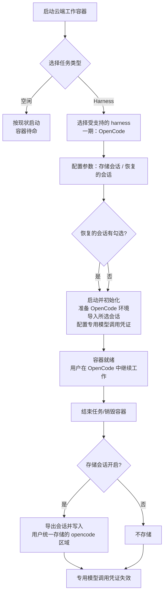
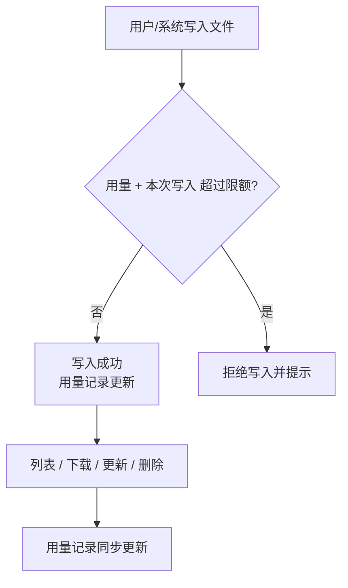

# 容器启动任务支持 harness 类型：OpenCode 工作负载与统一存储

**功能名称**: 容器启动任务 harness 类型、OpenCode 工作负载、统一存储
**PRD 版本**: v1.0
**创建日期**: 2026-10-20
**作者**: ZeroAsh

## 背景与目标

### 1.1 背景

云端工作容器目前只有一种启动任务类型——「空闲」：容器拉起后处于待命状态，由使用者进入后自行操作。平台已经在前几期补齐了「工作负载」能力（启动时按需初始化环境、参数化配置、依赖展开、执行留档），但容器本身「为什么而启动」始终只有空闲一种答案。

随着云端 Agent 使用场景成熟，出现了一类高频诉求：**用户希望容器一启动就已经是一个可用的 AI 编程工作台**——装好指定的 coding harness（AI 编程工具）、恢复自己上次的会话、模型调用直接走平台计费，工作结束后会话产物自动留存，下次接着用。

因此本期把启动任务从「空闲」扩展为「harness」：

1. 选择 harness 启动任务后，必须进一步选择一个受支持的 harness。项目第一期先支持 **OpenCode** 作为第一个 harness 工作负载。
2. OpenCode 工作负载需要「会话可存可取」：容器结束时把会话存储下来，下次启动时可勾选恢复。
3. 会话等产物需要一个**统一存储**：按用户划分目录、支持类 S3 的文件管理能力、记录用量并可限额。

### 1.2 目标

- 启动云端工作容器时，任务类型可选「空闲」或「Harness」；选择 Harness 后必须选择一个受支持的 harness（一期为 OpenCode），否则无法启动。
- OpenCode 工作负载提供两个参数：「存储会话」（开关）与「恢复的会话」（多选，从当前用户已存储的 OpenCode 会话中选择）。
- 勾选「恢复的会话」后，容器初始化完成时所选会话已导入容器，可直接继续对话。
- 开启「存储会话」后，容器结束时会话自动导出并存入该用户统一存储目录下的 OpenCode 会话区，下次启动可在「恢复的会话」中看到并选择。
- OpenCode 在容器内调用模型时使用**本次容器专用的模型调用凭证**：计费归属本次任务，有效期与容器一致，容器结束后立即失效。
- 模型可用范围与计费规则：前台用户按其个人可用模型列表、后台用户按后台模型列表提供；前台用户调用自定义模型不计费，调用系统提供的模型计费。
- 提供统一存储能力：按「用户类型 + 用户 ID」划分用户目录，提供类 S3 的对象增删改查与列表能力，独立记录每个用户的存储用量，超过限额时禁止写入请求；后台用户不限量，前台用户限量（本期不做限额的运营配置与执行）。

### 1.3 成功标准

- 启动对话框选择「Harness」任务类型后，出现 harness 选择项；一期唯一可选项为 OpenCode；不选 harness 时无法提交启动，提示明确。
- 选择 OpenCode 后出现「存储会话」「恢复的会话」两个参数控件；「恢复的会话」下拉多选中展示的是当前用户已存储的 OpenCode 会话（含会话标识与可辨识信息），空态有明确提示。
- 使用「恢复的会话」启动容器后，进入容器即可看到所选会话已经存在并可继续；未勾选恢复时容器内无历史会话。
- 开启「存储会话」的容器正常结束后，其会话出现在该用户的统一存储 OpenCode 会话区，并且在下一次启动的「恢复的会话」选项中可被选中；关闭「存储会话」时不产生会话存储。
- 容器内 OpenCode 调用系统提供的模型时，平台产生对应计费记录；调用前台用户自定义模型时不产生计费记录；容器结束后该专用调用凭证不可再用。
- 用户可以通过统一存储能力对本人目录下的对象进行上传、下载、覆盖（更新）、删除与列表；列表结果与实际存储一致。
- 每个用户的存储用量可查询，用量独立记录；达到限额的用户写入被拒绝并得到明确提示（本期前台用户不限额，机制先行）。

## 用户分析

### 2.1 目标用户

- **后台管理员/运营人员**（一期主要用户）：以 harness 任务类型拉起云端工作容器，恢复客户/自己的历史会话继续处理任务，会话与产物统一留存。
- **前台用户**（二期接入）：未来在个人入口拉起自己的 harness 容器、管理自己的存储目录与会话。本期仅在存储用量、计费规则等能力上预留其口径。

### 2.2 用户场景

| 场景 | 用户角色 | 目标 | 痛点 |
|--|--|--|--|
| 一键拉起 AI 编程工作台 | 后台管理员 | 容器启动即得到可用的 OpenCode 环境 | 空闲容器要人工安装工具、配置模型，耗时且易错 |
| 接着上次的会话继续干活 | 后台管理员 | 勾选上次会话，启动后直接继续 | 会话留在上一个容器里，容器销毁即丢失 |
| 任务收尾自动留存会话 | 后台管理员 | 容器结束时会话自动存好 | 手工导出、手工上传，容易漏存 |
| 模型调用直接计费到任务 | 后台管理员/运营 | 容器内调用模型自动按任务计费 | 共用大账号 key 无法归因，额度与账单混乱 |
| 自定义模型不产生费用 | 前台用户 | 用自带的自定义模型不被扣费 | 担心自带模型也被平台计费 |
| 会话与产物有地方放 | 后台管理员 | 会话、导出物存到自己的统一目录 | 文件散落各处，换容器就找不到 |
| 存储用量可控 | 平台运营 | 掌握每个用户占用了多少存储 | 无用量记录，无法治理 |

## 功能需求

### 3.1 功能概述

云端工作容器的启动任务在「空闲」之外新增「Harness」类型：选择后必须再选择一个受支持的 harness（一期为 OpenCode），并按 harness 提供参数（存储会话、恢复的会话）。容器初始化时准备好 OpenCode 环境、按需恢复会话、注入本次专用的模型调用凭证；容器结束时按需导出会话并存入统一存储。统一存储为每个用户划分独立目录，提供类 S3 的文件管理与用量记录能力。

### 3.2 功能列表

#### 功能点 1: 启动任务类型支持 Harness

- **描述**: 启动云端工作容器时，任务类型在「空闲」之外新增「Harness」：
  - 选择「空闲」时行为与现状完全一致。
  - 选择「Harness」后，必须进一步选择一个受支持的 harness；一期受支持列表为「OpenCode」。
  - 未选择 harness 时不允许提交启动，并给出明确提示。
  - 受支持的 harness 列表由平台维护，后续新增 harness 时用户可直接看到新选项。
- **用户价值**: 容器从「待命」升级为「即用的 AI 编程工作台」，启动即可干活。
- **验收标准**:
  - [ ] 任务类型可选「空闲」与「Harness」，且默认行为与现状一致
  - [ ] 选择「Harness」后展示受支持 harness 选择项，一期包含且仅需展示 OpenCode
  - [ ] 未选择 harness 时无法提交启动，提示明确
  - [ ] 选择「空闲」时不出现 harness 相关选择项

#### 功能点 2: OpenCode 工作负载参数——存储会话

- **描述**: OpenCode 工作负载提供「存储会话」开关（布尔）：
  - 开启后，容器结束时系统自动导出该容器内的 OpenCode 会话并存入该用户的统一存储 OpenCode 会话区。
  - 关闭时不进行任何会话存储。
  - 默认值由平台约定（默认开启），提交前可修改。
- **用户价值**: 会话不随容器销毁而丢失，下次可继续。
- **验收标准**:
  - [ ] 参数区展示「存储会话」开关，默认值正确
  - [ ] 开启时容器结束后会话出现在用户统一存储的 OpenCode 会话区
  - [ ] 关闭时容器结束后不产生会话存储
  - [ ] 同一用户的多次容器会话存储互不覆盖（按容器/会话可区分）

#### 功能点 3: OpenCode 工作负载参数——恢复的会话

- **描述**: OpenCode 工作负载提供「恢复的会话」下拉多选：
  - 可选项为当前用户**已存储的 OpenCode 会话**（来自统一存储 OpenCode 会话区），每项可辨识（会话标识/名称、来源与存储时间等可辨识信息）。
  - 后台先行提供「查询指定用户的已存储 OpenCode 会话」能力，页面据此渲染可选项并按调用用户过滤；前台入口二期接入。
  - 支持多选、可清空；未选择时容器内无历史会话。
  - 选项为空（该用户尚无已存会话）时给出空态提示，不影响启动。
  - 所选会话在容器初始化阶段被导入容器，进入容器后可直接继续。
- **用户价值**: 跨容器延续历史会话，工作不中断。
- **验收标准**:
  - [ ] 下拉多选展示当前用户已存储的 OpenCode 会话，不含其他用户数据
  - [ ] 多选、清空行为正常；未选择时容器内无历史会话
  - [ ] 勾选的会话在容器初始化完成后全部存在且可继续使用
  - [ ] 选项为空时展示空态提示，仍可正常启动
  - [ ] 勾选的会话在启动后已从选项语义上「消费」（历史记录仍可追溯本次恢复了哪些会话）

#### 功能点 4: 容器内模型调用与计费

- **描述**: OpenCode 在容器内调用模型时使用**本次容器专用的模型调用凭证**：
  - 凭证随容器初始化自动配置到 OpenCode，无需用户手工填写。
  - 凭证的有效期与该容器的有效期一致：容器销毁/结束后该凭证立即失效。
  - 凭证产生的模型调用费用计入本次任务的计费归属（同容器的计费账户）。
  - 模型可用范围：前台用户按其**个人可用模型列表**提供，后台用户按**后台模型列表**提供。
  - 计费规则：前台用户调用其**自定义模型**不计费；调用**系统提供的模型**计费。后台用户按后台口径计费。
- **用户价值**: 容器内模型调用可归因、可计费，杜绝共享大账号凭证；用户自带模型不被乱扣费。
- **验收标准**:
  - [ ] 容器内 OpenCode 无需手工配置即可调用模型
  - [ ] 调用系统提供的模型产生计费记录并计入对应计费账户
  - [ ] 前台用户调用自定义模型不产生计费记录
  - [ ] 前台用户看到的可用模型不超出其个人模型列表；后台用户看到的不超出后台模型列表
  - [ ] 容器结束后该凭证立即失效（无法再发起调用）
  - [ ] 凭证不在界面明文展示

#### 功能点 5: OpenCode 会话收尾与存储

- **描述**: 容器结束（正常销毁）时，若「存储会话」开启：
  - 系统导出该容器内的 OpenCode 会话清单与内容；
  - 导出结果写入该用户统一存储目录下的 OpenCode 会话区（用户目录下的 opencode 区域）；
  - 写入结果可在统一存储中查看，并出现在下一次启动的「恢复的会话」选项中。
  - 导出与写入失败时记录明确原因，不影响容器销毁流程本身。
- **用户价值**: 会话留存自动化、可恢复，形成「用完即存、下次再取」的闭环。
- **验收标准**:
  - [ ] 「存储会话」开启且容器正常结束时，会话导出物出现在用户目录的 OpenCode 会话区
  - [ ] 导出的会话可在下一次启动时被选择恢复
  - [ ] 导出物按容器/会话维度可区分，不互相覆盖
  - [ ] 导出或写入失败时有明确的失败记录与原因

#### 功能点 6: 统一存储——用户目录与文件管理

- **描述**: 新增统一存储能力：
  - 每个用户拥有独立的存储目录，目录前缀按「用户类型 / 用户 ID」划分（用户存储前缀 user-path）。
  - 提供类 S3 的对象管理能力：上传（创建/覆盖）、下载、查看（元信息）、删除、按前缀列表。
  - 所有读写都必须发生在调用者自己的用户目录下；跨用户访问被拒绝。
  - OpenCode 会话存储使用该用户目录下的 opencode 区域，其他产物也可使用同一目录体系。
- **用户价值**: 用户的会话与产物有统一、隔离、可管理的存放空间。
- **验收标准**:
  - [ ] 上传、下载、更新、删除、列表五类操作均可用
  - [ ] 列表按目录前缀返回，结果与实际存储一致
  - [ ] 访问他人目录被拒绝并提示
  - [ ] OpenCode 会话存储落在用户目录的 opencode 区域

#### 功能点 7: 统一存储——用量记录与限额

- **描述**: 统一存储按用户记录存储用量：
  - 有独立的用量记录，反映该用户当前占用的存储大小（含对象数量）。
  - 用量可查询（后台可查任意用户；用户可查自己）。
  - 限额规则：**后台用户不限量**；**前台用户限量**（限额的配置与执行本期不做，仅预留口径）。
  - 用量达到限额后，该用户的写入类请求被拒绝并明确提示；读取、删除不受限。
- **用户价值**: 平台可治理存储成本，用户对自身用量心中有数。
- **验收标准**:
  - [ ] 用量记录随上传/覆盖/删除实时更新，数值与实际一致
  - [ ] 后台用户不受限额约束
  - [ ] 达到限额后写入被拒绝且提示明确；读取、删除仍可用
  - [ ] 前台用户限额本期不生效，但用量记录完整

### 3.3 用户操作流程

#### 启动 Harness 容器

#### 会话存取闭环

#### 统一存储使用

### 3.4 页面/界面描述

| 页面 | 描述 | 关键元素 |
|------|------|---------|
| 启动云端工作容器对话框 | 任务类型新增「Harness」选项 | 任务类型选择（空闲/Harness）、harness 选择（OpenCode）、参数区（存储会话开关、恢复的会话多选）、提交/取消 |
| 容器列表/详情 | 展示 harness 容器的类型与状态 | 任务类型、所选 harness、参数摘要（是否存储会话、恢复了几个会话）、状态与耗时 |
| 统一存储（用户目录） | 查看与管理本人目录下的对象 | 对象列表（名称、大小、更新时间）、上传/下载/删除、用量展示 |
| 存储用量（后台） | 查看各用户存储用量 | 用户、用量大小、对象数、限额状态 |

### 3.5 异常与边界情况

| 情况 | 预期行为 |
|------|---------|
| 选择 Harness 但未选择具体 harness | 阻止启动并提示必须选择一个受支持的 harness |
| 受支持 harness 列表为空（异常） | 阻止启动并提示联系管理员 |
| 「恢复的会话」选项为空 | 展示空态提示，仍可正常启动 |
| 勾选的会话在启动前被删除/不可读 | 该会话跳过导入，其余会话照常；容器初始化有明确记录 |
| 会话导入失败 | 记录失败原因；不影响容器其他初始化步骤（会话恢复为可增强能力） |
| 「存储会话」关闭 | 不导出、不写入统一存储 |
| 容器异常退出/初始化失败 | 不产生会话存储；专用调用凭证按容器结束处理（立即失效） |
| 会话导出或写入存储失败 | 记录明确失败原因；不阻塞容器销毁 |
| 同名会话重复存储 | 按容器/会话维度区分存放，不覆盖历史 |
| 写入时用量超过限额 | 拒绝写入并明确提示；读取、删除不受影响 |
| 访问其他用户的目录 | 拒绝并提示无权限 |
| 容器已结束后再使用其调用凭证 | 失效拒绝，无法调用任何模型 |
| 前台用户调用自定义模型 | 不计费，正常返回 |
| 前台用户调用系统模型 | 正常计费到对应计费账户 |

## 四、非功能需求

### 4.1 性能要求

- 「恢复的会话」选项加载在秒级完成，选项数量大时支持滚动加载（本期不做搜索）。
- 会话导出与写入统一存储在容器销毁宽限期内完成；单个会话包大小应可预期，超大导出有截断或明确失败记录。
- 统一存储列表请求支持分页/截断返回，避免一次性返回超大列表。

### 4.2 安全性要求

- 容器专用模型调用凭证不明文展示、不写入任何可公开访问的位置；有效期严格限定为容器有效期，容器结束后立即失效。
- 统一存储严格按用户目录隔离，任何跨用户读写均被拒绝。
- 会话导出物属于用户数据，仅其属主（及平台运营治理口径）可访问。

### 4.3 兼容性要求

- 现有「空闲」任务类型的行为与现有工作负载能力完全不受影响。
- 已存量容器的记录与展示不受新类型影响。
- 现有计费链路（账户、账单、计费记录）保持不变，仅新增「容器专用凭证」这一产生计费的入口。

## 五、依赖与约束

### 5.1 依赖

- 工作负载能力（参数表单、初始化/收尾脚本、执行留档）——OpenCode 以工作负载形式交付。
- 计费能力（计费账户、模型定价、计费记录、调用凭证）——容器专用凭证与模型计费规则基于此。
- 模型列表能力（用户可用模型、自定义模型、后台模型列表）——决定容器内可用模型与计费口径。
- 统一存储能力（本期新建）——会话存储与恢复的数据来源。

### 5.2 约束

- 项目第一期仅支持 OpenCode 一个 harness；harness 架构需支持后续新增而不改动启动流程。
- 目前仅后台可以拉起容器；「恢复的会话」的前台入口与前台限额运营配置二期接入。
- 会话恢复的可选项只来自「已存储」的会话，本期不做会话的在线浏览/编辑/删除以外的高级管理。
- 统一存储限额：后台用户不限量；前台用户限量的配置与执行本期不做，但写入卡点与用量记录机制必须具备。

## 六、相关文档

- [[20261017-cloud-controller-workload.md]] — 云控制器工作负载功能
- [[20261018-workload-phase1.md]] — 工作负载一期（参数、依赖与预制工作负载）
- [[20261018-credits-billing.md]] — 费用中心（Credits 计费）
- [[20260522-available-models-and-mode-switch.md]] — 可用模型与模式切换
- [[../../engineering/proposals/20261020-feat-container-harness-support.md]] — 本期技术提案
