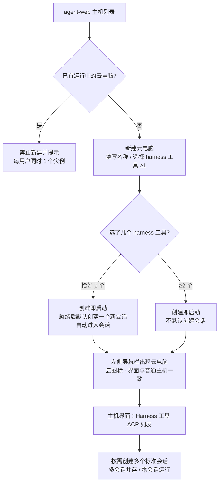
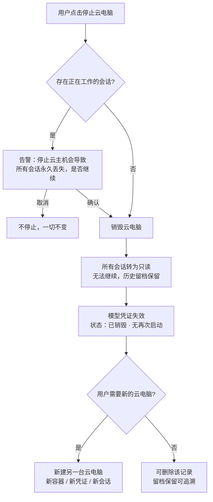
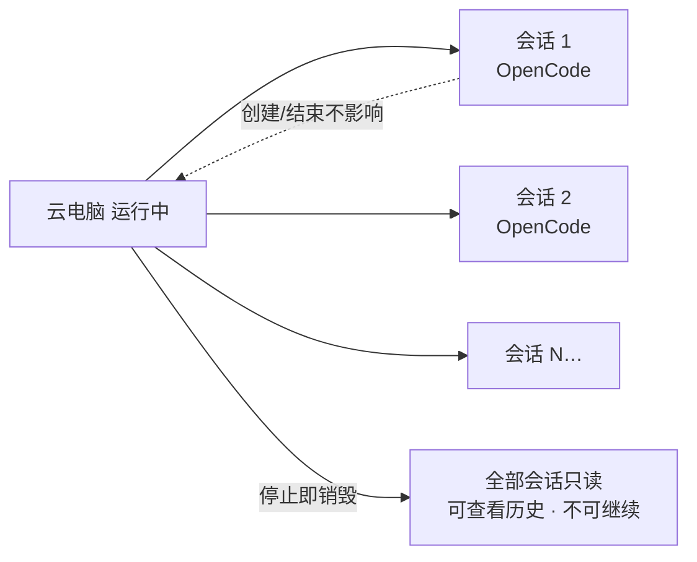

# 容器启动任务支持 harness 类型：OpenCode 云电脑

**功能名称**: 容器启动任务 harness 类型、OpenCode 云电脑
**PRD 版本**: v5.0
**创建日期**: 2026-10-20
**作者**: ZeroAsh

> 术语：本期将 harness 容器定位为用户的**「云电脑」**——一台云端的机器，在左侧导航栏以**「主机」**形态呈现（与本地主机同构）。
>
> v2.0 变更（需求重构）：交付面反转（agent-web 前台、后台本期不做）；harness 容器作为「主机」呈现在左侧导航栏（云图标、界面与普通主机一致、支持的 Harness 工具（ACP）列表）；新建时用户命名；容器内控制器天然支持 OpenCode ACP，走系统既有标准「会话」呈现。
>
> v3.0 变更（范围裁剪）：统一存储本期不做（整体二期）；harness 容器的会话导入（「恢复的会话」）暂不做（二期），会话导出（「存储会话」与收尾导出）依赖统一存储一并二期。
>
> v4.0 变更（会话与生命周期模型）：一主机多会话（会话与主机解耦、可零会话运行）；生命周期用户手动启动/停止；停止前活动会话告警「所有会话永久丢失，是否继续」；harness 工具多选（≥1），恰好选 1 个默认创建会话、选多个不创建。
>
> v5.0 变更（生命周期简化，与研讨口径对齐）：
>
> 1. **云电脑不可重新运行**：**停止即销毁**（终态，无「再次启动」）；停止后会话转为**只读**、无法继续（消息留档保留可查看）。
> 2. **实例上限**：每个前台用户同时最多 **1 个**云电脑实例。
> 3. **会话导入导出二期**：「将会话转为对应 harness 的 JSON 并导入、跨云电脑继续会话」与统一存储一起放二期。背景：harness 跑了一段时间后，当时容器的状态与重新初始化的截然不同，导入设计需处理状态差异（列入二期设计输入）。
> 4. 方案阶段允许完全重写，本版为整体重写后的现行设计（历史版本仅留变更记录）。

## 背景与目标

### 1.1 背景

云端工作容器目前只有一种启动任务类型——「空闲」：容器拉起后处于待命状态，由使用者进入后自行操作。平台已经在前几期补齐了「工作负载」能力（启动时按需初始化环境、执行留档），以及「主机」体系：用户机器上运行的控制器接入后成为一台「主机」，在左侧导航栏展示，其上可查看支持的 Harness 工具（ACP）列表、创建并使用标准「会话」。

随着云端 Agent 使用场景成熟，出现了一类高频诉求：**用户希望容器一启动就已经是一台可用的「云电脑」**——装好指定的 coding harness（AI 编程工具）、出现在自己的主机列表里、像本地主机一样开多个会话并行干活、不用了自己关停，模型调用直接走平台计费。

因此本期把启动任务从「空闲」扩展为「harness」，并在**前台（agent-web）**交付完整体验：

1. 选择 harness 启动任务后，必须选择至少一个受支持的 harness 工具。项目第一期先支持 **OpenCode** 作为第一个 harness 工作负载（契约按多选设计，二期可平滑增加）。
2. 拉起的 harness 容器作为一台**「云电脑」**呈现在左侧导航栏（以「主机」形态，云图标、与普通主机同构的 Harness 工具（ACP）列表与标准会话），新建时由用户命名。
3. **一台云电脑多个会话**：会话是其上的标准会话，多会话并存、随时新建/结束，与云电脑的运行互不影响；云电脑可以运行但没有会话。
4. **生命周期极简**：创建即启动、**停止即销毁**（不可重新运行）；停止后会话转为**只读**留档、无法继续；每个前台用户同时最多 **1 个**云电脑实例。
5. 云电脑内调用模型使用本次运行专用的模型调用凭证，按用户模型/计费口径执行。

关于「会话继续」的边界：harness 容器销毁后，其 harness（如 OpenCode）的会话状态随之丢失；要把留在云上的会话**继续进行**，需要具备「将会话转为对应 harness 的 JSON 并导入」的能力，且 harness 跑了一段时间后，当时容器的状态与重新初始化的截然不同（工作区、环境、上下文均有漂移）。**该能力连同统一存储一起放二期**；一期停止后会话只读、不可继续。

### 1.2 目标

- 前台用户可在 agent-web 新建**云电脑**：**命名**、选择**至少一个** harness 工具（一期可选 OpenCode）；恰好选一个时自动创建一个新会话并进入，选多个时不默认创建；后台管理入口本期不做。
- 每个前台用户同时最多 **1 个**云电脑实例：已有运行中的云电脑时无法再新建（明确提示）；停止（销毁）后可再新建新的云电脑。
- 云电脑作为一台「主机」出现在左侧导航栏，**界面与普通主机完全一致**（支持的 Harness 工具（ACP）列表、工作区、标准会话），使用**云的图标**。
- **一机多会话**：一台云电脑可创建多个标准会话（受所选 harness 工具约束），会话创建/结束不影响云电脑；云电脑可零会话运行。
- **停止即销毁**：用户手动停止云电脑；停止后**不可重新运行**，该云电脑的会话全部转为**只读**（可查看历史、无法继续对话），消息留档保留；停止时若存在正在工作的会话，提示「停止云主机会导致所有会话永久丢失，是否继续」并二次确认。
- 每次云电脑配置**专用的模型调用凭证**：计费归属该用户，有效期与容器一致，停止/结束后立即失效。
- 模型可用范围与计费口径（前台）：按用户的**个人可用模型列表**提供；用户调用其**自定义模型**不计费，调用**系统提供的模型**计费。
- 二期（本期不做）：统一存储 + 会话导入导出（会话 ↔ harness JSON，跨云电脑继续会话，含状态差异处理）。

### 1.3 成功标准

- 前台「新建云电脑」入口可用：填写名称、选择 ≥1 个 harness 工具后提交；名称为空或未选任何 harness 工具时无法提交并有明确提示。
- 恰好选择 1 个 harness 工具创建后，云电脑就绪时自动创建一个使用该工具的新会话并自动进入；选择 ≥2 个时不自动创建会话。
- 已有运行中的云电脑时，新建入口被拒绝并提示（每用户 1 实例）；停止后可再次新建。
- 创建成功后，左侧导航栏出现该云电脑：名称即用户命名，带云图标；界面与普通主机一致，可见支持的 Harness 工具（ACP）列表（含所选工具）。
- 在云电脑上可创建多个会话并自由切换/结束；任一会话的创建与结束不影响云电脑状态；云电脑可在无会话状态下持续运行。
- 停止时若存在正在工作的会话，弹出告警「停止云主机会导致所有会话永久丢失，是否继续」；取消则不停止；确认后云电脑销毁，所有会话转为只读、无法继续（历史留档可查看）。
- 停止后该云电脑**没有**「再次启动」入口；其会话仅可只读查看；可删除该记录（留档保留可追溯）。
- 每次云电脑内调用系统模型产生计费并计入该用户计费账户；调用自定义模型不计费；停止/结束后该凭证立即失效。
- 后台（管理后台）本期不出现任何新增的 harness/云电脑入口与页面；本期不出现任何统一存储与会话导入/导出入口。

## 用户分析

### 2.1 目标用户

- **前台用户**（一期主要用户）：在 agent-web 里自助创建、命名自己的云电脑（同时只有 1 台），在上面开多个标准会话并行干活，用完停止；模型费用计入自己的计费账户。
- **平台运营**（本期仅口径预留）：未来治理存储用量与限额、查看计费归属；后台管理面二期接入。

### 2.2 用户场景

| 场景 | 用户角色 | 目标 | 痛点 |
|--|--|--|--|
| 一键拉起云端「电脑」 | 前台用户 | 创建即得到一台可用的 OpenCode 云电脑 | 自备机器、装环境、配模型门槛高 |
| 一台电脑多个任务并行 | 前台用户 | 同一云电脑开多个会话互不干扰 | 一个容器一个会话，任务一多开一堆容器 |
| 电脑常驻、会话随用随开 | 前台用户 | 云电脑保持运行，会话自由创建/结束 | 会话结束连带容器被回收 |
| 不用了自己关停 | 前台用户 | 手动停止，资源与计费归零 | 生命周期不受自己控制 |
| 停止前知道代价 | 前台用户 | 停止前明确提示会话将只读、不能继续 | 误停导致进行中的工作无法继续 |
| 停止后回看当时聊了什么 | 前台用户 | 会话历史只读可查 | 停止后一切无从查看 |
| 模型调用直接计费到自己 | 前台用户 | 云电脑里调用模型按自己的账户计费 | 共用大账号 key 无法归因 |
| 自定义模型不产生费用 | 前台用户 | 用自带的自定义模型不被扣费 | 担心自带模型也被计费 |

## 功能需求

### 3.1 功能概述

前台新增「新建云电脑」能力：用户命名并选择**至少一个** harness 工具（一期 OpenCode）后，系统拉起 harness 容器；容器就绪后作为一台「主机」出现在左侧导航栏（云图标），界面与普通主机一致。**一台云电脑可创建多个标准会话**，会话与云电脑运行解耦；**停止即销毁、不可重新运行**，停止后会话转为**只读**留档；每个前台用户同时最多 1 个云电脑实例。每次运行自动准备所选 harness 工具的环境并注入专用的模型调用凭证，模型费用按用户口径计费。后台管理面本期不做；统一存储与会话导入导出（继续会话）二期交付。

### 3.2 功能列表

#### 功能点 1: 新建云电脑（命名 + harness 工具多选 + 默认会话规则 + 实例上限）

- **描述**: 前台提供「新建云电脑」入口，创建表单包含：
  - **名称**（必填）：用户自由命名，作为该云电脑在导航栏与主机界面的显示名称。
  - **任务类型**：固定为「Harness」（云电脑即 harness 任务类型；空闲容器仍属后台能力，本期不在前台暴露）。
  - **harness 工具**（必选，**至少一个**，可多选）：一期可选项为「OpenCode」；未选择任何工具不允许提交。契约按多选设计，二期新增工具时创建流程不变。
  - **默认会话规则**：恰好选择 **1 个** harness 工具 → 就绪后**自动创建一个使用该工具的新会话**并自动进入；选择 **≥2 个** → **不**默认创建会话，用户进入后自行创建。
  - **实例上限**：每个前台用户同时最多 **1 个**云电脑实例；已有运行中的云电脑（含启动中/运行中/停止中）时新建被拒绝并提示；停止（销毁）后可再新建。
  - 创建即启动；本期创建表单**不包含工作负载参数**（会话相关参数随二期导入导出交付）。
- **用户价值**: 一步得到一台按需装配的云端「电脑」；单工具场景开箱即用。
- **验收标准**:
  - [ ] 名称必填、harness 工具至少选一个；缺失时无法提交并提示
  - [ ] harness 工具支持多选；一期可选项为 OpenCode
  - [ ] 恰好选 1 个工具时，就绪后自动创建并进入该工具的新会话
  - [ ] 选 ≥2 个工具时，不自动创建会话，可手动创建
  - [ ] 已有运行中云电脑时无法新建并提示；停止后可再新建
  - [ ] 创建后主机列表出现「启动中」的云电脑，名称即用户命名
  - [ ] 后台不出现本期新增的 harness 入口

#### 功能点 2: 云电脑以「主机」形态呈现

- **描述**: 拉起的 harness 容器作为一台「主机」呈现：
  - 出现在**左侧导航栏**主机列表中，与普通主机同列展示（名称、在线状态）。
  - **界面与正常「主机」一致**：进入后可见的界面与普通主机相同，都是**支持的 Harness 工具（ACP）列表**，以及工作区、会话入口。
  - 区别仅在**使用云的图标**：云电脑使用云图标（普通主机维持现状）。
  - 状态口径：启动中 / 运行中 / 停止中 / 已销毁 / 失败。
- **用户价值**: 云电脑无缝融入既有主机体验，零学习成本。
- **验收标准**:
  - [ ] 云电脑出现在左侧导航栏主机列表，名称为用户命名
  - [ ] 云电脑条目使用云图标，普通主机展示不变
  - [ ] 进入云电脑的界面与普通主机一致，包含支持的 Harness 工具（ACP）列表
  - [ ] 状态与实际生命周期一致（含已销毁/失败）
  - [ ] 普通主机的展示与交互完全不受影响

#### 功能点 3: 一机多会话

- **描述**: 云电脑与会话解耦：
  - 一台云电脑上可创建**多个**标准会话（每个会话选择一个可用 harness 工具），多会话并存、自由切换。
  - 会话的创建与结束**不影响**云电脑生命周期；云电脑可以**运行但没有任何会话**。
  - 会话即系统既有标准「会话」：界面、交互、模式/模型切换、历史消息呈现与普通主机完全一致；工作区沿用主机工作区机制（云电脑自带默认工作区）。
  - 可创建会话的工具范围 = 创建时所选 harness 工具。
- **用户价值**: 一台电脑承载多个任务，资源与心智负担最小。
- **验收标准**:
  - [ ] 单台云电脑可创建多个会话并自由切换
  - [ ] 任一会话创建/结束不影响云电脑状态
  - [ ] 零会话状态下云电脑保持运行
  - [ ] 会话体验与普通主机的标准会话一致
  - [ ] 会话工具选择范围 = 所选 harness 工具

#### 功能点 4: 停止即销毁（含告警与会话只读）

- **描述**: 云电脑生命周期为「创建（即启动）→ 停止（即销毁）」：
  - **停止**：用户手动停止；停止 = **销毁本次云电脑，不可重新运行**（无「再次启动」入口）。
  - **停止告警**：停止时若存在**正在工作的会话**，弹出提示——「停止云主机会导致所有会话永久丢失，是否继续」——确认才继续；取消则不停止。确认后：
    - 云电脑销毁，**无法重新运行**；
    - 所有会话（含工作中/进行中）**转为只读**：可查看历史消息留档，**无法继续对话**（本期无恢复手段）；
    - 本次模型凭证立即失效。
  - 无活动会话时停止无需该告警。
  - **只读回看**：已销毁云电脑的会话可在历史中**只读**查看（消息留档保留）；不存在「继续会话」操作。
  - **删除记录**：可删除已销毁的云电脑（从主机列表移除；留档保留可追溯）；停止中/运行中的云电脑不可删除（须先停止）。
- **用户价值**: 资源与计费完全由自己掌控；停止的代价（会话无法继续）明确知情；历史仍可回看。
- **验收标准**:
  - [ ] 停止成功后云电脑进入「已销毁」，**无再次启动入口**
  - [ ] 停止时有正在工作的会话 → 展示告警「停止云主机会导致所有会话永久丢失，是否继续」
  - [ ] 告警取消 → 不停止、会话不受影响；告警确认 → 云电脑销毁、全部会话转只读
  - [ ] 停止后会话仅只读可查看，无法继续对话
  - [ ] 无活动会话时停止不弹该告警
  - [ ] 模型凭证在停止后立即失效
  - [ ] 删除仅限已销毁/失败的云电脑；删除成功后列表移除、留档可追溯

#### 功能点 5: harness 环境准备与模型配置注入

- **描述**: 云电脑启动时自动完成所选 harness 工具的环境准备：
  - 安装并校验对应工具的运行环境（固定版本、可重复执行）；失败则启动失败并给出原因。
  - 自动配置**本次专用**的模型调用凭证（端点与密钥），用户无需手工填写；配置不对外明文展示。
  - 凭证有效期与本次容器一致：停止/结束后立即失效。
- **用户价值**: 开箱即用，杜绝共享大账号凭证与手工配置。
- **验收标准**:
  - [ ] 云电脑就绪后所选 harness 工具全部可用（ACP 列表显示可用）
  - [ ] 会话内无需手工配置即可调用模型
  - [ ] 凭证明文不展示；停止后立即失效

#### 功能点 6: 模型调用与计费（前台口径）

- **描述**: 云电脑内调用模型的口径：
  - 可用模型范围：按用户的**个人可用模型列表**提供（与用户在前台设置的模型列表一致）。
  - 计费规则：用户调用其**自定义模型**不计费；调用**系统提供的模型**计费，费用计入该用户的计费账户。
  - 后台用户口径（后台模型列表）保留为后续能力，本期不交付后台入口。
- **用户价值**: 模型调用可归因、可计费，用户自带模型不被乱扣费。
- **验收标准**:
  - [ ] 可用模型不超出用户的个人模型列表
  - [ ] 调用系统提供的模型产生计费记录并计入用户计费账户
  - [ ] 调用自定义模型不产生计费记录

### 3.3 用户操作流程

#### 创建云电脑（含默认会话规则与实例上限）

#### 停止即销毁

#### 多会话使用与只读回看

### 3.4 页面/界面描述

| 页面 | 描述 | 关键元素 |
|------|------|---------|
| 左侧导航栏（主机列表） | 云电脑与普通主机同列 | 主机名称、状态点、**云图标（云电脑）**、生命周期状态、新建云电脑入口（实例上限时禁用/提示） |
| 新建云电脑对话框 | 创建 harness 容器 | 名称输入、**harness 工具多选（≥1）**、默认会话规则提示（选 1 个将自动创建会话）、提交/取消 |
| 主机界面（云电脑） | **与普通主机完全一致** | 支持的 Harness 工具（ACP）列表（按所选工具过滤/标注）、工作区、会话入口（多会话） |
| 标准会话界面 | 与普通主机一致 | 会话消息流、模式/模型切换、历史消息；多会话切换 |
| 只读会话（已销毁云电脑） | 历史回看 | 消息历史只读展示；无「继续/发送」入口 |
| 云电脑详情/管理 | 生命周期管理 | 状态、**停止按钮**、活动会话数、删除入口（已销毁）、失败原因 |
| 停止确认弹窗 | 停止前告警 | 文案「停止云主机会导致所有会话永久丢失，是否继续」、确认/取消 |

### 3.5 异常与边界情况

| 情况 | 预期行为 |
|------|---------|
| 名称为空/非法 | 阻止提交并提示 |
| 未选择任何 harness 工具 | 阻止提交并提示至少选择一个 |
| 已有运行中的云电脑再新建 | 拒绝并提示「每用户同时最多 1 个云电脑实例」 |
| 恰好选 1 个工具但默认会话创建失败 | 云电脑照常可用并提示「可手动创建会话」 |
| 停止时有正在工作的会话 | 告警「停止云主机会导致所有会话永久丢失，是否继续」；取消不停止 |
| 告警确认停止 | 云电脑销毁、全部会话转只读、无法继续；历史留档保留 |
| 停止时无活动会话 | 直接停止，不弹该告警 |
| 对已销毁的云电脑再次停止 | 幂等成功（按钮置灰/直接返回） |
| 停止后寻找「再次启动」 | 无该入口；需要时新建另一台云电脑 |
| 停止后打开旧会话 | 只读展示历史，无发送/继续入口 |
| 启动/初始化失败 | 状态「失败」并展示原因；可删除记录后重新新建 |
| 删除运行中/停止中的云电脑 | 拒绝并提示先停止 |
| 删除已销毁的云电脑 | 从主机列表移除；留档保留可追溯 |
| 会话全部结束后云电脑仍运行 | 不受影响，可继续创建新会话 |
| 容器已结束后再使用其凭证 | 失效拒绝，无法调用任何模型 |
| 用户调用自定义模型 | 不计费，正常返回 |
| 用户调用系统模型 | 正常计费到该用户计费账户 |
| 非属主访问/启停/删除该云电脑 | 拒绝并提示无权限 |

## 四、非功能需求

### 4.1 性能要求

- 新建云电脑到出现在主机列表（启动中）应在秒级反馈；就绪时间受容器初始化影响，界面持续展示进度状态。
- 停止操作应快速响应；停止告警弹窗即时呈现活动会话数与影响说明。
- 只读会话历史加载与普通主机历史会话同口径。

### 4.2 安全性要求

- 容器专用模型调用凭证不明文展示、不写入任何可公开访问的位置；有效期严格限定为本次容器，停止/结束后立即失效。
- 云电脑只能被其属主查看、启停与删除。
- 会话与对话记录沿用既有标准会话的访问控制（仅属主可见）；只读留档同样受此约束。

### 4.3 兼容性要求

- 现有「空闲」任务类型与后台既有能力完全不受影响；后台本期不新增 harness 入口。
- 普通主机（本地控制器）的导航栏展示、主机界面、多会话能力完全不受影响；云图标仅作用于云电脑。
- 已存量主机、会话、计费记录不受新类型影响；现有计费链路保持不变，仅新增「运行专用凭证」入口。

## 五、依赖与约束

### 5.1 依赖

- 「主机」体系（控制器接入、主机列表、工作区、Harness 工具（ACP）探测）——云电脑复用该体系呈现。
- 标准「会话」机制（多会话创建、ACP 交互、消息留档、历史只读回看）——云电脑的会话完全复用。
- 工作负载能力（初始化脚本、执行留档）——harness 工具环境准备以工作负载形式交付。
- 计费能力（计费账户、模型定价、计费记录、调用凭证）与模型列表能力（用户可用模型、自定义模型）。

### 5.2 约束

- **每前台用户同时最多 1 个云电脑实例**；**停止即销毁、不可重新运行**；停止后会话**只读**、无法继续。
- 一期仅 OpenCode 一个 harness 工具可选，但创建表单与契约按**多选（≥1）**设计；默认会话规则（选 1 个默认创建、选多个不创建）为契约级口径。
- 云电脑生命周期仅由用户手动创建/停止驱动，**不随会话自动启停**；云电脑可零会话运行。
- **会话导入导出与统一存储二期**：「将会话转为对应 harness 的 JSON 并导入、跨云电脑继续会话」不在本期；二期设计须处理**状态差异**——harness 运行一段时间后，当时容器的状态与重新初始化的截然不同（工作区内容、环境、上下文漂移）。
- 本期不提供「存储会话」「恢复的会话」参数与任何存储入口。
- 云电脑的工作区内容随容器生命周期存在（停止即销毁，不持久化）。
- harness 工具环境准备必须幂等且有硬校验（安装成功但不可用视为启动失败）。

## 六、相关文档

- [[20261017-cloud-controller-workload.md]] — 云控制器工作负载功能
- [[20261018-workload-phase1.md]] — 工作负载一期（参数、依赖与预制工作负载）
- [[20261018-credits-billing.md]] — 费用中心（Credits 计费）
- [[20260522-available-models-and-mode-switch.md]] — 可用模型与模式切换
- [[../../engineering/proposals/20261020-feat-container-harness-support.md]] — 本期技术提案
