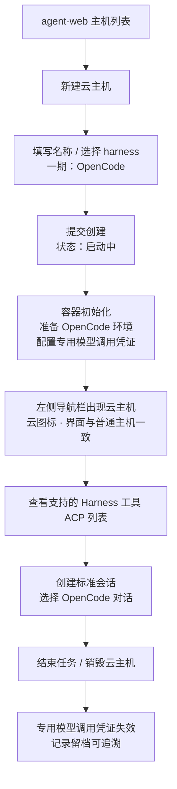
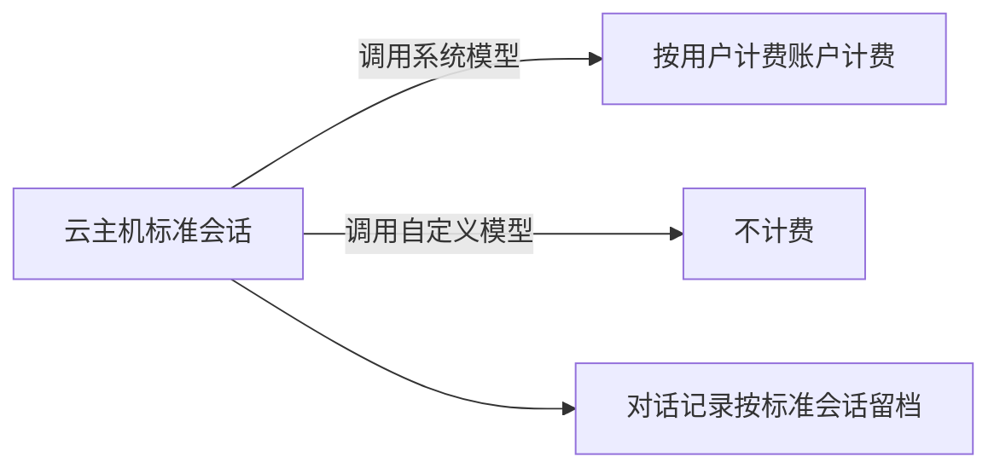

# 容器启动任务支持 harness 类型：OpenCode 云主机

**功能名称**: 容器启动任务 harness 类型、OpenCode 云主机
**PRD 版本**: v3.0
**创建日期**: 2026-10-20
**作者**: ZeroAsh

> v2.0 变更（需求重构）：
>
> 1. **交付面反转**：直接呈现在 agent-web（前台）交付，后台（管理后台）本期不做；
> 2. **产品模型变更**：拉起的 harness 容器作为一台「主机」——即此前由控制器管理的那类机器——呈现在左侧导航栏，界面与普通「主机」完全一致（都是支持的 Harness 工具（ACP）列表），区别仅在使用**云的图标**；
> 3. **用户命名**：前台新建 harness 容器时允许用户命名；
> 4. **标准会话**：harness 容器内的控制器天然支持 OpenCode ACP，直接走系统内已经存在的标准「会话」进行呈现与交互。
>
> v3.0 变更（范围裁剪返工）：
>
> 1. **统一存储本期不做**：用户目录、类 S3 的增删改查与列表、用量记录与限额能力整体移至二期；
> 2. **harness 容器的会话导入暂不做**：「恢复的会话」移至二期。因会话导出存储依赖统一存储，「存储会话」与收尾导出一并移至二期——OpenCode 工作负载的会话参数本期不交付；
> 3. 一期聚焦：harness 启动任务类型 + 前台云主机（命名、主机同构呈现、标准会话）+ OpenCode 环境与容器专用模型调用凭证（计费口径不变）。

## 背景与目标

### 1.1 背景

云端工作容器目前只有一种启动任务类型——「空闲」：容器拉起后处于待命状态，由使用者进入后自行操作。平台已经在前几期补齐了「工作负载」能力（启动时按需初始化环境、参数化配置、依赖展开、执行留档），以及「主机」体系：用户机器上运行的控制器接入后成为一台「主机」，在左侧导航栏展示，其上可查看支持的 Harness 工具（ACP）列表、创建并使用标准「会话」。

随着云端 Agent 使用场景成熟，出现了一类高频诉求：**用户希望容器一启动就已经是一台可用的「主机」**——装好指定的 coding harness（AI 编程工具）、出现在自己的主机列表里、用标准会话直接干活，模型调用直接走平台计费。

因此本期把启动任务从「空闲」扩展为「harness」，并在**前台（agent-web）**交付完整体验：

1. 选择 harness 启动任务后，必须进一步选择一个受支持的 harness。项目第一期先支持 **OpenCode** 作为第一个 harness 工作负载。
2. 拉起的 harness 容器作为一台「主机」呈现在左侧导航栏：界面与普通主机一致（支持的 Harness 工具（ACP）列表、标准会话），使用云的图标以示区别；新建时由用户命名。
3. 主机内的控制器天然支持 OpenCode ACP，会话直接走系统既有的标准「会话」机制呈现。
4. 主机内调用模型使用本次容器专用的模型调用凭证，按用户模型/计费口径执行。

会话与产物的持久化（统一存储、会话存储/恢复）经讨论**整体移至二期**：本期会话对话记录仍按标准会话机制留档可查，但跨容器的 OpenCode 会话迁移（导出存储、导入恢复）不在本期交付。

### 1.2 目标

- 前台用户可在 agent-web 新建云主机（harness 容器）：为它**命名**、选择受支持的 harness（一期为 OpenCode）；后台管理入口本期不做。
- 云主机创建成功后作为一台「主机」出现在左侧导航栏，**界面与普通主机完全一致**（支持的 Harness 工具（ACP）列表、工作区、标准会话），使用**云的图标**；其状态（在线/离线/启动中）与普通主机同口径展示。
- 在云主机上创建的会话即标准「会话」：选择 OpenCode 作为 Harness 工具后可直接对话交互，体验与普通主机一致。
- 云主机初始化时自动准备好 OpenCode 环境，并配置**本次容器专用的模型调用凭证**：计费归属本次任务，有效期与容器一致，容器结束后立即失效。
- 模型可用范围与计费口径（前台）：按用户的**个人可用模型列表**提供；用户调用其**自定义模型**不计费，调用**系统提供的模型**计费。
- 二期预留（本期不做）：统一存储（用户目录、类 S3 增删改查与列表、用量记录与限额）与会话存取（「存储会话」导出、「恢复的会话」导入），届时以参数形式接入 OpenCode 工作负载。

### 1.3 成功标准

- 前台「新建云主机」入口可用：填写名称、选择 harness（一期唯一 OpenCode）后提交；名称为空或未选 harness 时无法提交并有明确提示。
- 创建成功后，左侧导航栏出现该云主机：名称即用户命名，带云图标；点击进入的界面与普通主机一致，可见支持的 Harness 工具（ACP）列表（含 OpenCode）。
- 在云主机上创建 OpenCode 会话并正常对话，体验与普通主机上的标准会话一致；对话记录按标准会话机制留档可查。
- 云主机内调用系统提供的模型时，平台产生对应计费记录并计入该用户的计费账户；调用用户自定义模型时不产生计费记录；容器结束后该专用调用凭证不可再用。
- 云主机的可用模型不超出用户的个人模型列表。
- 销毁云主机后主机不再可交互、凭证立即失效，历史记录可追溯；失败场景有明确原因。
- 后台（管理后台）本期不出现任何新增的 harness/云主机入口与页面，既有「空闲」容器能力不受影响。
- 本期不出现任何统一存储与会话导入/导出入口（二期交付）。

## 用户分析

### 2.1 目标用户

- **前台用户**（一期主要用户）：在 agent-web 里自助拉起自己的云主机、命名管理它、在上面跑标准会话；模型费用计入自己的计费账户。
- **平台运营**（本期仅口径预留）：未来治理存储用量与限额、查看计费归属；后台管理面二期接入。

### 2.2 用户场景

| 场景 | 用户角色 | 目标 | 痛点 |
|--|--|--|--|
| 一键拉起云端「主机」 | 前台用户 | 新建即得到一台可用的 OpenCode 主机 | 自备机器、装环境、配模型门槛高、耗时长 |
| 主机列表统一管理 | 前台用户 | 云主机和本地主机在同一列表里管理 | 云资源与本地主机割裂，入口分散 |
| 模型调用直接计费到自己 | 前台用户 | 云主机里调用模型按自己的账户计费 | 共用大账号 key 无法归因，账单混乱 |
| 自定义模型不产生费用 | 前台用户 | 用自带的自定义模型不被扣费 | 担心自带模型也被平台计费 |
| 开箱即用的模型配置 | 前台用户 | 云主机里无需手工填 key/端点 | 手工配置模型凭证繁琐且易泄漏 |

## 功能需求

### 3.1 功能概述

前台新增「新建云主机」能力：用户命名并选择受支持的 harness（一期 OpenCode）后，系统拉起 harness 容器；容器就绪后作为一台「主机」出现在左侧导航栏（云图标），界面与普通主机一致——支持的 Harness 工具（ACP）列表、标准会话一应俱全。容器初始化时自动准备 OpenCode 环境并注入本次专用的模型调用凭证，用户在标准会话中直接使用 OpenCode 工作，模型费用按用户口径计费。后台管理面本期不做；统一存储与会话存取二期交付。

### 3.2 功能列表

#### 功能点 1: 前台新建云主机（harness 容器）

- **描述**: 前台提供「新建云主机」入口，创建表单包含：
  - **名称**（必填）：用户自由命名，作为该主机在导航栏与主机界面的显示名称。
  - **任务类型**：固定为「Harness」（云主机即 harness 任务类型；空闲容器仍属后台能力，本期不在前台暴露）。
  - **选择受支持的 harness**（必填）：一期受支持列表为「OpenCode」；未选择不允许提交。
  - 创建后进入「启动中」状态，就绪后自动出现在主机列表。
  - 本期创建表单**不包含工作负载参数**（「存储会话」「恢复的会话」随统一存储二期交付）。
- **用户价值**: 前台自助获得一台云端「主机」，无需自备机器与环境。
- **验收标准**:
  - [ ] 名称、harness 选择为必填；缺失时无法提交并提示
  - [ ] 创建后主机列表出现「启动中」状态的云主机，名称即用户命名
  - [ ] 本期创建表单无会话存储/恢复相关参数
  - [ ] 后台不出现本期新增的 harness 入口

#### 功能点 2: 云主机以「主机」形态呈现

- **描述**: 拉起的 harness 容器作为一台「主机」——即此前由控制器管理的那类机器——呈现：
  - 出现在**左侧导航栏**主机列表中，与普通主机同列展示（名称、在线状态）。
  - **界面与正常「主机」一致**：进入后可见的界面与普通主机相同，都是**支持的 Harness 工具（ACP）列表**，以及工作区、会话入口。
  - 区别仅在**使用云的图标**：云主机使用云图标（普通主机维持现状）。
  - 状态口径与普通主机一致（在线/离线/启动中/已结束），随心跳更新。
- **用户价值**: 云主机无缝融入既有主机体验，零学习成本。
- **验收标准**:
  - [ ] 云主机出现在左侧导航栏主机列表，名称为用户命名
  - [ ] 云主机条目使用云图标，普通主机展示不变
  - [ ] 进入云主机的界面与普通主机一致，包含支持的 Harness 工具（ACP）列表
  - [ ] 在线/离线状态与实际一致（容器结束后显示离线/已结束）
  - [ ] 普通主机的展示与交互完全不受影响

#### 功能点 3: 标准会话交互（OpenCode ACP）

- **描述**: 云主机内的控制器**天然支持 OpenCode ACP**：
  - 云主机的 Harness 工具（ACP）列表中展示 OpenCode（可用/版本与普通主机同口径）。
  - 用户在云主机上创建会话时选择 OpenCode，会话即系统内已有的**标准「会话」**：进入会话的界面、交互、模式/模型切换、历史消息等呈现与普通主机完全一致。
  - 会话的工作区沿用主机工作区机制（云主机自带默认工作区）。
  - 对话记录按标准会话机制留档，在会话历史中可查（本期不含跨容器的会话迁移）。
- **用户价值**: 不为云主机另造会话体系，功能与体验与本地主机同构。
- **验收标准**:
  - [ ] 云主机的 Harness 工具（ACP）列表包含 OpenCode 且可用
  - [ ] 在云主机上创建的会话就是标准「会话」，界面与普通主机一致
  - [ ] 对话、模式/模型切换、历史消息等既有会话能力正常
  - [ ] 云主机自带默认工作区，无需手工配置即可建会话

#### 功能点 4: OpenCode 环境准备与模型配置注入

- **描述**: 云主机初始化时自动完成 OpenCode 环境准备：
  - 安装并校验 OpenCode 运行环境（固定版本、可重复执行）。
  - 自动配置本次容器专用的模型调用凭证（端点与密钥），用户无需手工填写；配置不对外明文展示。
  - 凭证有效期与该容器一致：容器销毁/结束后立即失效。
- **用户价值**: 开箱即用，杜绝共享大账号凭证与手工配置。
- **验收标准**:
  - [ ] 主机就绪后 OpenCode 环境可用（Harness 工具列表显示可用）
  - [ ] 云主机内无需手工配置即可调用模型
  - [ ] 凭证在界面不明文展示；容器结束后立即失效（无法再发起调用）
  - [ ] 初始化失败时主机状态与失败原因明确

#### 功能点 5: 模型调用与计费（前台口径）

- **描述**: 云主机内调用模型的口径：
  - 可用模型范围：按用户的**个人可用模型列表**提供（与用户在前台设置的模型列表一致）。
  - 计费规则：用户调用其**自定义模型**不计费；调用**系统提供的模型**计费，费用计入该用户的计费账户（同云主机的计费归属）。
  - 后台用户口径（使用后台模型列表）保留为后续能力，本期不交付后台入口。
- **用户价值**: 云主机内模型调用可归因、可计费，用户自带模型不被乱扣费。
- **验收标准**:
  - [ ] 可用模型不超出用户的个人模型列表
  - [ ] 调用系统提供的模型产生计费记录并计入用户计费账户
  - [ ] 调用自定义模型不产生计费记录

#### 功能点 6: 云主机生命周期管理

- **描述**: 前台可查看与管理自己的云主机：
  - 主机列表/详情展示状态（启动中/在线/离线/已结束）、名称、创建时间。
  - 支持**销毁**云主机：销毁前提示「将结束该云主机」；销毁后主机从在线列表移除（历史记录保留可追溯）。
  - 容器异常退出/失败时展示明确的失败原因，允许重新新建。
- **用户价值**: 云主机资源可控、过程可追溯。
- **验收标准**:
  - [ ] 状态展示与实际生命周期一致
  - [ ] 销毁流程有确认提示，销毁后凭证失效
  - [ ] 销毁后主机不再可交互，历史记录可追溯
  - [ ] 失败时展示原因，可重新创建

### 3.3 用户操作流程

#### 新建并使用云主机

#### 标准会话与计费

### 3.4 页面/界面描述

| 页面 | 描述 | 关键元素 |
|------|------|---------|
| 左侧导航栏（主机列表） | 云主机与普通主机同列 | 主机名称、状态点、**云图标（云主机）**、新建云主机入口 |
| 新建云主机对话框 | 创建 harness 容器 | 名称输入、harness 选择（OpenCode）、提交/取消 |
| 主机界面（云主机） | **与普通主机完全一致** | 支持的 Harness 工具（ACP）列表（含 OpenCode）、工作区、会话入口 |
| 标准会话界面 | 与普通主机一致 | 会话消息流、模式/模型切换、历史消息 |
| 云主机详情/管理 | 生命周期管理 | 状态、创建时间、销毁按钮（含确认提示）、失败原因 |

### 3.5 异常与边界情况

| 情况 | 预期行为 |
|------|---------|
| 名称为空/非法 | 阻止提交并提示 |
| 未选择具体 harness | 阻止提交并提示必须选择一个受支持的 harness |
| 受支持 harness 列表为空（异常） | 阻止提交并提示稍后重试 |
| 容器初始化失败（OpenCode 环境/凭证配置） | 展示失败原因；专用调用凭证立即失效；可重新创建 |
| 容器异常退出 | 主机显示离线/已结束并给出原因；凭证立即失效 |
| 容器已结束后再使用其调用凭证 | 失效拒绝，无法调用任何模型 |
| 用户调用自定义模型 | 不计费，正常返回 |
| 用户调用系统模型 | 正常计费到该用户计费账户 |
| 可用模型列表为空 | 会话中模型选择为空态提示（与普通主机同口径） |
| 云主机离线（心跳丢失） | 主机列表显示离线/已结束，与普通主机同口径 |
| 销毁后再次销毁 | 幂等成功，不报错 |
| 非属主访问/销毁该云主机 | 拒绝并提示无权限 |

## 四、非功能需求

### 4.1 性能要求

- 新建云主机到出现在主机列表（启动中）应在秒级反馈；就绪时间受容器初始化影响，界面持续展示进度状态。
- 云主机进入主机列表、状态刷新与普通主机同口径（沿用既有轮询/心跳机制）。

### 4.2 安全性要求

- 容器专用模型调用凭证不明文展示、不写入任何可公开访问的位置；有效期严格限定为容器有效期，容器结束后立即失效。
- 云主机只能被其属主查看、使用与销毁。
- 会话与对话记录沿用既有标准会话的访问控制（仅属主可见）。

### 4.3 兼容性要求

- 现有「空闲」任务类型与后台既有能力完全不受影响；后台本期不新增 harness 入口。
- 普通主机（本地控制器）的导航栏展示、主机界面、会话能力完全不受影响；云图标仅作用于云主机。
- 已存量主机、会话、计费记录不受新类型影响；现有计费链路保持不变，仅新增「容器专用凭证」入口。

## 五、依赖与约束

### 5.1 依赖

- 「主机」体系（控制器接入、主机列表、工作区、Harness 工具（ACP）探测）——云主机复用该体系呈现。
- 标准「会话」机制（会话创建、ACP 交互、消息留档）——云主机的会话完全复用。
- 工作负载能力（初始化脚本、执行留档）——OpenCode 环境准备以工作负载形式交付。
- 计费能力（计费账户、模型定价、计费记录、调用凭证）与模型列表能力（用户可用模型、自定义模型）。

### 5.2 约束

- 项目第一期仅支持 OpenCode 一个 harness；harness 架构需支持后续新增而不改动创建流程。
- 交付面在前台（agent-web）；**后台（管理后台）本期不做**——不做后台启动 harness 容器、后台存储治理页与后台模型口径入口（仅在数据口径上预留）。
- **统一存储与会话存取本期不做**（二期）：本期不提供「存储会话」「恢复的会话」参数，不提供任何存储/导入/导出入口；会话对话记录仍按标准会话留档。
- 云主机的工作区内容随容器生命周期存在（不持久化）。
- OpenCode 环境准备必须幂等且有硬校验（安装成功但不可用视为失败）。

## 六、相关文档

- [[20261017-cloud-controller-workload.md]] — 云控制器工作负载功能
- [[20261018-workload-phase1.md]] — 工作负载一期（参数、依赖与预制工作负载）
- [[20261018-credits-billing.md]] — 费用中心（Credits 计费）
- [[20260522-available-models-and-mode-switch.md]] — 可用模型与模式切换
- [[../../engineering/proposals/20261020-feat-container-harness-support.md]] — 本期技术提案
